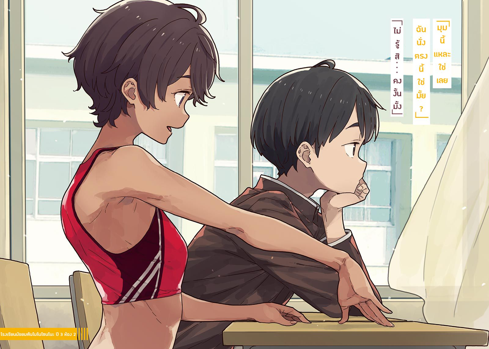

# Ch.28 — เล่ม 5 บทที่ 2-1

Ch.28 — เล่ม 5 บทที่ 2-1

By Monica

Published: 2025-04-22T10:31:10Z

Source: https://www.nekopost.net/novel/14560/28

เล่ม 5 บทที่ 2-1

เช้าวันจันทร์ สัปดาห์ต่อมา คาบแรกคือวิชาพละศึกษา และมันเป็นวิ่งทางไกลด้วย

อากาศเย็นในตอนเช้าพุ่งทะลุผ่านคอที่แห้งผากของผม ที่วิ่งอยู่รอบนอกของโรงเรียน

ผมเหนื่อยจนหมดแรงแล้วจึงชะลอฝีเท้าลง

การวิ่งสามรอบมันยากเกินไป ผมไม่เก่งเรื่องนี้เลย ขอน็อครอบไปหนึ่งรอบแล้วอู้ได้ไหม...?

เฮ้อ กลิ่นฤดูร้อนลอยมากระทบจมูก ขณะที่ผมค่อย ๆ วิ่งอยู่ด้านหลังกลุ่ม นี่มันเป็นไปไม่ได้เลยในถนนฤดูหนาวแบบนี้

ร่างที่มีสีเหมือนข้าวสาลีปรากฏขึ้นข้าง ๆผมตอนที่ยังงงๆอยู่

[ นุคคุง เหนื่อยแล้วเหรอ? ]

–เลม่อน ยากิชิโอะ

เธอเป็นคนแปลกๆที่ตื่นเต้นสุดๆ ตอนที่ได้ยินว่าจะต้องวิ่งทางไกลคาบแรก เธอใส่ชุดพละมาแต่เช้า

อามานัตสึเซ็นเซย์ดุเธอตอนท้าย แล้วเพื่อน ๆ ก็เริ่มล้อเธอเมื่อเธอกลับไปเปลี่ยนชุดนักเรียนในห้อง

[ นี่ คาบแรกเองนะ เธอต้องเก็บแรงไว้ก่อนมั้ย ? ถ้าวิ่งทางไกลตั้งแต่เช้าจะไม่รู้สึกเหนื่อยแย่เหรอ? ]

[ เอ๋ วิ่งตอนเช้าสิสุดยอดแล้ว ดูสิ นายควรวิ่งให้เร็วขึ้นนะ! ]

ยากิชิโอะไปอยู่ข้างหลังผมแล้วผลักหลังด้วยแรงเต็มที่ หยุดทีเถอะ

[ พวกผู้หญิงควรจะวิ่งที่สนามเด็กเล่นไม่ใช่เหรอ ทำไมเธอถึงมาวิ่งทางของผู้ชายล่ะ? ]

[ ฉันถึงเส้นชัยแล้ว แต่มันยังไม่พอ เลยขอร้องครูให้มาวิ่งทางของผู้ชายด้วย ]

กระฉับกระเฉงเหมือนเคยเลยนะ

ทั้งงงและประทับใจในเวลาเดียวกัน จากนั้นยากิชิโอะก็ปล่อยมือแล้วเข้ามาใกล้ผม

[ ฉันได้ยินมาจากยานะจังนะ น้องสาวของนายมีแฟนเหรอ? ]

...ยานามินี่ช่างปากไวจริง ๆ

[ ไม่ๆ แค่สงสัยน่ะ คิดว่าถ้าไม่มีใครเคยเห็นก็ถือว่าเขาไม่เคยมีอยู่จริง กล่าวอีกนัยนึงก็เหมือนกับน้องสาวของผมไม่มีแฟน- ]

ไม่ได้ ผมพูดตอนวิ่งไม่ไหวแล้ว…

ถึงจุดนี้ ผมหายใจไม่ทันแล้ว ยากิชิโอะวิ่งไปข้างหน้าผมแล้วก็เข้ามาใกล้ๆใบหน้าของผม

[ นุคคุง ฉันไม่เข้าใจเลย นายหมายถึง น้องสาวของนายจะมีแฟนถ้านายเห็นงี้เหรอ ? ]

[ ก็คง…ประมาณนั้น…เพราะว่านายจะรู้ได้ไง…ว่าน้องสาวมีแฟนมั้ย… ? ]

ผมตอบกลับไปอย่างลำบาก

ยาคิชิโอะพูดด้วยท่าทีสบาย ๆ

[ งั้นทำไมเราไม่ลองไปสังเกตเธอดูล่ะ? ]

เอ๊ะ? หมายความว่ายังไง?

สมองของผมพยายามหาคำตอบแม้ว่าจะขาดออกซิเจนอยู่ ยากิชิโอะพูดต่อ

[ ส่วนหนึ่งของการสอบแก้ตัวของฉัน ต้องเขียนรายงานเรื่อง <กิจกรรมเพื่อการมีส่วนร่วมในสังคม> ]

[ มี…อะไรแบบนั้น…ในข้อสอบเหรอ? ]

[ ฉันสอบปกติไม่ผ่านหรอก นั่นเป็นเหตุผลว่าทำไมถึงต้องใช้เทคนิคพิเศษ อามานัตสึจังบอกว่ามันอันตรายและห้ามบอกคนอื่น นั่นคือเหตุผลว่าทำไมถึงเป็นความลับ โอเค? ]

อืม คิดว่าเธอไม่ควรบอกผมด้วยซ้ำ…

[ แล้ว…มันเกี่ยวอะไรกับผม ? ]

[ ก็เรื่องการสังเกตน่ะ ชมรมกรีฑาที่โมโนโซโนะให้ฉันดูการฝึกซ้อมของพวกเขา ฉันจะใช้มันในรายงานด้วย ]

โรงเรียนมัธยมต้นโมโนโซโนะ ยากิชิโอะกับผมเคยเรียนที่นั่น คาจูก็เรียนอยู่ที่นั่นเหมือนกัน

[ พูดอีกอย่างก็คือ…ฉันจะ… ]

[ ถูกต้อง เราจะตามน้องสาวของนายไปเพื่อหาข้อมูลเรื่องแฟนของเธอไง น้องสาวของนายอยู่ชมรมไหนเหรอ? ]

[ สภานักเรียน… ]

แย่ละ ฉถึงขีดจำกัดแล้ว พูดไปวิ่งไม่ไหวแล้ว

ก้าวเท้าของผมเริ่มสั่นคลอนเรื่อย ๆ…

[ อ้อ ไม่รู้เลยว่าน้องสาวของนายอยู่สภานักเรียน งั้นเดี๋ยวฉันจะบอกครูที่โมโนโซโนะให้! ]

ยากิชิโอะตบหลังผมก่อนจะเพิ่มความเร็ว

ร่างของเธอหายไปในระยะไกลอย่างรวดเร็ว ในที่สุดผมก็ยอมแพ้และตัดสินใจเดิน

✧

คืนนั้น ผมกำลังกวนอะไรบางอย่างในหม้อที่ห้องครัวบ้านของผม

ผมรับหน้าที่ทำอาหารเย็นเพราะพ่อแม่และคาจูจะกลับบ้านช้า

ผมปิดเตาแล้วใส่ก้อนแกงกะหรี่ลงไป

ประตูห้องนั่งเล่นเปิดออกในขณะที่ผมกำลังดูแกงกะหรี่ค่อย ๆ ละลาย

[ ท่านพี่ หนูกลับมาแล้วค่ะ ]

คาจูเดินเข้ามาในห้อง แก้มของเธอแดงเพราะความหนาว

[ ยินดีต้อนรับกลับ กลับมาช้าจังเลยนะ ]

[ ใช่ค่ะ วันนี้มีงานในสภานักเรียนเยอะมาก พวกเราต้องจัดพิธีอำลานักเรียนที่จบการศึกษาในวันนี้ด้วย ]

คาจูวิ่งเข้ามาหาผมแล้วกอดจากด้านหลัง

[ อย่าทำแบบนี้สิ พี่กำลังทำอาหารอยู่นะ ]

[ ไม่เอา แบตเตอรี่ท่านพี่ของคาจูเหลือ 0% แล้วค่ะ ]

เธอก็ซบหน้าลงบนหลังของผม พร้อมกับคำนั้น

...เฮ้อ นิสัยแบบนี้ของเธอไม่เคยเปลี่ยนเลยจริง ๆ

แต่กระนั้น คาจูที่ติดผมมากขนาดนี้ก็เริ่มปิดบังความลับจากผม

รู้อยู่แล้วว่าวันนั้นจะมาถึง-

[ โอเคค่ะ ชาร์จเสร็จแล้ว ตอนนี้หนูมีแรงเต็มเปี่ยมเลย ท่านพี่ วันนี้เรากินแกงกะหรี่เหรอคะ? ]

คาจูพูดพร้อมปล่อยมืออกจากผมแล้วเดินไปเปิดตู้เย็น

[ งั้นคาจูทำสลัดเองนะคะ ใส่ถั่วงอกด้วยดีมั้ยคะ? ]

คาจูยังคงสดใสร่าเริงเหมือนเดิม

ผมถามเธอไปอย่างลวก ๆ ขณะที่กวนแกงกะหรี่บนไฟอ่อน

[ อ้อ จริงสิ คาจูเคยเป็นฝ่ายธุรการในสภานักเรียนใช่มั้ย ? ]

[ หนูได้เป็นรองประธานตั้งแต่เดือนที่แล้วค่ะ ปีการศึกษาใหม่เริ่มต้นช่วงปีใหม่ที่โมโนโซโนะ จำได้มั้ยคะ? ]

...อย่างนั้นเองเหรอ? ผมจำอะไรได้ลาง ๆ แต่คาจูกลับแสดงสีหน้าไม่พอใจ

[ ท่านพี่ เพิ่งจบจากโมโนโซโนะเมื่อปีที่แล้วเองนะคะ ลืมไปแล้วเหรอว่าชีวิตในโรงเรียนกับคาจูมันหวานชื่นแค่ไหน? ]

หวานชื่นอะไรกัน? ที่จำได้ก็แค่พยายามหนีจากความติดหนึบของคาจู

[ ไม่สิ พี่อยู่ชมรมกลับบ้านนะ ไม่ได้เกี่ยวข้องอะไรกับสภานักเรียนเลย ถ้าคาจูเป็นรองประธาน แล้วประธานหน้าตาเป็นยังไง? ]

[ ประธานคือคาวาอิคุง เพื่อนร่วมชั้นหนูเอง ท่าพี่ ทำไมถึงถามแบบนั้นล่ะคะ? ]

[ อ้อ ไม่มีอะไรหรอก แค่สงสัยนิดหน่อย ]

...อืม ประธานไม่ใช่ทาจิบานะคุงเหรอ? แต่ในสภานักเรียนก็ยังมีสมาชิกคนอื่น ๆ อีก ทาจิบานะคุงอาจเป็นหนึ่งในนั้นก็ได้ แต่ก็เป็นไปได้ที่เขาจะเป็นเพื่อนร่วมชั้นของเธอ-

[ ท่านพี่ ควรจะหรี่ไฟลงนะคะ ]

ไม่น่าเชื่อว่าจะลืม ผมรีบหรี่ไฟลง

คาจูล้างกะหล่ำปลีขณะฮัมเพลงไปด้วย ผมแอบมองเธอ

[ พรุ่งนี้จะกลับบ้านช้าเพราะมีงานในสภานักเรียนเหรอ? ]

[ อาจจะเป็นแบบนี้ไปทั้งสัปดาห์เลยค่ะ หนูคงจะกลับบ้านเวลาประมาณนี้ ]

[ อืม เข้าใจแล้ว ]

ผมกวนแกงกะหรี่ที่ก้นหม้ออย่างช้า ๆ

พรุ่งนี้ผมกับยากิชิโอะจะไปที่โรงเรียนมัธยมต้นโมโนโซโนะหลังเลิกเรียน

คาจูกลับมาถึงบ้านก่อน 1 ทุ่มวันนี้

ถ้าพรุ่งนี้เป็นแบบเดียวกัน ก็คงจะสังเกตพฤติกรรมของคาจูได้เต็มที่ในโรงเรียน

[ ...ท่านพี่เหงาเหรอคะที่คาจูกลับบ้านช้า? ]

[ หา? ]

คาจูหัวเราะและเอาหัวมาถูแขนของผม

[ มันลำบากนะคะเวลาโดนท่านพี่เอาอกเอาใจมาก ๆ คาจูเองก็เหงาเวลาไม่ได้เจอท่านพี่หมือนกันนะคะ ]

[ เอาล่ะ อย่าขยับไปมาตอนพี่ทำอาหารอยู่สิ ]

...ก็ไม่จำเป็นต้องปฏิเสธหรอก

ผมใส่มิโสะฮัตโจเพิ่มลงไปเพื่อปรุงรสก่อนจะปิดฝาหม้อ

พรุ่งนี้ต้องระวังเรื่องการ "สังเกตการณ์" ผมต้องแสดงความเป็นพี่ชายที่ใจดีและอ่อนโยนเหมือนเคย

✧

วันถัดมา หลังเลิกเรียน ผมเดินไปที่สนามของโรงเรียนเก่า โรงเรียนมัธยมต้นโมโนโซโนะ

ไม่มีเวลามานึกถึงอดีต เพราะเสียงสุดทรงพลังของยากิชิโอะดังก้องไปทั่ว

[ เป็นไงบ้างทุกคน!? ]

[ ดีมาก! ]

ยากิชิโอะชูหมัดขึ้น กลุ่มเด็กสาวก็ทำตามทันที

ชมรมกรีฑาหญิงของโรงเรียนมัธยมต้นโมโนโซโนะ เด็กสาวเหล่านี้ดูมีพลังเหมือนยากิชิโอะเลย

มีนักเรียนที่ยังใส่ชุดนักเรียนอยู่ด้วย พวกเขาน่าจะเป็นนักเรียนปีสามที่จบไปแล้ว

ยากิชิโอะดูเหมือนจะรู้จักคนเยอะ...แต่รุ่นน้องเหล่านี้ดูจะเป็นปัญหานะ…

[ ใช่แล้วล่ะ เกี่ยวกับพฤติกรรมของเธอที่จริงแล้ววิธีพูดที่ละเอียดอ่อนแบบนั้น ยากิชิโอะซังเป็นเหมือนนางฟ้า เลย ]

คนที่พยักหน้าอย่างหนักหน่วงด้วยหน้าผากที่สว่างวาบคือ จิฮายะ อาซากุโมะ

เธอเป็นเด็กสาวระดับหัวกะทิที่กำลังคบหากับคนที่ยากิชิโอะชอบแต่ตอนนี้เธอคือเพื่อนสนิทที่สุดของยากิชิโอะก็ว่าได้

...แต่ทำไมเธอถึงมาอยู่ที่นี่ล่ะ? เธอไม่ได้จบจากโมโนโซโนะใช่มั้ย?

[ เอ่อ...อาซากุโมะซัง ถึงจะพูดยากหน่อย แต่ทำไมถึงมาอยู่ที่นี่- ]

ในขณะนั้นเอง ผมสังเกตว่ามีสายตาหลายสิบคู่กำลังจ้องมองมาที่ผม เด็กสาวในชมรมกรีฑากำลังจ้องผมอยู่

[ เอ่อ...อะไรเหรอ...? ]

ผมถอยหลังด้วยความกลัว เสียงแหลมสูงดังก้องเข้ามาในหูของผม

[ รุ่นพี่ นั่นใครคะ?] [ แฟนของพี่เหรอ? ] [ ไม่ยุติธรรมเลย! ] [ หุ่นเพรียวมาก! ]

อุหวา เด็กม.ต้นเสียงดังขนาดนี้เลยเหรอ? ผมหันไปมองยากิชิโอะเพื่อขอความช่วยเหลือ แต่เธอกลับหัวเราะ แล้วทันใดนั้นเธอก็โอบแขนผม

[ เฮ้!? ]

ผมอยากจะหนี แต่การจับของยากิชิโอะนั้นแน่นมาก

[ เอาล่ะ ทุกคนคิดยังไงกันบ้าง? ใช่แล้ว บอกฉันมาเลย ! ]

เสียงเชียร์ดังลั่นออกมาจากฝูงชน

[ แฟน! แฟน! ] [ มาอวดแน่ ๆ เลย! ] [ อิจฉาจัง! ] [ ไม่ยุติธรรม! ]

เอ่อ...นี่มันสถานการณ์อะไรกันเนี่ย? ผมรู้สึกงุนงง แต่ยากิชิโอะกลับกระพริบตาให้ผมแล้วปล่อยแขนออก

[ น่าเสียดายจัง เขาไม่ใช่แฟนฉันหรอก ! คำตอบที่ถูกต้องก็คือ นุคคุง! ]

นี่มันอะไร? แต่เด็กม.ต้นก็ไม่น่าเชื่อคำนั้น….ใช่มั้ย ?

[ นุคคุง สวัสดีค่ะ! ] [ นุคคุง มีแฟนหรือยัง?] [ สอนหนูหน่อย!] [ นุกคุงหุ่นเพรียวมาก! ]

เด็กสาวโบกมือขณะที่พวกเธอเดินเข้ามาหาผม

ได้ผลจริง ๆ สาว ๆ พวกนี้เป็นรุ่นน้องของยากิชิโอะจริง ๆสินะ

ผมกลั้นความรู้สึกต่างๆเอาไว้ ยากิชิโอะก้าวไปข้างหน้า

[ งั้น มาเริ่มวิ่งกันเถอะ! ทุกคนพร้อมมั้ย? ]

[ พร้อม! ]

โอ้ว ในที่สุดพวกเขาก็เริ่มซ้อมกันแล้ว

แผนคือให้ผมลอบหนีไปในระหว่างการฝึก

ผมกำลังจะลอบออกไป แต่ยากิชิโอะกลับโยนเสื้อแจ็คเก็ตเครื่องแบบของเธอมาที่ผม

[ ...เอ๋? เฮ้ ยากิชิโอะ! ]

ผมต้องเรียกเธอ ยากิชิโอะปลดกระดุมเสื้อในสนามกลางสนามเด็กเล่น

เธอเมินต่อความพยายามของผมที่จะหยุดเธอ และถอดเสื้อออกอย่างรวดเร็วหลังจากปลดเนคไท

เธอใส่ชุดยูนิฟอร์มของชมรมกรีฑาโรงเรียนสึวาบุกิไว้ข้างใน

[ ดูสิ ฉันใส่ไว้ข้างในแล้ว ]

ยากิชิโอะหัวเราะแล้วเธอก็ดึงซิปกระโปรงลง

แค่ใส่มันไว้ข้างในไม่ได้หมายความว่ามันจะโอเคหรอกนะ

ผมกำลังจะหยุดเธอ แต่อาซากุโมะซังกลับมาตบไหล่ผม

[ เอาล่ะ อาซากุโมะซัง บอกเธอทีว่า- ]

[ โอเค งั้นช่วยรับนี่ด้วย ]

หลังจากนั้น เธอก็ยื่นเสื้อและเนคไทของยากิชิโอะให้ผม ]

[ อ่ะ นี่...]

[ เอาล่ะ เลม่อนซัง ฉันจะพับเครื่องแบบแล้ววางไว้ตรงนั้นเองน ]

อาซากุโมะซังหยิบกระโปรงของยากิชิโอะขึ้นมาและเดินไปที่มุมสนาม

[ ขอบคุณนะ จิฮะจัง! เอาล่ะ ทุกคนสู้เต็มที่นะ! ]

[ ค่ะ! ]

ผมยืนอยู่ตรงนั้นโดยมีเสื้อผ้าของยากิชิโอะอยู่ในมือ อาซากุโมะซังโบกมือให้ผม

อาซากุโมะซังแสดงรอยยิ้มเจ้าเล่ห์หลังจากที่ผมวิ่งไปหาเธอ

[ นุคุมิซึซัง พับผ้าแล้วค่อยไปโอเคมั้ย ? เดี๋ยวทุกคนลืมเรื่องของเราไปเอง ]

อ๋อ เข้าใจแล้ว ตอนนี้เป็นโอกาสที่พวกเราจะหนีไปได้สินะ

ยากิชิโอะถอดเสื้อผ้าต่อหน้าทุกคนเพื่อเรื่องนี้...ไม่สิ เธอคงซุ่มซ่ามมากกว่าใช่มั้ย?

ผมเผลอมองไปข้างๆ อาซากุโมะซังยิ้มพร้อมถือชุดของยากิชิโอะไว้ในมือ

[ ...อาซากุโมะซัง ดูเหมือนเธอจะมีความสุขมากเลยนะ ]

[ มิตสึกิซังเคยเรียนที่โรงเรียนนี้ใช่มั้ย? พูดตรงๆ เลยนะ ฉันตื่นเต้นมาก ฉันต้องหาทุกอย่างที่เป็นร่องรอยของมิตสึกิซังให้ได้ ]

อาซากุโมะซังเดินเร็วขึ้นด้วยความตื่นเต้น ผมจึงเดินตามไป

เอาล่ะ พอมีคนมาด้วยแทนที่จะต้องสำรวจโรงเรียนคนเดียวก็คงไม่ต้องกังวลมาก

แต่ถึงอย่างนั้น...

...ทำไมเธอถึงมาอยู่ที่นี่อะ ?

✧✧✧

โรงเรียนมัธยมต้นเทศบาลโมโนโซโนะ ห้อง 3-2 นุคุมิซึ คาซึฮิโกะ

นี่คือชื่อผมในตอนนี้

สถานะการเป็นนักเรียนมัธยมต้นของผมจะสิ้นสุดในเดือนมีนาคม

ไม่จำเป็นต้องกังวลเรื่องการไม่มีเพื่อนเลย ไม่มีอะไรให้ต้องห่วง

ตอนนี้เป็นช่วงพักระหว่างบทเรียน ผมวางข้อศอกลงบนโต๊ะแล้วเปิดหนังสือที่ยืมมาจากห้องสมุด

ผมกำลังหลงใหลในซีรีส์ **"ราชอาณาจักรลาพิสลาซูลี"** เป็นเรื่องการผจญภัยของสาวมัธยมปลายชื่อเรียวโกะที่กลับชาติมาเกิดในโลกที่มีลักษณะเหมือนประเทศจีน

เนื้อเรื่องเข้มข้นขึ้นมากในตอนที่ 2 ของเล่ม 7 จักรพรรดิแห่งอาณาจักรคู่แข่งได้ขอแต่งงานกับเรียวโกะ จริง ๆ แล้วผมอยากรู้มากว่าเรื่องจะดำเนินต่อไปยังไง

…เรียวโกะ เธอจะเป็นกังวลเพียงเพราะการปฏิบัติที่อ่อนโยนจากจักรพรรดิที่หล่อเหลาและลึกลับงั้นเหรอ เธอลืมนายพลสุดเย็นชาแต่ใจดีที่รอเธออยู่ที่บ้านไปแล้วหรือไง?

ผมเปิดหน้าถัดไปอย่างกังวล ในตอนนั้นเอง เสียงจากที่นั่งข้าง ๆ ทำให้มือของผมหยุดชะงัก

[ จริงเหรอ!? นั่นหมุนตั้ง 5 รอบเลยนะ! ]

คนที่พูดด้วยน้ำเสียงร่าเริงคือเพื่อนร่วมชั้นของผม เลม่อน ยากิชิโอะ

เธอโพสท่าด้วยแขนขาที่เรียวยาวและผิวสีแทน เด็กสาวกำลังหมุนตัวเหมือนนักบัลเล่ต์

ยาชิกิโอะชนโต๊ะของผมก่อนที่ผมจะทันได้พูดอะไร

[ โอ๊ย ขอโทษ! ]

[ อา ไม่เป็นไร... ]

ผมปิดหนังสือและพึมพำ

[ นี่ ทำอะไรอยู่น่ะ เลม่อน ? ]

[ นี่ไง นั่งลงสิ ]

[ เอ๊ะ แต่- ]

แม้ว่ายากิชิโอะจะมองผมด้วยสายตาขอโทษ แต่จริง ๆ แล้ว ผมแค่อยากให้เธอไปไกล ๆ ผมแค่อยากเป็นเงาในห้องนี้เท่านั้น

[ ขอโทษจริง ๆ นะ ]

ยาคิชิโอะปรบมือแล้วขอโทษก่อนจะกลับไปที่นั่งของเธอ

เอาล่ะ ขอให้ผมได้กลับมาอ่านหนังสืออีกครั้ง ผมเปิดหนังสือออก แต่รู้สึกว่าจดจ่อไม่ได้

เลม่อน ยากิชิโอะ เธอน่าจะเป็นกัปตันชมรมกรีฑา เธอมักจะได้รับคำชมอย่างมากในชั่วโมงโฮมรูม

เป็นคนที่เก่งด้านกีฬา ทำได้ทุกอย่าง เป็นที่นิยม และก็น่ารักมาก

ตรงข้ามกับผมอย่างสิ้นเชิง เธอเป็นคนที่ผมจะไม่มีทางได้เป็นเพื่อนด้วย

...ว่าแต่ ลักษณะของยากิชิโอะทำให้ผมนึกถึงอะไรบางอย่างเสมอ-

ใบหน้าที่มีผิวแทน ชุดนักเรียนของโรงเรียนโมโนโซโนะเป็นชุดกระโปรงชิ้นเดียวที่มีลวดลายเส้นที่ไม่เหมือนใคร-

[ นั่นมันเห็ดเอโนกิ(เห็ดเข็มทอง)ที่น่ารักหรือเปล่านะ? ]

ผมอดไม่ได้ที่จะพึมพำกับตัวเองก่อนจะเงยหน้าขึ้น มันไม่ใช่เห็ดเอโนกิ- แต่เป็นใบหน้าของยากิชิโอะ

[ เห็ดเอโนกิ? ]

[ เอ๊ะ!? ไม่ เอ่อ- ]

ยากิชิโอะมองใบหน้าที่ตกใจของผม

[ นุคุมิซึ อ่านอะไรอยู่น่ะ? ]

[ เอ๊ะ? อ่า...หนังสือจากห้องสมุด- ]

[ เฮ้ เลม่อน ฉันไปก่อนนะ ]

เสียงของเด็กสาวอีกคนกลบคำพูดที่ผมพยายามพูดออกมาอย่างยากลำบาก

[ จะตามไปเดี๋ยวนี้แหละ! ขอโทษที่รบกวนนะ นุคุมิซึคุง! ]

[ เอ๊ะ อ่า...ครับ ]

...ไม่อยากเชื่อเลยว่าเด็กสาวคนนั้นรู้จักชื่อของผม

ยากิชิโอะหายตัวไปเหมือนสายลม ความเงียบกลับคืนสู่ห้องเรียน

เอาล่ะ ในที่สุดก็สามารถกลับมามีสมาธิอ่านหนังสือได้แล้ว การต่อสู้ที่ตัดสินชะตากรรมของเรียวโกะและสันติภาพของทวีปกำลังจะเริ่มขึ้นแล้ว

…………

…………

...ว่าแต่ มันเงียบเกินไปมั้ย?

ผมเงยหน้าขึ้นจากหนังสือ ตอนนี้เป็นคนเดียวในห้องเรียน

[ อ่า คาบต่อไปเป็นวิชาดนตรีนี่เอง ]

ผมหยิบขลุ่ยออกมาจากกระเป๋าแล้วเดินไปยังห้องดนตรีอย่างรวดเร็ว

ผมมองไปรอบ ๆ ห้องเรียน ขณะที่จมอยู่ในความทรงจำ

สุดท้ายแล้ว ผมใช้เวลาทั้งหมดก่อนจบการศึกษาไปกับการอ่านนิยาย หนังสือเรียน และมองออกไปนอกหน้าต่าง

ไม่ใช่ว่าจะรู้สึกเสียใจมากมายอะไร ผมเป็นนักเรียนมัธยมปลายแล้วตอนนี้ แค่นี้ก็พอเข้าใจได้

ชอบหรือไม่ก็ตาม นี่คือที่ที่ผมเคยอยู่

และที่ที่ผมอยู่ตอนนี้...มันค่อนข้างมีชีวิตชีวา ต่างจากตัวผมในอดีตที่คงจะวิ่งหนีไปแล้ว

ผมยิ้มเยาะให้ตัวเองก่อนจะมองออกไปนอกหน้าต่าง สนามเด็กเล่นว่างเปล่า ไม่เห็นสาว ๆ จากชมรมกรีฑา

เอ๊ะ พวกเธอวิ่งออกไปนอกโรงเรียนเหรอ?

[ ยากิชิโอะ อย่าทำอะไรให้วุ่นวายนะ… ]

[ เรียกฉันเหรอ? ]

วะ!? ยากิชิโอะปรากฏตัวขึ้นจากไหนก็ไม่รู้ เธอดึงเก้าอี้ข้าง ๆ มานั่ง

เธอดูเย็นชานิดหน่อยในชุดนักเรียน แต่ร่างกายของเธอมีไอน้ำระเหยที่มาจากเหงื่อ

[ ฟู่ว วันนี้วิ่งเยอะเลย เด็กปีหนึ่งพัฒนาขึ้นเยอะ ฉันโล่งใจแล้ว ]

[ เอ่อ ทำไมเธอถึงอยู่ที่นี่? เสร็จจากชมรมกรีฑาแล้วเหรอ? ]

[ ทุกคนกำลังเล่นซ่อนแอบกัน ถ้าพวกเขาจับฉันได้ ฉันต้องเลี้ยงน้ำผลไม้ ]

[ ในโรงเรียน…เหรอ? ]

รู้สึกว่าพวกเธอกำลังจะสร้างปัญหาแล้ว

ยากิชิโอะโบกมือใส่หน้าตัวเองแล้วจ้องไปที่กระดานดำ

[ มุมนี้แหละใช่เลย นี่ ฉันนั่งตรงนี้ใช่ไหม? ]

[ ไม่รู้สิ...ก็อาจจะมั้ง? ]

ผมตอบไปแบบก้ำกึ่ง

ในเมื่อเราไม่เคยมีอะไรเกี่ยวข้องกันมาก่อน การจำที่นั่งของผู้หญิงนี่รู้สึกแปลก ๆ

[ นายยังจำได้ใช่มั้ย? นุคคุงนั่งข้าง ๆ ฉัน ]

[ เอ๊ะ? รู้จักผมมาตั้งแต่ตอนนั้นเหรอ? ]

[ ก็แน่นอนสิ นายไม่คุยกับใครเลย เอาแต่หมกมุ่นกับหนังสือ ฉันคิดว่าเขาคงมีอะไรผิดปกติกับผู้ชายคนนี้แน่ ๆ ]

…อืม ก็ไม่ปฏิเสธหรอก

[ คิดดูนะ ความประทับใจแรกของเธอที่มีกับผมก็แค่ผู้ชายที่นั่งอ่านหนังสือคนเดียวไม่ใช่เหรอ? ]

[ ฉันไม่คิดว่ามันจะจบแค่นั้นหรอกนะ เอ่อ... ]

ยากิชิโอะกอดอกแล้วคิด จากนั้นเธอก็นึกอะไรขึ้นมาได้แล้วปรบมือ

[ อ๊ะ! นุคคุงเป็นพวกสตอล์กเกอร์ใช่มั้ย ! ]

ห๊ะ!? เธอกำลังพูดอะไร?

[ ไม่ๆไม่ ไม่ได้มีอะไรเกิดขึ้นเลยนะ! ]

[ อืม รอแป๊บ อ่อ นุคคุงเป็นฝ่ายถูกสตอล์กเกอร์ ขอโทษที ]

ช่างเป็นการเข้าใจผิดที่ใหญ่หลวงจริง ๆ ...เอ๊ะ?

[ มีคนตามผมเหรอ? ไม่เคยรู้มาก่อนเลย ]

[ ใช่แล้ว เป็นเด็กสาวตัวเล็ก ๆ น่ารักมีผมยาวๆ พอมีเบาะแสมั้ย? ]

...เยอะไปหมดเลย ผมแกล้งทำใจเย็นแล้วถาม

[ คนนั้นอยู่ที่นี่ตลอดเวลาเลยเหรอ? ]

[ เธออยู่เกือบทุกครั้งที่พัก บางครั้งก็ในคาบเรียนด้วย ]

จริงเหรอ? ผมไม่เคยสังเกตเลย

[ เฮ้ นั่นมันความรักล่ะสิ นุคคุง เธอเคยมาที่บ้านของนายมั้ย? ]

เธอมาแทบทุกวัน เราอยู่ด้วยกันแล้วด้วยซ้ำ

[...นั่นคงเป็นน้องสาวของผม ]

แม้แต่หน้ายากิชิโอะก็ดูผิดหวังหลังจากได้ยินสิ่งที่ผมพูด

[ ทำไมน้องสาวของนายต้องเป็นพวกสตอล์กเกอร์ด้วย? ]

ไม่รู้เหมือนกัน ไม่มีไอเดียเลย

[ ถึงเธอจะเป็นสตอล์กเกอร์แต่น้องสาวของผมก็เป็นแบบที่ไม่อันตราย ไม่เป็นไรหรอก ]

[ เอ๊ะ มีแบบนี้ด้วยเหรอ? ]

...ขอโทษนะ ไม่หรอก ผมรู้สึกปวดใจเมื่อมองตายากิชิโอะที่ใสซื่อแบบนั้น

[ ไม่เคยเจอน้องสาวของผมตอนงานเตรียมงานเทศกาลสึวะบุกิเหรอ? เธอมาที่ห้องเรียนนี่นา ]

[ อ๋อ ใช่ ฉันว่าเด็กคนนั้นต้องเป็นพวกสตอล์กเกอร์นุคคุงแน่ ๆ ]

พูดแล้วเธอก็เหมือนจะนึกอะไรขึ้นมาได้ แล้วจ้องผมตรง ๆ

[ อะไร? ]

[ วันนี้นุคคุงเป็นพวกสตอล์กเกอร์สินะ ]

...ผมเถียงไม่ออกเลย

แต่ผมทำไปเพื่อปกป้องน้องสาวของผม เรียกว่าเป็นสตอล์กเกอร์ที่มีคุณธรรม หรือ อัศวินม้าขาวก็ว่าได้

[ ว่าแต่ ตอนนี้ไม่ใช่เวลามานั่งเล่นแล้วนะ ยากิชิโอะยังเล่นซ่อนแอบอยู่ใช่มั้ย ? ]

เด็กสาวที่ใส่ชุดพละปรากฏตัวขึ้นที่หน้าประตูก่อนที่ยากิชิโอะจะทันตอบ

[ รุ่นพี่อยู่ในนี้! ] [ เฮ้ เธออยู่นั่นไง! ] [ ฉันว่าพวกเขากำลังจีบกันอยู่นะ! ]

ยากิชิโอะกระเด้งตัวขึ้น

[ แย่ล่ะ! ไว้คุยกันนะ นุคคุง! ]

เธอวิ่งออกจากประตูหลังที่ยังไม่ได้ถูกปิดทันที

ผมค่อย ๆ ลุกขึ้นขณะที่มองกลุ่มเด็กสาวจากชมรมกรีฑาวิ่งตามเธอไป

ตอนนี้ไม่ใช่เวลามานั่งคิดถึงอดีต ผมควรเริ่มการสืบสวนได้แล้ว

ควรไปรวมกลุ่มกับอาซากุโมะซังสินะ?

แต่เด็กคนนั้นไม่เก่งเรื่องการสืบสวนแบบลับ ๆ เอาไงดีนะ ไปคนเดียวดีมั้ย...?

เหมือนเธอจะเห็นความคิดของผม อาซากุโมะซังโผล่หน้ามาจากประตูห้องเรียน

[ นุคุมิซึซัง เมื่อกี้เธอสองคนกำลังจีบกันใช่มั้ย ? ]

[ อาซากุโมะซัง ช่วยหยุดแกล้งผมทีเถอะ? ]

[ อาระ ฉันไม่ได้แกล้งนะ เอาล่ะ ฉันได้ข้อมูลมาแล้ว ไปกันเถอะ ]

อาซากุโมะซังโบกมือให้ผมแล้วเดินไปที่ทางเดิน

[ เอ่อ เธอไปที่ไหนมา? ]

[ ฉันไม่อยากขัดจังหวะ เลยเดินไปรอบ ๆ โรงเรียน โชคดีที่ฉันเจอห้องสมุด ]

[ มีครูคุมอยู่ในห้องสมุดตอนเย็นใช่มั้ย? เธอไม่เป็นไรเหรอ? ]

[ อ่า พวกเราสนิทกันแล้วน่ะ เธอแนะนำข้อมูลเกี่ยวกับโรงเรียน รายงานห้องเรียน และชมรมให้ฉัน- ฉันเช็คชื่อเด็กทุกคนในโรงเรียนแล้ว ]

ห๊ะ? ยัยนี่พูดถึงอะไรน่ะ? ผมเดินตามอาซากุโมะซังลงบันไดไป

[ เอ๊ะ เธอหมายความว่าเธอเช็คข้อมูลของทุกคนในโรงเรียนนี้หมดแล้วเหรอ? ในเวลานิดเดียวแบบนี้? ]

[ ใช่ ฉันมีเทคนิคพิเศษน่ะ ]

อาซากุโมะซังเคาะหน้าผากของเธอแล้วพูดต่อ

[ จำหน้าที่จำเป็นผ่านภาพแล้วค่อย ๆ อ่านซ้ำในใจ มันช่วยลดเวลาการจดจำให้น้อยที่สุด ]

อ๋อ เข้าใจล่ะ แต่ก็ยังมีบางอย่างที่ผมไม่เข้าใจ อาซากุโมะซังเป็นมนุษย์จริง ๆ เหรอ?

ผมรู้สึกตกใจเล็กน้อย อาซากุโมะซังยิ้มให้ผม

[ เธอกำลังสืบหาความสัมพันธ์ระหว่างน้องสาวของเธอกับทาจิบานะซังอยู่ใช่มั้ย? มีคนเดียวที่ชื่อทาจิบานะในโรงเรียนนี้ ไม่มีแม้แต่ครูหรือเจ้าหน้าที่ ]

อาซากุโมะซังจู่ ๆ ก็หันกลับมาที่ปลายบันได กระโปรงของเธอพลิ้วไหวเบา ๆ

[ ทาจิบานะ ซาโตชิ ห้อง 2-4 เขาเป็นนักเรียนชายในชมรมทำสวนน่ะ ]

---
