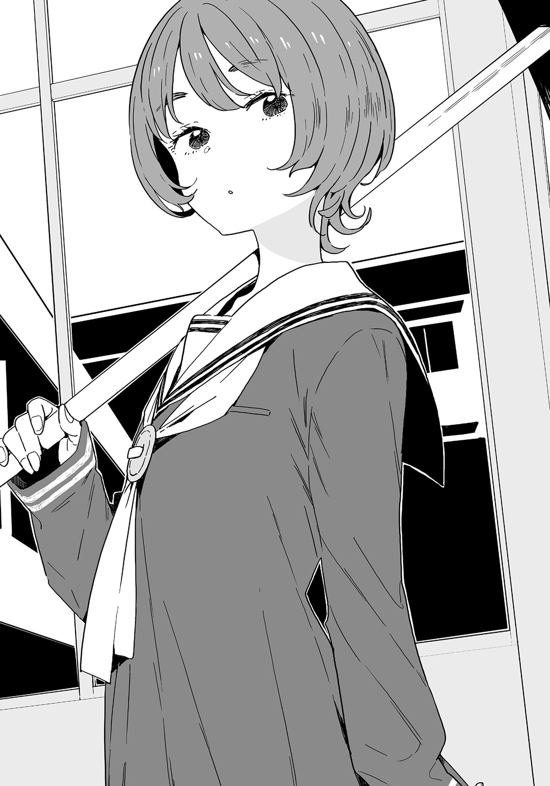

# Ch.29 — เล่ม 5 บทที่ 2-2

Ch.29 — เล่ม 5 บทที่ 2-2

By Monica

Published: 2025-04-22T10:32:32Z

Source: https://www.nekopost.net/novel/14560/29

เล่ม5 - 2.2

ห้องของชมรมจัดสวนเหมือนจะอยู่หลังอาคารเรียน

นี่เป็นครั้งแรกที่ผมรู้ว่ามีชมรมการจัดสวนอยู่ คิดว่าอาซากุโมะซังน่าจะรู้เรื่องโมโมโซโนะมากกว่าผมในเมื่อเธอจำแผนที่โรงเรียนได้

...เธอนี่เป็นคนที่เรียนจบแทนผมได้เลยนะ?

อาซากุโมะซังค่อยๆพยักหน้าให้กับนักเรียนปีสามที่เดินผ่านเราไป ขณะที่เรายืนไหล่ชนไหล่กันบนทางเดิน

[ ห้องสมุดนี่มันใหญ่จริงๆ ใหญ่กว่าของสึวะกิอีก ? ]

[ ห้องมันถูกรวมเข้ากับห้องอื่นๆระหว่างการปรับปรุง เรากลายเป็นโรงเรียนสาธิตด้วย เลยได้ทำห้องสมุดใหญ่ขนาดนี้ ]

รู้มั้ย , ผมยังรู้อีกเยอะนะ ?

อาซากุโมะซังหยุดและมองออกไปนอกหน้าต่างของทางเดิน

[ นั่นคือแปลงของชมรมการจัดสวนนะ ดูสิ อันที่อยู่ถัดจากเรือนกระจกนั่นไง ]

ผมมองไปทางนั้น มันเป็นแปลงที่มีขนาดประมาณครึ่งหนึ่งของห้องเรียน มีเรือนกระจกอยู่ข้างๆ ด้วย

มีเด็กผู้ชายในชุดพละสีน้ำเงินอยู่ในแปลง เขากำลังพ่นผงสีขาวจากถุงที่ถืออยู่ในอ้อมแขน

[ เด็กคนนั้นน่าจะเป็นทาจิบานะคุง ? รูปของเขาอยู่ในข้อมูลแนะนำชมรมด้วย ]

เขาคือทาจิบานะคุงเหรอ?

เขาเป็นเด็กที่ค่อนข้างเตี้ยสำหรับเด็กในวัยเดียวกัน มีรูปร่างผอมบางเหมือนเด็กม.ต้น และดวงตาที่ยาวมากนั้นทำให้เขาดูดีเลยทีเดียว

นอกจากความสดใสแล้ว ยังมีเสน่ห์ที่ไม่สามารถอธิบายได้เปล่งออกมาจากตัวเขา

...คิดว่าน่าจะฮ็อตในหมู่สาวๆเลย

ผู้ชายที่ฮ็อตมักจะไม่ได้เรื่องทั้งนั้น(อคติส่วนตัว) ผมต้องเปิดเผยตัวตนที่แท้จริงของเขา !

[ เอาล่ะ ไปกันเถอะ นุคุมิซึซัง ]

[ เอ๋ เดี๋ยวก่อน ]

อาซากุโมะซังเดินออกจากอาคารและตรงเข้าไปหาทาจิบานะคุงโดยไม่ลังเล

ผมหยุดไปชั่วขณะก่อนจะตามเธอไป

[ สวัสดีค่ะ ขอรบกวนหน่อยนะคะ ]

[ สวัสดีครับ มีอะไรให้ช่วยหรือเปล่าครับ? ]

เด็กหนุ่มทาจิบานะเงยหน้าขึ้น อาซากุโมะซังยกมือขึ้นระหว่างหน้าอกและทักทายเขา

[ พวกเราเป็นนักเรียนปีหนึ่ง วาตานาเบะค่ะ ค่อนข้างกะทันหันไปหน่อย แต่ขอเข้าชมชมรมการจัดสวนได้มั้ยคะ? ]

หา!? ดูไม่สมเหตุสมผลเลยn บอกว่าเป็นนักเรียนม.ต้นปีหนึ่งแล้วยังบอกว่า "พวกเรา" อีก?

เครื่องหมายคำถามขนาดยักษ์ลอยอยู่เหนือหัวของผม อาซากุโมะซังส่งยิ้มขี้เล่นมาให้ผม

[ พวกเราเป็นฝาแฝดกันน่ะ ใช่มั้ย คาซึคุง? ]

[ เอ๋? อ-อื้ม โอเน่ซัง…. ]

เดี๋ยวสิ ทำไมเราถึงต้องทำเซ็ตติ้งให้ซับซ้อนขนาดนี้กัน?

ผมพยักหน้าอย่างเก้ๆกังๆเด็กหนุ่มทาจิบานะมองผมด้วยท่าทีที่ดูไม่เชื่อก่อนจะวางถุงลงกับพื้น

[ ยินดีต้อนรับเสมอครับ ผมทาจิบานะ อยู่ปีสอง คุณทั้งสองสนใจการจัดสวนเหรอครับ? ]

[ ใช่ค่ะ ฉันสนใจมานานแล้วล่ะค่ะ รุ่นพี่กำลังทำอะไรอยู่เหรอคะ? ]

อาซากุโมะซังมองไปที่เท้าของเด็กหนุ่มทาจิบานะ

[ ผมกำลังเตรียมปลูกกะหล่ำปลีครับ มีต้นกล้าที่เพาะในเรือนกระจกแล้ว คุณสองคนอยากดูมั้ยครับ? ]

[ ได้ค่ะ พวกเราอยากดูเลย ]

เด็กหนุ่มทาจิบานะค่อยๆเดินไปทางเรือนกระจกด้วย ผมจับแขนอาซากุโมะซังไว้ก่อนที่เธอจะตามเขาไป

[ เดี๋ยวก่อน อาซากุโมะซัง ทำไมถึงพูดว่าเป็นแฝดกันล่ะ? ]

[ ก็ปีหนึ่งมีคนชื่อวาตานาเบะตั้ง 6 คน ถ้าจะตรวจสอบมันยากกว่าไง ]

[ ถึงอย่างนั้นแฝดยิ่งน่าสงสัยมากกว่านะ ]

[ งั้นให้ฉันเป็นคู่หมั้นของนายแทนดีมั้ยล่ะ? หมือนรอมคอมเลยนะ ตื่นเต้นจัง คาซึคุง ]

...อาซากุโมะซัง สนุกอยู่สินะ?

เรือนกระจกมีขนาดประมาณ 8 เสื่อทาทามิ และเป็นระเบียบเรียบร้อยมาก

[ ผมกำลังเพาะต้นกล้าจากเมล็ดอยู่ครับ ตอนนี้เป็นช่วงการตัดแต่งขั้นสุดท้ายแล้ว ]

เด็กหนุ่มทาจิบานะชี้ไปที่โต๊ะทำงานขนาดใหญ่ตรงกลางด้วยสีหน้าที่ดูภูมิใจ

กระถางขนาดเล็กถูกจัดเรียงไว้ในถาดที่มีประมาณหนึ่งชุด

กระถางนั้นเป็นกระถางต้นไม้พลาสติกขนาดเล็กที่ใช้สำหรับเพาะต้นกล้าก่อนที่จะปลูกลงดิน ข้างในมีต้นกล้าที่มีใบไม่กี่ใบงอกขึ้นมา

อาซากุโมะซังมองดูต้นกล้าเหล่านั้นด้วยดวงตาที่เปล่งประกาย

[ การตัดแต่งหมายถึงการดึงใบออกใช่ไหมคะ? ]

[ ใช่ครับ เหลือไว้แค่ใบที่ใหญ่ที่สุด ใบที่เหลือต้องดึงออกครับ พวกเธอสองคนลองทำดูก็ได้นะครับ? ]

[ ได้ค่ะ ฉันอยากลองดูมากเลย ]

อาซากุโมะซังเริ่มลงมือทำด้วยความตื่นเต้น

[ อาซะ- เอ้ย โอเน่ซังสนใจเรื่องพวกนี้มากเลยล่ะ ]

[ ก็เพราะว่าการฝึกปฏิบัติมอบความรู้ที่หาไม่ได้จากหนังสือไงล่ะ ตัวอย่างเช่น แม้แต่ต้นกล้าที่ใหญ่ที่สุดก็ยังมีปัจจัยหลายอย่างที่เกี่ยวข้อง เช่น ความสูง ความหนาของลำต้น และความกว้างของใบใช่มั้ยล่ะ? คาซึคุง อย่าแค่คิดสิ ใช้มือทำด้วย ]

แม้แต่น้ำเสียงของอาซากุโมะ-โอเน่ซังก็เปลี่ยนไปเช่นกัน

ผมยืนนิ่งอยู่ที่เดิม เด็กหนุ่มทาจิบานะพูดกับผมด้วยน้ำเสียงอ่อนโยน

[ นายน่าจะเป็นน้องชายสินะ? อยากมาช่วยผมมั้ย? ]

...เฮ้ เด็กม.ต้นเป็นห่วงนักเรียน.ปลายเลยเหรอ

[ อ่ะ ครับ แล้วผมต้องทำอะไรบ้าง? ]

[ ช่วยดึงต้นกล้าที่เกินมาของแถวนี้ออกไปหน่อยนะ ทำไปตามสบายเลย ]

อืม…ผมต้องดึงต้นกล้าที่ใหญ่ที่สุดออกจากกระถางสินะ

ทางนี้—ไม่สิ มันต้องเป็นทางนี้สิ ใช่มั้ย? แต่ใบนี้มันดูดีกว่า…

[ ไม่ต้องลังเลขนาดนั้นหรอก ทำไปตามสัญชาตญาณเถอะ ]

[ แต่ว่าถ้าผมดึงผิด มันจะเหี่ยวรึเปล่า? ]

เด็กหนุ่มทาจิบานะยิ้มเบาๆ

[ ถ้านายเลือกแล้ว มันก็ถือว่าถูกต้องแล้วล่ะ นี่มันก็แค่กิจกรรมชมรมนะ ไม่ว่านายจะเพาะยังไง มันก็เป็นส่วนหนึ่งของประสบการณ์ ไม่ต้องกังวลหรอก ]

...ทำไมรู้สึกว่าเขาดูเป็นผู้ใหญ่กว่าผมนะ? อย่างน้อยก็ด้านวุฒิภาวะ เขาก็ดูโตกว่ายานามิแน่ๆ

พวกเราทำงานกันต่ออีกประมาณ 10 นาที อาซากุโมะซังเช็ดเหงื่อบนหน้าผากของเธอด้วยรอยยิ้มอันมีเสน่ห์

[ เฮ้อ...รุ่นพี่ เรียบร้อยแล้วค่ะ ]

[ ผมก็เสร็จแล้วเหมือนกัน ส่วนน้องชาย—อ้อ ก็น่าจะโอเคอยู่ล่ะนะ ]

นั่นเป็นคำพูดที่บอกว่าจริงๆ แล้วมันไม่โอเคเท่าไหร่

เด็กหนุ่มทาจิบานะยกถาดต้นกล้าไปวางบนชั้นแล้วตบมือเบาๆ

[ สัปดาห์หน้าเราจะปลูกต้นกล้า พวกเธอแวะมาอีกก็ได้นะ อยู่ห้องไหนกันเหรอ? ]

[ เอ๋? ]

…แย่ล่ะ พวกเราไม่ได้คิดเผื่อไปถึงขนาดนี้

ผมไม่รู้จะตอบอะไรดี อาซากุโมะซังดึงแขนผมไว้

[ คาซึคุง พวกเราต้องไปพบคุณครูแล้ว ขอโทษด้วยนะคะรุ่นพี่ พวกเราต้องไปแล้ว ]

[ อ้อ เข้าใจแล้วครับ ปกติจะมีคนอยู่ที่นี่หลังเลิกเรียนทุกวันนะ ทั้งสองคนจะมาเมื่อไหร่ก็ได้ครับ ]

เด็กหนุ่มทาจิบานะแสดงรอยยิ้มแบบไม่คิดมาก

[ ค่ะ จะมาอีกแน่นอน คาซึคุง ขอบคุณรุ่นพี่ด้วยสิ ]

[ อ่ะ ครับ ขอบคุณมากนะครับที่ดูแลพวกเรา ]

พวกเราก้มหัวต่ำแล้วออกจากแปลงของชมรมการจัดสวน รู้สึกเหมือนมีคนมองพวกเราจนกระทั่งเข้ามาในตัวอาคาร หลังจากนั้นผมก็ถอนหายใจแล้วดึงแขนออกจากมือของอาซากุโมะซัง

[ มันดูไม่ธรรมชาติมากเลยนะ อยู่ๆ พวกเราก็หนีไปตอนที่เขาถามถึงห้องเรียนเนี่ย ]

[ ใช่ แต่ก็ช่วยไม่ได้ จริงๆ เลม่อนซังก็เพิ่งส่งข้อความมาหาฉันเอง ]

ยากิชิโอะส่งข้อความหาเธอตั้งแต่เมื่อไหร่น่ะ?

อาซากุโมะซังยิ้มแล้วยกมือขึ้นมาทางผม

[ ทาดา~ โอเน่ซังมีสมาร์ทวอทช์ด้วยล่ะ ]

สมาร์ทวอทช์ ผมคิดว่ามันเชื่อมต่อกับสมาร์ทโฟนและทำได้หลายอย่าง

หน้าจอแสดงข้อความลับจากยากิชิโอะ

<ระดับ S กำลังใกล้เข้ามา>

...อะไรน่ะ? อาซากุโมะซังแกว่งนิ้วไปมาตรงหน้าผมที่กำลังขมวดคิ้ว

[ คาซึคุง ถึงเลม่อนซังจะดูเหมือนวิ่งวนไปมาแบบไร้จุดหมาย แต่จริงๆ แล้วเธอกำลังสำรวจโรงเรียนเพื่อตามหาเป้าหมายนะ ]

ระดับ S—เหมือนกับตัวอักษร "S" ในคำว่า "sisters" หรือเปล่า?

[ อ๊ะ ถ้าคาจูกำลังมาที่นี่ พวกเราควรออกไปได้แล้วล่ะ ]

ผมหันกลับและพยายามจะวิ่งหนี แต่กลับเกือบชนเข้ากับใครบางคน

[ อุวะ ขอโทษนะครับ ผมรีบมากๆ ]

[ ไม่เป็นไร ฉันก็รีบเหมือนกัน โอเคมั้ยคะ? ]

คนที่ขอโทษคือเด็กสาวตัวสูงที่ถือจอบบนบ่า

คิดว่าผมน่าจะเคยเห็นเธอที่ไหนมาก่อน—

[ กอนจัง อยู่ไหนน่ะ— ]

[ เอ๊ะ! ]

ผมคิดว่า…ไม่ต้องบอกหรอกว่าเสียงนี้เป็นของใคร

ผมคว้ามือของอาซากุโมะซังแล้วรีบหนีออกมา

เราหันหลังกลับที่ทางเดินและแอบดูการเคลื่อนไหวของพวกเธอจากมุมมืด ในช่วงเวลานั้น เด็กสาวตัวเล็กวิ่งเข้ามาทางที่พวกเราเพิ่งอยู่

ผมสีดำเงา ใบหน้าจิ๋วๆ แขนขาเรียวเล็ก และวิ่งอย่างช้าๆ

ไม่ต้องบอกก็รู้เลยว่าเป็นคาจู

[ นุคุจัง? เป็นอะไรไปเหรอ? ]

[ ฉันได้ยินจากคุณครูว่ากอนจังไปที่ชมรมการจัดสวนน่ะ ก็เลย... ]

ผมได้ยินบทสนทนาของพวกเขาแผ่วๆ

ผมเอียงตัวไปข้างหน้าให้มากที่สุดแล้วตั้งใจฟัง

[ จอบใหม่มาแล้ว ฉันเลยอยากเอาไปให้ซาโตชิ ]

[ อ๋อ คาจูก็มีอะไรเกี่ยวกับทาจิบานะคุงเหมือนกัน งั้นฉันไปกับเธอได้มั้ย? ]

[ ได้สิ แต่ว่าทำไมล่ะ นุคุจัง? ]

[ ฉันอยากจะพูดถึงเรื่องในวันที่ 14 มันไม่สะดวกที่จะพูดเรื่องนี้ในห้องเรียนน่ะ ขอไปด้วยนะ? ]

ว่าแล้ว พวกเขานัดเจอกันในวันวาเลนไทน์

แถมยังเป็นเรื่องที่พูดในห้องเรียนไม่ได้อีกเหรอ? กอนจัง ปฏิเสธไปสิ ปฏิเสธไปตอนนี้เลย

[ อืม งั้นเธอก็เอาจอบไปให้เขามั้ยล่ะ ? ]

[ หืม แน่ใจเหรอว่าเธอไม่อยากเจอทาจิบานะคุง? ]

[ ไม่เป็นไรหรอก งั้นฉันจะฝากเรื่องนี้ให้เธอนะ ]

[ ได้เลย ให้คาจูจัดการเอง ]

คำอธิษฐานของผมไร้ประโยชน์ คาจูกับทาจิบานะคุงจะได้อยู่ด้วยกันตามลำพังแล้ว

กอนจังเดินไปทางที่คาจูเพิ่งจะมา

…ผมสังเกตทางเดินอยู่สักพัก ตอนนี้คาจูก็หายไปแล้ว

ควรตามคาจูไปมั้ย ? แต่ที่ชมรมการจัดสวนก็ไม่มีที่ซ่อนด้วย

ผมไม่สามารถเข้าไปใกล้พอที่จะฟังบทสนทนาของพวกเธอได้...

ทันใดนั้น อาซากุโมะซังก็ส่ายหัวขณะที่ผมกำลังคิดอยู่

[ คาซึคุง เด็กสาวที่สูงๆคนนั้นเป็นเพื่อนน้องสาวของนายใช่มั้ย? ]

[ เอ่อ ใช่ คิดว่าเธอเป็นเพื่อนของคาจูนะ เธอเคยมาเยี่ยมบ้านหลายครั้งแล้ว—นี่เรายังเล่นบทพี่น้องฝาแฝดกันอยู่อีกเหรอ? ]

[ ฉันชอบเรื่องราวนี้มากเลยอะ เอาล่ะ ฉันต้องปรับแต่งอุปกรณ์นิดหน่อย ]

…ปรับแต่งอุปกรณ์? อาซากุโมะซังเริ่มคลิกสมาร์ทวอทช์ของเธอด้วยตาเป็นประกาย

[ เดี๋ยวนะ อย่าบอกนะว่าเธอทำอะไรบางอย่างที่ชมรมการจัดสวน? เธอสัญญาแล้วหรอว่าจะไม่ใช้ GPS อีก? ]

[ ใช่ ฉันได้บทเรียนแล้วล่ะ การตามใครบางคนด้วย GPS น่ะเป็นการละเมิดสิทธิ์ของเขา และมันเป็นสิ่งที่ยอมรับไม่ได้เลย ]

ใช่แล้ว ดีใจที่เธอเข้าใจนะ

[ แล้วเธอกำลังทำอะไรอยู่ล่ะ? ]

[ นุคุมิซึซัง นายจะตำหนิใครสักคนถ้าเขาบังเอิญได้ยินบทสนทนาของพวกเราหรือเปล่า? ]

…เอ๊ะ? ผมอดไม่ได้ที่จะมองไปรอบๆ

ไม่มีใครอยู่ในทางเดินที่ว่างเปล่า มีเพียงเสียงเชียร์ของชมรมกีฬาไกลๆ

[ ไม่เป็นไรหรอก ที่นี่เป็นทางเดินน่ะ คนจะได้ยินเราก็ช่วยไม่ได้ ]

อาซากุโมะซังพยักหน้าอย่างจริงจัง

[ ใช่แล้วล่ะ เพราะฉะนั้น ภายนอกของอาคารก็เป็นสิ่งที่ทุกคนสามารถมองเห็นได้ใช่มั้ย? งั้นการที่บังเอิญได้ยินบทสนทนาของใครบางคนในที่สาธารณะก็ไม่ควรถูกตำหนิใช่มั้ย ? ]

เข้าใจแล้ว…? คิดว่าพอจะเข้าใจล่ะ

[ หมายความว่าเธอติดอุปกรณ์ดักฟังแทน GPS เหรอ? ]

อาซากุโมะซังค่อยๆ ส่ายหัว

[ มนุษย์เป็นสิ่งมีชีวิตที่ขับเคลื่อนด้วยภาษา มันไม่ใช่อุปกรณ์ดักฟังหรอก แต่มันคือ ‘สมาร์ทบัค’—ฉันเรียกมันอย่างนั้นน่ะ ]

อะไรอะ ? ชื่อโคตรเท่

[ หมายความว่าการฟังสิ่งที่พวกเขาคุยกันเป็นเรื่องที่ไม่ผิดจรรยาบรรณ...ใช่มั้ย? ]

[ ใช่ ถูกต้องเลย ]

[ ถ้าเป็นแบบนั้นก็คงช่วยไม่ได้ แต่ว่าอย่าไปบอกใครล่ะ ]

[ รู้แล้ว นี่จะเป็นความลับระหว่างเราสองคน ]

เราทั้งคู่เอาหูไปแนบใกล้กับสมาร์ทวอทช์หลังจากที่ปรับแล้ว

<-เธอ-แน่ใจ-ใช่มั้ย ว่า->

มีเสียงรบกวนปนเข้ามามาก แต่เสียงนั้นเหมือนกับทาจิบานะคุง

อาซากุโมะซังกับผมยังคงเอาหูแนบกับสมาร์ทวอทช์ในขณะที่เราแยกย้ายไปที่หน้าต่างอย่างลับๆ เสียงรบกวนหายไป

<-เอาล่ะ เราจะทำตามแผนตามที่วางไว้ใช่มั้ย? >

เสียงนี้คือคาจูแน่ๆ ไม่ผิดแน่ ผมอดไม่ได้ที่จะกลั้นหายใจ

<โอ๊ะ งั้นฉันจะฝากไว้กับเธอนะ ขอโทษที่ต้องให้เธอต้องมาชมรมจัดสวน >

<คาจูไม่ว่าอะไรหรอก มันก็เขินนิดๆที่จะพูดเรื่องนี้ต่อหน้าคนอื่นน่ะ>

เขินที่จะพูดเรื่องนี้ต่อหน้าคนอื่นเหรอ...? ไม่ เดี๋ยวก่อน แค่รู้สึกเขินก็ไม่ได้แปลว่ามันจะเป็นเรื่องรักๆนี่นา ผมก็เคยเป็นนักเรียนม.ต้นมาก่อน ครั้งนึงยังเคยเรียกคุณครูว่า "แม่" เลย

สมองที่สับสนอยู่ของผมก็ระเบิดไปกับบทสนทนาต่อมา

<อืม เกี่ยวกับเรื่องนี้ พี่ชายของเธอ->

<ฟุฟุ....ห้ามบอกสิ่งที่เกิดขึ้นในวันที่ 14 กับท่านพี่ล่ะ โอเคมั้ย?>

หา!? มีบางอย่างที่ต้องเก็บเป็นความลับจากผมงั้นเหรอ!?

[ พี่ไม่มีทางยอมรับอะไรแบบนี้หรอก! ]

ผมตะโกนออกมาเสียงดังสุดชีวิต อาซากุโมะซังตกใจ

[ นุคุมิซุซัง พวกเขาไม่ได้ยินเธอหรอกนะ ]

[ งั้นเหรอ? งั้นผทจะไปที่นั่นเอง— ]

[ ถ้าเป็นแบบนั้นพวกเขาก็จะเห็นเธอน่ะ แน่ใจเหรอ? ]

แย่แล้ว…ผมต้องสงบสติอารมณ์และคิดให้ดี ผมวางมือที่หน้าอกแล้วสูดหายใจลึกๆ -

---
