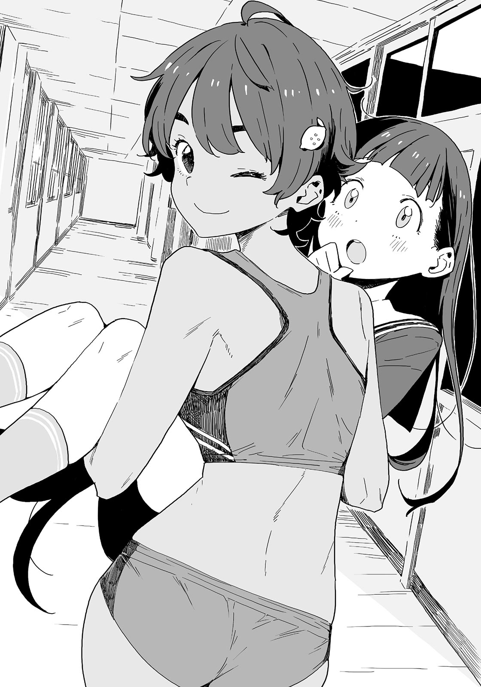

# Ch.30 — เล่ม 5 บทที่ 2-3

Ch.30 — เล่ม 5 บทที่ 2-3

By Monica

Published: 2025-04-22T10:33:15Z

Source: https://www.nekopost.net/novel/14560/30

เล่ม 5 บทที่ 2-3

[...คาจูไปที่นั่นเพื่อคุยเรื่องวันวาเลนไทน์กับเด็กหนุ่มทาจิบานะ ]

เธอแค่รู้สึกว่าไม่สะดวกใจที่จะพูดถึงเรื่องนี้กับคนอื่น มันน่าอาย นั่นเป็นเหตุผลที่เธอเก็บเป็นความลับจากผม—

[ ไม่สิ...มันต้องมีอะไรผิดปกติแน่ๆ เธอไม่คิดอย่างนั้นเหรอ อาซากุโมะซัง? ]

[ นุคุมิซึซังเป็นคนเดียวที่ผิดปกติมาตั้งแต่ตอนนั้นนะ ]

อาจจะจริง แต่เข่าของผมยังคงสั่นอยู่

จากบทสนทนาของพวกเขา ทั้งคู่ดูสนิทกันพอสมควร ถึงแม้จะไม่รู้ว่าพวกเขาคบกันอยู่หรือเปล่า แต่ก็ไม่มีเด็กผู้ชายคนไหนในโลกนี้ที่จะไม่ตกหลุมรักคาจู—

[ หมายความว่าเขาจะกลายเป็นน้องชายของผม... นี่พี่กำลังจะกลายเป็นพี่เขยเหรอ...? ]

[ โอเค เราพักกันสักครู่นะคะ ]

อาซากุโมะซังวางมือลงที่แก้มซีดๆของผม

[ เอ๊ะ พักอะไรล่ะ— ]

[ เอาล่ะ หายใจเข้าลึกๆ— ]

[ อ่า ได้เลย ]

ผมสูดหายใจเข้าลึกๆ

[ แล้วก็หายใจออก! หายใจออกสิ! ]

ผมสูดหายใจเข้าลึกๆอีกสองครั้ง หลังจากนั้นผมก็เริ่มสงบลงเล็กน้อยในครั้งที่สาม

[ ดีขึ้นแล้วเหรอ…? ใช่สิ น้องสาวเธอแค่กำลังจีบกันเล่นๆนิดหน่อยเอง นายกับโอเน่ซังก็ทำเหมือนกันใช่นิ? ]

[ ไม่เคยเลย ]

เธอไม่ใช่พี่สาวของผมนะ ?

[ เอาล่ะ เราไปเจอเลม่อนซังกันเถอะ แล้วก็ใส่ชุดให้เรียบร้อยด้วยนะ ]

อาซากุโมะซังเอื้อมมือไปที่คอของผมแล้วติดกระดุมเสื้อตัวบนให้

อืม...เธอเป็นพี่สาวของผมจริงๆเหรอ? ผมเป็นคาซึคุงใช่มั้ย...คาซึคุงคือผม...

ขณะที่จ้องหน้าผากตรงหน้าอย่างเหม่อลอย นักเรียนหญิงตัวเล็กๆคนหนึ่งก็เดินผ่านไปที่ทางเดิน

เธอหยุดเดิน ดวงตาของเธอเบิกกว้างด้วยด้วยความไม่น่าเชื่อ

[ หา? ห๊ะ!? ท่านพี่!? เกิดอะไรขึ้นคะ!? กลับไปเป็นนักเรียนม.ต้นอีกแล้วเหรอคะ!? ]

ท่านพี่..อ่า ใช่...ผทมีน้องสาว...นี่คือ...น้องสาวของผม...?

[ เธอคือคาจู...? ]

ผมเพิ่งได้สติกลับมา แต่คาจูก็เข้ามาพิงตัวผมแบบติดหนึบ

[ อุว๊ะ อุหว๊าาา ! ท่านพี่ในชุดนักเรียนของพวกเราดูหล่อมากเลยค่ะ ! ขอโทษนะคะ ขอคาจูถ่ายรูปที- ]

คาจูหยิบโทรศัพท์ขึ้นมาด้วยตาที่เป็นประกาย

[ เอ๊ะ? คุณคืออาซากุโมะซังใช่มั้ยคะ ? คาจูเคยเจอคุณที่บ้าน ทำไมถึงใส่ชุดนักเรียนของเราล่ะคะ ? ]

อาซากุโมะซังยิ้มแล้วตอบ

[ ไม่ได้เจอกันนานเลย วันนี้ฉันเป็นพี่สาวของคาซึคุง ]

...เดี๋ยวนะ อย่าทำให้เรื่องมันซับซ้อนสิ

ดวงตาของคาจูเริ่มส่องแสงแปลกๆหลังจากได้ยินคำว่า “พี่สาว”

[ พี่สาวของท่านพี่...!? ไม่ยุติธรรมเลยค่ะ! คาจูอยากเป็นพี่สาวเหมือนกัน! ]

เห็นมั้ย บอกแล้ว คาจูจับมือผมด้วยความตื่นเต้น

[ ไม่ๆ ใจเย็นๆก่อน ]

[ ไม่เอา! ถ้าคาจูเป็นพี่สาว คาจูต้องป้อนข้าวคาซึคุง เปลี่ยนเสื้อผ้าให้ ถูหลังให้ และนอนด้วยกัน—อ๊ากก หนึ่งวันนี่ไม่พอเลย ! ]

พี่สาวปกติไม่ทำอย่างนั้นหรอก

เอาเถอะ สิ่งที่เธออยากทำมันก็ไม่ได้ต่างจากคาจูปกติมากนัก

[ โอเค เข้าใจแล้ว พักกันก่อน นี่ คาจู มองที่นิ้วของพี่นะ ]

ผมยกนิ้วชี้ของมือทั้งสองข้างขึ้น

[ นิ้วสองนิ้วนี้กำลังวิ่งไล่กันอยู่นะ นิ้วนี้กำลังเข้าใกล้ แล้วก็แตะกับนิ้วนี้แล้ว ]

[ มันกำลังไล่กันอยู่ อ่า พวกมันแตะกันแล้ว... ]

คาจูมองตามนิ้วของผม หนูสงบลงแล้วใช่มั้ย?

เธอกลับมามีสีหน้าเคร่งขรึมแล้วก็ไอเบาๆ

[ ใจเย็นลงแล้วใช่มั้ย? ]

[...ค่ะ ท่านพี่ ช่วยอธิบายให้ฟังหน่อยว่ามันเกิดอะไรขึ้น? ]

[ เอ่อ...คือว่า...]

แย่ล่ะ นี่มันเกิดขึ้นทุกครั้งเวลาที่เรื่องต่างๆเริ่มสงบลง….

ผมมองไปทางใครสักคนเพื่อขอความช่วยเหลือ อาซากุโมะซังพยักหน้าแล้วก้าวมาข้างหน้า

โอเค ผมคาดหวังไว้สูงมากเลยนะ….โอเน่ซัง

[ คาจูซัง เหตุผลที่คาซึฮิโกะซังกับฉันอยู่ในท่านี้ก็คือ— ]

[ อะไรเหรอคะ? ]

[ —นี่เป็นการแสดงน่ะ ]

[ เหมียว!? ]

ความคาดหวังของผมถูกหักหลังไปซะแล้ว

[ นักเรียนชายหญิงที่แอบเข้าไปในโรงเรียนเก่าของพวกเขาในชุดนักเรียนเก่าแล้วเล่นเป็นพี่น้องกัน—พวกเขาต้องสนุกกับการเล่นเกมที่ไร้ศีลธรรมแบบนี้แน่นอน นี่ไม่ใช่การสืบสวนลับๆหรอกนะ ฉันไม่มีทางคิดอะไรที่ไร้สาระมากขนาดนี้หรอก! ]

อาซากุโมะซังพูดทุกอย่างเสร็จก็หันมามองผมอย่างภาคภูมิใจ

เอ่อ...คนๆนี้คิดว่านี่เป็นคำตอบที่ถูกต้องจริงๆอะ? ขอโทษนะถ้าเธอคิดว่านี่จะช่วยให้เรารอดไปได้

คาจูอ้าปากแล้วก็ไอเบาๆก่อนจะพยายามพูดอย่างใจเย็น

[ อ-เอ่อ ได้ค่ะ งั้นตามหนูมาเถอะ หนูจะพาไปหาครูฝ่ายปกครอง ]

อาซากุโมะซังเอียงคออย่างสงสัย

[ อาระ เราไม่ได้มาสืบสวนนะ นี่มันก็แค่การแสดงน่ะ ]

...พอเถอะ คาจูกำลังมองผมด้วยสายตาที่ไม่เคยเห็นมาก่อน

ผมเตรียมใจสำหรับการประชุมครอบครัวคืนนี้แล้ว—แต่ทันใดนั้นร่างของคาจูก็ถูกยกขึ้น

[ เมี๊ยววว!? ]

[ ฉันจับรองประธานได้แล้ว! ซาลาเปาเนื้อต้องเป็นของฉัน! ]

คาจูถูกอุ้มแบบเจ้าหญิง คนที่ส่งเสียงด้วยความดีใจก็คือยากิชิโอะ

เด็กสาวจากชมรมกรีฑาตามมาในไม่ช้า พวกเธอปรากฏตัวที่หัวมุมทางเดิน

[ เธอแซงพวกเราอีกแล้ว! รุ่นพี่เลม่อนก็ไวเกินไปนะ!] [ เดี๋ยวก่อน มันยังไม่จบหรอก! ]

ยากิชิโอะมองรุ่นน้องของเธอด้วยรอยยิ้มเย่อหยิ่ง

[ ฟุฟุ...ถ้าพวกเธอชิงรองประธานกลับไปจากมือของฉันได้ ซาลาเปาเนื้อจะเป็นของพวกเธอ ! ลองไล่ตามฉันดูสิ! ]

[ เอ๊ะ เดี๋ยวสิ ยากิชิโอะ เธอทำอะไร? ]

[ ปล่อยให้เป็นหน้าที่ฉันเถอะ! ]

ยากิชิโอะขยิบตา แล้วเธอก็เริ่มวิ่งโดยที่ยังอุ้มคาจูอยู่

เด็กสาวคนอื่นๆก็ไล่ตามเธอไปทันที

[ เดี๋ยวสิ ซาลาเปาเนื้อ ! ] [ไปทางนั้นนะสาวๆ ! ] [ ฉันจะโจมตีจากชั้นสอง! }

...พวกเธอทำอะไรกันเนี่ย?

พวกเราที่ยืนอยู่ตรงนั้นได้แต่มองตามไปด้วยอาการอ้าปากค้างหลังจากที่ยากิชิโอะกับรุ่นน้องของเธอหายตัวไป

หลังจากที่ยืนนิ่งอยู่พักหนึ่ง อาซากุโมะซังก็จิ้มไหล่ของผม

เอ่อ คาจูถูกพาไปแล้ว แต่—ยากิชิโอะบอกให้ปล่อยเธอจัดการเอง

...เอาเถอะ ปล่อยให้เธอจัดการแล้วกัน

ผมพยักหน้าอย่างจริงจังแล้วก็แกะกระดุมเสื้อของตัวเองออก

✧✧✧✧

ความทรงจำในวัยเด็กของผมไม่มีอยู่เลย

าถึงแม้ผมจะจำได้ แต่ก็ลืมอย่างรวดเร็วในภายหลัง หรือไม่ก็เป็นเพราะผมมีความทรงจำอยู่แล้ว แต่นึกไม่ออก

ผมอายุเค่ 1 ขวบครึ่ง ตอนที่คาจูเกิด ปกติแล้วผมไม่ควรจะมีความทรงจำเกี่ยวกับเรื่องนี้

เพราะงั้น นี่เป็นความทรงจำที่ถูกสร้างขึ้นจากเรื่องราวของพ่อแม่และสิ่งที่ผมจำได้หลังจากโตขึ้น

ผมเคยเป็นศูนย์กลางของครอบครัว แต่พอถูกแทนที่ ผมเลยโวยวายใหญ่โต

เป็นเรื่องธรรมดาที่จะคิดถึงเรื่องนี้ในตอนนี้ มันคงจะลำบากสำหรับพ่อแม่ของผมที่ต้องดูแลผมในตอนที่ยังเดินไม่คล่องเมื่อตอนที่คาจูเกิดมาในโลกนี้

ชื่อของน้องสาวอ่านค่อนข้างยาก จนผมพูดไม่ถูก

คิดว่าผมเคยรู้สึกเหงาและโกรธกับการปรากฏตัวของตัวละครใหม่ในโลกแห่งนี้

แล้วในวันเกิดครบ2ขวบของผม ผมก็กลับมาเป็นศูนย์กลางของเวทีอีกครั้ง แต่ผมโกรธมากเมื่อแม่ต้องไปอยู่กับคาจูเพราะเธอร้องไห้

ผมโยนมงกุฎกระดาษทิ้งแล้วม้วนตัวไปนอนอยู่ที่มุมห้องก่อนจะหลับไปในที่สุด

คิดว่าเวลาผ่านไปไม่นานหลังจากที่ผมตื่นขึ้นมา

[ อรุณสวัสดิ์ , โอนี่จัง ]

แม่เมินความงอนของผมแล้วอุ้มผมขึ้นมา

เธอพาผมไปที่เตียงเด็กของคาจู

ผมจ้องมองคาจูจากด้านบนในอ้อมแขนของแม่ เธอดูเหมือนมนุษย์ถึงแม้จะตัวเล็กกว่าผมมาก สำหรับผมแล้วมันไม่น่าเชื่อเลย

[ คาจูก็ตื่นแล้วด้วย รีบพูดอรุณสวัสดิ์กับโอนี่จังสิ ]

คาจูตื่นขึ้นมาแล้วยื่นมือเล็กๆ ออกมา

ผมลูบมันเบาๆ ด้วยนิ้วของผม คาจูจับมือของผมแน่น

มันเล็กและอบอุ่น แต่ก็รู้สึกแข็งแรงกว่าที่ผมคิด

ผมหยุดนิ่งอยู่กับที่ แล้วทันใดนั้นคาจูก็หัวเราะขึ้นมา

ตอนนั้นผมก็รู้สึกตัว

— ผมเป็นพี่ชายแล้ว

ความทรงจำแรกของผมในฐานะพี่ชายเริ่มขึ้นตอนที่ผมอายุ 3 ขวบ

ส่วนคาจู เธอยังคงตามผมไปเรื่อยๆ หลังจากที่เข้าเรียนมัธยมต้น

นั่นคือเหตุผลที่ผมมักจะยึดมั่นในความทรงจำตอนนั้นและผลักวันเวลาที่คาจูจะออกห่างจากผมออกไป

วันนั้นจะมาถึงในที่สุด—แต่ไม่ใช่วันนี้ ผมคิดแบบนั้น

✧✧✧

ก่อนที่ผมจะรู้ตัว ฟ้าก็มืดลงแล้ว ถนนก็เริ่มมืดตามไปด้วย

สายตาของผมหลุบลงไปยังแผ่นหินบนทางเดินเท้า และผมก็สนใจเพียงแค่เดินไปข้างหน้า

ทางเท้าสิ้นสุดลง เมื่อแสงไฟส่องไปที่ทางข้ามถนน

ในขณะที่ผมกำลังจะก้าวเข้าทางข้ามถนน มีคนจับแขนผมไว้

[ ระวังรถด้วย นุคุมิซึซัง! ]

อาซากุโมะซังหยุดผม

เธอมองผมด้วยสีหน้างุนงงในชุดเครื่องแบบสึวะบุกิของเธอ

[ นี่ นายจะไปไหน? ]

[ ...เอ๋? จะกลับบ้านไง ]

หลังจากพูดเสร็จ ผมมองไปรอบ ๆ นี่มันไม่ใช่ทางที่บ้านของผมอยู่เลย

ดูเหมือนว่าผมจะเดินหลงมาที่สถานีโทโยฮาชิ

[ ขอโทษนะ เธอตามผมมาถึงที่นี่เลยเหรอ? หลังจากนี้ผมโอเคแล้ว ไม่ต้องห่วง-]

อาซากุโมะซังส่ายหน้าอย่างแรง

[ ฉันปล่อยให้นุคุมิซึซังอยู่คนเดียวตอนนี้ไม่ได้หรอก ไปพักกันสักที่เถอะ ]

คำพูดของเธอชวนให้คนเข้าใจผิดได้เลยนะ เธอพาผมไปที่ร้านชื่อ “มัทเทอร์ฮอร์น” ซึ่งเป็นร้านขนมตะวันตกเก่าแก่ในโทโยฮาชิ นี่เป็นครั้งแรกที่ผมเข้ามาในส่วนคาเฟ่ของพวกเขา

ผมนั่งลงและมองไปรอบ ๆ คาเฟ่สไตล์โบราณ อาซากุโมะซังยื่นโทรศัพท์ให้ผมดู

[ ยากิชิโอะซังบอกลารุ่นน้องเธอแล้ว เธอกำลังมาที่นี่ ]

พนักงานเสิร์ฟวางกาแฟถ้วยหนึ่งต่อหน้าผม ผมพยักหน้าเงียบ ๆ

[ นายเอาแค่นี้เหรอ? ]

[ ผมไม่หิวน่ะ ]

อาซากุโมะซังมีเค้กกับน้ำผลไม้รวมอยู่ตรงหน้า รอยยิ้มของเธอค่อย ๆ หายไป

[ ...นายควรดูแลปริมาณน้ำตาลของนายนะ สมองที่เหนื่อยล้าต้องการการเติมเต็มให้เพียงพอ… ]

[ รู้แล้วๆ ขอโทษที่ทำให้เป็นห่วงวันนี้นะ ]

ผมเติมน้ำตาลลงในกาแฟและคนมัน อาซากุโมะซังยื่นส้อมที่มีเค้กชิ้นหนึ่งมาให้ผม

[ นี่ อ้าม- ]

[ เอ๋? เดี๋ยวก่อน มีคนอยู่ที่นี่นะ ]

[ ฉันไม่ได้บอกเหรอว่าเราจะจีบกันทีหลังก็ได้น่ะ? โอเน่ซังไม่เคยผิดสัญญาหรอกนะ ]

เกมนั้นยังไม่เลิกอีกเหรอ?

ดูเหมือนว่าเธอจะไม่ยอมแพ้ งั้นก็ได้ ผมจะกินก็ได้ ความหวานละมุนลิ้นแบบที่คุ้นเคยแผ่กระจายเต็มปาก

อาซากุโมะซังสั่งเค้กมัทเทอร์ฮอร์นที่ตั้งชื่อตามชื่อร้าน สปันจ์เค้กบาง ๆ ผสมกับครีมและเกาลัด นานแล้วที่ผมไม่ได้กิน.. อร่อยอย่างที่คิดไว้จริง ๆ

ผมเป็นแฟนช็อกโกแลตมาโดยตลอด แต่การกลับมาลองความคลาสสิกดูเหมือนจะเป็นความคิดที่ดีเหมือนกัน..

ผมเห็นรอยยิ้มของอาซากุโมะซังขณะที่กำลังเอื้อมไปหยิบกาแฟ

[ รู้สึกดีขึ้นหรือยัง? ]

[ ขอบคุณนะ ดีขึ้นมากแล้ว ]

ในเมื่อเธอเป็นห่วงผมขนาดนี้ ผมก็ไม่ควรจะเศร้าอยู่ตลอด

ผมยิ้มอย่างไม่เต็มใจและเห็นกระเป๋ากีฬาข้างที่นั่งของอาซากุโมะซัง

[ พวกเธอทำอะไรกันอยู่? ]

ยากิชิโอะจ้องมาที่พวกเราด้วยดวงตาสีน้ำตาลโตของเธอ อุหวาา เธอเห็นเราในตอนที่ทำอะไรแปลก ๆ พอดี

[ วันนี้ฉันเป็นพี่สาวของคาซึคุงน่ะ ]

[ อะไรอะ? น่าสนุกจัง! โอ๊ะ ขอโทษ! ]

เอ๋ แค่นี้เธอก็เข้าใจแล้วเหรอ?

ยากิชิโอะนั่งลงข้างๆอาซากุโมะซังหลังจากที่เธอสั่ง

[ แล้วยังไง? ฉันได้ยินมาว่านายดูเศร้าพอตัว แต่ตอนนี้ก็ดูปกติดีนะ นายยังมีมาจีบกันต่ออีกนี่ ]

เธอวางข้อศอกบนโต๊ะและพูดอย่างขี้เล่น

ถ้าอายาโนะรู้เรื่องคงจะยุ่งแน่ๆ ผมต้องเปลี่ยนเรื่อง

[ ว่าแต่ ยากิชิโอะพาน้องสาว-คาจูไปไหนมา? เกิดอะไรขึ้นกับเธอ? ]

[ น้องสาวเหรอ? ดูเหมือนเธอจะสับสนหน่อยๆน่ะ ]

แน่นอน นั่นไม่ใช่สิ่งที่ผมอยากถาม

[ เอ่อ เธอปล่อยคาจูไปแล้วใช่มั้ย? ]

[ ฉันส่งเธอไปที่ห้องสภานักเรียน ฉันชนะการแข่งด้วย ! ]

ผมไม่รู้กฎหรอก แต่เธอชนะเหรอ?

…เอาล่ะ ก็ดีที่เธอโอเค

ผมดื่มกาแฟ แล้วชาร้อนกับเค้กช็อกโกแลตของยากิชิโอะก็มาถึง

เค้กของยากิชิโอะเป็นเค้กช็อกโกแลตกับสปันจ์เค้กที่มีช็อกโกแลตเคลือบ และ เป็นที่นิยมเสมอ

ยากิชิโอะพูดด้วยน้ำเสียงสงบอย่างผิดปกติขณะที่จิ้มส้อมลงไปในเค้ก

[ น้องสาวนายน่ะ จะว่าไงดีล่ะ? เธอโอเคหรือเปล่า? ]

[ ...เธอคุยกับคาจูเหรอ? ]

[ ไม่เยอะหรอก ฉันมัวแต่ยุ่งวิ่งไปวิ่งมา แต่เธอก็สนิทกับคนรอบข้างดีนะ มีเพื่อนเยอะ จะว่าไงดีล่ะ? ]

ยากิชิโอะกินเค้กคำหนึ่ง

[ -เธอเป็นเด็กที่พึ่งพาได้ เธอมุ่งมั่นและมีความคิดเป็นของตัวเอง ฉันรู้ว่านายกังวลเรื่องของเธอ แต่ควรเชื่อใจเธอมากกว่านี้นะ ]

ยากิชิโอะตักเค้กอีกชิ้นขึ้นมาด้วยส้อมและยื่นให้ผม

[ นี่ คาซึคุง อ้าปากสิ ]

[ เฮ้ย นี่เธอทำอะไร ยากิชิโอะ? ]

ผมหันหน้าหนีด้วยความกลัว ยากิชิโอะเข้าใกล้ผม

[ นายกินของของจิฮะจังได้ แต่กินเค้กของเลม่อนโอเน่จังไม่ได้เหรอ? ]

[ เฮ้ย? เฮ?? ]

บางครั้งยากิชิโอะก็ดูใจแข็งไม่เบา แม้แต่อาซากุโมะซังก็เข้าร่วมความสนุกนี้ด้วย

ช่วยไม่ได้ ผมกินเค้กเข้าไป รอยยิ้มที่พึงพอใจปรากฏบนใบหน้ายากิชิโอะ

[ โอเค แก้ปัญหาแล้ว ทีนี้ กินเค้กของเราเถอะ ]

แก้ปัญหาอะไรล่ะ? ยังไงก็เถอะ ในฐานะพี่ชาย ผมต้องเชื่อในคาจูให้มากขึ้น

…พูดถึงเรื่องนี้ ถึงแม้พวกเธอจะสนิทกัน แต่นั่นไม่ได้หมายความว่าพวกเธอจะเป็นแฟนกันหรอก ผมก็เป็นตัวอย่างที่ดี

ผมพยักหน้าอยู่คนเดียว ด้วยเหตุผลบางอย่าง อาซากุโมะซังมองออกไปนอกหน้าต่างด้วยความกังวล

[ นี่ก็ดึกแล้วนะ นุคุมิซึซัง น้องสาวของนายกลับบ้านแล้วหรือยัง? ]

[ เธอมีงานต้องทำที่สภานักเรียน น่าจะยังอยู่ที่โรงเรียน คิดว่าเธอคงกลับบ้านดึกทั้งสัปดาห์ ]

[ งั้นนี่เป็นโอกาสที่ดี ]

...? หมายความว่าไง?”

ผมงง อาซากุโมะซังยื่นสมาร์ตวอทช์บนข้อมือมาให้ดู

[ จิฮะจัง นั่นอะไรเหรอ? ]

[ สมาร์ตวอทช์ ด้วยสิ่งนี้ ฉันสามารถตรวจจับอุปกรณ์ดักฟังที่ฉันฝังไว้ทั่วโรงเรียนโมโมโซโนะได้-]

[ หยุดนะ อาซากุโมะซัง! ]

ผมรีบขัดจังหวะเธอ อาซากุโมะซังพยักหน้าอย่างจริงจัง

[ ...นี่คือสมาร์ตบั๊ก มันไม่ใช่อุปกรณ์ธรรมดาหรอกนะ ]

ผมบอกให้หยุดไม่ใช่หรอ?

ยากิชิโอะมองข้อมือของอาซากุโมะซังด้วยตาเป็นประกาย

[ อะไรน่ะ? เท่มาก! เหมือนอุปกรณ์ลับของนักสืบเลยใช่มั้ย? ]

[ ใช่แล้ว ฉันได้ยินเสียงจากที่ไกลๆได้ ด้วยพลังนักสืบนี้ ฉันจะได้ยินเสียงที่หน้าห้องสภานักเรียนชัดมาก ]

พลังนักสืบนี่น่ากลัวจัง แป๊บหนึ่งนะ…?

[ เรายังรับสัญญาณหลังออกจากโมโมโซโนะได้เหรอ? ]

ผมถามอย่างสมเหตุสมผล อาซากุโมะซังตอบอย่างเป็นธรรมชาติ

[ ฉันทิ้งตัวปล่อยสัญญาณ Wi-Fi ไว้ที่โรงเรียน สัญญาณจากอุปกรณ์เสริมจะส่งตรงจากที่นั่นน่ะ ]

[ นั่นคือเหตุผลที่เธอสมัคร Wi-Fi งั้นเหรอ? เพื่อไอนี่เนี่ยนะ? จริงดิ? ]

อาซากุโมะซังยิ้มและเริ่มปรับสมาร์ตวอทช์ของเธออย่างเงียบ ๆ

…ช่างเธอเถอะ ทำอะไรก็ทำไป ผมยอมแพ้ขณะที่ดูพลังนักสืบของอาซากุโมะซัง

[ เฮ้ จิฮะจัง! ไอนี่มันทำอะไรได้อีกเหรอ? มันเรืองแสงได้มั้ย? ]

[ ครั้งหน้าฉันจะเพิ่มไฟ LED ลงไป โอเค เชื่อมต่อแล้ว ]

พวกเราจ้องไปที่สมาร์ตวอทช์

…ได้ยินแต่เสียงจาง ๆ

[ ไม่ได้ยินอะไรเลย ไม่มีใครอยู่ที่นั่นหรือเปล่า? ]

[ อ๊ะ! ฉันคิดว่ามีเสียงอะไรบางอย่างนะ! ]

พวกเราได้ยินบางอย่างจริง ๆ ทุกคนกลั้นหายใจ แต่เสียงก็เงียบลงอีกครั้ง

จากนั้นอาซากุโมะซังก็ดูเหมือนจะตระหนักอะไรบางอย่างและเงยหน้าขึ้นทันที

[ นี่ไม่ใช่สัญญาณ Wi-Fi แต่เป็นวิทยุตรงจากอุปกรณ์ดักฟัง ]

[ สมาร์ตบั๊ก ]

[ ใช่ สมาร์ตบั๊ก ]

ดีใจที่เธอเข้าใจนะ นอกจากนี้ ถ้าอุปกรณ์ดักฟังอยู่ใกล้ นั่นหมายความว่า-

[ มีคนใช้อุปกรณ์เดียวกันโดยบังเอิญเหรอ? ]

[ ไม่ นี่เชื่อมต่อกับแอป ไม่มีทางหรอก ]

อาซากุโมะซังส่ายแขนขณะที่มองมาที่ผม แล้วเธอก็หยุด

[ ...ทำไมถึงมองมาแบบนั้นล่ะ? ]

[ นุคุมิซึซัง อะไรอยู่ในกระเป๋าของนาย? ]

[ หืม? ชุดนักเรียนโมโมโซโนะที่เพิ่งใส่ไง ]

หน้าผากของอาซากุโมะซังเป็นประกายเมื่อผมเปิดซิปกระเป๋า

วิทยุเริ่มแรงขึ้น มีอะไรบางอย่างอยู่ข้างในแน่นอน

เอ๋ ไม่มีทางใช่มั้ย? ผมหยิบเสื้อออกมาและค้นหา สุดท้ายก็มีบางอย่างตกลงมาจากด้านหลังปก ผมเก็บมันขึ้นมา มันเป็นชิปสีดำเล็ก ๆ ขนาดเท่าปลายนิ้วก้อย

เดี๋ยว มีตัวเลขอยู่ด้วย

[...หมายเลข 1? ]

[ นี่คือสมาร์ตบั๊กที่ฉันฝังไว้ที่ประตูห้องสภานักเรียน... เดี๋ยวก่อน งั้นเสียงนี่ก็คือ-]

อาซากุโมะซังล้วงมือเข้าไปในกระเป๋าของเธอ

สักพักเธอก็หยิบชิปแบบเดียวกันออกมา

[ หมายเลข 2- นี่คืออันที่ฉันฝังไว้ในชุดของน้องสาวนาย ]

ผู้หญิงคนนี้ทำอะไรลงไปเนี่ย? คิดว่าตอนนี้เป็นเวลาที่จะเรียกอาซากุโมะซังว่า “ผู้หญิงคนนี้” ใช่มั้ย?

พวกเรานิ่งเงียบไป ยากิชิโอะถือส้อมและมองพวกเราอย่างสับสน

[ เอ่อ ยังไงก็เถอะ เกิดอะไรขึ้น? ]

อาซากุโมะซังเอานิ้วชี้มาวางที่คางและเอียงศีรษะอย่างเขิน ๆ

[ ดูเหมือนว่าวัตสันโอนี่จังจะโดนมอริอาร์ตีตัวน้อยหลอกซะแล้วล่ะ ]

[ นั่นสินะ วัตสันโอเน่จังก็- ]

[ อืม ฉันไม่ค่อยเข้าใจหรอก แต่ขอบคุณสำหรับอาหารนะ ]

ยากิชิโอะปรบมือต่อหน้าวัตสันคุงทั้งสอง

---
