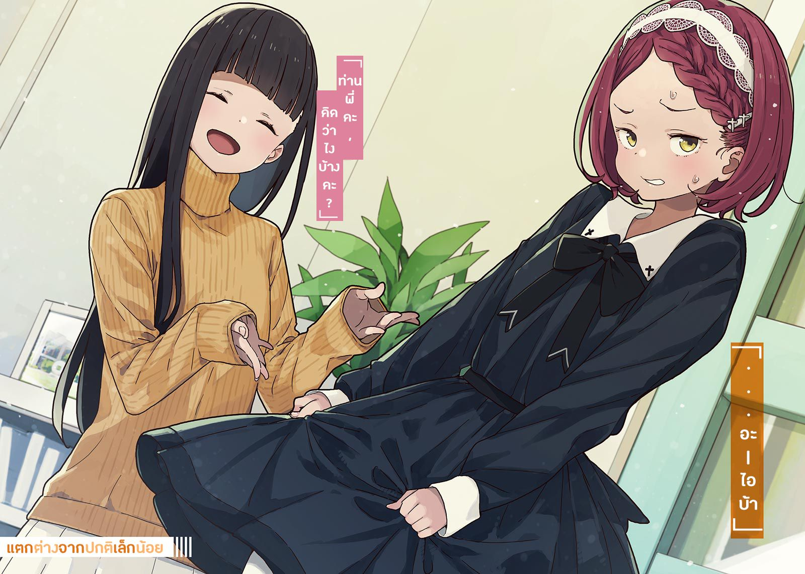

# Ch.32 — เล่ม 5 บทที่ 3-1

Ch.32 — เล่ม 5 บทที่ 3-1

By Monica

Published: 2025-04-22T10:33:25Z

Source: https://www.nekopost.net/novel/14560/32

เล่ม 5 บทที่ 3-1

วันถัดมาหลังเลิกเรียน ผมอยู่ที่ห้องสมุดใจกลางเมือง ไม่ไกลจากสถานี

ห้องสมุดนี้อยู่ที่ชั้นสองและชั้นสามของตึก มีพื้นที่สำหรับทำกิจกรรมและคาเฟ่อยู่ตรงบรรไดด้านบนด้วย

ตอนแรก ผมรู้สึกว่าพื้นที่ทันสมัยแบบนี้ไม่ใช่ที่ของผม แต่ยังไงนี่ก็เป็นห้องสมุดนี่นา บรรยากาศที่ผสมผสานระหว่างพลังงานและความสงบ ทำให้รู้สึกสบายใจ

ผมนั่งอยู่ในห้องที่มีที่นั่งคู่หนึ่ง ขณะที่เปิดหนังสือ ผมก็หวนนึกถึงสิ่งที่เกิดขึ้นเมื่อวาน

การสืบสวนลับๆในโรงเรียนมัธยมต้นโมโมโซโนะ

สุดท้ายแล้ว ผมก็ได้รู้ว่าทาจิบานะคุงเป็นคนจริงๆ ความจริงข้อนี้ทำให้ผมแทบทนไม่ไหว แล้วยังได้ยินคาจูจีบกับเขาอีก

โชคดีที่ผมไม่ใช่พวกซิสค่อน เพราะงั้นความเสียหายจึงไม่ถึงตาย แต่ก็ยังคงฟื้นตัวอยู่

...ก็อย่างว่า คาจูยังอยู่แค่มัธยมต้นปี2เอง มันก็ปกติที่เธอจะมีเพื่อนผู้ชายใช่มั้ย ?

ใช่แล้ว แม้ว่าตอนนั้นผมจะไม่มีเพื่อนผู้ชายเลยก็ตาม แต่มันก็ไม่แปลกที่คาจูจะมีเพื่อนที่เป็นเพศตรงข้าม ..ก็แค่เพื่อนกันแหละ

พอเปรียบเทียบกับเรื่องนั้น วันเปิดบ้านที่จะมาถึงในสุดสัปดาห์นี้ดูสำคัญกว่ามาก

ผมพยายามหนีจากความจริงขณะที่เปิดไปยังหน้าข้อมูลในนิยาย

ต้นฉบับของนิตยสารชมรมยังไม่มีความคืบหน้าเลย นี่ก็เป็นอีกหนึ่งความจริงที่ปฏิเสธไม่ได้

ผมจดไอเดียบางอย่างลงในสมุดบันทึก จากนั้นหน้าจอโทรศัพท์ก็สว่างขึ้น

ผมหยิบมันขึ้นมาดู เป็นข้อความในไลน์จากโคมาริ

< นายโดดกิจกรรมชมรมอยู่ที่ไหน? >

...โอ้โห เข้าใจผิดอย่างแรงเลยนะ นี่ก็เป็นส่วนหนึ่งของกิจกรรมชมรมเหมือนกัน

ไม่มีเวลามาสนใจโคมาริ ผมบอกเธอว่ากำลังเขียนต้นฉบับอยู่ในห้องสมุด แล้วก็พลิกโทรศัพท์คว่ำลง

ผมกำลังคิดเกี่ยวกับนิยายสั้นที่จะตีพิมพ์ในนิตยสารชมรม

โครงเรื่องเกี่ยวกับตัวละครหญิงลึกลับและสวยที่ปรากฏตัวข้างๆตัวละหญิงอีกคน แต่ผมยังไม่ได้ตัดสินใจว่าใครจะเป็นนางเอกหลัก

[ ไอเดียดีๆ ไม่ได้เกิดขึ้นได้ง่ายๆนะ… ]

ผมปิดหนังสือแล้วบิดหลังยืดตัวก่อนจะมองออกไปนอกหน้าต่าง

หน้าต่างอยู่ทางด้านขวาของห้องนี้ สามารถเห็นวิวผ่านม่านได้

มีลานที่ปูด้วยแผ่นหินอยู่ นักเรียนมัธยมปลายกลุ่มหนึ่งกำลังเดินกลับบ้าน

...จะว่าไปแล้ว คู่รักก็เต็มไปหมดเลย

ที่นี่ก็เป็นที่นั่งคู่ด้วย พอคิดๆดูแล้ว ที่นั่งด้านหน้าและด้านหลังก็เหมือนจะมีคู่รักนั่งอยู่เหมือนกัน

ผมคิดอยู่ในใจ ถ้าพวกนี้ต้องจ่ายภาษีมากกว่านี้สักหน่อยก็คงดี- แล้วกระเป๋านักเรียนของโรงเรียนสึวะบุกิก็ถูกวางลงบนโต๊ะ

[ เอ๊ะ โคมาริ เธอมาทำอะไรที่นี่? ]

เจ้าของกระเป๋านั้นคือ โคมาริ ชิกะ เธอมองไปรอบๆ ก่อนจะกระซิบว่า

[ เฮ้ ขยับเข้าไปหน่อยสิ ]

ผมทำตามคำสั่งของเธอด้วยความงุนงงเล็กน้อย เธอนั่งลงที่มุมที่นั่งของผม

[ น-นายไม่ได้ไปชมรม ละ-แล้วจะทำยังไงกับวันเปิดบ้านในว-วันอาทิตย์ล่ะ? ]

[ บอกแล้วว่ากำลังคิดเกี่ยวกับต้นฉบับนิตยสารชมรมอยู่ หาข้อมูลไว้แล้ว แต่ยังคิดตัวละครหญิงดีๆไม่ออกเลย ]

โคมาริยื่นมือไปที่หนังสือที่ผมเพิ่งอ่าน

[ ธ-เธอหมายถึงหนังสือภาพจุลินทรีย์เล่มนี้น่ะเหรอ? ]

[ ใช่ คิดว่าตัวละครหญิงลึกลับกำลังเป็นที่นิยม อาจจะทำให้ผมได้ไอเดียบ้าง ]

โคมาริเปิดหนังสือไปมา เธอส่ายหัวแล้วปิดหนังสือ

[ ถ-ถึงอย่างนั้น มันก็ยากเกินไปไม่ใช่เหรอ? น-นายควรดูความสามารถของตัวเองด้วยนะ ]

ผมก็คิดงั้นเหมือนกัน

โอเค งั้นครั้งนี้ผมจะใช้เมดหูแมวสวมแว่นเป็นตัวละครหญิงล่ะกัน สิ่งสำคัญที่สุดคือต้องซื่อสัตย์กับตัวเอง

[ แล้วเธอล่ะ โคมาริ? เสร็จแล้วหรือยัง? ]

[ ฉ-ฉันเขียนต่อจากการผจญภัยต่างโลกของมิชิมะและดาไซแล้ว ]

...? นั่นไม่ใช่นิยายของรุ่นพี่สึคิโนกิหรอ?

[ เอ่อ ไม่ใช่ว่ามันเป็นนิยายผลัดกันเขียนเหรอ ? ]

[ ร-รุ่นพี่ไม่ยอมรับหรอก ร-เรื่องที่มิชิมะอยู่โพบน ]

...ผมไม่อยากจะเชื่อเลยว่าผู้หญิงคนนี้กล้าจะเล่นกับเรื่องต้องห้ามแบบนี้

เอาล่ะ การติดต่อกับนักเรียนปีสามในช่วงนี้เป็นเรื่องที่ยากมาก

รุ่นพี่สึคิโนกิสมัครเรียนไป 5 มหาวิทยาลัยแล้ว เธอถูกปฏิเสธจากที่ๆหนึ่งแล้วด้วย

ส่วนรุ่นพี่ทามากิก็สอบแอดมิชชั่นเสร็จแล้ว และกำลังเตรียมตัวสำหรับการสอบเข้ามหาวิทยาลัยของรัฐรอบที่สอง ดูเหมือนเขาจะได้คะแนนขั้นต่ำแล้ว แต่นี่เป็นเพียงจุดเริ่มต้นของการแข่งขัน

[ ยังไงก็เถอะ จะทำให้เสร็จก่อนวันอาทิตย์ สบายใจได้เลย ]

[ ล-แล้วเธอจะข-เข้าเล่มเมื่อไหร่? ]

ผมเกาหัวแล้วมองไปทางอื่น

[ เอ่อ นิยายของโคมาริกับยานามิซังพิมพ์ก่อนได้เลย ส่วนของผมจะพิมพ์ที่ร้านสะดวกซื้อแล้วให้ผู้เข้าชมเข้ามาเข้าเล่มกันเอง ]

[ ผ-ผู้เข้าชม? ]

ผมพยักหน้าอย่างมั่นใจ

[ เป็นประสบการณ์ในการทำนิตยสารชมรมไง  คิดว่าเป็นไอเดียที่ดีเลย ]

[ มะ-มันก็แค่ทำการบ้านเอง อ-อยู่ทำจนดึกแล้วเขียนให้เสร็จสิ ]

โคมาริพูดด้วยน้ำเสียงที่เย็นชาอย่างไม่เคยเป็นมาก่อน

[  ผมไม่ได้ไปที่ห้องชมรมเพราะเรื่องนี้แหละ พรุ่งนี้เป็นวันหยุดด้วย ขอเวลาหน่อย เดี๋ยวค่อยไปตอนวันศุกร์ ]

ผมเริ่มเขียนลงในสมุดบันทึกอย่างตั้งใจ จากนั้น โคมาริก็เริ่มประสานนิ้วของเธอเข้าด้วยกันด้วยความกระสับกระส่าย

[ มีอะไรหรือเปล่า? อยากบอกอะไรอีกมั้ย? ]

[ อ-เอ่อ ยานามิพูดว่าเราควรทำอย่างอื่นนอกจากนิตยสารชมรมด้วย ]

ยานามิพูดอย่างนั้นเหรอ? นั่นหมายความว่า-

[ ไม่ว่ายัยนั่นจะคิดอะไร มันต้องเป็นเรื่องที่น่ารำคาญมากแน่ๆ ให้หมากฝรั่งเธอเคี้ยวตอนที่กำลังพูด เดี๋ยวเธอก็ลืมมันไปเองแหละ ]

โคมาริยังคงเล่นกับนิ้วของเธอด้วยหัวที่ก้มต่ำแม้ว่าผมจะให้คำแนะนำไปแล้วก็ตาม

[ ถ้ามันน่ารำคาญมากจนหมากฝรั่งหลอกเธอไม่ได้ เราก็แค่ให้ข้าวผัดเธอแทน- ]

[ ว-วันเปิดบ้านคือวันวาเลนไทน์ เธอเลยอยากทำช็อกโกแลตให้แล้วเอามา ]

วันวาเลนไทน์ใช่มั้ย? อ่าใช่ มันก็สุดสัปดาห์นี้แหละ

สภาพจิตใจของผมย่ำแย่เพราะคาจู เมื่อคิดย้อนกลับไป เรื่องทั้งหมดนี้ก็เริ่มต้นจากช็อกโกแลตทำมือ...

[ แล้วไอ้ช็อกโกแลตตามมารยาทนี่มันเกี่ยวอะไรกับวันเปิดบ้านล่ะ? ]

[ เธอบอกว่า… ถ้าอย่างนั้นก็เอาไปแจกให้ผู้ชมด้วย…ถ-ถล่มพวกเขาด้วยพลังสาวๆน่ะ... ]

...ไม่มีทางหรอกใช่มั้ย? สาวๆ ชมรมวรรณกรรมนี่ป็นกลุ่มที่ห่างไกลจากพลังสาวๆที่สุดแล้ว ยานามิน่ะ ถ้าพูดถึงเรื่องการกินช็อกโกแลตแบบถล่มทลาย เธอน่าจะทำได้แน่ๆ

[ แต่การแจกช็อกโกแลตก็ฟังดูดีเหมือนกันนะ เอาล่ะ ทำให้ดีที่สุดแล้วกัน ]

มองข้ามสองคนที่เหลือไป โคมาริน่าจะไม่เป็นไร

ผมกำลังจะกลับไปที่ต้นฉบับของผม แต่โคมาริก็ก้มหน้าลง ตัวเธอเลื่อนเข้ามาใกล้ผมทีละนิดๆ

[ อ-อีกอย่าง… ฉ-ฉันได้ยินเรื่องการสะกดรอยตามมาจากยากิชิโอะ.. ]

เธอรู้เร็วขนาดนี้เลยเหรอ? ผมถอนหายใจแล้ววางปากกาลงอีกครั้ง

[ มันไม่ใช่การสะกดรอยตามหรอกนะ มันคือการสืบสวนลับๆต่างหาก ผมอยู่ฝ่ายความยุติธรรมแม้ว่าจะเป็นสตอล์กเกอร์ก็ตาม ]

โคมาริมองไปรอบๆ อย่างระมัดระวัง ก่อนจะลดเสียงลงและพึมพำเบาๆ

[ ...นายไม่อยากรู้เรื่องผู้ชายที่น้องสาวนายชอบเหรอ? ]

[ เอ๊ะ นั่น... ]

ยังไม่แน่ว่าคาจูจะมีใจให้ทาจิบานะคุง

แต่ก็มีความเป็นไปได้อยู่บ้าง จากการสนทนาของพวกเขาเมื่อวานนี้

ผมไม่สามารถหลีกหนีความจริงหลังจากที่โคมาริพูดแบบนั้นได้

ผมกลืนน้ำลาย และฟังเสียงจากลำคอราวกับไม่มีส่วนเกี่ยวข้องกับมัน ขณะที่ตอบออกไปด้วยน้ำเสียงลึกๆ

[ ...ฟังอยู่ ]

โคมาริหยิบหนังสือเล่มหนึ่งออกมาแล้ววางมันบนโต๊ะอย่างเงียบๆ

ชื่อหนังสือคือ < กลยุทธ์เพื่อดึงความรู้สึกที่แท้จริงของคนที่คุณสนใจออกมา >

อะไรน่ะ? ผมเอียงคอ แต่โคมาริก็ยืดอกอย่างภาคภูมิ

[ ฉ-ฉันถามเธอเกี่ยวกับผู้ชายคนนั้นได้...ด-ด้วยทักษะการสื่อสารของฉัน ]

เป็นไปไม่ได้เลยหนู ผมตอบในใจทันที แต่ไม่ได้พูดออกมา นี่แหละคือการตอบโต้ที่เป็นผู้ใหญ่ ผมหยิบหนังสือขึ้นมาและตรวจดู

เอาล่ะ ผู้เขียนมีปริญญาด้านจิตวิทยาจากมหาวิทยาลัยในอเมริกา เธอเป็นที่ปรึกษาในบริษัทต่างชาติ ไม่ค่อยเข้าใจเท่าไหร่ แต่ดูน่าเชื่อถือดี ผู้เขียนยังดูสวยในภาพถ่ายด้วย

[ เข้าใจแล้ว แต่พวกเธอจะเจอกันยังไง? เธอไม่รู้จักน้องสาวของผมนี่ ]

[ อ-เอ่อ... ]

โคมาริวางมือไว้บนหน้าอกและสูดลมหายใจลึกๆ

[ ช-ช็อกโกแลตที่เรากินในห้องชมรมเมื่อครั้งที่แล้ว...ม-มันอร่อยมาก ฉ-ฉันหวังว่าน้องสาวของนายจะสอนฉันทำบ้าง ]

พูดแล้วโคมาริก็ถอนหายใจและแสดงออกถึงความโล่งใจ

พูดง่ายๆ คือ เธอต้องการหาข้อมูลจากคาจูโดยใช้การทำช็อกโกแลตเป็นข้ออ้าง แต่คนที่จะทำคือโคมาริ...

[ เอ่อ น้องสาวผมค่อนข้างจะดื้อนะ เธอโอเคมั้ย? ]

คำแนะนำแบบอ้อมๆ ของผมไม่ถูกใส่ใจเลย โคมาริยืดอกอย่างภาคภูมิอีกครั้ง

[ ห-ให้เป็นหน้าที่ฉันเอง ฉ-ฉันมีประสบการณ์เป็นพี่สาวมานานแล้วน่ะ ]

ผมก็มีประสบการณ์ในการรับมือน้องสาวเหมือนกันนะ

แม้ว่าผมจะกังวลเล็กน้อย แต่คิดว่าข้อเสนอนี้ฟังดูไม่เลวเลย

[ เธอจะเรียนทำช็อกโกแลตที่ไหนล่ะ? ]

[ อ-เอ่อ...บ-บ้านนุคุมิซึ...เอ่อ... ]

โคมาริเล่นนิ้วของเธอไปมา เธอก้มหน้าลงแล้วหยุดเคลื่อนไหว

อืม ผมได้ยินไม่ชัดเท่าไหร่ แต่ผมเดาว่าเธอต้องใช้บ้านของผมเป็นที่เรียนสินะ?

คิดๆดูแล้ว พ่อกับแม่บอกว่าวันหยุดพรุ่งนี้จะไปดูหนังกัน…

[ ได้ๆ พรุ่งนี้พ่อแม่ผมไม่อยู่บ้านด้วย โคมาริก็มาที่บ้านผมสิ ]

ใช่ นั่นดีเลย ข้อเสนออันสุดยอดของผมทำให้โคมาริตกใจจนกระโดดขึ้น แล้วเธอก็หน้าแดง

[ เอ๊!? พ-พ่อแม่นายไม่อยู่บ้าน!? ]

อะไร ? ไม่ได้พึ่งบอกเธอเหรอ? ทำไมดูตกใจขนาดนั้น?

[ เธออยากเรียนทำช็อกโกแลตกับคาจูใช่มั้ยล่ะ? มาบ้านผมจะสะดวกกว่า ถ้าพ่อแม่ไม่อยู่บ้านโคมาริก็จะได้สบายใจด้วย ]

[ จ-จริงเหรอ? น-น้องสาวนายจะอยู่ใช่มั้ย? ]

[ แน่นอนสิ ไม่งั้นเธอจะมาเพื่ออะไรล่ะ? ]

[ ...ป-ไปตายซะ ]

ด่าผมทำไมเนี่ย ?

แต่ก็ดีเหมือนกัน เมื่อวานนี้ผมแทบจะไม่ได้คุยกับคาจูเลย

ถ้าเธอรู้เรื่องที่ดักฟัง ผมคิดว่าน่าจะมีปฏิกิริยาบางอย่าง แต่คาจูยังคงปกติทุกอย่าง มันกลายเป็นผมที่พยายามหลีกเลี่ยงเธอแทน

ผมคิดว่าจะปล่อยไว้แบบนั้น แค่ถ้าเลื่อนออกไปนานๆมันจะยิ่งพูดยาก

[ ถ้าเธอมาคุยกับน้องสาวผมจะช่วยได้มากเลย เดี๋ยวเตรียมวัตถุดิบทุกอย่างไว้ให้ ส่วนโคมาริก็มาแค่ตัวเปล่าก็พอ ]

[ ต-ตัวเปล่า!? รู้ตัวมั้ยว่าพูดอะไรออกมา!? ]

อะไร ? ผมพูดอะไรแปลกๆไปหรือเปล่า?

[ เอาล่ะ ใจเย็นๆ ก่อนนะ กำลังเขียนฉบับร่างอยู่ แล้วโคมาริจะทำอะไรล่ะ? ]

[ อ-เอ่อ ฉันจะอ่านหนังสือ! ]

ผมพูดพร้อมกับยื่นหนังสือให้เธอ

โคมาริรับหนังสือแล้วเปิดมัน เอาล่ะมาอ่านตำราเรียนเตรียมตัวสำหรับพรุ่งนี้กัน

หลังจากนั้นสักพักผมก็เหลือบมองเธอ โคมาริกำลังจมอยู่กับหนังสือเล่มนั้น

พรุ่งนี้ผมจะได้ยินความคิดที่แท้จริงของคาจูแล้ว อ๊ะ เดี๋ยวนะ ผมยื่นหนังสือจุลินทรีย์ให้เธอเหรอ

[ ขอโทษนะ โคมาริ หนังสือเล่มนั้น- ]

โคมาริไม่ได้สนใจตำราเรียนเลย เธอกำลังพูดพึมพำเบาๆ

[ พ-แพลงก์ตอนสัตว์, ...โครมิสตา, ...แคมไพโลแบคเตอร์, ...แหะๆ...]

...ดูเหมือนเธอจะสนุกกับมันนะ งั้นก็อย่ารบกวนเธอเลย มุ่งสมาธิไปที่การเขียนร่างของผมดีกว่า

ผมหันกลับมาอย่างใจเย็นและเริ่มเขียนในสมุดโน้ตต่อ

✧

วันต่อมา วันพฤหัสบดี ซึ่งตรงกับวันชาติแห่งการก่อตั้งประเทศ เราได้หยุดพักผ่อน

แม้ว่าจะกังวลอยู่บ้าง แต่คาจูก็ว่างวันนี้ โคมาริจะมาที่บ้านผมเพื่อเรียนทำช็อกโกแลตในช่วงบ่าย

ผมซื้อวัตถุดิบระหว่างทางกลับจากการเดินเล่น

ผมมองลงมาจากท้องฟ้าที่สงบและมีแดดลงมาที่พื้น มีผงสีขาวกระจายอยู่ทุกหนทุกแห่ง

...พอพูดถึงก็คิดขึ้นได้ว่าวันนี้เป็นวันเทศกาลหลัก

เทศกาลผีโทโยฮาชิเป็นเทศกาลที่มีประวัติศาสตร์ยาวนานตั้งแต่สมัยเฮอันและได้รับการขึ้นทะเบียนเป็นมรดกทางวัฒนธรรมพื้นบ้านที่จับต้องไม่ได้ที่สำคัญโดยประเทศญี่ปุ่น

มีผีอยู่รอบบ้านเราเช่นกัน นั่นเป็นเหตุผลที่คาจูกับผมเคยเข้าร่วมความสนุกเมื่อตอนเรายังเด็ก

เมื่อมองดูใกล้ๆ ผู้คนที่นี่มีผงสีขาวอยู่บนศีรษะ

คุณอาจสงสัยว่ามันคืออะไร แต่เทศกาลนี้เกี่ยวกับผีที่เดินไปทั่วเมืองและโปรยผงสีขาวกับลูกอม ดังนั้นทุกคนจึงไปที่นั่นเพื่อให้โดนผงสีขาวคลุมตัว

นอกจากนี้ยังมีแอปที่ออกแบบมาเพื่อแสดงตำแหน่งของผีที่แม่นยำด้วย นั่นเป็นเหตุผลที่ผู้คนจะได้รับผงไปคลุมหัวอย่างมีประสิทธิภาพ

ในตอนนี้ ผมได้ยินเสียงครางน่ารักๆ จากผู้หญิงที่อยู่ไกลๆ

เธอคงโดนผงสีขาวคลุมแล้ว ผมก็อยากจะโดนโปรยเหมือนกัน ถ้าผมมีเวลาว่างอะนะ...

เอาล่ะ ถ้าไม่รีบล่ะก็โคมาริก็คงจะไปถึงแล้ว

ผมหยิบของขึ้นมาและรีบเดินทางกลับบ้าน

สิ่งแรกที่เห็นคือรองเท้าของคาจูที่วางอยู่ที่ทางเข้าหลังจากเปิดประตูเข้ามาในบ้าน ดูเหมือนว่าโคมาริจะยังมาไม่ถึง

[ กลับมาแล้วครับ ]

เสียงของผมถูกกลืนหายไปในโถงทางเดินที่เงียบสงบอยู่ครู่หนึ่ง

จากนั้น ประตูห้องนั่งเล่นก็เปิดออกอย่างรวดเร็ว คาจูพุ่งออกมา

[ ยินดีต้อนรับกลับบ้านค่ะ ท่านพี่! ]

คาจูรีบวิ่งมารับของจากมือของผม

[ เพื่อนของพี่ โคมาริซัง กำลังจะมาถึงแล้วค่ะ เราต้องรีบเตรียมตัวต้อนรับเธอแล้ว! ]

[ อ-อืม, ใช่แล้วล่ะ ]

คาจูดูปกติดี แต่ช่วงนี้ เธอดูแปลก ๆ แต่บางทีอาจจะเป็นแค่ผมที่คิดไปเอง...

ผมมองดูคาจูที่กำลังยิ้มแย้มขณะที่ผมถอดรองเท้าออก แล้วก็ได้ยินเสียงกริ่งประตูดังขึ้น

โคมาริมาแล้วเหรอ?

ผมรีบใส่รองเท้าอีกครั้งแล้วไปเปิดประตู ก็เป็นโคมาริจริง ๆ ด้วย

แต่ทั้งตัวเธอกลับเต็มไปด้วยผงสีขาว

[ เฮ้ย!? เกิดอะไรขึ้น โคมาริ!? ]

[ ฉ-ฉันโดนฝูงชนดึงเข้าไปตอนที่อยากเข้าไปดูผีใกล้ ๆ ]

โคมาริไอออกมา ผงสีขาวก็ปลิวฟุ้งไปทั่ว ยังไงก็ตาม ก็น่าทึ่งมากที่เธอโดนผงคลุมไปทั่วขนาดนี้

ระหว่างที่ผมกำลังทึ่งอยู่ ก็ได้ยินเสียงร้องเบา ๆ จากข้างหลัง

[ โคมาริซัง!? ท่านพี่ช่วยเติมน้ำร้อนในอ่างอาบน้ำหน่อยค่ะ! ]

[ เอ๊ะ? อ่ะ โอเค! ]

จริงด้วย ตอนนี้ไม่ใช่เวลามายืนดูเฉย ๆ ผมได้ยินเสียงการสนทนาของพวกเธอขณะที่กำลังวิ่งไปที่ห้องน้ำ

[ เรียบร้อยแล้วค่ะ โคมาริซัง! มาทางนี้เถอะ! ฉันจะเตรียมเสื้อผ้าให้ ]

[ เอ๊ะ? …ต-แต่ผงสีขาว ]

[ ไม่ต้องกังวลเรื่องนั้นค่ะ มานี่ เร็ว ๆ ]

ผมถอนหายใจด้วยความโล่งใจหลังจากเตรียมอ่างอาบน้ำเสร็จแล้ว คาจูเดินเข้ามาในห้องเปลี่ยนเสื้อผ้าและยื่นแจ็กเก็ตที่เต็มไปด้วยผงสีขาวให้ผม

[ ขอฝากแจ็กเก็ตไว้นะคะ ท่านพี่ เอาล่ะค่ะ โคมาริซัง ถอดออกมาเลยค่ะ ]

[ ร-รอเดี๋ยว! น-นุคุมิซึยังอยู่นี่นะ! ]

[ ...ช่วยออกไปก่อนค่ะ ท่านพี่ ]

อ่า ใช่ ก็ถูก

ผมรีบวิ่งออกจากห้องเปลี่ยนเสื้อผ้า ประตูด้านหลังก็ปิดลงอย่างรวดเร็ว

สถานการณ์ทั้งหมดนี้ทำให้ผมยืนอยู่ในโถงทางเดินพร้อมกับแจ็กเก็ตในมือ

…อ่า, ต้องจัดการกับแป้งพวกนี้ก่อน

[ นี่ คาจู ใช้เครื่องดูดฝุ่นดูดผงสีขาวได้มั้ย? ]

ผมเรียกเธอจากทางประตู จากนั้นก็ได้ยินเสียงผ้าตกลงพื้น

[ ท่านพี่ ยังอยู่อีกเหรอคะ!? ]

[ เอ๊ะ? แต่พี่ไม่รู้ว่าจะทำยังไงกับผงที่ติดอยู่บนแจ็กเก็ตนี่ดี ถ้ามีเสื้อผ้าอื่นก็ช่วย- ]

เสียงของโคมาริดังขึ้นกลบเสียงของผมก่อนที่จะพูดจบ

[ ป-ไปตายซะ! ]

…เธอด่าผมต่อหน้าคาจู

ก็ได้ ผมจะไปปัดผงออกในสวนแทนแล้วกัน ผมถอนหายใจและเดินไปที่ประตูหน้า

✧

-เกือบ 30 นาทีแล้วที่โคมาริมาถึง คาจูรีบวิ่งลงบันไดไปที่ห้องเปลี่ยนเสื้อผ้าพร้อมถืออะไรบางอย่างในมือ

[ โคมาริซัง นี่ค่ะ เสื้อผ้าที่คุณจะเปลี่ยน ใส่ตามสบายเลยนะคะ ]

ผมหยุดเช็ดทางเดินทันที

…………

คิดไปคิดมา ตอนนี้โคมาริกำลังอาบน้ำอยู่

ตอนที่เธอเปลี่ยนเสื้อผ้า ผมไม่ได้คิดอะไร แต่พอรู้ตัวว่าเพื่อนร่วมชั้นหญิงกำลังอาบน้ำในบ้านผม มันทำให้รู้สึกกังวลอยู่เล็กน้อย

ใช่ กังวลนั่นแหละ นี่มันเป็นสถานการณ์ที่คาดไม่ถึงสุดๆ ผมเลยเริ่มชงกาแฟในครัวเพื่อพักสมอง

ไม่มีความหมายลึกซึ้งอะไรหรอก แต่ผมอยากบดเมล็ดกาแฟตอนนี้

ผมหมุนเครื่องบดขณะที่มองไปที่แจ็กเก็ตของโคมาริที่แขวนอยู่บนผนัง

หลังจากใช้เครื่องดูดฝุ่นปัดผงสีขาวออกอย่างระมัดระวัง มันก็ดูเหมือนใหม่บอกไม่ได้เลยว่าเคยมีอุบัติเหตุเกิดขึ้น คิดว่าคาจูน่าจะชมผม-

ผมยักไหล่และหยุดหมุนเครื่องบด

…นี่อาจเป็นเหตุผลที่คนอื่นคิดว่าซิสค่อนหรือเปล่า?

แต่คาจูก็ทำขนมให้ผมกินตั้งแต่เด็กแล้ว ไม่ใช่ว่าไม่รู้ตัวเลยว่าเธอทำเพื่อผม

ผมคิดว่าจะชงกาแฟหลังจากบดเมล็ดเสร็จ แต่แล้วผมก็คิดได้ว่าผมไม่อยากดื่มเลย

ผมแค่อยากบดเมล็ดกาแฟ ส่วนเหตุผล…บ้าเอ้ย เริ่มรู้สึกประหม่าอีกแล้ว

ยังมีเมล็ดกาแฟอีกมั้ยเนี่ย ? ถ้ามี จะบดทั้งหมดเลยดีมั้ย?

ประตูห้องนั่งเล่นเปิดออกตอนที่ผมกำลังค้นลิ้นชัก

คาจูเดินเข้ามาในห้องด้วยท่าทางกระฉับกระเฉง เธอหันกลับมาและโบกมือที่ประตู

[ เอาล่ะค่ะ โคมาริซัง! ไม่ต้องเกรงใจนะคะ เข้ามาเลย! ]

[ ต -แต่…ช-ชุดนี้… ]

เธอคงยืมชุดของคาจูมา บางทีมันอาจจะอายเล็กน้อยที่ต้องใส่ชุดนักเรียนของนักเรียนมัธยมต้น แต่โคมาริดูเหมือนเป็นเด็กนักเรียนจริง ๆ -

โคมาริเดินเข้ามาในห้องด้วยความลังเล ผมอดไม่ได้ที่จะหันไปมองเธอถึงสองครั้ง

โคมาริสวมชุดเดรสสีดำที่ยาวแค่เหนือเข่าเล็กน้อย เป็นสไตล์โกธิคโลลิต้า ขาของเธอสวมถุงน่องลาย และมีที่คาดผมลูกไม้ประดับอยู่บนหัว

ทรงผมของเธอก็ไม่ยุ่งเหยิงเหมือนปกติด้วย

ที่คาดผมที่ประดับอยู่ช่วยเก็บผมของเธอไว้ บางส่วนของหน้าม้าถูกถักเป็นเปีย

[ …คาจู ไม่มีชุดอื่นให้เธอใส่แล้วเหรอ? ]

[ คาจูจะให้แขกใส่เสื้อผ้าเก่าๆของหนูได้ยังไงล่ะคะ? นี่เป็นชุดใหม่แค่ชุดเดียวที่หนูมีด้วย มันช่วยไม่ได้ค่ะ เข้าใจมั้ยคะ ? ]

คาจูลากแขนผมแล้วบังคับให้ผมยืนต่อหน้าโคมาริ

[ เร็ว ๆค่ะ คิดว่าไงบ้างคะ? ]

เอ๊ะ? ให้ผมออกความเห็นเรื่องชุดงั้นเหรอ แต่โคมาริเป็นคนใส่-

แก้มของโคมาริแดงเล็กน้อยหลังจากอาบน้ำ เธอก้มหน้าด้วยความเขินอาย

เธอพยายามจะเล่นกับหน้าม้าของเธอ แต่ก็จับอะไรไม่ได้ นั่นทำให้เธอหน้าแดงขึ้นไปอีก เธอจึงกำกระโปรงไว้แน่น

หืม? โคมาริดูต่างจากปกติเล็กน้อย…

[ อ-เอ่อ, ธ-เธอน่ารักมากเลย- ]

[ อุนะ!? ]

สิ่งที่ผมเผลอพูดออกมาทำให้โคมาริหน้าแดงจัด

[ ไม่ ไม่! หมายถึงว่ามันเข้ากับเธอมากเลย ! แค่อยากจะบอกว่าเธอดูดีมากในชุดนี้น่ะ ! ]

ผมรีบแก้ตัว แต่ก็ไม่ได้ช่วยอะไรเลย

[ เอ๊ะ, …งั้นเหรอ, ม-มันเข้ากับ- ]

โคมาริหยุดพูดกลางคัน บ้าเอ้ย นี่จะเป็นเหตุการณ์#MeTooอีกแล้วใช่มั้ย? ]

[ โคมาริซัง คุณดูดีมากเลยค่ะ! ชุดนี้เป็นชุดที่ใช้กับท่านพี่เท่านั้นเพื่อจะ…กระซิบ กระซิบ ]

[ ฟุเอ๊ะ!? ]

คาจูพูดบางอย่างข้างหูของเธอ โคมาริทันใดนั้นก็หมดเรี่ยวแรงและนั่งลง

…เอ๊ะ? คาจูพูดอะไรกับเธอ? ผมกำลังจะโดนลากขึ้นศาลหรือเปล่า?

[ เฮ้, โคมาริ เธอโอเคมั้ย ? ]

ผมยื่นมือออกไป โคมาริจ้องมาที่ผมด้วยน้ำตาคลอเบ้า

[ …อะ-ไอบ้า ]

อ่า น้ำเสียงของเธอต่างจากปกติเล็กน้อย

และด้วยเหตุผลบางอย่าง ผมเริ่มรู้สึกกระวนกระวายอีกครั้ง- ผมจะไม่บอกเรื่องนี้กับใครเด็ดขาด

---
