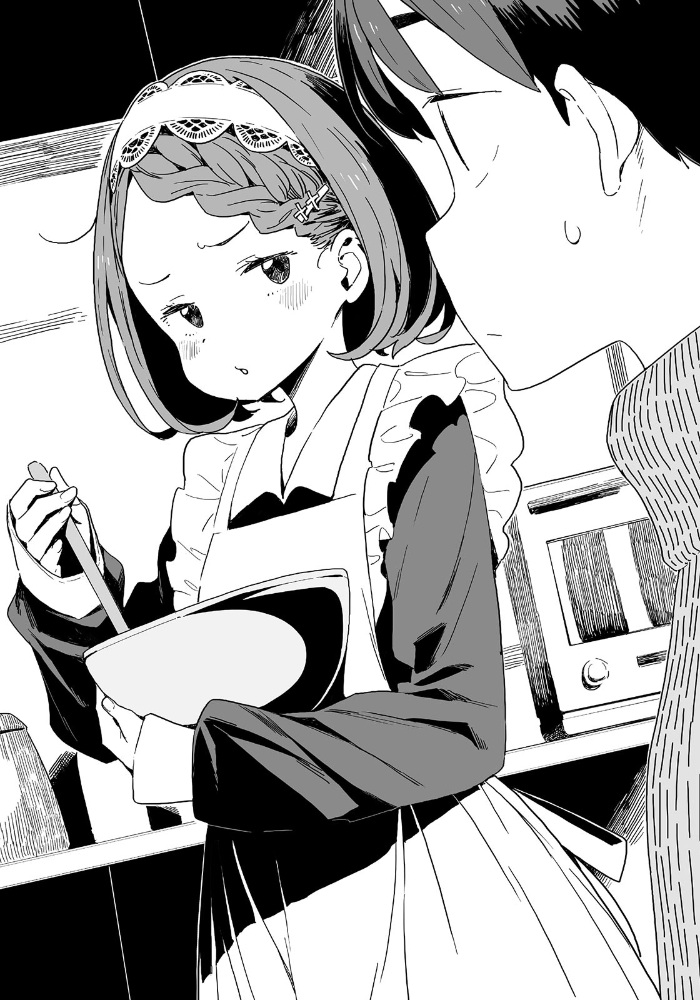

# Ch.33 — เล่ม 5 บทที่ 3-2

Ch.33 — เล่ม 5 บทที่ 3-2

By Monica

Published: 2025-04-22T10:33:44Z

Source: https://www.nekopost.net/novel/14560/33

เล่ม 5 บทที่ 3-2

ห้องเรียนทำขนมของคาจูกำลังเริ่มขึ้นแล้ว

คาจูหยิบเทอร์โมมิเตอร์ออกจากช็อกโกแลตที่ละลายแล้ว เธอยิ้มและพยักหน้า

[ โอเค ตอนนี้มัน 45 องศาแล้วค่ะ วางชามในน้ำแข็งแล้วคนส่วนผสมจากด้านล่างช้าๆได้เลยค่ะ ]

[ เอ๋ …อา ]

โคมาริส่งเสียงออกมา เธอวางชามช็อกโกแลตลงในน้ำแข็ง ไม่แน่ใจว่าเสียงนั้นเป็นการตอบรับหรือเป็นเสียงครวญครางกันแน่ คาจูซ่อนความชื่นชมของเธอไว้ไม่ได้เมื่อเห็นโคมาริคนช็อกโกแลตอย่างชำนาญ

[ โคมาริซังทำได้ดีมากเลยค่ะ เคยทำแบบนี้มาก่อนหรือเปล่าคะ? ]

[ เอ๊ะ? เอ่อ อ่า อืม ฉันเคยทำแบบนี้...แล้วก็ค-เค้กด้วย... ]

…เธอเหมือนจะหมดสติแล้ว ผมหยุดล้างจานทันที

[ เธอมักจะทำบิสกิตกับเค้ก แต่ไม่ทำช็อกโกแลต ใช่มั้ย โคมาริ ? ]

ใช่ๆใช่ โคมาริพยักหน้ารวดเร็ว

[ เข้าใจแล้วค่ะ คราวหน้าเราน่าจะอบเค้กด้วยกันนะคะ ]

โคมาริพยักหน้าอย่างแรงอีกครั้ง

…ลืมไป นี่คือพฤติกรรมของโคมาริเวลามีคนแปลกหน้าอยู่รอบๆ

เราจะทำยังไงให้คาจูบอกสิ่งที่เธอคิดจริงๆดีถ้าเธอยังเป็นแบบนี้อยู่ ? ผมเช็ดอุปกรณ์ที่ล้างแล้วขณะสังเกตดูสองสาว

[ พื้นฐานทั้งหมดเกี่ยวกับการควบคุมอุณหภูมิ รวมถึงปริมาณน้ำร้อนและช็อกโกแลตด้วยค่ะ ถ้าโคมาริซังเตรียมการมาดีก็จะทำได้เร็วมากขึ้นค่ะ โอ๊ะ การทำให้เย็นก็ทำได้ดีมากเลยค่ะ ตอนนี้เรามาเพิ่มอุณหภูมิเป็น 30 องศากันเถอะค่ะ ]

โคมาริพยักหน้าเงียบๆ ผมคิดว่าเธอน่าจะเลิกพูดไปแล้ว

[ ต่อไป วางกระดาษรองอบลงบนถาดตรงนั้นหน่อยค่ะ เราจะทำให้มันแข็งตัวครึ่งหนึ่ง จากนั้นเราจะทำช็อกโกแลตดิบจากอีกครึ่งหนึ่ง โอเคมั้ยคะ? ]

กะพริบ กะพริบ ตาของโคมาริกำลังขอความช่วยเหลือจากผม

เอ๊ะ ไม่รู้หรอกนะว่าเธอต้องการอะไร

โคมาริจ้องมองถาดและผม เอ่อ ถาดนั้นมีปัญหาอะไรอะ...?

[ เอ่อ คาจู ถาด... ]

[ อืม ถาดมีอะไรผิดปกติหรือเปล่าคะ? ]

ผมพูดต่อหลังจากที่โคมาริพยักหน้าซ้ำๆ

[ ถ้าใส่ทุกอย่างลงไปในถาดจะทำให้มันกลายเป็นแผ่นช็อกโกแลตขนาดใหญ่ใช่มั้ย? แล้วเราจะทำยังไงต่อจากนั้นล่ะ? ]

[ ใช่ค่ะ เราจำเป็นต้องตัดช็อกโกแลตออกเป็นชิ้นเล็กๆ แล้วทาชั้นช็อกโกแลตอีกที่ชั้นบนสุด นั่นเป็นวิธีที่เราสามารถเปลี่ยนรสชาติและสีของมันได้ นอกจากนี้ ปริมาณก็สำคัญมากถ้าเราจะเอาไปแลกเปลี่ยนหรือมอบให้กับผู้มาเยือนนะคะ? ]

เข้าใจแล้ว โคมาริดูเหมือนจะเข้าใจเหมือนกัน เธอพยักหน้าหลายครั้ง

แต่พวกเธอสองคนจะเลิกให้ผมเป็นล่ามได้ยัง..?

ในที่สุด ผมก็ถูกบังคับให้เข้าร่วมกิจกรรมในฐานะผู้รับผิดชอบโคมาริ

[ งั้น คาจู พี่อุ่นวิปครีมแบบนี้ได้มั้ย ? ตอนนี้เธอแค่ต้องผสมมันกับช็อกโกแลตแล้วปล่อยให้เย็นนิ ]

[ หืม ทำช็อกโกแลตดิบนี่มันง่ายกว่าที่คิดนะ ]

ผมคิดว่าโคมาริเริ่มคุ้นเคยกับห้องครัวของเราแล้ว เธอทำหน้าที่ของเธอได้อย่างชำนาญ

…พอสังเกตอีกครั้ง ชุดของยัยคนนี้มันบ้าไปแล้ว ชุดโกธิคโลลิต้าพร้อมผ้ากันเปื้อนฟูฟ่อง

โกธิคโลลิต้าตาอาจจะไม่ใช่สไตล์ของผม แต่เธอดูเหมือนสาวใช้ที่มีผ้ากันเปื้อนเลย

เพื่อนผู้หญิงในชั้นเดียวกันอาบน้ำในบ้านของผม และตอนนี้เธอกำลังทำอาหารแถมสวมกระโปรงกับถุงน่อง ใช่แล้ว นี่คือจินตนาการของนักเรียนมัธยมต้นแบบแท้ๆเลย

ยังไงก็เถอะ บอกได้เลยว่าผมได้บรรลุความฝันของผมจากอีกมุมหนึ่งแล้ว

บางทีเธออาจสังเกตเห็นสายตาของผม โคมาริจ้องมาที่ผมด้วยความสงสัย

[ เอ๊ะ …ท-ทำไมนายถึงจ้องฉันล่ะ...? ]

[ เปล่า แค่คิดว่าไม่ค่อยเห็นเธอโชว์หน้าผากเท่าไหร่ ]

อ๊ะ, ผมทำอีกแล้วเหรอ จะ #MeToo อีกครั้งหรือเปล่าเนี่ย ?

ผมเตรียมตัวโดนเธอตำหนิแล้ว แต่โคมาริก็ยังคงคนชามอยู่ เธอบ่นพึมพำ

[ อ-อันไหนดีกว่าล่ะ...? ]

[ ...เอ๊ะ? ]

นี่มันบทสนทนาอะไรกัน?

ผมแอบชำเลืองมองคาจู เธอกำลังหาวัตถุดิบจากชั้นวางในอีกฝั่งของครัว

[ เอ่อ ตอนนี้เธอดูดีมากเลย แต่ชินกับลุคปกติของเธอมากกว่า ]

[ ขะ-เข้าใจแล้ว… ]

[ อ-อ้อ… ]

...อย่างที่ผมบอกไป นี่มันบทสนทนาอะไรกัน?

ผมวางแผนจะสอบถามข้อมูลเกี่ยวกับเด็กหนุ่มทาจิบานะ จากคาจู นั่นแหละเหตุผล-

[ นี่ โคมาริ เธอไปถึงไหนแล้วล่ะ? เธอได้ถามคาจูหรือยังว่านางชอบใคร? ]

ผมพูดเล่นๆไปครึ่งหนึ่ง แต่โคมาริกลับยืดอกอย่างมั่นใจ

[ อุเอ๊ะ? อะ-อะ-อา ใช่แล้ว ป-ปล่อยให้เป็นหน้าที่ฉันเถอะ ฉันทำได้แน่ๆ ]

ขอร้องล่ะอย่าฝืนตัวเองเลย

ผมแค่ต้องการโอกาสจากโคมาริ ถ้าเธอทำได้ ผมก็สามารถใช้ทักษะการสื่อสารที่ผมเรียนรู้จากหนังสือเพื่อให้คาจูบอกความลับ-

[ พวกพี่สองคนคุยอะไรกันอยู่เหรอ? ให้คาจูเข้าร่วมด้วยได้มั้ย? ]

คาจูกลับมาพร้อมกับถุงถั่วผสม

ในตอนนั้น คาจูกับผมสบตากันก่อนที่เธอจะก้าวไปข้างหน้า

[ ค-คาจู...จัง! ]

[ คะ? ]

ดีมาก โคมาริ มาเริ่มคุยเรื่องความรักกันแบบใจเย็นๆดีกว่า-

โคมาริขยับเข้าไปใกล้เล็กน้อยและตะโกนออกมาด้วยเสียงสูง

[  บ-..บอกฉันหน่อยสิ ! ธ-เธอชอบใครเหรอ ]

เดี๋ยวก่อน เธอทำอะไรอยู่เนี่ย ?

ผมตกใจและยืนขวางหน้าเธอ คาจูมองมาด้วยตาใสซื่อ

[ คนที่คาจูแอบชอบ...ใช่มั้ย? ]

[ [ ช-ใช่… ] ]

พวกเราสองคนตอบพร้อมกันอย่างช่วยไม่ได้ คาจูหัวเราะเบาๆ

[ ไม่ใช่ความลับหรอกค่ะ แต่ถ้าบอกคนอื่นไปจะทำให้เขาลำบากน่ะค่ะ ]

[ เอ๊ะ? งั้นคนที่เธอรักจริงๆ คือ- ]

คาจูเอานิ้วแตะที่ริมฝีปากผมแล้วส่งรอยยิ้มไร้เดียงสาให้

[ อืม มันไม่ใช่ว่าหนูบอกไม่ได้หรอกนะคะ แต่ช่วงนี้มีเอลฟ์สาวที่ไม่เอาไหนบินวนเวียนรอบๆ คาจูอยู่เรื่อยๆ ]

[ [ หา! ] ]

โคมาริกับผมถอยหลังไปหนึ่งก้าวพร้อมกัน

[ น-น้องสาวของนายนี่เป็นเด็กที่แปลกจริงๆ เลย… ]

ไม่ใช่ว่าเธอพูดผิดหรอก แต่มันก็ไม่ใช่เรื่องนี้ซะทีเดียว

คาจูยิ้มพลางมองใบหน้าของโคมาริกับผม

[ เอลฟ์สาวคนนั้นไปที่ไหนก็ตามที่คาจูอยู่ตลอด บางครั้งเธอก็จะเปลี่ยนลุคและหลอกเพื่อนของคาจู บางครั้งก็พยายามสืบความลับของคาจู นี่ค่ะ อ้าม ]

คาจูใส่ช็อกโกแลตชิ้นเล็กๆ เข้าไปในปากของโคมาริกับผม

[ เธอมักจะทำตัวไม่ดีเสมอเลย พวกพี่สองคนคิดว่าไงล่ะคะ? ]

แล้วเธอก็แสดงรอยยิ้มที่สวยงามราวกับนางฟ้าให้เรา

โคมาริผู้ขี้อายจับแขนผมแน่น แต่เอาจริงๆ ผมเองก็รู้สึกกลัวจนตัวสั่น

[ มะ-แหม ถึงการแกล้งจะไม่ดี แต่บางทีเอลฟ์สาวคนนั้นอาจจะเป็นเอลฟ์ที่ดีนะ รู้มั้ย? เป็นเหมือนพวกสตอล์กเกอร์ที่มีเจตนาดีไง ]

[ น-นั่นมันไม่ดีเลยนะ หัดเรียนรู้ซะบ้างเถอะ ]

โคมาริเดินอ้อมคาจูมาและเริ่มตำหนิผม ยัยคนนี้เล่นงานผมซะแล้ว

คาจูจับแก้มของผมทั้งสองข้าง เธอถอนหายใจเบาๆ ขณะที่เธอเข้ามาใกล้ๆผมจนเราเกือบจะสัมผัสกัน

[ เพราะว่าเป็นเด็กไม่ดีแบบนี้──หนูไม่คิดจะบอกหรอกนะ ]

✧

ช่วงเย็นวันฤดูหนาวมักจะสั้น

ท้องฟ้าภายนอกมืดสนิท เสื้อผ้าของโคมาริก็แห้งสนิทแล้ว

ผมปิดประตูและหันหลังกลับ โคมาริกำลังยืนอยู่ภายใต้แสงไฟถนนสีขาวอย่างไม่สบายใจ

[ อ-อืม ไม่ต้องส่งฉันกลับหรอกนะ ฉันกลับเองได้ ]

[ ไม่ได้หรอก มืดแล้ว ฉันจะเดินไปส่งเธอที่สถานี ]

...แล้วคาจูจะโกรธแน่ถ้าผมไม่ทำแบบนี้

ผมยิ้มแห้งๆ ขณะที่หยิบกระเป๋าของโคมาริและเริ่มเดิน

แล้วผมก็รู้ว่าโคมาริยืนนิ่งไม่ขยับ

[ อ๊ะ ขอโทษที ฉันเคยทำแบบนี้เวลาออกไปไหนกับคาจู ]

ผมยื่นกระเป๋าให้โคมาริ แต่เธอกลับไม่สนใจและเดินข้างๆผมแทน

[ ข-ขอบค-คุณนะ ]

[ เอ๊ะ? อ๋อ ไม่เป็นไร... ]

เอ๊ะ? คิดว่าเธอจะโกรธและด่าแรงๆซะอีก แต่กลับไม่ใช่ ทำไมเอารู้สึกแปลกๆแหะ...

ความเงียบเข้าปกคลุมขณะที่เราก้าวเข้าไปบนถนนที่เงียบสงบ

...เอ่อ ผมควรพูดอะไรสักอย่าง

[ ขอบคุณที่ช่วยดูแลคาจูวันนี้นะ โคมาริ ]

[ ก-ก็เรื่องเล็กๆ แค่นี้ฉันจัดการได้สบายๆอยู่แล้ว ]

โคมาริเล่นผมถักสามเส้นที่คาจูทำให้ด้วยท่าทีเขินอาย

[ ถึงเราจะไม่ได้ข้อมูลอะไรจากคาจูเลยก็ตาม ]

ผมพึมพำอย่างเย้ยหยันตัวเอง โคมาริพยักหน้าอย่างภูมิใจ

[ อ-อืม เราเหลืออีกแค่นิดเดียว ]

จริงเหรอ? ถ้าเธอว่าอย่างนั้นก็...เอ่อ งั้นก็คงใช่...

[ ง-งั้น ขั้นตอนต่อไปของผ-แผนคือ ? ]

เอ๊ะ? เรายังต้องทำต่อเหรอ? ขอโทษนะ แต่ไม่มีทางที่ผมกับโคมาริจะชนะคาจูได้เลย

[ ผมเปิดเผยความตั้งใจของผมไปแล้ว ตอนนี้เราควรสังเกตการณ์ก่อน ]

[ จ-จริงเหรอ? ]

[ ในสถานการณ์แบบนี้ การตั้งสติและใจเย็นลงเป็นสิ่งจำเป็นนะ ]

นึกขึ้นได้ว่ามีอีกเรื่องที่ผมอยากถามเธอ

ผมก้มหัวลงและมองโคมาริที่อยู่ข้างๆ

[ ม-มีอะไรเหรอ? ]

[ ไม่มีอะไรหรอก แค่สงสัยว่าทำไมโคมาริถึงช่วยผมล่ะ ]

[ เอ๊ะ? ...ก-ก็... ]

ถ้าเป็นยานามิหรือยากิชิโอะ พวกเธออาจจะคิดว่าเรื่องนี้มันน่าสนุก

แต่ทำไมโคมาริถึงกระตือรือร้นขนาดนี้?

โคมาริเปิดปากพยายามจะพูดอะไรบางอย่าง แต่กลับออกมาเพียงไม่กี่คำ

[ ธ-เธอไม่ม-มาที่ห้องช-ชมรมตอนที่ร-เราคคุยกันเรื่องท-ทัวร์วันหยุดสุดสัปดาห์ ]

[ อ๋อ ไม่ๆ ทั้งสัปดาห์นี้ผมยุ่งตลอดน่ะ ]

[ ถ-ถ้าไม่มีสมาชิกใหม่ ร-เราก็จะต้องปิดชมรม ธ-เธอต้องคิดเรื่องนี้ให้ดีนะ ]

...พูดไม่ออก

ถึงแม้ว่าผู้เข้าชมทุกคนอาจจะไม่ได้เป็นนักเรียนที่สึวะบุกิ แต่บางคนอาจจะสอบเข้าก็ได้

สิ่งสำคัญคือการให้พวกเขาได้เห็นความประทับใจแรกที่ดี

[ ไม่เคยไปทัวร์ที่สึวะบุกิเลย วันนั้นเป็นยังไงบ้าง? ]

[ ฉ-ฉันก็ไม่เคยไป ฉ-ฉันคุยกับคนแปลกหน้าไม่เก่ง ]

...อืม เธอพูดถูก

ในการเข้าชมครั้งหน้า ได้ยินว่า ยากิชิโอะจะไปช่วยที่ชมรมกรีฑา ส่วนยานามิจะแยกจากชมรมวรรณกรรมไปนำทางผู้เข้าชม เลยจะเข้ามาสมทบกับทางนี้กลางคัน

พวกเราสองคนที่มีปัญหาเรื่องการสื่อสารจะทำหน้าที่รับรองได้ดีหรือเปล่านะ...

[ ว่าแต่ จะมีคนมาเยอะมั้ย? ]

[ จ-จากที่ฉันได้ยินมาจากรุ่นพี่ น่าจะเยอะ ฉ-ฉันคิดว่าพวกเขาน่าจะมาตามลำดับ ]

เข้าใจละ นั่นหมายความว่าพวกเขาอาจจะแค่แวะเข้ามาดูเท่านั้น แม้ว่าจะไม่ได้สนใจก็ตาม

แต่ผมไม่ค่อยถนัดกับการรับมือแบบนั้นเท่าไหร่ ถ้าเราโชว์รูปแมวก่อนเดี๋ยวค่อยมาจริงจังตอนยานามิมาถึง-

เรามาถึงถนนตรงข้ามบริเวณที่พักอาศัยขณะที่ผมกำลังคิดเรื่องนั้น

มันเป็นสถานีรถไฟหลังจากข้ามทางแยก

ผมคิดว่าส่งตรงนี้ก็พอแล้ว ผมต้องกลับไปและทำฉบับร่างที่ค้างคาให้เสร็จ

ผมกำลังจะยื่นกระเป๋าคืนให้เธอ แต่โคมาริวิ่งข้ามถนนไป

[ ฟ-ไฟกำลังจะเปลี่ยนนะ ร-รู้มั้ย? ]

[ เอ๊ะ รอด้วยสิ ]

ไม่มีทางเลือก ผมต้องตามเธอไป สัญญาณไฟเปลี่ยนเมื่อเราพ้นสถานีแล้ว

...เราต้องรอก่อนที่รถไฟจะมา

ผมกำลังมองรถที่วิ่งบนถนนอย่างเหม่อลอยโคมาริก็ยื่นมือเข้าไปในกระเป๋า

[ มีอะไรเหรอ โคมาริ? ]

[ อ-เอ่อ ช็อกโกแลตที่ฉันทำวันนี้น่ะ ]

หลังจากนั้นเธอก็หยิบถุงห่อสวยงามออกมา

มันคือช็อกโกแลตที่เธอทำในวันนี้

[ เอ๊ะ แล้วเธอห่อมันตั้งแต่เมื่อไหร่? ]

แทนที่จะตอบ โคมาริก็หลบสายตาและยื่นถุงให้ผม

[ ล-ลองชิมสิ ]

[ ทำไมเธอไม่ถามตอนนั้นเลยล่ะ ถ้าเธออยากให้ผมลอง- เอาล่ะ รู้แล้วๆ ]

ทำไมเธอถึงกล้าพูดตรงๆ แบบนี้นะ เธอมักจะกล้าหาญในที่ที่ไม่ควรเสมอเลย...

ผมรับถุงนั้นมาอย่างเลี่ยงไม่ได้ ภายในถุงมีช็อกโกแลต 4 ชนิดหลังจากที่ผมแกะริบบิ้นออก

ผมควรจะลองชิมมาหมดแล้วนะ...เอ๊ะ? แต่วันนี้เราเพิ่งทำช็อกโกแลตแค่ 3 ชนิดไม่ใช่เหรอ?

มีช็อกโกแลตรสนม รสขม และราสเบอร์รี่ - นอกจากนั้นยังมีช็อกโกแลตรูปหัวใจสีแดงสดอีกด้วย

ผมความจำเสื่อมเหรอ? ช่วงนี้เกิดเรื่องอะไรเยอะไปหมด...

ผมแกะห่อและใส่ช็อกโกแลตรูปหัวใจเข้าปากโดยไม่รู้ตัว

ความหวานขมๆ แผ่กระจายทั่วปาก - นี่มันแบล็คเคอร์แรนท์

ใช่แล้ว ผมคิดว่าคาจูเคยทำรสเดียวกันนี้มาก่อน งั้นเธอคงใช้ซอสที่เหลือจากตอนนั้นสินะ ตอนนี้ผมรู้แล้ว แต่จำไม่ได้เลยว่าเราทำช็อกโกแลตนี้กันตอนไหน...

ผมรู้ตัวว่าโคมาริกำลังจ้องผมขณะที่พยายามค้นความทรงจำอยู่

[ ...มีอะไรเหรอ โคมาริ? ]

[ เอ๊ะ!? ฉ-ฉันไม่ได้ม-มองนะ ]

เธอมองอยู่ใช่มั้ย?

[ ช็อกโกแลตนี้อร่อยดีนะ วันอาทิตย์จะโอเคใช่มั้ย? ]

[ ว-วันอาทิตย์...? ]

[ ก็ชมรมวรรณกรรมตกลงกันไว้ว่าจะแลกช็อกโกแลตตามารยาทในวันอาทิตย์นี้ไง? เหมือนกับว่าจะแจกให้กับผู้เยี่ยมด้วย..แล้วก็แสดงถึงพลังสาวๆอะไรของพวกเธอนั่นด้วย ]

[ อะ-ใช่ แต่ยานามิก็เป็นคนบอกนั่นแหละ ฉ-ฉันแค่คิดว่าฉันควรจะเป็นคนที่ให้ช็อกโกแลตตามมารยาทได้จริงๆเหรอ..]

เสียงของโคมาริเบาลง ผมอดไม่ได้ที่จะลดโทนเสียงตาม

[ เธอพูดอะไรน่ะ? ยานามิซังกับยากิชิโอะเป็นเพื่อนของเธอไม่ใช่เหรอ? ]

ผมยื่นถุงช็อกโกแลตให้โคมาริ

โคมาริก้มหน้าอยู่สักพัก จากนั้นเธอพยักหน้าเบาๆ และหยิบช็อกโกแลตชิ้นหนึ่ง

[ อ-อร่อยใช่มั้ย? ]

ผมพูดด้วยน้ำเสียงที่เหมือนกับแสดงละครอยู่ โคมาริตอบกลับมา

[ ฉ-ฉันยังไม่ได้ลองชิมเลย ]

โคมาริใส่ช็อกโกแลตเข้าปาก รอยยิ้มบางๆและเขินอายปรากฏขึ้นบนใบหน้าของเธอ

