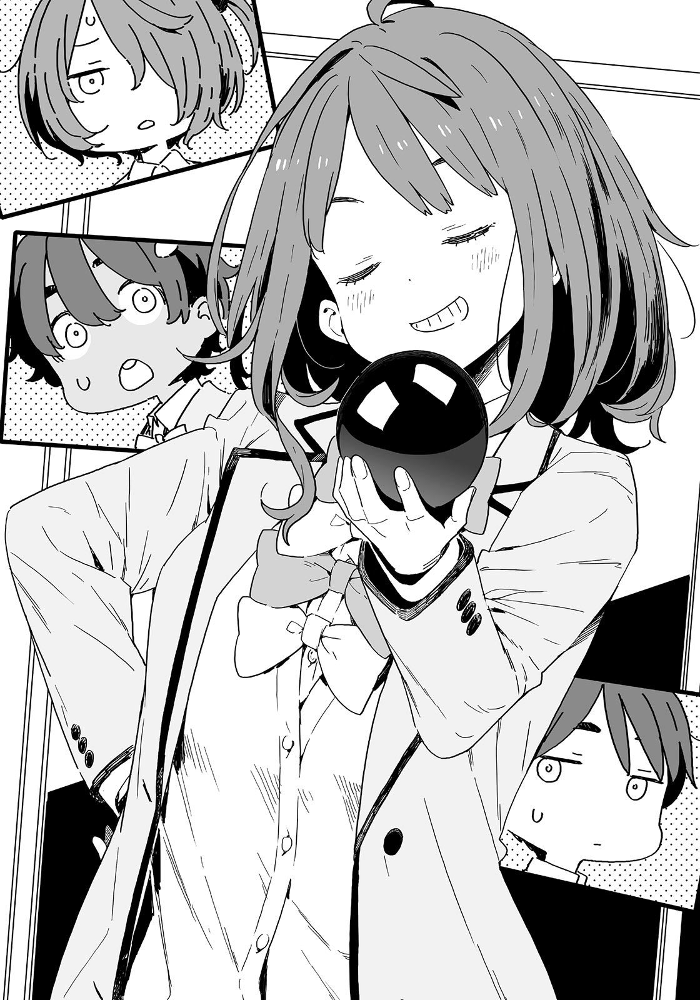

# Ch.37 — เล่ม 5 บทที่ 4-1

Ch.37 — เล่ม 5 บทที่ 4-1

By Monica

Published: 2025-04-22T10:34:30Z

Source: https://www.nekopost.net/novel/14560/37

เล่ม 5 บทที่ 4-1

<เล่ม5-4> พูดให้มันชัดเจนหน่อย ! =>

งานวันเปิดบ้านโรงเรียนมัธยมซึวะบุกิ

ตอนนี้เวลาเที่ยงครึ่ง มีสมาชิกชมรมวรรณกรรม 4 คน ล้อมรอบโต๊ะในห้อง

สาวๆ มองหน้ากันอย่างเงียบๆ ยากิชิโอะเป็นคนแรกที่หยิบกล่องออกมา

[ งั้นฉันจะเริ่มก่อนนะ! ดูนี่สิ ฉันภูมิใจมากเลย ]

เธอพูดพร้อมกับเปิดฝา มีช็อกโกแลตในรูปทรงที่แปลกประหลาดมากมายเต็มไปหมด

ยานามิกับโคมาริมองผมเงียบๆ

พวกเธอคงอยากให้ผมเป็นคนออกความเห็นสินะ…

[ อา...ก็ดีนะ ถ้าให้พูดละก็ นี่น่าจะเป็นอะมีบาที่เราเรียนในคาบชีวะ- ]

[ นี่คือดอกไม้ของซึวะบุกิ ส่วนต้นใบ... นุคคุง เมื่อกี้นายพูดอะไรน่ะ? ]

[ เปล่านะ หมายถึงดอกไม้ของซึวะบุกินี่แหละ... ]

[ นั่นมันใบ ]

[ แล้วอันนี้ล่ะเป็นดอกไม้? ]

[ นั่นก็ใบเหมือนกัน ]

...ทำไมมันยากแบบนี้อะ? เป็นเหมือนกับพวก captcha บนเว็บไซต์ต่างประเทศรึไง?

ยากิชิโอะมองผมด้วยสายตาไม่พอใจ

[ นี่ นุกคุง นายหยาบคายตั้งแต่เมื่อกี้แล้วนะรู้มั้ย? ]

เอาจริงๆ ผมควรให้ความคิดเห็นหลังจากลองชิมสินะ ผมหยิบชิ้นช็อกโกแลตที่บิดเบี้ยวมากๆ และเอาเข้าปาก

รสหวานของน้ำตาลพร้อมกับความกรุบกรอบกระจายไปทั่วลิ้น

มันให้รสชาติเหมือนช็อกโกแลตที่ถูกวางไว้ก้นกระเป๋านักเรียนมาเป็นเวลาครึ่งปี…

[ เอ่อ ก็.. อร่อยดี รู้สึกได้ถึงรสชาติที่สุกงอม… ]

ผมเลือกคำอย่างระมัดระวังและให้ความคิดเห็นไป ยากิชิโอะกัดชิ้นช็อกโกแลตท่าทางไม่เชื่อ

[ จริงเหรอ? ฉันว่ามันค่อนข้างแย่นะ นุคคุง นายนี่รสนิยมแปลกจริงๆ ]

เอ๋ มันจะแปลกได้ไง? ผมก็คิดว่ามันแย่อยู่เหมือนกันนะ

ดูเหมือนยานามิจะสนใจหลังจากได้ยินการสนทนาของเรา เธอหยิบชิ้นช็อกโกแลตขึ้นมาแล้วโยนเข้าปาก

[ โอ้ จะบรรยายรสชาติของช็อกโกแลตนี้เป็นคำพูดก็ยากเหมือนกันแหะ อุณหภูมิมันไม่ใช่ รู้สึกว่าถ้ากินไปเรื่อยๆจะติดใจ รู้สึกเหมือนย้อนอดีตด้วย มันเหมือนกับกำแพงดินที่ฉันเคยกินมาก่อนเลย ไม่รู้จะอธิบายยังไง... ]

ยานามิกำลังเคี้ยวอยู่ แล้วทำไมผู้หญิงคนนี้ถึงรู้รสชาติของกำแพงดินล่ะ...?

[ อะ-เอ่อ ฉ-ฉันทำอันนี้ ]

คราวนี้โคมาริหยิบกล่องเบนโตะออกมา ข้างในมีก็ช็อกโกแลตที่เธอมาทำที่บ้านผมเมื่อไม่กี่วันก่อน

มีรสขม รสนม แล้วก็รสแบล็กเคอแรนท์—

[ เอ๊ะ? แล้วช็อกโกแลตอันที่เป็นรูปหัวใจสีแดงล่ะ? ]

ผมค่อยๆพูดอย่างใจเย็น แต่จู่ๆ โคมาริก็หยุดชะงัก

[ เป็นอะไรไปเหรอ โคมาริ? ]

[ ฉ-ฉันทำอันนั้นแค่อันเดียว! ว-วัตถุดิบมันไม่พอ! ]

อ๋อ เธอคงใช้ซอสที่เหลือในบ้านผมสินะ

ก็เข้าใจได้อยู่แต่ทำไมเธอถึงหน้าแดงขนาดนั้นล่ะ…?

ยานามิกินช็อกโกแลตของยากิชิโอะไปเยอะแล้ว เธอหันไปมองช็อกโกแลตของโคมาริ

[ ยานามิซัง เราต้องเก็บไว้ให้ผู้เยี่ยมชมนะ? อย่ากินหมดล่ะ ]

[ รู้แล้วน่า แล้วก็ ฉันทำช็อกโกแลตของฉันเองมาด้วยนะ ]

[ ช็อกโกแลตของยานะจังเป็นไงเหรอ? ]

ยากิชิโอะกำลังเคี้ยวช็อกโกแลตของโคมาริในขณะที่ถามออกไป

[ ฉันอยากช่วยให้ทุกคนทำตามความฝันให้สำเร็จ นั่นคือเหตุผลที่ฉันทำช็อกโกแลตนี้ ]

แลดูเหมือนจะเต็มไปด้วยความรู้สึก

ยานามิหยิบกล่องทรงสูงออกมาแล้วเปิดฝาอย่างระมัดระวัง คิดว่ามันน่าจะเป็นกล่องเค้ก

[ ทาดา ! นี่คือช็อกโกแลตพิเศษจากยานามิจัง ]

มีช็อกโกแลตรูปทรงกลมขนาดเท่าลูกเบสบอลอยู่ข้างในกล่อง

ทั้งสามคน รวมถึงผม ตกอยู่ในความเงียบ ผมเลยเป็นตัวแทนพูดขึ้น…

[ เอ่อ…มีแค่อันนี้เหรอ? ]

[ ใช่ ฉันปิ๊งไอเดียแล้วก็ผสมวัตถุดิบทุกอย่างลงไปในช็อกโกแลตนี้น่ะ แล้วก็ จะทำให้ช็อกโกแลตกลมขนาดนี้มันไม่ง่ายเลยนะ ]

[ แล้วพวกเราจะกินกันยังไง? ]

เป็นคำถามที่จริงจังดีมาก ยานามิเอียงคอด้วยความงุนงง

[ เอ๊ะ? ก็แค่กัดเลยสิ ]

ยานามิกัดช็อกโกแลตบอลนั้นแล้วส่งต่อให้ยากิชิโอะ

ยากิชิโอะกัดไปอย่างงงๆ ตามด้วยโคมาริ สุดท้ายมันก็มาอยู่ในมือผมแล้ว

เห็นรอยกัดสามรอย ผมตัดสินใจกัดส่วนเล็กๆ ที่อยู่ไกลสุด

มัน…ก็รสช็อกโกแลตนั่นแหละ ใช่ มันก็ช็อกโกแลตธรรมดา

[...เราให้ผู้เยี่ยมชมกินไอนี่ไม่ได้หรอก ]

ยานามิมองผมด้วยสายตาไม่พอใจหลังจากวางช็อกโกแลตกลับเข้ากล่องอย่างระมัดระวัง

[ นุคุมิซึคุง ถ้านายจะว่าของคนอื่น งั้นนายก็ควรจะเอาช็อกโกแลตของตัวเองมาด้วยนะ ]

[ เอ๊ะ? ต้องเตรียมด้วยเหรอ? ]

[ แน่นอนสิ ฉันบอกนายไปแล้วนะ ถึงฉันจะไม่ได้อธิบายละเอียด แต่นายควรจะคิดถึงสถานการณ์และความรู้สึกของคนอื่นบ้าง ถ้าแค่เตรียมช็อกโกแลตมานายยังทำไม่ได้ แล้วพวกเราจะทำยังไง? ]

เอ่อ…ยานามิเป็นคนสุดท้ายที่ผมอยากให้มาเป็นหัวหน้าในอนาคตเลย อ๊ะ แต่-

[ ผมได้ช็อกโกแลตมาก่อนออกมาแล้วน่ะ ไม่ได้ทำเองหรอก แต่ถ้าพวกเธอไม่รังเกียจ ก็เอาไปเถอะ ]

ผมหยิบกล่องช็อกโกแลตออกมาจากกระเป๋านักเรียน สายตาของทั้งสามคนเบิกกว้าง

[ ค-ใครให้นายมา? ]

[ ฉันว่า นุคุมิซึคุงน่าจะซื้อมาเองแน่ๆ นายซื้อที่คาลเมียเหรอ? ที่นั่นมีของอร่อยเยอะเลยนะรู้มั้ย? ]

รู้สึกเหมือนพวกเธอกำลังพูดว่าร้ายผมอยู่

[ ไม่อะ ได้มาจากคนอื่นจริงๆ ผมไม่โกหกเรื่องน่าสมเพชแบบนั้นหรอก ]

แล้วจู่ๆ ยากิชิโอะก็ดึงกล่องออกจากมือผมไป

[ เฮ้ ใช้ได้เลยนี่นุคคุง ใครให้นายมาหรอ? ]

[ หมายความว่าไง-ได้ช็อกโกแลตนี้มาจากแม่ต่างหาก ]

ยานามิกับโคมารินั่งลงหลังจากที่ลุกขึ้นมา

[ ว-ว่าแล้วเชียว]

[ ก็เป็นนุคุมิซึคุงนี่นา ปกติแหละ ]

สาวๆ เปิดกล่องแล้วก็เริ่มกินช็อกโกแลตโดยไม่ได้ขออนุญาตจากผม

ก่อนอื่นเลย พวกเธอเอาช็อกโกแลตของผมไป อย่างที่สองทำไมผมถึงโดนล้ออยู่ล่ะ?

[ แม่บอกให้เอาช็อกโกแลตมาและแบ่งให้ทุกคน- แต่ว่านะ ยานามิซัง ไม่ได้หมายความว่าเธอจะกินหมดเลยได้เลยนะ เธอฟังอยู่มั้ยเนี่ย ? ]

ผมดึงกล่องช็อกโกแลตกลับมาในขณะที่จัดการตารางงานวันนี้ในหัว

หลังจากนี้ ทุกคนยกเว้นโคมาริต้องไปรอผู้เยี่ยมชมที่โรงยิม

หลังจากแนะนำเบื้องต้นเสร็จ จะมีแค่ผู้เยี่ยมชมที่มีเวลาอิสระ นั่นแหละเวลาที่ผมจะกลับไปที่ห้องชมรม

โคมาริต้องอยู่ในห้องชมรมตั้งแต่ต้นจนจบ ถ้ามีผู้เยี่ยมชมมาก่อนที่พวกเราจะกลับ เธอจะต้องรับมือคนเดียว และใช่ โคมาริต้องอยู่ตามลำพัง—

[ ว-ว่าไง? ทำไมนายจ้องฉันแบบนั้นล่ะ? ]

[ เอ่อ ไม่มีอะไรหรอก ]

มาคิดๆดูแล้ว ยังไม่ได้บอกโคมาริเลยว่าผมไปเป็นไกด์นำผู้เยี่ยมชม…

ผมเปิดเอกสารเพื่อหลีกเลี่ยงการสบตากับเธอ หลังจากนั้น ยานามิเช็ดปากแล้วลุกขึ้น

[ เลม่อนจัง นุคุมิซึคุง ใกล้ได้เวลาแล้ว ไปกันเถอะ ]

[ ใช่ๆ นี่ นุคคุง ลุกมาได้แล้ว ]

ผมลุกขึ้นอย่างช้าๆ แล้วตาของโคมาริก็เริ่มสั่น

[ เอ๊ะ…น-นุคุมิซึก็ไปด้วยเหรอ? ]

[ มีคนแต่งตั้งให้ผมเป็นไกด์น่ะ จะกลับมาทีหลัง ก่อนอื่น ขอฝากเธอจัดการด้วยนะ ]

ผมไม่มองหน้าเธอ โคมาริจับแขนเสื้อผมไว้ตอนที่ผมเตรียมจะออกจากห้อง

[ ต-แต่ฉันจ-จัดการคนเดียวไม่ได้นะ…! ]

[ แต่ผมต้องไปนะ นี่ยานามิซัง- ]

ผมหันไปขอความช่วยเหลือ แต่ยานามิกับยากิชิโอะหายไปแล้ว

[ สองคนนั้นหนีไปแล้ว-เฮ้ อย่าดึงเสื้อฉันสิ! ]

เรื่องเริ่มยุ่งยากแล้ว ผมไปไหนไม่ได้เลย แล้วผมก็สังเกตเห็นผู้หญิงคนนึงที่ยืนโผล่หน้าเข้ามาครึ่งหนึ่งตรงประตูที่เปิดอยู่

[ เซ็นเซ ! ]

[ ต้องการให้ช่วยมั้ย ? ]

เธอเดินเข้ามาในห้องชมรมด้วยท่างทางสบายๆ เธอเป็นที่ปรึกษาของชมรมวรรณกรรมและเป็นพยาบาลโรงเรียน โคนุกิ ซาโยะ

คนๆนี้มีปัญหาหลายอย่าง แต่ผมคิดว่าก็ยังดีกว่าอีกคน

[ มาได้ถูกจังหวะพอดีเลย ผมต้องไปเป็นไกด์นำทางผู้เยี่ยมชมแล้ว ช่วยอยู่ในห้องชมรมและต้อนรับผู้เยี่ยมชมไปพร้อมกับโคมาริได้มั้ยครับ ? ]

[ เอ๊ะ!? ]

โคมาริร้องออกมาเบาๆ เธอวิ่งไปที่มุมห้องชมรม

โคนุกิเซนเซย์เลียริมฝีปากและนั่งลงที่โต๊ะตรงข้ามกับโคมาริ

[ ฝากฉันจัดการเอง ถึงจะเห็นเป็นแบบนี้ แต่เซ็นเซก็รู้ดีว่าไม่ควรทำเรื่องแย่ๆ กับเด็กมัธยมต้นนะ ]

เข้าใจแล้ว โล่งใจขึ้นมาหน่อย

[ งั้น ผมฝากด้วยนะครับ โคมาริเธอก็ฟังที่เซนเซบอกด้ว ]

[ ป-ไปตายซะ…! ]

ผมทิ้งโคมาริที่ตัวสั่นอยู่แล้วเดินออกจากห้องชมรมไป

เมื่อวาน คาจูทำช็อกโกแลตสำหรับวันวาเลนไทน์

ถ้าช็อกโกแลตนี้ไม่ใช่ของผม วันนี้เธอคงจะให้คนอื่นแล้ว และคนๆนั้นคือ…

ผมส่ายหัวเยาะเย้ยตัวเองไปมา มันต้องเป็นคนอื่นแน่ๆ

คาจูกับทาจิบานะคุงเริ่มคบกันแล้วหรือยัง? หรือว่าเธอจะสารภาพรักวันนี้…?

ผมตบแก้มตัวเองเบาๆ เพื่อให้มีกำลังใจขึ้น แล้วรีบเดินไปที่โรงยิม

คิดมากไปก็ไม่มีประโยชน์ ปล่อยไปตามน้ำดีกว่า

✧

บรรยากาศในโรงยิมคึกคักไปด้วยชีวิตชีวา

ผมมองเห็นนักเรียนหลายคนจากโรงเรียนมัธยมต้นต่างๆในเมือง ทุกคนแต่งชุดนักเรียนกันอย่างเรียบร้อย เกาะเป็นกลุ่มใหญ่อยู่จำนวนไม่น้อย

ผมสงสัยว่าจะมีนักเรียนกี่คนที่จะกลายมาเป็นรุ่นน้องของผม

พอมองที่กำแพงของโรงยิม ก็เห็นสมาชิกสภานักเรียนกำลังจัดแถวผู้มาเยือนตามโรงเรียนของพวกเขา

วันนี้ คาจูมอบหมายให้ผมเป็นคนนำทัวร์ของเธอ

ทาจิบานะคุงก็มาด้วย—บางทีคาจูอาจตั้งใจจะแนะนำเขาให้ผมรู้จัก

เพื่อนของเธอ กอนโด ก็อยู่ที่นี่เช่นกัน บางทีเธออาจช่วยทำให้สถานการณ์ผ่อนคลายขึ้นหากเกิดการทะเลาะกัน แน่นอนว่าต้องดูว่าเธออยู่ข้างคาจูมั้ย

ผมตกอยู่ในภวังค์ จากนั้นกลิ่นดอกไม้ที่คุ้นเคยก็เข้ามาอบอวลในจมูก

ทำนองเพลงที่คุ้นเคยเริ่มบรรเลงในใจของผม

[ นุคุมิซึคุง ฉันยืนข้างๆนายได้มั้ย ? ]

[ เอ๋ ? แน่นอนสิ ]

ฮิเมมิยะ คาเรน มายืนอยู่ข้างๆผม เธอเป็นนางเอกผู้ที่ชนะและกลายมาเป็นแฟนของฮาคามาดะ โซสุเกะ ยานามินับเธอว่าเป็นคู่แข่งในด้านความรัก

อืม คิดๆ แล้วก็เป็นแบบนั้นจริงๆ—

[ วันนี้เธอไม่ได้อยู่กับฮาคามาดะหรอ? ]

[ ฟุฟุ โซสุเกะจะมาที่บ้านฉันแล้วทำอาหารให้ เขาอยากเซอร์ไพรส์ฉันน่ะ ]

นี่คือ "ธุระ" ที่ฮากามาดะพูดถึงก่อนหน้านี้สินะ?

[ เซอร์ไพรส์? …แต่ฮิเมมิยะซังก็รู้แล้วนี่ ]

[ เขาเป็นคนซุ่มซ่ามเสมอเลย ฉันคิดว่าตรงนี้ของเขาก็น่ารักดีนะ ]

ฮิเมมิยะซังไม่ตอบตรงๆ เธอเล่าถึงความรักของเธอด้วยท่าทีสบายๆ ก่อนจะมองไปรอบๆ อย่างผ่อนคลาย

[ นุคุมิซึคุง วันนี้เป็นวันวาเลนไทน์ นายได้ช็อกโกแลตหรือเปล่า?]

…หา? นี่เป็นวิธีที่พวกชอบเข้าสมคมแหย่พวกชอบเก็บตัวสินะ?

ผทปิดหัวใจบางส่วนแล้วตอบไปพร้อมกัน

[ ได้จากแม่เมื่อเช้านี้น่ะ น่าจะนับได้นะ? ]

[ อ๋อ …อันนะไม่ได้ให้ช็อกโกแลตนายเหรอ? ]

[ ฮะ เธอไม่ได้ให้มาเป็นพิเศษหรอก ]

ช็อกโกแลตในห้องชมรม—ไม่ใช่ของผม

…แปลกจัง ดูเหมือนฮิเมมิยะซังจะผิดหวัง

รู้สึกเหมือนทำนองเพลงในใจเริ่มเงียบลงเช่นกัน

[ เมื่อวานนี้ ฉันทำช็อกโกแลตกับอันนะที่บ้าน ]

เอ๊ะ ไม่รู้มาก่อนเลยว่าเธอทำช็อกโกแลตทรงกลมแปลกประหลาดนั่นที่บ้านฮิเมมิยะซัง

ฮิเมมิยะซังเผยให้เห็นฟันขาวๆ ของเธอแล้วโน้มตัวเข้ามาหาผม เธอจ้องเขม็งมาที่หน้าผม

[ เธอทุ่มเทมากเลยนะ ฉันเลยสงสัยว่าเธอกำลังจะให้กับคนที่สำคัญสำหรับเธอหรือเปล่า ? ]

คนสำคัญ? หมายความว่าฮิเมมิยะซังคิดว่าอันนะเป็นคนประเภทที่ให้สิ่งของกับผู้ชายที่เธอชอบงั้นเหรอ?

แน่นอนว่าผมไม่ปฏิเสธ แต่ครั้งนี้เป็นครั้งเดียวที่รู้สึกแย่แทนเธอนิดหน่อย...

[ เอ่อ สมาชิกชมรมวรรณกรรมทุกคนเอาช็อกโกแลตมาด้วย เรากำลังวางแผนที่จะให้ผู้เยี่ยมชมลองชิมกัน , เธอทำช็อกโกแลตทรงกลมนั่นใช่มั้ย? ]

[ โอ๊ะ ใช่ๆ , ว้าว จะให้ผู้เยี่ยมชมชิมช็อกโกแลตนั่นด้วยสินะ ]

[ จะพูดยังไงดี… พอลองชิมแล้วเราคงไม่เอาช็อกโกแลตของเธอให้คนอื่นกินแล้ว ]

[ เอ๊ะ ทำไมล่ะ? ]

ฮิเมมิยะซังเอียงคอน่ารักๆ ด้วยความสงสัย

ทำไมน่ะเหรอ—รอยกัดของคนสามคนลอยเข้ามาในความคิดของผม

[ ผมไม่ให้คนอื่นกินช็อกโกแลตของยานามิซังหรอก ]

ทำนองเพลงในใจของฮิเมมิยะซังเริ่มสับสนวุ่นวายขึ้นหลังจากที่ผมพูดแบบนั้นไปโดยไม่ทันคิด

[ เอ๊ะ!? หมายความว่า…แบบนั้น? ]

[ ...ใช่ หมายถึงแบบนั้นแหละ ]

ผมตอบไปอย่างขอไปที ฮิเมมิยะซังแสดงสีหน้าเหมือนตกใจมากขึ้นไปอีก

[ โห... นุคุมิซึคุง ไม่คิดเลยว่านายจะจริงจังขนาดนี้ ]

[ ก็ไม่รู้เหมือนกันว่ามันคือความจริงจังหรือความรับผิดชอบ เอ่อ... แต่ยังไงก็เถอะ รู้สึกเหมือนว่าผมต้องรับผิดชอบน่ะ ]

ยังไงผมก็เป็นประธานชมรมวรรณกรรม ผมให้คนอื่นมากินช็อกโกแลตที่มีรอยฟันของเด็กสาวมัธยมปลายไม่ได้หรอก

ดวงตาของฮิเมมิยะซังเบิกกว้างขึ้นไปอีกหลังจากที่ผมพูดแบบนั้น

[ รับผิดชอบ!? นุคุมิซึคุง พวกเธอสองคนไปถึงขนาดนั้นแล้วเหรอ!? ]

ท่าทีของฮิเมมิยะซังดูเกินจริงไปมาก

แน่นอนว่านั่นเป็นเพราะเธอไม่รู้ว่าผมเป็นประธานชมรมวรรณกรรม แต่มันน่าตกใจขนาดนั้นเลยเหรอ? ...ผมรู้สึกตกใจนิดหน่อยเหมือนกัน

[ เอ่อ... ใช่ ก็เป็นแบบนี้มานานแล้วนะ ]

[ อ-อืม... เข้าใจแล้ว... พวกเธอสองคนเป็นแบบนี้มานานแล้วสินะ ]

ท่าทีของเธอทำผมสงสัย? จริงๆ แล้วผมกับฮิเมมิยะซังไม่เคยเข้ากันได้เลยเวลาคุยกัน...

ฮิเมมิยะซังดูตื่นเต้นมากเกินไป นั่นทำให้ผมต้องทนกับช่วงเวลาที่น่าอึดอัดใจนี้

---
