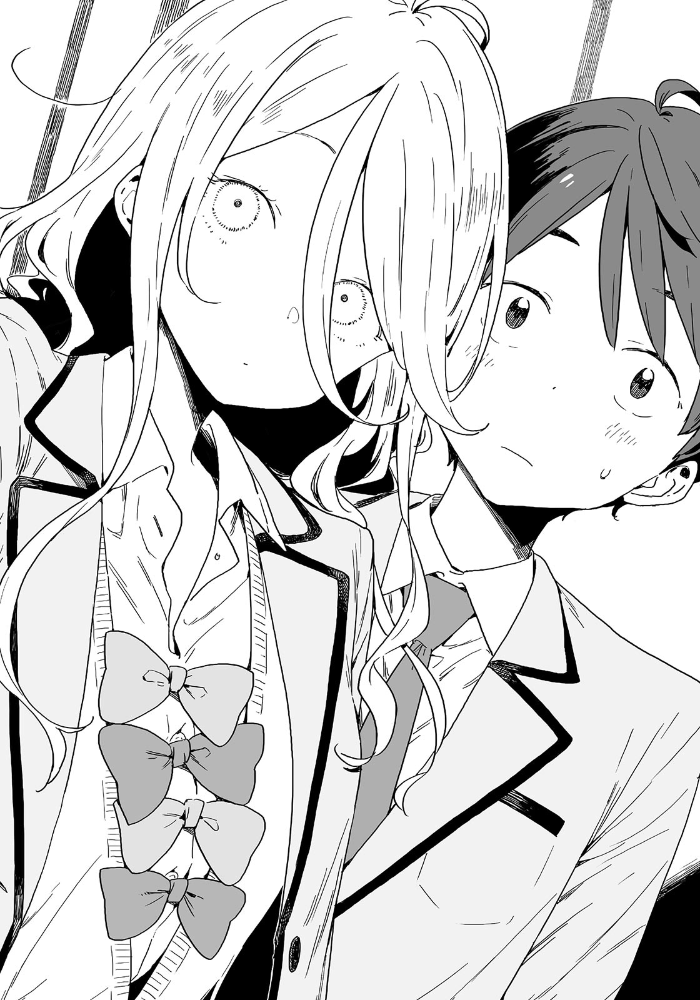

# Ch.40 — เล่ม 5 บทที่ 4-4

Ch.40 — เล่ม 5 บทที่ 4-4

By Monica

Published: 2025-04-22T10:35:36Z

Source: https://www.nekopost.net/novel/14560/40

เล่ม 5 บทที่ 4-4

ชั้นเรียนสาธารณะของอามานัตสึเซนเซได้เริ่มขึ้นแล้ว

โต๊ะและเก้าอี้ที่เคยจัดเรียงตามปกติถูกดันไปที่มุมห้อง กระดานไวท์บอร์ดตั้งอยู่ใกล้หน้าต่าง ทุกเก้าอี้มีล้อเลื่อน ทุกคนสามารถเลือกนั่งตรงไหนก็ได้ตามใจชอบ

หลังจากเห็นคาจูกับเพื่อนๆ นั่งลง ผมจึงตัดสินใจยืนฟังบทเรียนอยู่แถวๆ ประตูห้องเรียน

จำได้ว่าชั้นเรียนสาธารณะมีไว้ให้ผู้เยี่ยมชมได้เข้าใจถึงบรรยากาศการเรียนการสอนปกติ แต่ผมไม่เคยเข้าร่วมชั้นเรียนพิเศษแบบนี้มาก่อนเลยนะ…?

เมื่อผู้เยี่ยมชมหลายสิบคนนั่งลงครบแล้ว อามานัตสึเซนเซก็ก้าวมายืนหน้ากระดานไวท์บอร์ด

[ เอาล่ะ ฉันชื่ออามานัตสึ ฉันสอนวิชาประวัติศาสตร์โลกที่โรงเรียนนี้ ]

ทุกคนหันมามองเธอ หลังจากนั้นเธอก็ไอเล็กน้อยและหยิบหนังสือเรียนขึ้นมา

อามานัตสึจัง เธอคือครูตัวแทนของโรงเรียนซึวะบุกิ ขอฝากด้วยนะ

[ บางคนบอกว่าการจำวันที่ในบทเรียนวิชาประวัติศาสตร์มันไม่มีประโยชน์ แถมบอกอีกว่าตอนโตขึ้นเราจะไม่ได้ใช้มันเลย ฉันคิดว่าคนเหล่านี้ควรฆ่〇ตัวตุยซะ ]

ขอฝาก……ด้วยนะ?

[ เอาล่ะ ฉันอยากถามความคิดเห็นของพวกเธอเกี่ยวกับบทเรียนวิชาพละศึกษาหน่อย ฉันรู้อยู่แล้วว่าเด็กๆ คงอยากพูดว่า ‘พวกเราจะเป็นผู้ใหญ่แล้ว ไม่ต้องบอกว่าเราต้องหาเลี้ยงชีพด้วยการกระโดดข้ามกล่องหรือแยกขาหรือหมุนตัวไปข้างหน้าหรอก’ แต่เซนเซก็เป็นผู้ใหญ่แล้ว ฉันจะไม่พูดมาก เอาล่ะ บทเรียนจะเริ่มแล้ว ]

ป๊อก อามานัตสึเซนเซเปิดฝาปากกา

ดูเหมือนความมืดในใจของเธอจะสงบลงแล้ว ตอนนี้ถึงเวลาเรียนอย่างจริงจังแล้ว-

[ อ๊ะ นั่นประธานชมรมวรรณกรรม นุคุมิซึ ! ]

จู่ๆ เธอก็ลากผมเข้ามา

[ เอ่อ มีอะไรให้ช่วยเหรอครับ? ]

[ หนังสือเล่มเก่าที่สุดที่เธอรู้จักคืออะไร? ]

ทุกคนหันมามองผม ผมตกใจและรีบพยายามนึกหาคำตอบ

[ เอ่อ <ตำนานเก็นจิ> ไงครับ…? ]

อามานัตสึเซนเซพยักหน้าและเริ่มเขียนลงบนกระดานไวท์บอร์ด

[ ถูกต้อง มีการยอมรับกันทั่วว่าตำนานเก็นจิคือหนังสือเล่มเก่าที่สุด มันถูกเขียนขึ้นในช่วงต้นศตวรรษที่ 11 ในขณะเดียวกันจักรวรรดิไบแซนไทน์กำลังอยู่ในยุครุ่งเรืองในยุโรปตะวันออก ]

อามานัตสึเซนเซยังคงสอนต่อไปโดยไม่หยุด

[ ในขณะเดียวกัน ญี่ปุ่นอยู่ในยุคเฮอัน ในเวลานั้นข้ารับใช้ในวังเขียนนิยายที่มีเนื้อหาค่อนข้างวาบหวาม มันถูกส่งต่อไปทั่ววัง จนกระทั่งจักรพรรดิอิจิโจได้อ่านด้วย ส่วนทางด้านไบแซนไทน์ พวกเขาชนะในสมรภูมิไคลเดียนและจับเชลยได้กว่า 10,000 คน ชาวโรมันตะวันออกควักลูกตาของเชลยออกและส่งพวกเขากลับประเทศ- ]

…ดูเหมือนว่าเธอจะเข้าสู่โหมดครูจริงๆ แล้ว

หลังจากนั้น อามานัตสึเซนเซโยนหัวข้อออกมาให้ผู้เยี่ยมชมได้พูดคุยกัน บทเรียนดำเนินไปอย่างเรียบร้อย หัวข้อในวันนี้ดูเหมือนจะเกี่ยวกับความแตกต่างระหว่างวิธีคิดและความรู้ทั่วไปของผู้คนในยุคสมัยและวัฒนธรรมที่ต่างกัน

บรรยากาศเริ่มสบายขึ้นเล็กน้อย ตอนนี้ อามานัตสึเซนเซแบ่งผู้เยี่ยมชมออกเป็นสองกลุ่ม

[ จากที่ได้ฟังมา กลุ่มนี้จะเป็นชาวปารีสในศตวรรษที่ 14 ส่วนอีกกลุ่มจะเป็นชาวญี่ปุ่นในศตวรรษที่ 21 ที่ย้อนเวลากลับไป ทั้งสองกลุ่มจะต้องคิดวิธีแก้ปัญหาโรคระบาดแบล็คเดธ(กาฬมรณะ)ในยุคนั้น ]

อามานัตสึเซนเซย์กอดอกและยืนอยู่ระหว่างสองกลุ่มด้วยความภูมิใจ

[ เซนเซย์จะเป็นคนดำเนินการเอง และฉันเกิดในศตวรรษที่ 23 ตัวละครของฉันเป็นนักทฤษฎีสมคบคิดที่ดื้อรั้น ]

อะไรเนี่ย จะทำให้มันซับซ้อนทำไม ?

บทเรียนกำลังดำเนินไปอย่างราบรื่น อามานัตสึเซนเซมอบหัวข้อที่เหมาะสมให้กับนักเรียนที่ค่อนข้างขี้อายและปล่อยให้พวกเขามีปฏิสัมพันธ์กันไปพร้อมกัน เธอยังค่อยๆ ชี้นำให้ทุกคนได้พูดในที่สาธารณะ ผมพอใจกับวิธีการของเซนเซมาก อย่างไรก็ตามในช่วงเวลานั้น-

แชะ ผมได้ยินเสียงถ่ายรูป

ผมหันกลับไปชิกิยะซังยืนอยู่ข้าง ๆ ผม เธอกำลังเลือกมุมเพื่อถ่ายรูปด้วยโทรศัพท์ของเธอ

[ อ่า รุ่นพี่ชิกิยะ สภานักเรียนต้องถ่ายรูปด้วยเหรอ? ]

[ ถ่ายภาพ...รายงาน... ]

ชิกิยะซังตรวจสอบรูปที่เธอถ่ายได้ เธอหยุดถ่ายรูปแล้วมายืนข้าง ๆ ผมโดยที่โอนเอนเล็กน้อย

เธอพึมพำอะไรบางอย่าง จากนั้นเธอก็ถ่ายรูปผม

[ ทำไมถึงถ่ายรูปผมล่ะ? ]

[ รู้สึกว่า...มีใครบางคนอยากได้น่ะ… ]

ชิกิยะซังพูดแปลก ๆ ก่อนจะเริ่มพิมพ์ในโทรศัพท์ของเธอ

[ ถ้าเป็นรูปของรุ่นพี่ก็ว่าไปอย่าง แต่ไม่มีใครอยากได้รูปของผมหรอกนะ? ]

ผมหัวเราะกับตัวเองแต่ชิกิยะซังยังนิ่งเหมือนเดิม

[ ...นาย...อยากได้รูปฉันมั้ย? ]

[ ห้ะ ? ]

ชิกิยะซังเอียงคอเล็กน้อย ดวงตาสีขาวของเธอสะท้อนภาพใบหน้าของผมอย่างเลือนราง

[ เอ่อ... เดี๋ยวต้องถามความคิดเห็นจากทุกคนก่อนมั้ย หรือดูว่ามีใครอยากได้รูปนี้บ้าง ]

ผมพูดไร้สาระไปเรื่อย ชิกิยะซังหันมาและเอนตัวเข้ามาหาผม

หลังจากนั้น เธอยื่นมือออกมา— แชะ! แล้วก็กดปุ่มเซลฟี่...

[ ฉันให้....รูปนี้กับนาย....อย่าไปซื้อจากคนอื่นนะ…โอเคมั้ย..? ]

ผมได้รับข้อความแจ้งเตือนในโทรศัพท์ 'ส่งรูปภาพแล้ว'

[ เอ๊ะ อ่า รูปนี่…ให้ผมเหรอ? ]

ชิกิยะซังพยักหน้า

ผมหันกลับไปมองในห้องเรียนด้วยความเขินอาย อามานัตสึเซ็นเซย์แผ่บรรยากาศอันมืดมนออกมา

[ อย่ามาหวานกันตรงนี้ ไปจีบกันที่อื่นทีไป !! ]

เดี๋ยวก่อน อามานัตสึจัง เธอกำลังพูดต่อหน้านักเรียนมัธยมต้นนะ

หลังจากบ่นไป อามานัตสึเซนเซปรับอารมณ์ตัวเองแล้วสอนต่อ

ผมถอนหายใจด้วยความโล่งอก จากนั้นผมกับชิกิยะซังก็คอยดูบทเรียนด้วยกัน

...ใช่สิ เราไม่ได้มีโอกาสคุยกันแบบสองต่อสองเลยตั้งแต่คืนวันคริสต์มาสอีฟ

วันนั้นชิกิยะซังดูมีบรรยากาศที่แตกต่างออกไปจากปกติเล็กน้อย

ภายใต้แสงเทียน แก้มของชิกิยะซังพร้อมกับกลิ่นเครื่องสำอางและน้ำหอมผสมกัน ทั้งหมดนั่นถูกจดจำไว้อย่างชัดเจนในความทรงจำของผม

ฉากนั้นดูเหมือนจะไม่ใช่ความจริง บางครั้งผมยังคงฝันถึงมันอยู่เลย

ทุกครั้งที่เราพบกัน ผมกับชิกิยะซังจะโบกมือทักทายกัน ยังไงก็เถอะ...เรายังไม่ได้เป็นเพื่อนกันจริงๆสินะ เป็นมากกว่าคนรู้จัก แต่น้อยกว่าเพื่อน...อย่างนั้นเหรอ?

[ เอ่อ ช่วงนี้เป็นยังไงบ้างครับ? ]

ผมจ้องไปข้างหน้าแล้วลดเสียงลง แล้วถามเธอเบาๆ เพื่อไม่ให้โดนอามานัตสึเซนเซโกรธ

[ ฉันกำลังเรียนพร้อมทำงาน...ไม่มีเวลาเล่นเลย... ]

ชิกิยะซังไม่ได้เป็นแค่สมาชิกสภานักเรียนเท่านั้น เธอยังเป็นนักเรียนที่มีความสามารถพิเศษด้วย แม้ว่าเธอจะดูเป็นคนสบายๆ (ในแง่กายภาพ) เธอก็เป็นเด็กสาวที่ยุ่งมาก

ผมอยากจะไปที่คาเฟ่บอร์ดเกมกับทุกคนอีกครั้ง แต่ก็อายเกินกว่าจะชวนคนอื่น...

ชิกิยะซังพึมพำหลังจากเห็นผมลังเลอยู่ทั้งวัน

[ ดูเหมือนว่า...นายชอบบอร์ดเกม...ฉันเลยซื้อมา... ]

หืม? ผมเผลอปล่อยความคิดออกไปโดยไม่รู้ตัวเหรอ?

[ เอ๋ เอ่อ เธอกำลังพูดถึงคาเฟ่บอร์ดเกมใช่มั้ย? งั้นผมจะพาทุกคนไปคราวหน้า- ]

[ บอร์ดเกมอันนั้น...สำหรับเล่นสองคน... ]

...ถ้าอย่างนั้นทุกคนก็เล่นด้วยกันไม่ได้ ยกตัวอย่างเช่น ยานามิที่รอลงการ์ดของเธอตามลำดับไม่ไหว

[ ถ้างั้น- เราสองคนไปกันครั้งหน้าก็ได้ ]

[ อืม... ]

ชิกิยะซังพยักหน้าเล็กน้อย ผมเกาหลังหูตัวเองเพื่อปิดบังความเขินอาย

...บรรยากาศแสนสงบแบบนี้มันคืออะไรกันนะ?

[ น้องสาวของผมไปทัศนศึกษากับสภานักเรียนเมื่อปีที่แล้ว รุ่นพี่ไปด้วยหรือเปล่า? ]

ผมเปลี่ยนหัวข้อเพื่อเลี่ยงความอึดอัด ชิกิยะซังมองมาที่ผม

[ ไป...นุคุมิซึ..คาจู ...เหมือน...นายเลย... ]

[ ไม่ๆ เราน่ะ- อ๊ะ เราหน้าเหมือนกันเหรอ!? ]

ผมโวยวายหลังจากคิดตามสิ่งที่ชิกิยะซังพูด

มันชัดเจนอยู่แล้ว คาจูกับผมหน้าตาเหมือนกันมาก แต่ไม่มีใครบอกเรื่องนี้กับผมเลยตลอดหลายปีที่ผ่านมา

[ ก็ใช่ พวกเราเป็นพี่น้องกันนี่นา ]

ทาจิบานะคุงกำลังสวมบทบาทเป็นพลเมืองในศตวรรษที่ 21 เขายังคงกล่าวสุนทรพจน์ของเขา

เขาสมมุติแหล่งที่มาของโรคระบาด โดยใช้การติดเชื้อของพืชเป็นตัวอย่าง แม้แต่คาจูในศตวรรษที่ 14 ก็พยักหน้าเห็นด้วยบ่อยครั้ง

ทั้งสองฝ่ายยังคงแสดงความคิดเห็นกันต่อไป บทเรียนใกล้จะจบแล้ว หลังจากการอภิปราย อามานัตสึเซนเซก็เริ่มสรุป ทาจิบานะคุงฟังเธออย่างตั้งใจ

...จากที่คุยกันก่อนหน้านี้ เขาไม่ใช่คนเลวเลยนะ

ไม่สิ เขาเป็นคนที่ดีมากๆ ด้วยซ้ำ

- คาจูยังเด็กเกินไปที่จะมีแฟน

ความรู้สึกของผมยังคงเหมือนเดิม แต่ก็ยังดีกว่าที่เธอจะถูกผู้ชายแปลก ๆ แย่งไป...

บทเรียนสิ้นสุดลงในขณะที่ผมจมอยู่ในความคิด

อามานัตสึเซนเซกำลังลบกระดานไวท์บอร์ด

[ จำไว้นะ ทุกคน ความรู้นั้นเปลี่ยนแปลงไปตามแต่ละยุค แต่ สามัญสำนึกก็ไม่ได้เปลี่ยนไปแม้ว่าจะอยู่ในกลุ่มหรือสถานการณ์ที่ต่างกันก็ตาม แม้ว่าบางสิ่งจะดูผิดจากมุมมองสมัยใหม่ แต่พวกเธอควรคิดว่ามันเกิดขึ้นได้อย่างไร และทำไมคนในยุคนั้นถึงทำแบบนั้น จะดีที่สุดหากทุกคนมีความเข้าใจพื้นฐานเกี่ยวกับประวัติศาสตร์ เพื่อที่จะสามารถไตร่ตรองเรื่องเหล่านี้ในอนาคตได้ ]

อามานัตสึเซนเซลบคำสุดท้ายบนกระดานไวท์บอร์ดหลังจากกล่าวอย่างเคร่งขรึม จากนั้นเธอก็หันกลับมา

[ ก็ประมาณนี้ที่ฉันคิดระหว่างสอน ฉันแค่ให้บทเรียนปกติตามคู่มือการศึกษา ถ้าอยากจะเข้าที่ซึวะบุกิพวกเธอควรตั้งใจเรียนนะ ]

อามานัตสึเซนเซจบบทเรียนด้วยการคุยเรื่อยเปื่อยเป็นครั้งสุดท้าย

ในตอนนั้นมีใครบางคนปรบมือขึ้นมา นั่นคือคาจู

นักเรียนคนอื่นๆ ตามมาด้วยการปรบมือให้เธออย่างอบอุ่น

แม้แต่อามานัตสึเซนเซก็ดูเขินอายเล็กน้อยเช่นกัน เธอหันกลับมาแล้วพูด “เอาล่ะ คลาสจบแล้ว ไม่มีอะไรต้องสอนอีกแล้ว” เธอพูดแบบนั้นขณะทำเป็นเช็ดกระดานไวท์บอร์ดต่อ

...ได้เวลาแล้วที่จะพาสามคนนั้นกลับห้องชมรม ผมสงสัยว่าโคมาริกับโคนุกิเซนเซจะเข้ากันได้ดีหรือเปล่า

ในตอนนั้นเอง อามานัตสึเซนเซเหมือนจะนึกอะไรบางอย่างได้ เธอหันหัวกลับมา

[ โอ๊ะ มีใครช่วยฉันย้ายกระดานไวท์บอร์ดกับเก้าอี้หน่อยได้มั้ย? ฉันยกออกมาจากห้องประชุมโดยไม่ได้รับอนุญาต ถ้าไม่เอากลับไปจะโดนดุเอา ]

ทาจิบานะคุงรีบยกมือทันที ดูเหมือนเขาจะคิดว่า “โอ๊ะ ดูเหมือนเธอต้องการความช่วยเหลือจากฉัน”

[ ครับ! ผ-ผมจะช่วยเองครับ ]

เขายังคงเป็นหนุ่มน้อยที่น่าชื่นชมมาก ดีแล้ว ผมจะกลับไปที่ห้องชมรมก่อน-

[ เอาล่ะ เธอก็มาช่วยด้วยสิ นุคุมิซึ นายยังมีเวลาจีบกันอยู่เลยนี่ ]

อามานัตสึเซนเซมองมาที่ผมด้วยสายตาเย้ยหยัน

...เฮ้อ รู้แล้วๆ ผมเลิกคิดจะหนีและพยักหน้า

---
