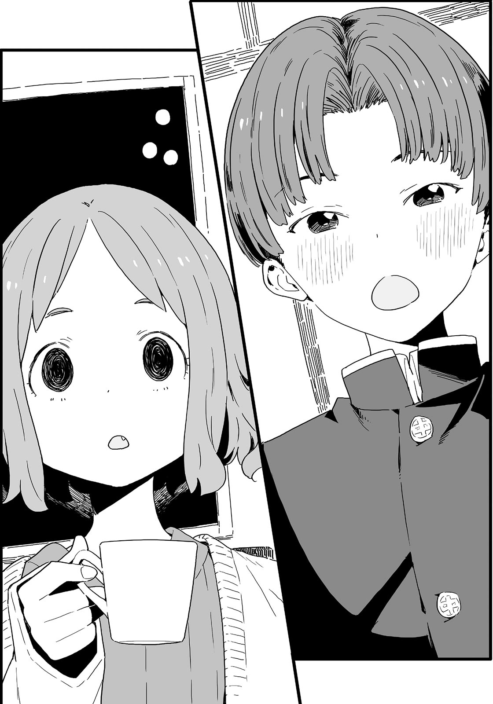

# Ch.40 — เล่ม 5 บทที่ 4-5

Ch.40 — เล่ม 5 บทที่ 4-5

By Monica

Published: 2025-04-22T10:36:13Z

Source: https://www.nekopost.net/novel/14560/40

เล่ม 5 บทที่ 4-5

ห้องสืบค้นข้อมูลวิชาสังคมศึกษา ที่นี่เป็นห้องเล็กๆที่มีหนังสือและเครื่องมือสำหรับใช้เรียนวางกองอยู่ราวกับภูเขา

ชิกิยะซังได้เดินไปที่จุดถ่ายรูปถัดไปแล้ว ส่วนพวกเราสี่คนก็ขนของเสร็จแล้วและมารวมตัวกันรอบโต๊ะกลางในห้อง

[ ขอบคุณที่ช่วยกันนะทุกคน ดื่มชากันสักหน่อยสิ เรามีขนมด้วยนะ ]

อามานัตสึเซนเซปิดตู้เย็นด้วยเท้าแล้ววางขวดพลาสติกขนาด 2 ลิตรลงอย่างแรง

[ ฉันจะรินชาให้ทุกคนเอง ]

ผมมองดูคาจูขณะที่ผมกำลังแจกถ้วยชาให้ทุกคน

ปกติแล้วคาจูจะเป็นคนแรกที่ทำอะไรแบบนี้ แต่ตอนนี้เธอกำลังกำถ้วยกระดาษอยู่ในมือและมองไปรอบ ๆ ด้วยความประหม่า

กอนโดซังก้มหน้าและไม่ขยับเขยื้อน ส่วนทาจิบานะคุงตอนนี้ดูเหมือนจะไวต่อความรู้สึกมาก หากมีใครไปสัมผัสเขาตอนนี้ตัวจะสั่นเอาได้ง่ายๆ

เอ๊ะ เดี๋ยวก่อนนะ จากสถานการณ์ตอนนี้ อย่าบอกนะว่าเขากำลังจะสารภาพรักที่นี่ ผมว่าเขาเลือกที่แปลกๆไปแล้วล่ะ

อามานัตสึเซนเซไม่สนใจบรรยากาศสุดอันตรายนี้เลย เธอเริ่มแจกขนมเค้กพิเรนีสให้กับทุกคน

เค้กพิเรนีสเป็นขนมตะวันตกที่พบได้ทั่วไปในเมืองโทโยฮาชิ มีครีมที่ถูกห่อด้วยชั้นของสปันจ์เค้ก

พูดตามตรงผมมีความสุขมากเพราะมันอร่อย

[ ไม่ต้องเกรงใจนะ กินเท่าที่พวกเธออยากได้เลย อันนี้ฉันเตรียมมาให้พวกเธอโดยเฉพาะ ]

ถึงเซนเซคนนี้จะอ่านบรรยากาศไม่ค่อยออก แต่การดูแลพวกเราก็ถือว่าน่าดี…

ดีล่ะ ผมเป็นคนรักษาคำพูด เพราะงั้น ผมจะหยุดการสารภาพรักครั้งนี้ตอนนี้แหละ

[ ขอบคุณมากนะครับ เตรียมมาสำหรับวันนี้โดยเฉพาะเลยหรือเปล่า ]

[ ก็ ฉันจะเอาไปให้ระหว่างการประชุมในอีกสักพัก แต่ถ้าพวกเธอไม่พูดอะไร ก็ไม่มีใครรู้หรอก ใช่มั้ยล่ะ ]

จากนั้นอามานัตสึเซนเซก็หยิบเค้กเข้าปาก

…เธอจะให้เรากินขนมพวกนี้เหรอ ? อามานัตสึเซนเซอัดเค้กเข้าปากจนหมด แล้วทำลายหลักฐาน หลังจากนั้นเธอเช็ดมุมปากและมองไปที่ฝั่งของคาจู

[ พวกเธอสามคนใส่ชุดนักเรียนของโมโมโซโนะสินะ นั่นหมายความว่าพวกเธอเป็นรุ่นน้องของฉัน ]

[ เอ๋ เซนเซเป็นรุ่นพี่ของพวกเราด้วยเหรอครับ? ]

ผมอดไม่ได้ที่จะถามออกไป เซนเซพยักหน้าอย่างแรง

[ ใช่แล้ว ฉันเคยเรียนที่โรงเรียนประถมอาโอกิ พวกเธอล่ะ นุคุมิซึ? ]

[ เอ่อ ผมกับน้องสาวไม่ได้เรียนที่นั่น แต่สองคนนั้น- ]

ผมหันไปมองทาจิบานะคุง เขาพยักหน้า

[ อา ใช่ครับ ผมก็เรียนที่อาโอกิเหมือนกัน ]

[ อ๋อ งั้นเหรอ บางทีเราอาจจะเคยเจอกันมาก่อนก็ได้ ฉันล้อเล่นนะ ฮ่าฮ่า ]

ผมเมินมุขตลกที่ไม่ค่อยตลกของอามานัตสึเซนเซ แต่แล้ว-

[ …ใช่ครับ ผมจำเซนเซได้ ]

ทาจิบานะคุงพูดขึ้น น้ำเสียงของดูเขาจริงจังมาก

[ เซนเซเคยไปฝึกสอนที่อาโอกิเมื่อ 6 ปีก่อนใช่มั้ยครับ ]

[ ใช่ มันนานขนาดนั้นแล้วเหรอเนี่ย ]

อามานัตสึเซนเซจิบชา

…เอ๊ะ ผมว่าเราไม่ได้เร่งเวลาไปถึงอีเวนท์พิเศษเลยนะ

[ ผมชื่อทาจิบานะครับ เซนเซเคยสอนพวกเรา ผมคิดว่าเซนเซคงจำผมไม่ได้หรอกครับ ]

อามานัตสึเซนเซหยุดไปทันทีที่ได้ยินเช่นนั้น

[ อา- …ใช่ ฉันจำเธอได้ ฉันจำได้แน่ ๆ ]

[ เอ๋ จริงเหรอครับ!? ]

ทาจิบานะคุงเอนตัวมาข้างหน้าด้วยดวงตาที่เป็นประกาย

[ แน่นอน… เอ่อ… อืม… รู้สึกว่า... ]

เธอค่อย ๆ ลดเสียงลงและก้มหน้าลงไป เดาว่าคงจำไม่ได้แล้วล่ะ

…แต่นี่หมายความว่าเหตุการณ์อะไรบางอย่างกำลังจะเกิดขึ้นมั้ยนะ

ถ้าพูดถึงเรื่องนี้ กอนโดซังกับเขาน่าจะเรียนโรงเรียนประถมเดียวกัน จากนั้น ขณะที่ผมมองปฏิกิริยาของเธออยู่ กอนโดซังก็ทำลายความเงียบด้วยการลุกขึ้นทันที

[ ฉันไปเข้าห้องน้ำก่อนนะ ]

กอนโดซังเหลือบมองทาจิบานะคุงแล้วรีบวิ่งออกจากห้องไป

…เอ๊ะ หนึ่งในตัวละครได้ออกไปแล้ว ทำไมกอนโดซังถึงทำแบบนั้นทันทีเลยล่ะ?

อามานัตสึเซนเซอ้าปากค้างเมื่อมองเธอวิ่งออกไป จากนั้นเธอก็ให้กำลังใจตัวเองและกระแอมเบา ๆ

[ เอาล่ะ ทาจิบานะคุง ตอนนี้อยู่ชมรมอะไรอยู่เหรอจ๊ะ ]

[ ครับ ผมอยู่ชมรมจัดสวนครับ ]

เธอพยายามเปลี่ยนหัวข้ออย่างเห็นได้ชัด แต่ทาจิบานะคุงตอบอย่างตรงไปตรงมา

[ ผมชอบพืชพันธุ์มาตั้งแต่เด็กแล้วครับ ผมเคยดูแลต้นไม้ในห้องเรียน และผมปลูกดอกไม้ในแจกันด้วย คนอื่น ๆ ชอบล้อว่าผมเหมือนผู้หญิงเพราะตัวเล็กด้วยน่ะครับ- ]

ทาจิบานะคุงเอียงคอเล็กน้อยและยิ้มอย่างเขินอาย

[ แต่เซนเซก็ช่วยผมมาตลอด ผมมีความสุขมากเลยครับ ]

[ โอ๊ะ มันเกิดเรื่องแบบนั้นด้วยเหรอ…? ]

[ ใช่ครับ ตอนนั้นผมคิดว่าเซนเซเท่มากเลยครับใน ส่วนตอนนี้ตอนสอนหนังสืออยู่ก็เหมือนกัน ถึงแม้เซนเซจะตัวเล็ก แต่ก็แมนและดูหล่อมาก ผมชื่นชมมาก ๆ เลยครับ ]

[ ชื่นชมฉันเหรอ!? ฉันน่ะเหรอ!? แต่หน้าที่ของครูคือช่วยให้นักเรียนพัฒนาสิ่งที่พวกเขาถนัด ฉันว่าอย่างนั้นแหละ เฮะๆ ทุกคนชมฉันแบบนี้ตลอดแหละ ฟุเฮะเฮ~ ]

เธอคงไม่ชินกับการถูกชมสินะ เสียงหัวเราะของอามานัตสึเซนเซฟังดูน่ากลัวนิดหน่อย จากนั้นเธอก็ตบมือเบา ๆ

[ …อา ฉันจำได้แล้ว มีคนหนึ่งที่มีดอกไม้วางอยู่บนโต๊ะตลอด ใช่เธอหรือเปล่า? ]

[ นั่นผมเองครับ! เซนเซจำผมได้จริง ๆ ด้วย! ]

รอยยิ้มของทาจิบานะคุงบานสะพรั่ง

[ ดอกไม้ดอกนั้นเฉาเร็วมาก มันก็เลยออกจะเศร้า ๆ หน่อย แต่ผมก็พอใจแล้วล่ะ ถ้ามีใครสักคนมองดอกไม้ของผม ]

[ อ่าา ฉันเคยดูมันทุกเช้าเลย มันสวยดีนี่นะ ฉันยังอยากจะเอามาวางบนหิ้งพระที่บ้านด้วย… เอ่อ ไม่ใช่ ๆ ]

— ในที่สุดผมก็เข้าใจแล้วว่าเกิดอะไรขึ้น

[ แล้วสองปีก่อน ผมเห็นชื่อเซนเซในรายชื่อครูในหนังสือพิมพ์ ผมได้ยินมาว่าพี่ชายของนุคุมิซึซังก็เรียนอยู่ที่โรงเรียนนี้ ผมก็เลยขอร้องเขาให้พาผมมาที่นี่เพื่อจะได้เจอเซนเซ ]

[ หา ทำไมถึงต้องทำขนาดนั้นล่ะ? ]

อามานัตสึเซนเซถือแก้วชาอยู่ด้วยสีหน้าที่ตกใจ

เอ๊ะ เธอโอเคมั้ยเนี่ย คนๆนี้น่าจะเข้าใจได้แล้วนะว่าเกิดอะไรขึ้น?

นอกจากผม ก็มีคาจู ทาจิบานะคุง และอามานัตสึเซนเซอยู่ด้วยกัน

ในชีวิตจริงไม่มีปุ่มสคิป ทุกอย่างจะดำเนินไปเมื่อมันเกิดขึ้นแล้ว

ทาจิบานะคุงลุกขึ้นทันที ใบหน้าของเขาเต็มไปด้วยความมุ่งมั่น

ใช่แล้ว เขาไม่ได้จะสารภาพรักกับคาจู-

[ ผมนับถือและรักเซนเซมาตลอดเลยครับ ! ]

เขากลับสารภาพรักกับอามานัตสึเซนเซแทน

การสารภาพรักครั้งนี้ตรงไปตรงมาและเงอะงะมาก หลังจากที่ได้ยินแล้ว คำตอบของอามานัตสึเซนเซก็คือ

[ หา ]

เสียงของเธอฟังดูอ่อนแรง

ความเงียบปกคลุมห้องราวกับเวลาหยุดนิ่ง ผมทนไม่ไหว ผมเลยค่อยๆพูดกับเซนเซ

[ เอ่อ...เซนเซ ควรจะพูดอะไรหน่อยนะครับ ]

[ หืม...? เอ๊ะ? ฉันเหรอ!? ]

ใช่ เธอนั่นแหละ

เซนเซเพิ่งตระหนักได้ว่าเกิดอะไรขึ้นหลังจากที่มึนงงไปสักพัก

เธอลุกขึ้นและเดินไปหาทาจิบานะคุง

[ อา- ...เธอคงจะเป็นซาโตชิ ทาจิบานะคุงใช่มั้ย? ]

[ ใช่ครับ ]

[ ฉันซาบซึ้งในความรู้สึกของเธอนะ แต่ฉันเป็นครู ฉันตอบรับความรู้สึกของเธอไม่ได้ ]

[ ครับ ผมพอใจแล้วที่ได้สารภาพความรู้สึกออกมา ]

[ งั้นเหรอ ขอโทษนะ ]

อามานัตสึเซนเซยิ้มอย่างอบอุ่น รอยยิ้มเดียวกันก็ปรากฏบนใบหน้าของทาจิบานะคุงด้วย

— ผมได้เห็นความรักอันสิ้นหวังของชายหนุ่มที่จบลงภายในไม่กี่วินาที

แทนที่จะรู้สึกหดหู่ ผมกลับรู้สึกเหมือนมีอะไรบางอย่างที่ถูกยกออกจากบ่าของผม

อามานัตสึเซนเซค่อย ๆ วางมือบนไหล่ของทาจิบานะคุงอย่างนุ่มนวล

[ อีกอย่าง ถ้าเธอมีพี่ชายที่อายุมากกว่าหลายปีละก็- ]

[ เซนเซ!? ต้องไปประชุมต่อไม่ใช่เหรอครับ ? ]

ผมรีบขัดมาขึ้นทันที เธอนี่มักจะพูดอะไรแปลก ๆ เสมอเลย

[ อ่า ใช่สิ ฉันต้องไปที่ห้องประชุมเล็ก ขึ้นบันไดตั้ง 4 ชั้นด้วย ]

อามานัตสึเซนเซถอนหายใจอย่างอ่อนแรง

[ เอาล่ะ ฉันต้องไปแล้ว ฝากที่เหลือไว้กับเธอนะ นุคุมิซึ ]

[ เอ๊ะ? อ่า ครับ ]

เซนเซตบไหล่ทาจิบานะคุงเบา ๆ ก่อนจะเดินออกไป "14 ปี... อีก 4 ปี..." เธอบ่นพึมพำแล้วเดินออกจากห้องสืบค้นข้อมูลไป ดูเหมือนเธอกำลังจินตนาการถึงสิ่งที่จะเกิดขึ้นในอีก 4 ปีข้างหน้า

ผมยังคงอยู่ที่เดิมหลังจากที่เธอออกไป ทาจิบานะคุงก็ยังคงนิ่งอยู่ ผมจึงพูดกับเขา

[ เอ่อ... ทาจิบานะคุง นายโอเคมั้ย? ]

[ ผมโอเคครับ ขอโทษจริง ๆ นะครับ ผมทำทัวร์พังหมดเลย ]

[ ไม่เป็นไรหรอก คนอื่นสองคนก็รู้เรื่องนี้อยู่แล้วใช่มั้ย? ]

ทาจิบานะคุงพยักหน้าเงียบ ๆ

ความไม่สบายใจที่ครอบงำเราก่อนหน้านี้ค่อย ๆ หายไป

เขารู้ว่าอามานัตสึเซนเซเป็นครูประจำชั้นของผม เขามาที่วันเปิดโรงเรียนนี้เพื่อสารภาพความรู้สึกที่ซ่อนไว้มานานหลายปี

เขาเข้าเรียนที่โรงเรียนสึวะบุกิไม่ได้ นี่อาจเป็นวิธีเดียวของเขา

แต่คำถามใหม่ก็ผุดขึ้นในใจของผม

คาจูรู้สึกยังไงในเมื่อเธอมาที่นี่กับเขา?

แล้วทำไมกอนโดซังถึงออกไปก่อนที่ทาจิบานะคุงจะสารภาพ...?

ใช่แล้ว คาจูเงียบมากเลย ผมมองไปที่เก้าอี้ของเธอ

— คาจูหายไปแล้ว

✧

เราพูดคุยกันหลายเรื่องขณะที่ผมพาทาจิบานะคุงไปที่ประตูทางเข้าโรงเรียน

ถึงอย่างนั้นก็เหมือนกับว่าเขาเป็นฝ่ายเล่าเรื่องความทรงจำของเขากับอามานัตสึเซนเซมากกว่า

ในใจของทาจิบานะคุง อามานัตสึเซนเซเป็นคนที่มีอิสระและตั้งใจแน่วแน่ แม้ว่าเธอจะซุ่มซ่ามเล็กน้อย แต่เธอก็เป็นผู้หญิงที่มีความละเอียดอ่อน

ไม่น่าเชื่อเลยว่าครูที่เราทั้งคู่รู้จักจะเป็นคนเดียวกัน แต่จากวิธีที่เขาพูดถึงเธอ เธอกลายเป็นคนที่ดูมีเสน่ห์มากทีเดียว

[ ผมรู้สึก...ผิดหวังนิดหน่อย ผมอาจจะคิดมากเกินไป แต่พอผมตื่นมาในวันพรุ่งนี้ ผมยังไม่รู้ด้วยซ้ำว่าจะเกิดอะไรขึ้น ]

ทาจิบานะคุงพูดความในใจออกมาอย่างจริงใจ และก้มหน้าด้วยความเขินอาย

[ นุคุมิซึซังคงจะคิดว่านี่เป็นแค่ความนับถือของเด็กมัธยมต้นใช่มั้ยครับ? ]

[ ไม่จริงหรอก ฉันคิดว่ามันไม่จำเป็นที่จะต้องแบ่งเส้นชัดเจนระหว่างความรักกับความนับถือขนาดนั้น ]

[ จริงเหรอครับ? ]

ความรู้สึกลังเลระหว่างความรักกับความนับถือของเขาดูเหมือนจะกลายเป็นความทรงจำที่งดงามแล้ว

นี่แหละคือสิ่งที่ดีที่สุด ความรักในวัยเยาว์เป็นแค่ประสบการณ์เท่านั้น เขาจะพบรักแท้ของเขาสักวันหนึ่ง

ผมครุ่นคิดกับคำถามเชิงอารมณ์เหล่านี้อยู่นาน ทาจิบานะคุงก้มหัวลงต่ำเมื่อเรามาถึงประตูฝั่งตะวันออก

[ ขอบคุณมากสำหรับวันนี้นะครับ ]

[ ไม่เป็นไรหรอก ฉันไม่ต้องเดินไปส่งนายที่สถานีแน่นะ? ]

[ ครับ ไม่เป็นไร ]

รอยยิ้มของเขาดูสดชื่นมาก ราวกับว่าเขาปล่อยวางไปแล้ว

[ งั้นผมไปก่อนนะครับ พี่ชาย ]

[ เดี๋ยว ทาจิบานะคุง ]

ผมอดไม่ได้ที่จะเรียกเขาไว้ ผมพูดต่ออย่างประหลาดใจ

[ นาย- คิดยังไงกับคาจูเหรอ? ]

[ หมายถึงคาจูซังเหรอครับ? ]

ทาจิบานะคุงหยุดนิ่งเมื่อได้ยินคำถามที่ไม่คาดคิด เขาดูสับสน

[ เพราะเธอสนิทกับอาซามิ- ]

เขาดูเหมือนจะกำลังคิดคำตอบ ดวงตาของเขาลอยไปมา จากนั้นเขามองตรงเข้ามาในตาของผมแล้วพูดขึ้น

[ ...ผมรู้สึกดีใจมากทุกครั้งที่เห็นพวกเธอสองคนมีความสุขครับ ]

ใบหน้าผมค่อย ๆ คลายยิ้มออกเมื่อได้ยินคำตอบที่ไร้เดียงสานั้น

[ งั้นเหรอ ในอนาคตฉันฝากคาจูด้วยนะ ]

ถ้าเขาเป็นคนที่คาจูชอบ-

ผมเชื่อว่ามันคงเป็นสิ่งที่โชคดีอย่างมาก
