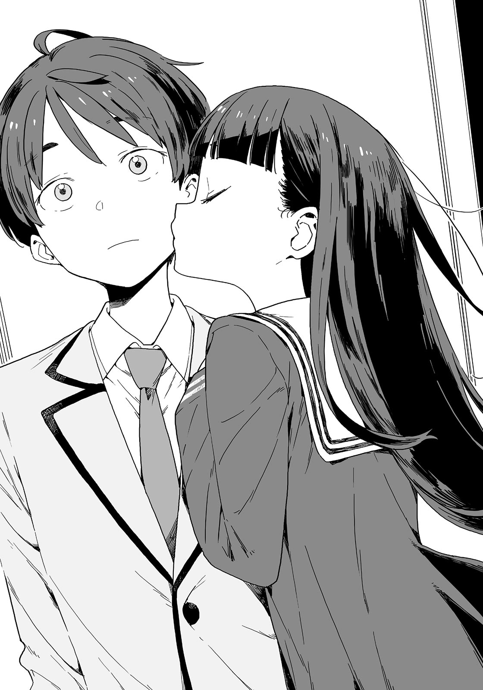
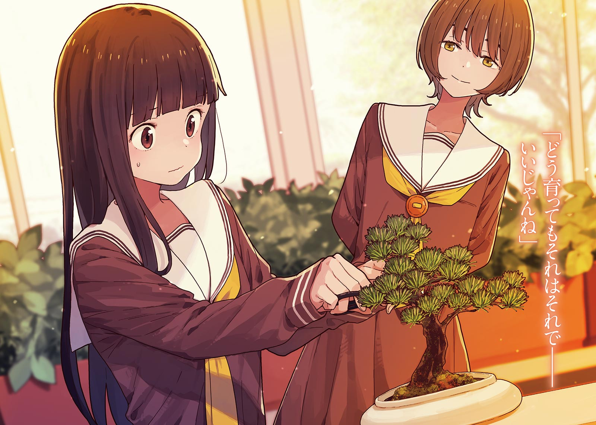

# Ch.42 — เล่ม 5 บทที่ 4-7

Ch.42 — เล่ม 5 บทที่ 4-7

By Monica

Published: 2025-04-22T10:36:35Z

Source: https://www.nekopost.net/novel/14560/42

เล่ม 5 บทที่ 4-7

ผมส่งเทียร่าซังกลับไปที่ห้องสภานักเรียน ใช้เวลานานกว่าที่คาดไว้ ตอนที่ผมกลับถึงบ้าน พระอาทิตย์ก็ตกดินแล้ว

ผมบอกคนในชมรมวรรณกรรมทางไลน์ว่าผมจะกลับบ้าน แต่ก็โดนโคมาริระเบิดข้อความใส่ ดูเหมือนว่าเธอมีเรื่องจะบ่นมากมาย ผมว่าพรุ่งนี้ไม่ไปเข้าชมรมดีกว่า…

ผมถอนหายใจและมองท้องฟ้า รุ่งอรุณที่เลือนลางกำลังแต่งแต้มขอบฟ้าเป็นสีน้ำเงินเข้มราวกับกำลังเร่งกลับบ้าน

แกร๊ก! ผมยืนอยู่หน้าประตู ไฟเปิดขึ้นโดยอัตโนมัติเมื่อเซนเซอร์จับการเคลื่อนไหวได้

ผมไขกุญแจเข้าไป พลางคิดว่าควรจะบอกอะไรกับคาจูดี

— เรื่องนี้เริ่มต้นด้วยความรู้สึกสิ้นหวังของทาจิบานะคุงที่มีต่ออามานัตสึเซนเซย์

หลังจากนั้นก็เป็นเรื่องของคาจู, กอนโดซัง, และทาจิบานะคุง เรื่องราวควรจะหมุนรอบสามคนนี้

แล้วทำไมคาจูถึงต้องพาดพิงถึงผมด้วยล่ะ?

พูดอีกอย่างคือ ผมรู้สึกว่าเรื่องนี้เป็นเรื่องของคนสามคน

มันต้องมีคำตอบที่ชัดเจนกว่านี้—

ผมเริ่มกังวลทันทีที่เปิดประตูและเห็นรองเท้าของคาจูวางเรียบร้อยอยู่ที่พื้น

ดูเหมือนว่าจะไม่มีใครอยู่ชั้นล่าง แม่กับพ่อคงยังไม่กลับบ้าน

ผมตั้งสติก่อนจะเดินขึ้นบันไดไป จนถึงหน้าประตูห้องคาจู

ผมเคาะประตู แต่ไม่มีเสียงตอบกลับ ผมเปิดประตูเข้าไปอย่างลังเล ในห้องนั้นมืดมาก

แสงจากทางเดินส่องเข้ามาในห้อง ห้องของเธอมีโทนสีชมพูที่ให้ความรู้สึกเป็นผู้หญิง มีโปสเตอร์ของผมติดอยู่ที่ผนัง คิดว่าเธอคงได้อันใหม่มา…

คาจูนั่งอยู่ที่พื้นพิงข้างเตียง เธอหลับไปแล้ว

ผมถอนหายใจด้วยความโล่งใจเมื่อเห็นหน้าตอนหลับของเธอที่ดูน่ารัก

ใช่สิ เมื่อคืนเธอบอกว่าเธอนอนไม่หลับ

ผมเปิดไฟและเห็นอัลบั้มเล่มหนึ่งอยู่ตรงหน้าคาจู

หน้าที่เปิดเผยให้เห็นภาพถ่ายของผมกับคาจูตอนเด็ก ๆ

…โอ๊ะ นี่คือตอนที่เราถ่ายในงานชิจิโกะซัง ผมใส่ฮากามะ ส่วนคาจูใส่กิโมโน เราทั้งสองยิ้มกันอย่างสดใส

ผมกินจิโตเสะอาเมะ(ลูกอมพันปี)เยอะไปจนฟันผุ จำได้ว่าคาจูเป็นห่วงผมมากตอนนั้น เธอแสดงบทบาทเป็นหมอฟัน มันเป็นวันที่บ้านเราคึกคักมาก

ในใจผม คาจูไม่ได้เปลี่ยนไปมากนัก เธอยังคงเป็นน้องสาวที่น่ารักของผม

อย่างไรก็ตาม คาจูก็ได้เติบโตขึ้นอย่างช้า ๆ โดยที่ผมไม่ทันสังเกต

ต่อจากนี้ไป อัลบั้มเล่มนี้จะมีภาพถ่ายของคาจูที่ไม่มีผมอยู่ด้วยมากขึ้น

หวังว่าคาจูจะยังคงยิ้มได้ในภาพถ่ายเหล่านั้น แต่เบื้องหลังกล้องนั้นเธออาจจะกลั้นน้ำตาไว้ไม่ได้

วันหนึ่งที่เธอจะร้องไห้ในอ้อมกอดของคนอื่นแทนผมคงไม่ไกลเกินไปแล้ว

ผมคิดว่าครอบครัวที่แท้จริงคือคนที่พร้อมจะสนับสนุนโดยไม่ลังเลถ้าต้องการหยุดพักผ่อน

ผมค่อย ๆ พลิกหน้าอัลบั้มด้วยนิ้ว แล้วทำรูปหล่นไปสองสามใบ มีเสียง "ชะ" ดังขึ้นมา

[ อือ…อือ… ]

เสียงนี้ดูเหมือนจะเป็นเสียงสุดท้ายที่ปลุกเธอให้ตื่น

เสียงเบา ๆ หลุดออกมาจากริมฝีปากของคาจู คิ้วของเธอกระตุกเล็กน้อย

[ คาจู ตื่นหรือยัง? ]

[ ท่านพี่...? ]

คาจูดูเหมือนยังงง ๆ เธอขยี้ตาด้วยท่าทางสะลึมสะลือ

[ คาจูหลับไป...อ๊ะ ท่านพี่!? ]

คาจูดูตกใจอยู่สักพัก แล้วแสดงสีหน้าหม่น ๆ ก่อนจะจับเสื้อของผม

[ ท่านพี่คะ! ที่โรงเรียนน่ะ ! แอบฟังเราตั้งแต่เมื่อไหร่คะ!? ]

[ เอ๋? อา... คิดว่ามันตั้งแต่ตอนที่เธอบอกว่าพี่ชอบผู้ชาย ]

[ แล้วก่อนหน้านั้นล่ะ!? ได้ยินเราพูดถึงอะไรบ้างมั้ย!? ]

[ อืม? ไม่ได้ยินนะ ]

[ ไม่ได้ยินเหรอ... เฮ้อ โล่งอกไปที ]

คาจูถอนหายใจด้วยความโล่งใจ

เดี๋ยวนะ ถ้าเธอให้ผมแอบฟังเรื่องแบบนี้ อย่าบอกนะว่ามันมีอะไรที่ลับยิ่งกว่านั้นอีก…?

[ อ่อใช่สิ คาจู เธอพูดว่าพี่ชอบผู้ชายนี่ หมายความว่ายังไง? ]

คาจูเบะปากเล็กน้อยแล้วพูดด้วยความหงุดหงิด

[ อย่าแกล้งบื้อสิคะ คาจูพูดถึงผู้ชายที่ท่านพี่ออกไปเที่ยวด้วยในวันคริสต์มาสอีฟ ]

...? เธอพูดถึงใครกัน? ชิกิยะซังดูเหมือนผู้หญิงนะ ไม่ว่าจะดูยังไงก็—

[ เธอเห็นพี่กับรุ่นพี่ผู้ชายคนนั้น? ]

[ ใช่ค่ะ ทั้งสองคนใช้หลอดเดียวกัน ทั้งสองคนดูสนิทกันมากเลย ]

คาจูหันหน้าหนี

[ รุ่นพี่คนนั้นไปทานข้าวเย็นก่อน แต่โดนทิ้ง ฉันเลยไปกับเขาแทน มันไม่มีอะไรพิเศษหรอก ]

[ แล้วไอ้หลอดสำหรับคู่รักนั่นล่ะ? ]

[ นั่น...คิดดูสิ มันบังเอิญน่ะ คาจูคงเคยเจออะไรแบบนี้ใช่มั้ย? ]

[ ไม่เคยค่ะ ]

นั่นสินะ

[ ยังไงก็เถอะ รุ่นพี่คนนั้นมีแฟนแล้ว พวกเขารักกันดีมาก ฉันเป็นแค่ตัวแทนเฉยๆ ]

[ ...จริงเหรอ? ]

คาจูจ้องหน้าผมอยู่สักพัก เธอถอนหายใจด้วยความพึงพอใจ แต่ก็ยังมีสีหน้าซับซ้อนอยู่

[ ใช่แล้ว คาจู ฉันอยากคุยเรื่องทาจิบานะคุง ]

[ ...ค่ะ น่าเสียดายมากเลย ]

เห็นคนที่เธอรักถูกปฏิเสธทำให้เธอยิ่งกังวลกับเขามากขึ้น นั่นแหละคือคาจู

อย่างไรก็ตาม ความไม่สบายใจนี้ยังคงติดอยู่ในใจผม

คาจูไม่ได้อยู่คนเดียวในป่าหลังโรงเรียน กอนโดซังก็อยู่ที่นั่นด้วย

— กอนโด อาซามิ

เธอเป็นเพื่อนสนิทของคาจู และดูเหมือนเธอจะเป็นคนรู้จักเก่าของทาจิบานะคุงด้วย

แค่เธอคนเดียวก็ทำให้สมองของผมเต็มไปด้วยความคิดซับซ้อนมากมาย

เธอวิ่งหนีไปตอนที่ทาจิบานะคุงสารภาพรัก จากนั้นก็มีเรื่องทะเลาะกับคาจู สุดท้ายคาจูก็เป็นฝ่ายวิ่งหนีออกจากที่นั่น

เธอเป็นตัวละครในเรื่องนี้เช่นกัน

ผมรู้ดี - มีความเศร้าเล็กๆ ในดวงตาของเธอ และความดื้อรั้นด้วย

[ ขอโทษนะ พี่เข้าใจผิดเธอ]

ผมพูดขึ้นมาอย่างกะทันหัน คาจูส่ายหัว

[ ไม่หรอกค่ะ ท่านพี่ไม่ผิด- ]

[ พี่นึกว่าคาจูรักทาจิบานะคุง แต่พี่คิดผิดแล้ว ]

หัวของคาจูสั่นเล็กน้อย

เธออ้ำอึ้งไป ผมเลยยื่นมือไปขัดจังหวะและพูดต่อ

[ กอนโดซังชอบทาจิบานะคุง พี่รู้ดี คาจูก็เข้าใจสิ่งที่พี่เข้าใจได้เหมือนกัน นั่นแหละที่ทำให้พี่คิดว่าวันนี้คาจูแปลกๆ ]

[ ...แปลกเหรอ? ]

คาจูทวนคำอย่างสับสน ผมพยักหน้าให้เธอ

[ พี่มองออกนะว่ามันไม่ปกติเลย ถ้าน้องสาวกับเพื่อนของเธอมาชอบคนเดียวกัน เธอต้องหงุดหงิดและเสียใจแน่ สุดท้ายคนที่เจ็บก็มีแค่เธอ ]

ผมลูบหัวคาจูเบาๆ

[ เพราะฉะนั้น ถ้ากอนโดวซังชอบเขา คาจูก็จะไม่แอบชอบเขา ล่ะเป็นไง โลจิคของพี่ชัดเจนดีใช่มั้ย? ]

[ ...ใช่ค่ะ ]

คาจูดูเหมือนเด็กที่ถูกจับได้ว่าเล่นอะไรซนๆมา เธอก้มหน้าด้วยความอาย

[ คาจูคิดกับทาจิบานะคุงแค่เพื่อนจริงๆ ไม่ได้ชอบเขาแบบโรแมนติก ]

[ อืม พี่รู้ มันไม่เกี่ยวอะไรกับวันวาเลนไทน์เลยที่เธอชวนทาจิบานะคุงวันนี้ ตอนแรกเธอสองคนคุยกันเรื่องวันเปิดบ้านอยู่แล้ว ]

คาจูพยักหน้าอย่างเขินอาย

[ แล้วเดทที่โทโยคาวะอินาริล่ะ? ]

[ หนูกับกอนจังสัญญากันไว้ว่าจะไปด้วยกันน่ะ รุ่นพี่คนหนึ่งกำลังเตรียมสอบ พวกเราเลยอยากไปขอพรให้เขา ]

ผมคิดมากไปตั้งแต่แรก

ผมยิ้มแห้งๆ ให้กับตัวเอง

[ แล้วทำไมเธอถึงพูดอะไรที่มันชวนให้เข้าใจผิดล่ะ? ]

[ เพราะว่า- ]

คาจูก้มหน้าลงและไตร่ตรองอยู่สักพัก เธอตัดสินใจและพูดขึ้นมา

[ ทาจิบานะคุงโทรหาหนูตอนกำลังทำช็อกโกแลตวันนั้น ท่านพี่ก็คงรู้ใช่มั้ย? ]

[ ท่านพี่เริ่มสงสัยเรื่องความสัมพันธ์ระหว่างหนูกับเขาตั้งแต่ตอนนั้น - หนูเลยมีความคิดแย่ๆแบบว่าอยากให้ท่านพี่เข้าใจผิดไปเรื่อยๆ ]

คาจูหลบตาอย่างเก้ๆ กังๆ

[ ท่านพี่ไม่มีเพื่อนใช่มั้ย? หนูอยู่กับท่านพี่ทุกวันตั้งแต่เด็กๆ หรือเป็นเพราะหนูเหรอท่านพี่ถึงไม่มีเพื่อน? ]

[ พี่ผิดเอง 100% เพราะไม่มีเพื่อนใช่มั้ย? ]

เธอดูเหมือนจะเอาความคิดสุดซื่อสัตย์ของผมให้เป็นเรื่องตลก เธอหัวเราะคิกคักอย่างช่วยไม่ได้

[ นั่นแหละที่ทำให้คาจูดีใจตอนที่ท่านพี่เข้ามัธยมปลาย เข้าชมรมวรรณกรรม และมีเพื่อนหลายคนถ้าท่านพี่หาแฟนที่ยอดเยี่ยมได้ คาจูคงไม่ต้องดูแลท่านพี่อีกแล้ว ใช่มั้ย? ...เวลาเธอคิดถึงเรื่องนี้ คาจูกังวลมากๆค่ะ ]

คาจูเปิดอัลบั้มขณะที่พูด

[ คาจูอยู่กับท่านพี่มาตั้งแต่จำความได้ ท่านพี่อยู่ข้างๆ คาจูเสมอ ไม่ว่าจะสุขหรือเศร้า เพราะยังไงก็อยู่กับครอบครัวเป็นเรื่องธรรมดา ]

คาจูเปิดชั้นของอัลบั้มและหยิบรูปถ่ายออกมา

นั่นเป็นวันที่ผมเข้าโรงเรียนประถม ผมยืนหน้าประตูโรงเรียนอย่างกังวล คาจูวัย 4 ขวบยืนร้องไห้ตาแดงอยู่ข้างๆ ผม

พอนึกถึง - คาจูก็หัวเราะ

[ คาจูคิดว่าท่านพี่จะไม่กลับบ้านหลังเข้าโรงเรียนประถมแล้ว หนูร้องไห้ทั้งงานเปิดภาคเรียนเลย ]

[ พี่จำได้ คืนนั้นคาจูไม่ยอมให้พี่ไปไหน ]

คาจูเก็บรูปภาพกลับเข้าไปและเริ่มเปิดหน้าต่อไป

เธอหยุดนิ้วที่รูปถัดไป รูปนี้น่าจะเมื่อ 3 ปีที่แล้ว

พวกเราถ่ายตอนที่ครอบครัวไปเที่ยวทะเล

รูปนั้นเป็นตอนที่คาจูวิ่งไล่ผมพร้อมกับปลาดาวในมือ ส่วนผมก็กำลังวิ่งหนีด้วยสีหน้าเอาจริงเอาจัง

[ ...คาจูใจร้ายไปหน่อยมั้ย? ]

[ ท่านพี่ชอบพาวเวอร์เรนเจอร์ คาจูก็เลยคิดว่าโอนี่ซามะน่าจะชอบปลาดาว ]

มันดูเหมือนอาวุธจริงๆ

คาจูชี้ไปที่รูปถัดไป เป็นตอนที่คาจูสวมเครื่องแบบของโรงเรียนมัธยมต้นโมโมโซโนะครั้งแรก เธอถ่ายกับผมเพื่อเป็นที่ระลึก

คาจูกอดแขนผมและยิ้มแย้มสดใส ขณะที่ผมทำหน้าบึ้ง

[ ยังจำได้มั้ย? ท่านพี่ยังทะเลาะกับคาจูเพราะไม่อยากถ่ายรูปด้วยกัน ]

ผมจำได้ดี

ผมไม่สนใจเรื่องไม่มีเพื่อนในมัธยมต้นเลย แต่ผมไม่อยากให้คาจูเห็นสภาพแบบนั้น

นั่นแหละที่ทำให้ผมไม่สามารถยินดีกับคาจูได้อย่างจริงใจที่ได้อยู่โรงเรียนเดียวกับผม

[ ...ตอนนั้นพี่ทำตัวเป็นเด็กไปหน่อย ]

ผมพึมพำด้วยความเยาะเย้ยตัวเอง

[ คาจูก็เป็นแค่เด็กเหมือนกัน คาจูเห็นท่านพี่ค่อยๆ เปลี่ยนไป หนูก็ดีใจมาก แต่ก็รู้สึกเหงานิดหน่อย ]

คาจูวางหัวของเธอบนไหล่ของผม

[ นั่นแหละที่ทำให้คาจูอยากให้ท่านพี่สนใจคาจูมากขึ้น ]

เส้นผมสีดำของคาจูลื่นลงมา มันทำให้หลังมือผมจั๊กจี้

น้ำหนักบนไหล่ของผมไม่เคยเปลี่ยน

คาจูเดินเคียงข้างผมมาตลอดตั้งแต่เรายังเด็ก

แต่ต่อจากนี้ไป เราต้องเดินไปตามทางของตัวเองในฐานะผู้ใหญ่

[ ...ว่าไง คาจู แล้วกอนโดซังล่ะ? ]

[ เธอเป็นยังไงเหรอ...? ]

ตอนนี้เราจัดการเรื่องหนึ่งไปได้แล้ว แต่ยังมีอีกเรื่องที่ต้องจัดการ

[ เธอสนับสนุนการสารภาพรักของทาจิบานะคุงหรือเปล่า? ]

[ ก็ไม่นะคะ แต่- ]

คาจูพูดติดขัด ผมพูดต่อ

เธอก็รู้ว่า ทาจิบานะคุงจะสารภาพรักใช่มั้ย? เราเลี่ยงให้ทาจิบานะคุงตกหลุมรักใครต่อใครไม่ได้หรอก แต่ก็ไม่ควรขอให้เธอช่วยเรื่องการสารภาพรักได้หรอกนะ?

[ แต่ทาจิบานะคุงชอบอามานัตสึเซนเซ อามานัตสึเซนเซก็เป็นคนที่จริงจังมาก และเธอคงจะปฏิเสธแน่นอนค่ะ คาจูรู้เรื่องนี้ดีถึงได้ทำแบบนั้น ]

…ไม่สิ คนแบบนั้นอันตรายเกินไป ทาจิบานะคุงคงต้องเจอกับปัญหาใหญ่แน่ถ้าเขาสารภาพรักอีกสี่ปีต่อมา

[ กอนจังบอกว่าถ้าปล่อยให้เรื่องเป็นแบบนี้ก็ไม่เป็นไร เธอยังบอกอีกว่าไม่อยากสารภาพรักกับทาจิบานะคุงแม้จะมีคนอื่นที่ชอบเขาด้วยเหมือนกัน ]

ความกังวล ผมเข้าใจความรู้สึกของเธอ

แต่ทำไมคาจูถึงได้ลงแรงขนาดนี้เพื่อเข้าไปแทรกแซงความสัมพันธ์ของคนอื่นจนละเลยความต้องการของพวกเขาเองล่ะ?

[ เธอเห็นด้วยกับการที่เรื่องเป็นแบบนี้แล้วใช่มั้ย? ]

[ จริงเหรอ ? นั่นคือสิ่งที่ท่านพี่คิดแบบนั้นเหรอคะ? ]

ผมพยักหน้าเงียบ ๆ คาจูเริ่มมองไปรอบ ๆ ด้วยความกังวล

[ คาจูกับเพื่อน ๆ กำลังจะขึ้นปีสามในเดือนเมษายน การสอบเข้าใกล้เข้ามา ทุกคนจะต้องกล่าวคำอำลาเมื่อเข้าสู่โรงเรียนมัธยมปลาย ]

คาจูเอานิ้วไขว้กันและกำมือแน่น

[ กอนจังต้องเสียใจแน่ถ้าเธอไม่ยอมเคลื่อนไหวอะไรเลย พวกเขาจะเข้าโรงเรียนคนละที่และจะเจอกันน้อยลง คนที่เคยรักกันยังเลิกรากันได้ ถ้าคิดถึงเรื่องนี้น่ากลัวแค่ไหน... ]

ผมลูบหัวคาจูเบา ๆ ขณะที่ถามเธออย่างอ่อนโยน

[ เพราะงั้น คาจูเลยให้กอนโดซังเข้ามาในแผนเพื่อกระตุ้นเธอใช่มั้ย? ]

ไหล่ของคาจูสั่นเล็กน้อย

[ คาจู…ไม่อยากเห็นกอนจังเสียใจ ถ้าปล่อยไปแบบนี้ พวกเขาคงไม่ได้อยู่ด้วยกันอีกแล้วก็จะไม่คุยกันอีก แค่คิดถึงมันก็น่ากลัวแล้ว ]

รู้สึกว่าในที่สุดผมก็เข้าใจ หลังจากเห็นท่าทางของคาจูที่เต็มไปด้วยความกังวล

คาจูในสายตาของผม "ผม" ในสายตาของคาจู

พ่อแม่ต้องทำงาน นั่นคือเหตุผลที่ผมอยู่กับคาจูมากที่สุด

แต่อันดับของผมคงจะลดลงจากนี้

จะมีใครสักคนที่อยู่กับคาจูในเวลานั้นหรือเปล่า ผมไม่รู้ แต่มันคงเป็นการโกหกถ้าผมบอกว่าผมไม่รู้สึกเหงา

[ …คาจูเองก็กังวลใช่มั้ย? ]

[ …ค่ะ ]

ผมเงียบไปสักพักก่อนจะตบเข่า

คาจูพุ่งตัวเข้ามานั่งบนตักผมทันทีอย่างตื่นเต้น

[ หลายสิ่งจะค่อย ๆ เปลี่ยนไปในอนาคต และพี่ก็กังวลเหมือนกัน พี่ต้องการให้สิ่งต่าง ๆ อยู่เหมือนเดิมกับคาจู ถ้าเธอก็ต้องการเหมือนกันล่ะนะ ]

[ …จริงเหรอคะ? ]

ผทลูบหัวคาจูแทนคำตอบ

[ แต่ว่าคาจูก็เกิดมา 14 ปีแล้ว เวลาที่เราสองคนอยู่ด้วยกันจะไม่มีวันเปลี่ยนไป จริงมั้ยคะ? ]

คาจูเงยหน้าขึ้นมองผมอย่างเงียบ ๆ

[ ตัวอย่างเช่น ตอนนี้พี่ลูบหัวคาจู นี่จะกลายเป็นอดีตในอีกไม่กี่วินาทีข้างหน้า นี่คือสิ่งที่ไม่มีใครสามารถสัมผัสหรือเปลี่ยนแปลงได้ ]

ผมลูบหัวคาจูเบา ๆ อีกครั้ง

[ ไม่ต้องห่วงหรอกนะ ความทรงจำระหว่างเราพี่น้องจะไม่มีใครสัมผัสได้ สิ่งนี้จะไม่มีวันเปลี่ยนไปแม้ว่าเราจะไม่ได้อยู่ด้วยกันในอนาคต ถึงแม้ว่าเธอจะพบคนพิเศษคนนั้นแล้วก็ตาม ]

[ …ค่ะ ]

คาจูพยักหน้าเบา ๆ

[ บางทีคาจูอาจจะถูก บางทีอาจจะมีวันหนึ่งที่กอนโดซังต้องเสียใจ ยังไงก็เถอะ แค่เพราะมันถูกต้อง ไม่ได้หมายความว่ามันเป็นคำตอบที่ถูกต้องหรอก ]

คาจูพยายามจะพูดอะไรสักอย่าง แต่ผมขัดจังหวะและกดดันเธอต่อไป

[ เธอเป็นเพื่อนที่ดีที่สุดของคาจู ใช่มั้ย? คุยกันยาว ๆ จะดีกว่านะ ]

[ …ค่ะ คาจูจะไปคุยกับเธอที่โรงเรียนพรุ่งนี้ค่ะ ]

ในที่สุดคาจูก็เคลียร์ความคิดและพิงไหล่ของผม

[ ช่วยโอบกอดคาจูเหมือนตอนเรายังเด็กได้มั้ยค่ะ ท่านพี่ ]

ผมจำไม่ได้ว่าเคยทำแบบนั้นมาก่อน แต่ตอนนี้ไม่ใช่เวลาที่จะพูดถึงเรื่องนั้น ผมกอดคาจูจากด้านหลังอย่างอบอุ่น

คาจูวางมือของเธอบนมือผมแล้วหัวเราะเบา ๆ ดูเหมือนเด็กคนหนึ่งจริง ๆ

...ผมรู้สึกถึงความอบอุ่นบนเข่าของผม แล้วคำถามหนึ่งก็ผุดขึ้นมา

[ ว่าแต่ ช็อกโกแลตของเธออยู่ไหน? เธอตั้งใจทำมันมากเลยนะ งั้นคงจะให้คนอื่นใช่มั้ย ไม่ใช่พี่เหรอ? ]

[ ถึงคาจูจะไม่ได้ให้ ท่านพี่ก็ได้ช็อกโกแลตที่โรงเรียนแล้วมาเยอะแล้ว ใช่ไหมล่ะคะ ? ]

แก้มของคาจูพองเหมือนปลาปักเป้า เธอกระแทกศอกมาที่ผม

[ ถ้าท่านพี่ได้รับช็อกโกแลตโฮมเมดมามากมาย คาจูให้ไปอีกคงดูน่าสงสาร คาจูก็มีศักดิ์ศรีของสาวๆนะคะ ]

[ เดี๋ยวนะ พี่ไม่ได้รับช็อกโกแลตโฮมเมดเลยสักชิ้นนะ ]

คาจูประเมินผมเกินไปอีกแล้ว ผมได้แต่ยิ้มเจื่อน ๆ

[ ...ท่านพี่ไม่ได้ช็อกโกแลตเลยเหรอคะ? แม้แต่จากโคมาริซัง? ]

ตาของคาจูเบิกกว้างด้วยความตกใจ

[ ทุกคนเอาช็อกโกแลตมา แต่มันสำหรับผู้เยี่ยมชมเท่านั้น พี่ได้แค่ช็อกโกแลตตามมารยาท.. ]

[ ได้มันมาเหรอ!? จากใคร!? ]

คาจูกระโดดเข้ามาหาผมอย่างตื่นเต้น ผมดันเธอออกไป

[ จากอาซากุโมะซังน่ะ เธอมีแฟนแล้ว เพราะงั้นนี่คือช็อกโกแลตตามมารยาทแน่ ๆ 99.9% ]

[ ...ไม่ใช่ 100% เหรอ? ]

[ เวลาซื้อล็อตเตอรี่น่ะ เธอจะคิดแผนการใช้เงินไว้ในกรณีที่ถูกรางวัลใช่มั้ย? ความเป็นไปได้ 0.1% สำคัญมากนะ เช่น สมมติว่าคนที่ให้ช็อกโกแลตเป็นฝาแฝดของอาซากุโมะซัง แค่พี่ไม่รู้จักเธอ ลองคิดดูสิ ]

[ อืม...เข้าใจแล้วค่ะ..? ]

คาจูขยี้หน้าผากด้วยนิ้ว แต่ดูเหมือนเธอไม่อยากคิดต่ออีกแล้ว

เธอโซเซลุกขึ้นมายืนแล้วหยิบอะไรบางอย่างออกมาจากลิ้นชักโต๊ะ

เธอซ่อนไว้ข้างหลังแล้วนั่งลงตรงหน้าผม

[ เอ่อ...ท่านพี่ จะถามครั้งสุดท้ายนะคะ ท่านพี่ไม่ได้รับช็อกโกแลตโฮมเมดใช่มั้ยคะ? ]

[ ใช่ พี่ไม่ได้ ]

คาจูขยับนิ้วเล็กน้อย ก่อนยื่นถุงเล็ก ๆ ให้ผม แพ็กเกจดูน่ารักมาก

[ นี่คือช็อกโกแลตน้องสาวโฮมเมด! ช่วยรับไว้ด้วยนะคะ! ]

ผมรับถุงนั้นด้วยความสงสัย ข้างในถุงใส ๆ นั้นมีช็อกโกแลตของคาจู

[ ...นี่ให้พี่เหรอ? เธอไม่ได้บอกว่าจะไม่ให้พี่หรอกเหรอ? ]

[ เพราะท่านพี่ไม่ได้ช็อกโกแลตโฮมเมดใช่มั้ยคะ? งั้นก็แปลว่าท่านพี่ยอมรับช็อกโกแลตน้องสาวโฮมเมดจากคาจูในปีนี้แล้ว! ]

เข้าใจแล้ว คงจะยากที่จะใช้เหตุผลเมื่อเผชิญกับแนวคิดลึกลับอย่างช็อกโกแลตน้องสาวสินะ

คาจูหน้าแดงมาก ผมลูบหัวเธออย่างอ่อนโยน

[ ขอบคุณนะ ฉันจะลองชิมด้วยความเต็มใจเลย ]

[ ค่ะ ท่านพี่! ]

เสียงสดใสของคาจูก้องกังวานไปทั่วห้อง

-ในช่วงเวลานั้น เสียงเครื่องยนต์ที่คุ้นเคยดังมาจากนอกหน้าต่าง

[ คุณพ่อกับคุณแม่กลับมาแล้ว ]

[ อา ใช่ หนูต้องไปเตรียมอาหารเย็น ]

คาจูจับมือผมแน่นขณะยืนขึ้น

ในที่สุดก็จัดการเรื่องเร่งด่วนเสร็จสิ้นแล้ว ความรักของทาจิบานะคุงจบลง คาจูกำลังยิ้มแย้ม และอาจารย์อามานัตสึก็เริ่มได้รับความนิยมขึ้นเล็กน้อย

แม้ว่าเหตุการณ์วันวาเลนไทน์จะจบลง แต่มันยังคงอยู่ในชีวิตประจำวันของเรา

ผมเดินตามคาจูขณะเตรียมจะออกจากห้อง คาจูจับที่จับประตูแล้วหยุด

[ เป็นอะไรไป คาจู? เราจะไม่ออกไปเหรอ? ]

[ ท่านพี่เพิ่งบอกว่าคาจูควรเปิดโอกาสให้เพื่อนถ้าคาจูตกหลุมรักคนเดียวกับเพื่อนใช่มั้ยคะ? ]

คาจูพึมพำเบา ๆ ขณะที่หันหลังให้ผม

[ เอ๋? ใช่ พี่พูดแบบนั้นแหละ ]

[ ...แต่บางทีมันคงต่างกันนิดหน่อย ]

หืม? เธอพูดถึงอะไรอยู่?

คาจูหันกลับมาและยืนตรง

เธอจุ๊บแก้มของผม

[ เฮ้!? ทำอะไรน่ะ คาจู! ]

คาจูถอยหลังทันทีและชี้ไปที่หน้าผม

[ มีช็อกโกแลตติดอยู่ที่แก้มท่านพี่ค่ะ คาจูช่วยเช็ดออกให้ ]

[ เอ๊ะ เธอข้ามเส้นไปแล้วนะ ]

[ เฮะเฮะ อย่าลืมเก็บเป็นความลับจากแม่ด้วยนะคะ? ]

คาจูพูดพลางยิ้มอย่างเบ่งบาน

ผมได้แต่ส่ายหัวเบา ๆ

— ผมทำได้เพียงยอมแพ้เมื่อเธอยิ้มอย่างสดใสขนาดนี้

◇

วันถัดมาคือวันจันทร์ สายลมตะวันตกเงียบผิดปกติ

ท้องฟ้าทางตอนเหนือมีเมฆชั้นลอยอยู่บางส่วน

โรงเรียนมัธยมต้นโมโมโซโนะ แสงแดดบริสุทธิ์ยามเช้าสาดเข้ามาในเรือนกระจกของชมรมทำสวนจากเพดาน กอนโด อาซามิ กอนจัง กำลังเผชิญหน้ากับกระถางใต้แสงแดด

แคร่ก เสียงน่าพึงพอใจดังมาจากกรรไกรตัดแต่งต้นไม้

กอนจังจ้องมองกิ่งไม้ครู่หนึ่ง เธอตัดสินใจอีกครั้งและยื่นกรรไกรออกไป

แอ๊ด ประตูเรือนกระจกเก่าเปิดออก มันส่งเสียงดัง

คนที่โผล่ศีรษะมาคือ นุคุมิซึ คาจู

[ กอนจัง ฟังคาจูหน่อยได้มั้ย...? ]

[ มีปุ๋ยอยู่บนพื้นตรงนั้น ระวังด้วย ]

คาจูพยักหน้าเงียบ ๆ เธอหลบกระสอบที่อยู่ข้างเท้าแล้วเดินเข้ามาหากอนจัง

[ เอ่อ กอนจัง… ]

[ บอนไซเป็นเรื่องของการจำลองฉากในธรรมชาติให้อยู่ในกระถาง ลองดูจากด้านนี้สิ ]

กอนจังพูดขึ้นมากะทันหันก่อนจะโบกมือเรียกคาจูให้เข้ามาใกล้

คาจูเดินเข้ามาด้วยความสับสน ดวงตาของเธอหยีเล็กลงขณะมองต้นไม้

[ ฉาก- มันเหมือนกับแบบจำลองขนาดเล็กเลย ]

กอนจังเงยหน้าขึ้น ดูเหมือนเธอกำลังคิดหาคำพูด

[ ใกล้เคียง แต่ยังมีบางอย่างแตกต่างออกไป บอนไซต้องใช้เวลาในการดูแลลำต้น กิ่งไม้ และใบ สิ่งเหล่านี้จะค่อย ๆ กลายเป็นทิวทัศน์ในที่สุด ]

กอนจังมองไปยังกิ่งไม้ที่เติบโตในแนวนอนแล้วพึมพำกับตัวเอง

[ ...บอนไซต้นนี้มีอายุเท่าเราน่ะ ]

[ มันมีชีวิตมา 14 ปีแล้วเหรอ? ]

กอนจังพยักหน้า

เวลาผ่านไปนานแค่ไหนแล้ว? แม้แต่กอนจังและคาจูก็ไม่รู้ แต่สำหรับพวกเธอ ช่วงเวลานี้เพียงพอที่จะครอบคลุมทุกสิ่งที่พวกเธอเคยมี

[ ครูที่ทิ้งบอนไซนี้ให้ฉันเคยบอกว่า การพยายามตัดแต่งต้นไม้ให้เป็นรูปร่างที่เราต้องการนั้นไม่เคยได้ผลดี แต่กิ่งไม้ที่เติบโตอย่างไม่คาดฝันนั้น บางครั้งกลับกลายเป็นทิวทัศน์ที่งดงาม ]

แคร่ก กอนจังตัดปลายกิ่งออก

เธอจ้องมองที่รอยตัดอยู่ครู่หนึ่งก่อนจะวางกรรไกรลงอย่างแผ่วเบา

[ ...ฉันคงเสียใจถ้าซาโตชิมีแฟน ]

[ ใช่ แต่ว่า- ]

[ แต่จะบอกว่าฉันอยากคบกับเขาตอนนี้ก็คงไม่ถูก ]

คาจูอยากจะพูดอะไรบางอย่างแต่ก็ปิดปากไว้

กอนจังค่อย ๆ ส่ายหัว

[ ซาโตชิที่อยู่ข้างฉันเคยชอบครูคนหนึ่งตั้งแต่เด็กแล้ว เขาช่างโง่เขลา แต่เขาซื่อสัตย์มาก ถ้าฉันสารภาพรักกับซาโตชิและเขาเปลี่ยนใจเพราะเหตุนี้ เขาก็คงไม่ใช่ซาโตชิที่ฉันรู้จักอีกแล้ว ใช่มั้ย? ]

[ งั้น... หมายความว่าคาจูเข้าใจผิดเหรอ? ]

กอนจังไม่สามารถห้ามรอยยิ้มบนริมฝีปากของเธอเมื่อได้ยินคำพูดที่คาดไม่ถึง

[ อาจจะเป็นแบบนั้น เพราะงั้นฉันจะดีใจมากถ้าเธอทำเป็นไม่เห็นอะไรเลย ]

[ ...อืม ขอโทษนะ กอนจัง ]

[ ฉันต่างหากที่ควรจะขอโทษ ขอโทษที่ทำให้เธอเป็นห่วง ]

พระอาทิตย์ขึ้นมาแล้วโดยไม่รู้ตัว เรือนกระจกสว่างไสวไปทั้งหลัง

คาจูมองไปรอบ ๆ ก่อนจะก้าวเข้าไปใกล้กอนจังอีกหนึ่งก้าว

[ ...เอ่อ กอนจัง ฟังฉันหน่อยได้มั้ย? ]

กอนจังพยักหน้า คาจูหยิบกล่องสีชมพูเล็ก ๆ ที่ตกแต่งอย่างประณีตออกมา

[ คาจูทำช็อกโกแลตมิตรภาพมา กอนจังรับไว้ได้มั้ย? ]

[ ให้ฉันเหรอ? แน่ใจเหรอ? ]

[ ใช่ คาจูอยากให้กอนจังรับไว้ ]

กอนจังรับช็อกโกแลตจากคาจูแล้วส่งกรรไกรทำสวนให้เธอแทน

[ ลองใช้มันตัดกิ่งนี้ดูสิ ]

[ เอ๋? คาจูทำได้เหรอ? ]

คาจูรับกรรไกรอย่างระมัดระวัง

[ ไม่เป็นไร มันไม่สำคัญหรอกว่ามันจะดูไม่ดีแค่ไหน ตราบใดที่เธอสนุกกับมันก็พอ ]

คาจูดูตกใจเล็กน้อย กอนจังยื่นมือออกมาลูบหัวเธออย่างอ่อนโยน

เธอยืนอยู่หน้ากระถางด้วยความประหม่า

[ มีลวดเหล็กบนกิ่งพวกนี้ มันเอาไว้ทำอะไรเหรอ? ]

[ ปรับรูปทรงของกิ่ง ทำให้กิ่งได้รับแสงแดดมากขึ้น และช่วยให้ระบายอากาศได้ดีขึ้น ต้นไม้จะพักในช่วงฤดูหนาว แล้วเราจะใช้ลวดในช่วงนั้น ]

[ เธอติดลวดเหล็กทุกปีเหรอ? นี่คงเป็นสาเหตุที่บอนไซดูเป็นแบบนี้ตอนนี้ ]

กอนจังพยักหน้าแล้วสัมผัสกิ่งอย่างอ่อนโยน

[ แต่รูปร่างมันเปลี่ยนไม่ได้ง่าย ๆ ถึงจะใช้ลวดก็เถอะ ]

[ จริงเหรอ? ]

กอนจังมองลำต้นที่ขรุขระอย่างรักใคร่

[ มันจะเติบโตช้า ๆ ตามกาลเวลา บางครั้งมันทำให้เจ้าของพอใจ และบางครั้งก็ไม่คาดฝัน รูปทรงของมันในปัจจุบันเกิดขึ้นจากการลองผิดลองถูกมายาวนาน ]

[ หลังจากการลองผิดลองถูกมายาวนาน... ]

คาจูตระหนักถึงสิ่งนี้หลังจากได้ยินคำพูดนั้น

ไม่ว่าจะเป็นอนาคตของเธอหรือพี่ชายของเธอ พวกเขาจะไปตามเส้นทางของตัวเองในที่สุด

แต่มันยังคงเชื่อมโยงกันอย่างแน่นแฟ้นกับเวลาที่พวกเขาเคยมีร่วมกัน

[ ..บอนไซก็ดูน่าสนใจดีนะ ]

[ จริงเหรอ? ถ้านุคุจังสนใจ ฉันสอนเธอได้ทุกเมื่อเลยนะ ]

ดวงตาของกอนจังเป็นประกาย คาจูพยักหน้าและจับกรรไกรอีกครั้ง

[ เอ่อ ฉันตัดตรงนี้ได้มั้ย? ]

อาซามิรีบยื่นมือออกไปเมื่อคาจูจะตัดกิ่ง

[ ยกกรรไกรให้สูงกว่านี้ได้มั้ย? ]

[ แบบนี้ใช้ได้มั้ย? ]

[ อ๊ะ ขยับมันไปอีกด้านหนึ่งนิดหน่อยสิ ]

กอนจังอดไม่ได้ที่จะแทรกแซง คาจูจึงย่นริมฝีปาก เธอวางมือไว้ที่เอว

[ เฮ้อ กอนจัง บอกว่าไงว่าคาจูทำเองได้ ]

จริงด้วย

แม้ว่าจะต้องเสียใจ แม้ว่าจะต้องร้องไห้

เธอต้องเดินไปข้างหน้าด้วยความมุ่งมั่นตราบเท่าที่มันเป็นเส้นทางที่เธอเลือกแล้ว เธอตัดสินใจเช่นนั้น

[ ขอโทษนะ ]

กอนจังยิ้มเยาะ ยกมือขึ้นยอมแพ้

[ ไม่ว่ามันจะเติบโตเป็นแบบไหน ผลลัพธ์ก็ดีอยู่แล้วใช่มั้ย? ]

---
