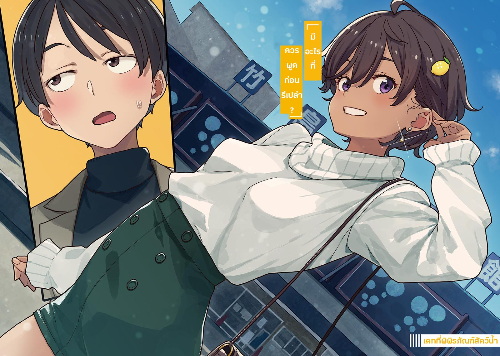

# Ch.46 — เล่ม 6 บทที่ 1-2

Ch.46 — เล่ม 6 บทที่ 1-2

By Monica

Published: 2025-04-23T17:53:37Z

Source: https://www.nekopost.net/novel/14560/46

เล่ม 6 บทที่ 1-2

หลังจากกลับถึงบ้านและเดินขึ้นบันไดมาผมก็เผลอครุ่นคิดถึงคำพูดของยากิชิโอะซ้ำไปซ้ำมา

เดท…

ถึงแม้ความหมายจะต่างกันออกไป แต่การที่เธอถามออกมาตรงๆ ก็ทำให้มั่นใจได้ว่านี่ต้องเป็นเดทแน่นอน

ไม่เคยคิดเลยว่าจะมีเหตุการณ์แบบนี้เกิดขึ้นในช่วงชีวิตมัธยมของผม…

พยายามทำใจให้สงบลงจากหัวใจที่เต้นแรง ผมเปิดประตูเข้าห้อง ก็เห็นคาจูกำลังถือสายวัดอยู่

[ คาจู อยู่ที่นี่เองเหรอ? ]

[ ยินดีต้อนรับกลับค่ะ ท่านพี่! ]

เธอวางสายวัดลงแล้วเดินมาเพื่อช่วยผมถอดเสื้อแจ็คเก็ต

[ วันนี้คงเหนื่อยสินะคะ? มื้อเย็นเราจะมีบุริไดกงที่ท่านพี่ชอบด้วยนะคะ ]

[ โอ๊ะ ฟังดูน่าอร่อยจัง ]

[ เมื่อกี้กำลังวัดอะไรอยู่น่ะ? ]

ขณะที่คาจูกำลังแขวนเสื้อแจ็คเก็ตแล้วเริ่มปลดเนคไท ผมก็มองไปที่สายวัดที่วางอยู่บนโต๊ะ

[ คาจูคิดจะจัดห้องใหม่สักหน่อยน่ะค่ะ ]

จริงเหรอ? แต่นี่มันห้องของผมนะ

[ เอ่อ จำเป็นต้องจัดใหม่ด้วยเหรอ? ตอนนี้ก็ไม่ได้มีปัญหาอะไรนี่นา ]

คาจูเอียงหัวอย่างน่ารักในขณะที่ถือเนคไทที่แกะแล้ว

[ ค่ะ จริงๆ แล้วคาจูกำลังคิดว่า เราจะใส่เตียงของคาจูเข้าไปในห้องนี้ได้มั้ยน่ะค่ะ ]

[ เราจะไม่ทำแบบนั้นนะ ]

[ ถ้างั้น จะเปลี่ยนเป็นเตียงคู่ใช่มั้ยคะ!? ]

[ ไม่ใช่แบบนั้น ]

คาจูนี่ชอบอะไรคิดแผลงๆตลอดจริงๆ

วันวาเลนไทน์ที่ผ่านมา เรามีเรื่องโต้เถียงเล็กน้อยกัน

ผมรู้สึกไม่สบายใจเพราะความสัมพันธ์ระหว่างเราที่เปลี่ยนไป

แต่คิดว่าพวกเราเข้าใจกันดีขึ้นเล็กน้อยจากการคุยกันถึงเรื่องที่ยังไม่เคยพูดออกมา

ตั้งแต่วันนั้น สิ่งเดียวที่ค้างคาใจผมก็คือ ระยะห่างระหว่างผมกับคาจูที่ใกล้ชิดขึ้นเล็กน้อย…

ผมเปิดตู้เสื้อผ้าเพื่อมองหาเสื้อที่เหมาะใส่ไปเดทในขณะที่คาจูกำลังเก็บเนคไท

[ เสื้อตัวที่พี่ซื้อเมื่อปีที่แล้วน่ะ อยู่ไหนนะ? ตัวที่มีลายพิมพ์เป็นหนังสือพิมพ์น่ะ? ]

[ เสื้อตัวนั้นมันมีรูจากตัวมอดแล้วค่ะ คาจูเลยทิ้งไปแล้ว รูมันขึ้นตรงตัวหนังสือน่ะค่ะ ]

เหรอ อย่างนี้นี่เอง แบบนี้ก็มีด้วยสินะ

[ แล้วเสื้อที่มีลายมังกรเล็กๆ ล่ะ? ]

[ มังกรนั่นบินขึ้นฟ้าไปแล้วค่ะ ลมหนาวปีนี้มันแรงมากจริงๆ ]

ก็จริงนะ ลมที่โทโยฮาชิแรงมากเลย เหลือแต่เสื้อเรียบๆแทน

[ ...เสื้อผ้าที่เหลือนี่มันเรียบเกินไปสำหรับวันหยุดมั้ยเนี่ย? ]

คาจูจ้องผมตาเป็นประกายขณะที่ผมบ่นเบาๆ

[ ท่านพี่ จะไปไหนเหรอคะ? ]

[ เอ๊ะ? เอ่อ ก็แค่… ]

ผมตอบแบบอ้อมๆ ไปว่า “อาจจะ” หรือ “แค่นิดหน่อย” แล้วก็ปิดตู้เสื้อผ้า

การบอกน้องสาวเรื่องเดทนี่มันรู้สึกเหมือนพวกซิสค่อนยังไงก็ไม่รู้

◇

แล้ววันเดทจริงก็มาถึงในวันอาทิตย์ ท้องฟ้าปลอดโปร่งอย่างน่าประหลาดใจ

ไม่มีลม แสงแดดช่วงปลายเดือนกุมภาพันธ์แผ่วๆส่งสัญญาณให้รู้ว่านี่ใกล้จะเข้าฤดูใบไม้ผลิแล้ว

ผมยืนอยู่หน้าพิพิธภัณฑ์สัตว์น้ำทาเคะชิมะ ห่างจากโทโยฮาชิไปเพียง 12 นาทีโดยรถไฟความเร็วสูง

— ทำไมยากิชิโอะถึงชวนผมมาเดทกันนะ?

ผมเลิกนับไปแล้วว่าตัวเองถามคำถามนี้ไปกี่ครั้งแล้ว

โดยปกติ เดทจะหมายถึงว่าทั้งสองฝ่ายมีความสนใจต่อกันไม่มากก็น้อย

แต่ถ้าดูในความหมายที่กว้างกว่านั้น คำนี้ก็มักถูกตีความแบบหลวมๆ ในสังคม เหมือนกับคำว่า "เดทแบบกลุ่ม" นั่นแหละ

คิดในแง่นั้นแล้ว มันก็เกินจริงไปหน่อยที่จะคิดว่าคนที่ฮอตอย่างยากิชิโอะอาจจะชอบผม

[ ...บางทีเธออาจจะแค่แกล้งเล่นก็ได้ ]

ผมพูดออกมาเสียงดังเพื่อพยายามโน้มน้าวตัวเอง

การมาเยือนพิพิธภัณฑ์สัตว์น้ำแบบลับๆ แค่เราสองคน-

ถึงแม้ว่าสถานการณ์นี้อาจชวนให้คิดไปไกล แต่ผมไม่ไร้เดียงสาขนาดจะมองว่ามันเป็นสัญญาณของความรักหรอกนะ

มันก็แค่การไปเป็นเพื่อนยากิชิโอะเพื่อเปลี่ยนบรรยากาศก็เท่านั้น ใช่แล้ว ต้องเป็นอย่างนั้นแน่ๆ

พอคิดได้แล้ว ผมก็ปรับปกเสื้อแจ็คเก็ตอย่างกระวนกระวาย

วันนี้ผมใส่ชุดที่คาจูจัดให้

เป็นแจ็คเก็ตที่ยืมมาจากตู้เสื้อผ้าของพ่อ คู่กับเสื้อคอเต่า

มันดูโตเกินไปสำหรับผมแต่ก็เด็กเกินไปสำหรับพ่อ ตอนแรกที่ซื้อมาดูดีมาก แต่ตอนนี้มันแค่เก็บไว้ในตู้เสื้อผ้า

ผมไม่ได้มาพิพิธภัณฑ์สัตว์น้ำนี่นานแล้ว แต่บรรยากาศที่ไม่เปลี่ยนแปลงเลยก็ทำให้รู้สึกสบายใจ

ตัวอาคารที่ดูมีประวัติศาสตร์ยาวนานแห่งนี้เปิดให้บริการมาตั้งแต่รุ่นของปู่ย่าตายาย

แม้ภายนอกจะดูธรรมดา แต่ที่นี่ก็เต็มไปด้วยครอบครัวที่มาเที่ยวกัน

ชั้นล่างของอาคารที่อยู่ติดกันเคยเป็นร้านขายของที่ระลึก แต่ตอนนี้ปิดไปแล้ว

ท่ามกลางบรรยากาศที่ทั้งย้อนยุคและมีชีวิตชีวานี้ รู้สึกเหมือนได้ย้อนเวลากลับไป

และทันใดนั้น สาวน้อยคนหนึ่งก็เดินเข้ามาจากทางลานจอดรถ

ใบหน้าสีน้ำตาลเล็กๆ พร้อมทรงผมสั้นเป็นเอกลักษณ์ นั่นคือยากิชิโอะแน่นอน

ขณะที่ผมยกมือขึ้นทักทายก็ต้องตกตะลึงเล็กน้อยกับลุคของเธอ

ยากิชิโอะสวมมินิสเกิร์ตคู่กับเสื้อไหมพรมแขนฟูดูนุ่ม

มันเรียบง่าย แต่ดูเข้ากับสไตล์ของเธออย่างลงตัวแถมยังดึงดูดสายตาอีก

...ยากิชิโอะสวยขนาดนี้ตลอดมาเลยเหรอ?

เธอโบกมือทักทายเบาๆ เมื่อเห็นท่าทางตะลึงของผม

[ ขอโทษที่ให้รอนะ นุกคุง เป็นอะไรไปเหรอ? ดูเหมือนจะค้างไปเลยนะ ]

[ อ่ะ ไม่-ไม่เป็นไรครับ ]

ผมตอบกลับไปโดยไม่ได้ตั้งใจที่จะพูดสุภาพ รู้ว่าเธอน่ารักอยู่แล้ว แต่แบบนี้มันเหนือความคาดหมายจริงๆ...

[ เอ่อ งั้นเราไปซื้อตั๋วกันเลยมั้ย? ]

[ เดี๋ยวก่อนสิ นุกคุง ]

ยากิชิโอะค่อยๆ จับแขนผมไว้ขณะที่ผมรีบไปทางบูธขายตั๋ว

เธอปัดผมที่ปิดหูไปข้างหลัง เผยให้เห็นต่างหูเล็กๆ ที่เปล่งประกายแวววาว

[ มีอะไรที่ควรพูดก่อนรึเปล่า? ]

...จะเป็นอะไรดีล่ะ? ผมไม่ได้มาสาย แล้วก็ไม่ได้ติดหนี้เธอด้วย

หรือว่าจะเป็นบทสนทนาที่ควรพูดในวันเดทกันนะ?

[ ...อา คือ วันนี้ เธอดูมีสไตล์มากเลย ]

[ มีสไตล์ ? ]

[ แล้วก็ดูดีมากด้วยล่ะ….... ]

หลังจากพูดจบไปอย่างอายๆ ยากิชิโอะก็ยิ้มกว้าง เผยให้เห็นฟันขาวสะอาดของเธอ

[ งั้น ฉันให้อภัยก็แล้วกัน ]

ผมได้รับการให้อภัยแล้ว

[ ไปเถอะ เดี๋ยวตั๋วหมด ]

[ ไม่หมดหรอกน่า—เฮ้ อย่าดึงสิ ]

ขณะที่ยากิชิโอะที่อารมณ์ดีดึงผมไปอย่างร่าเริง ผมก็เช็ดเหงื่อที่หน้าผากอย่างลับๆ ด้วยผ้าเช็ดหน้า

ไม่มีข้อสงสัยอะไรอีกแล้ว ผมเคยสงสัยอยู่เกือบ 90% แต่ตอนนี้ผมผิดไปเต็มๆ เลย

นี่ไม่ใช่แค่เพื่อความสนุก แต่มันเป็นเดทจริงๆ

◇

ห้องแสดงของพิพิธภัณฑ์สัตว์น้ำทาเคะชิมะ อยู่แค่ชั้นแรก ไม่ได้กว้างใหญ่อะไรนัก

เล็กพอให้เดินผ่านได้ภายในเวลาไม่กี่นาที แต่ก็มีเหตุผลว่าทำไมที่นี่ถึงได้รับความนิยม

[ นี่ นุกคุง รู้มั้ยว่าแมงดาทะเลนี่ไม่อร่อยเลยนะ? ]

[ อ่า เลือดมันก็เป็นสีฟ้าด้วย ]

ใช่เลย ที่นี่ขึ้นชื่อเรื่องคำอธิบายด้วยลายมือของเจ้าหน้าที่ โดยเฉพาะบทรีวิวอาหารที่ได้รับคำชื่นชมอย่างมาก ยานามิสามารถใช้เวลาทั้งวันอยู่ที่นี่ได้เลย

ขณะที่อ่านคำอธิบายและดูปลา ยากิชิโอะก็ร้องขึ้นอย่างตื่นเต้นเมื่ออยู่หน้าตู้ถัดไป

[ ว้าว ดูปลาไหลมอเรย์พวกนี้สิ! ]

อย่างที่ยากิชิโอะบรรยายเลย ปลาประมาณสิบตัวกำลังแหวกว่ายอยู่ในตู้ที่ใหญ่กว่าเล็กน้อย

จากคำอธิบาย ตู้นี้มีปลาไหลมอเรย์ถึงแปดสายพันธุ์

ยากิชิโอะบ่นเบาๆ อย่างสงสัยขณะจ้องมองตู้ด้วยความสนใจ

[ เราจำเป็นต้องมีปลาเยอะขนาดนี้เลยเหรอ? แยกไม่ออกเลยว่าตัวไหนเป็นตัวไหน ]

เธอบ่นกับใครน่ะ? พระเจ้าเหรอ?

[ ต้องมีสิ มันเป็นเรื่องของ...ความหลากหลายทางชีวภาพอะไรแบบนั้น ]

[ อ้อ ความหลากหลายทางชีวภาพสินะ งั้นคงเลี่ยงไม่ได้แล้วล่ะ ]

เราเดินคุยกันแบบไม่ค่อยฉลาดนักก่อนจะเดินต่อไป ข้างหน้าคือถังน้ำตื้นขนาดใหญ่ตรงกลางทางเดิน กว้างประมาณสามเสื่อทาทามิและสามารถมองได้รอบด้าน ไม่ใช่แค่มองด้านข้าง

ยากิชิโอะรีบเดินไปด้วยความตื่นเต้น ผมตามไปแบบไม่ได้คาดหวังอะไร

...พวกเราคุยกันอย่างเป็นปกติ ยังไงก็ตาม ถึงคำว่า “เดท” จะทำให้ผมรู้สึกตื่นเต้น แต่ยากิชิโอะก็ดูเป็นตัวของตัวเองมากกว่าที่เคย เพราะงั้นผมต้องพยายามทำตัวให้เป็นปกติสองเท่า

ผมไม่ได้ทำอะไรแปลกๆ ใช่มั้ยนะ?

[ นี่ นุกคุง มาทางนี้เร็ว! ]

[ อ่ะ เออ ]

เมื่อผมมายืนข้างๆยากิชิโอะและมองลงไปในถัง เราเห็นแนวปะการังที่เรียงกันเป็นชั้นๆ พร้อมปลาสวยงามสีสันสดใสแหวกว่ายอยู่รอบๆ

การสนทนาของเราหยุดลง และปลาสีสันสดใสที่แหวกว่ายอยู่นั้นก็ดึงดูดสายตา

— ทำให้นึกถึงช่วงฤดูร้อนที่ผ่านมา ช่วงเวลาที่เงียบสงบนี้

คืนนั้นที่ศาลเจ้า ท่ามกลางกลิ่นหญ้าและดิน ยากิชิโอะยืนอยู่ข้างๆผม น้ำตาไหลอาบแก้มเธอ

ตอนนี้เธอยืนอยู่ข้างผม แต่งตัวสวย พร้อมกลิ่นหอมของเครื่องสำอางและน้ำหอม

เมื่อผมหันไปมอง ดวงตาสีน้ำตาลของยากิชิโอะก็มองตรงมาที่ผม

[ เป็นอะไรไป? ]

[ เอ่อ ไม่ แล้วเธอล่ะ ยากิชิโอะ? ]

ยากิชิโอะยิ้มให้ผมด้วยรอยยิ้มที่ดูเป็นผู้ใหญ่ ขณะที่ผมพยายามคิดคำพูด

[ สวยมากเลยใช่มั้ยล่ะ? ]

[ ใช่ มันสวยจริงๆ ]

ผมก้มหน้าลงมองถังเพื่อซ่อนความเขินอาย

สายตาของเรากลับมาสบกันอีกครั้งในเงาสะท้อนบนผิวน้ำ และเราต่างก็ยิ้มออกมา

ต่างหูของยากิชิโอะสะท้อนแสงบนผิวน้ำ แวววาวและโยกเบาๆ

เงานั้นเต้นระบำอยู่ในสายตาของผม ทำให้เสียงจอแจของพิพิธภัณฑ์สัตว์น้ำดูล่องลอยห่างไกล

ผมยืนนิ่งอยู่ พลางมองดูปลาเขตร้อนและเงาสะท้อนของยากิชิโอะบนผิวน้ำ

◇

ยากิชิโอะเริ่มพึมพำเบาๆ ขณะที่ผมมองดูคาปิบาร่าผ่านกระจก

[ พอเรายืนข้างกันแบบนี้ มันทำให้นึกถึงคืนนั้นเลยนะ จำตอนที่เราไปโรงเรียนประถมอาโอกิด้วยกันได้มั้ย ? ]

[ ...ฤดูร้อนที่แล้วใช่มั้ย? ]

ยากิชิโอะพยักหน้าเบาๆ

มันเป็นช่วงใกล้จะปิดเทอมฤดูร้อน ยากิชิโอะกับผมเดินไปตามถนนยามค่ำคืนเพื่อไปพบอายาโนะเป็นครั้งสุดท้าย

มันเป็นการปิดฉากความรักที่พังทลายลง

ผมยังไม่รู้เนื้อหาของบทสนทนาที่เธอคุยกับอายาโนะในคืนนั้น และก็ยังไม่เข้าใจความรู้สึกที่แท้จริงของยากิชิโอะ

แต่ความทรงจำในครั้งนั้นยังคงเป็นเสี้ยวหนึ่งที่สำคัญในใจของยากิชิโอะ

มันยังคงเปล่งประกายสดใสอยู่จนไม่มีที่ว่างให้ความรักอื่นใดเข้ามาได้

แล้วสายตาของยากิชิโอะก็ดึงผมกลับจากความคิด

[ ...เอ่อ เป็นอะไรไป? ]

ยากิชิโอมองผมนิ่งๆ สายตาแน่วแน่

ผมพยายามสบตาเธอ

แต่เธอก็เบือนหน้าไปอีกทางในวินาทีถัดมา

เอ๋ ผมทำอะไรให้เธอโกรธหรือเปล่า...?

ขณะที่กำลังจะเดินไปดูตู้ถัดไป ก็รู้สึกได้ว่าเธอกำลังจ้องผมอีกครั้ง พอหันไปมองเธอ เธอก็รีบหันหน้าหนี พร้อมยิ้มและกลั้นหัวเราะ ไหล่ของเธอสั่นเล็กน้อย

...กำลังแกล้งผมสินะ งั้น จะเล่นด้วยแล้วกัน

ผมทำท่าเหมือนจะเดินหนีไป แล้วหันกลับไปหาเธอทันที

[ เฮ้ นี่มันโกงไม่ใช่หรือไง? ]

[ ไม่มีการโกงในการเล่นหรอกนะ ตอนนี้เสมอกันแล้ว ]

ผมตอบกลับอย่างเย็นชาก่อนจะเดินต่อไปข้างหน้า

[ ฉันยังนำอยู่ 2 ต่อ 1 นะ ]

เธอประท้วงและเดินตามมา

แต่ส่วนนี้ก็เป็นแผนของผมเหมือนกัน ผมหันไปทันทีโดยไม่ให้เธอตั้งตัว

แต่ยากิชิโอะกลับเร็วกว่าผม เธอเลี่ยงมาด้านข้างแล้วจิ้มแก้มผมเบาๆ

[ จับได้แล้ว 3 ต่อ 1 แล้วนะ ]

...เธอกำลังแกล้งผมจริงๆ ว่าแต่ไอกฎของเกมนี้มันคืออะไรกันแน่?

[ นี่ นุกคุง ลองหาฉันให้เจอสิ ]

ดูเหมือนว่าครั้งนี้เธอกำลังจะหลบอยู่หลังผม

ผมหันไป เธอก็คว้าไหล่ผมแล้วเบี่ยงตัวไปอีกด้านอย่างรวดเร็ว

[ นั่นไง 4 ต่อ 1 แล้ว! ]

[ อย่าจับไหล่ผมสิ ]

...ไม่ดีแน่ผมรู้สึกถึงสายตาของคนรอบข้างแล้ว

เราคงดูเหมือนคู่รักที่งี่เง่าในสายตาคนอื่น

[ โอเค ยอมแพ้แล้ว ขอร้องปล่อยผมเถอะ ]

[ อะ ยอมแพ้ง่ายๆ แบบนี้เลยเหรอ? ]

[ มันรบกวนคนอื่นน่ะ ไปต่อเถอะ ]

ยากิชิโอะยื่นลิ้นออกมาเล่นๆ แล้วดันผมจากด้านหลัง กระตุ้นให้เดินต่อไป

เฮ้อ วันนี้ยากิชิโอะดูตื่นเต้นจริงๆ

ผมพยายามทำหน้านิ่ง แต่ไม่รู้ทำไม รอยยิ้มกลับโผล่ออกมาบนใบหน้า

[ ไม่เคยรู้มาก่อนเลยว่า... ]

ผมพึมพำกับตัวเองเบาๆ

เดท...มันสนุกมากขนาดนี้

---
