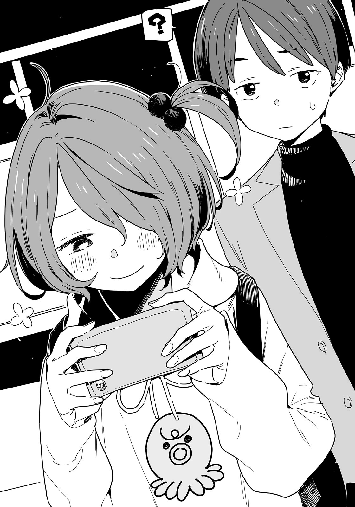

# Ch.47 — เล่ม 6 บทที่ 1-3

Ch.47 — เล่ม 6 บทที่ 1-3

By Monica

Published: 2025-04-23T17:53:46Z

Source: https://www.nekopost.net/novel/14560/47

เล่ม 6 บทที่ 1-3

เดทแรกของผมกำลังเป็นไปด้วยดี

หลังจากออกมาจากห้องน้ำและแน่ใจว่ายากิชิโอะไม่ได้อยู่แถวนั้น ผมวางมือลงที่หน้าอกแล้วสูดลมหายใจลึกๆ

หลังจากเกมลึกลับที่ดึงดูดสายตาผู้คน เราก็เริ่มเล่นเกมบังกันตัดหน้ากันไปมาแบบเด็กๆ — อันที่จริงมันก็เหมือนพฤติกรรมแสนซนในวัยประถม

แต่เพราะอยู่ในบริบทของการออกเดท เกมเด็กๆพวกนี้กลับดูเหมือนการหยอกล้อกันอย่างน่ารักของคู่รักงี่เง่า

ผมอยากจะเล่าเรื่องนี้ให้ใครสักคนฟังจริงๆ บางทีอาจจะเอาใส่ในนิยายเล่มหน้าของผมได้ แล้วให้ยานามิกับโคมาริช่วยวิจารณ์ดู

[ ...ไม่สิ ต้องใจเย็นก่อน ]

ขอบอกก่อนเลยว่า ผมกับยากิชิโอะเป็นแค่เพื่อนกัน เราแค่มาเดทด้วยกันเท่านั้น

สำหรับยากิชิโอะ ก็คงแค่สนุกสนานไปกับความไร้เดียงสาเหมือนในวัยเด็ก

จากนั้นก็มีเงารางๆสะท้อนเข้ามาที่ดวงตาของผม

...เงานั้นคุ้นตาอย่างน่าประหลาด

โดยเฉพาะสิ่งมีชีวิตตัวน้อยที่มักจะอ่านหนังสืออยู่มุมห้องชมรมหรือไม่ก็อาละวาดพาลใส่คนอื่น

ขณะที่ผมกำลังครุ่นคิดและเริ่มเดินไปทางนั้น—

[ มีอะไรเหรอ นุกคุง? ]

เสียงของยากิชิโอะหยุดฝีเท้าผมไว้

[ อ๋อ คิดว่าเห็นอะไรบางอย่างตรงนั้นน่ะ ]

[ หรือว่าจะเป็นพวกนั้น? ]

ยากิชิโอะดูสนใจอย่างไม่น่าเชื่อ เธอชะโงกมองข้ามไหล่ผมไปทางโถงทางเดิน

[ บางสวนสัตว์ก็ปล่อยพวกห่านเดินเพ่นพ่านใช่มั้ยล่ะ ? อาจจะมีอะไรแบบนั้นที่นี่ก็ได้ ]

[ เราอยู่ในอควาเรียมนะ ตัวมันจะแห้งเอา.... ]

[ ก็แค่สาดน้ำใส่สิ เอาเถอะ เราควรไปกันได้แล้ว ]

อ้อ ใช่เลย ไม่มีเวลาแล้ว เพราะโชว์สิงโตทะเลซึ่งเป็นไฮไลท์ของอควาเรียมกำลังจะเริ่ม

เราผ่านประตูอัตโนมัติออกสู่ลานด้านนอก

เวทีโชว์นั้นมีขนาดประมาณสองห้องชมรมวรรณกรรมต่อกัน มีสระน้ำที่ใหญ่ประมาณสองเท่าอยู่ด้านหน้า บรรยากาศดูอบอุ่นสบายๆ

ที่นั่งนั้นจัดเป็นขั้นๆ มีแค่ห้าแถว ยากิชิโอะกับผมเลือกนั่งที่แถวสาม

ยากิชิโอะมองไปรอบๆ ท่าทางดูคิดถึง

[ ตั้งแต่ที่ฉันมาดูโชว์นี้ครั้งสุดท้ายก็ผ่านมา5ปีแล้วมั้ง ทุกอย่างยังเหมือนเดิมเป๊ะเลย ]

ผ,ก็ไม่แน่ใจว่าผ่านมากี่ปีแล้วเหมือนกัน พอกิจกรรมครอบครัวเริ่มหายไป ถึงได้รู้ว่าเราต่างคนต่างใช้วันหยุดสุดสัปดาห์กันไปคนละทาง

ผมไม่ได้รู้สึกเศร้าสักเท่าไหร่ แต่พอมองย้อนกลับไปแล้ว มันก็ดูเหมือนจะเปลี่ยนแปลงเร็วไปหน่อย

[ ครั้งสุดท้ายที่มาที่นี่คือตอนที่น้องสาวพึ่งขึ้นประถมล่ะมั้ง ส่วนมากถ้าไม่มีน้องมาด้วยก็จะไม่ค่อยมาหรอก ]

[ อาจจะจริงนะ ฉันก็มีน้องสาวอยู่ ป.6 คนนึงเหมือนกัน ]

เดี๋ยวนะ ยัยนี่เป็นพี่สาวเหรอ?

ภาพของการเล่นคู่พี่น้องอาซะกุโมะกับยากิชิโอะลอยเข้ามาในหัวผม มันไม่ใช่ความผิดของผมเลยสักนิด!

[ ...น้องสาวฉันเรียบร้อยมากนะ นุกคุง นายไม่คิดว่าฉันเป็นขั้วตรงข้ามของเธอเหรอ? ]

[ จะไปรู้ได้ไง? ]

ยากิชิโอะจ้องผมตาเขียว แล้วดึงหูผมอย่างแรงหลังจากผมตอบไปตามตรง

โอ๊ย เจ็บนะ!

ขณะที่ผมกำลังทนต่อความรุนแรงที่ไร้เหตุผลนี้ คนดูรอบๆ ก็เริ่มเพิ่มมากขึ้น

พอที่นั่งเริ่มเต็ม หญิงสาวคนหนึ่งพร้อมสิงโตทะเลก็ปรากฏตัวบนเวที

โชว์เริ่มขึ้นทันทีที่เธอส่งสัญญาณให้สิงโตทะเล

เธอโยนห่วงไปให้สิงโตทะเลที่จับอย่างคล่องแคล่วและสวมเข้าคอได้อย่างพอดิบพอดี

[ ดูนั่นสิ นุกคุง! สิงโตทะเลสุดยอดเลยเนอะ ? ]

ยากิชิโอะชี้อย่างตื่นเต้น

เฮ้อ อายุ 16 แล้ว แต่ยากิชิโอะก็ยังมีมุมเหมือนเด็กอยู่ดี

แน่นอนว่าทักษะการโยนห่วงของหญิงสาวนั้นยอดเยี่ยม และความผูกพันระหว่างเธอกับสิงโตทะเลก็น่าประทับใจจริงๆ

...ตอนเด็กๆ ผมไม่ทันสังเกตหรอก แต่การแสดงนี้ถือว่าขั้นสูงมากเลยทีเดียว

แม้จะไม่ได้ฉูดฉาดอะไร แต่ตอนที่สิงโตทะเลกระโดดลงสระสำเร็จในตอนท้าย ผมก็เผลอปรบมืออย่างเป็นธรรมชาติ

[ เห็นมั้ย ? กระโดดครั้งสุดท้ายนั่นสุดยอดเลยนะ! มาอควาเรียมทั้งทีต้องดูโชว์สิงโตทะเลให้ได้สิ! ]

[ อืม เธอพูดถูก… ]

ยากิชิโอะคงจะตื่นเต้นเหมือนกัน แต่เธอกลับนิ่งไป มือขวาค้างกลางอากาศ เหมือนลังเลอยู่

[ เป็นอะไรไป ยากิชิโอะ? มีแมลงอะไรเกาะอยู่หรือเปล่า? ]

[ อ๋อ ก็แค่... ]

พอโชว์จบ คนดูก็เริ่มทยอยกลับเข้าไปข้างใน

ทันใดนั้น ยากิชิโอะลุกพรวดขึ้น

[ นุกคุง ฉันต้องไปคุยโทรศัพท์หน่อย เดี๋ยวมานะ! ]

[ หือ? ได้สิ ไม่ต้องรีบหรอก ]

[ ฉันจะรีบมา! ]

เธอหยิบโทรศัพท์ออกมาแล้วรีบเดินกลับเข้าไปในอาคาร ทิ้งให้ผมนั่งอยู่คนเดียวในที่นั่งโล่งๆ

เกิดอะไรขึ้นเนี่ย?

แล้วผมก็สังเกตเห็นกระดาษพับเล็กๆ แผ่นหนึ่งอยู่ที่ที่นั่งของยากิชิโอะ

อาจจะเป็นกระดาษบอกตารางเวลารถบัสหรือเปล่านะ?

ผมหยิบมันขึ้นมาอย่างไม่ได้คิดอะไร เปิดดูข้อความที่เขียนด้วยลายมือกลมๆ น่ารัก

< ขั้นตอนที่ 1 - จับมือ >

“ห้ามเริ่มจับมือก่อนเด็ดขาด! แค่บอกใบ้ให้ฝ่ายชายเป็นคนเริ่มเอง!”

...นี่มันอะไรเนี่ย? จริงๆแล้ว นี่คืออะไร? แล้วทำไมยากิชิโอะถึงมีของแบบนี้ด้วย?

ดูเหมือนจะมีขั้นตอนอื่นอีก แต่ผมคิดว่าไม่ควรจะดูต่อ

[ แต่เราเคยจับมือกันแล้วนี่นา... ]

งั้นแผนนี้จะมีไว้ทำไม? ผมคิดอย่างสับสนแล้วลุกขึ้นยืน

การที่จู่ๆก็ไปคุยโทรศัพท์มีขึ้น โน้ตแปลกๆ นั่น—ให้ความรู้สึกเหมือนเหตุการณ์พลิกผันที่น่าตกใจในมังงะเรื่องนึงที่ผมเพิ่งอ่านมา

อะไรบางอย่างดึงความสนใจของผมที่ขอบสายตา

ดูเหมือนมีใครบางคนหลบอยู่หลังที่นั่ง สูงระดับไหล่ของผม ผมที่รวบไว้แบบยุ่งๆ โผล่ออกมาให้เห็นเป็นระยะ

...จะต้องเป็นยัยนั่นแน่ๆ

ผมค่อยๆ ย่องไปหลังที่นั่งเพื่อยืนยันตัวตนของคนลึกลับคนนั้น

เด็กสาวที่สูงระดับไหล่ผม ใส่เสื้อฮู้ดสีเหลืองสด กับกางเกงขาสั้น มีเป้สีเขียวประดับพวกเข็มกลัดและของจุกจิกที่กระทบกันดังกรุ๊งกริ๊ง และรองเท้าผ้ากใบเขียวเข้าชุดกัน

ทรงผมกับเงานั่นไม่ผิดแน่ นี่มันโคมาริชัดๆ แต่ชุดแบบนั้นมันอะไรเนี่ย ?

ผมแอบมองจากด้านหลังโคมาริ (ที่คิดว่าใช่) กำลังดูวิดีโอโชว์สิงโตทะเลในโทรศัพท์ของเธอ

[ ถ-ถ่ายได้เยี่ยมเลย… ]

[ โคมาริ ทำไมแต่งตัวแบบนั้นล่ะ? ]

[ อุวะ!? ]

โคมาริสะดุ้งเฮือกจนกระโดดถอยหลัง มือกุมสมาร์ทโฟนแน่น ปากสั่นเปิดๆ ปิดๆ ด้วยความตกใจ

ชุดที่ไม่คุ้นตาและท่าทางที่ดูน่าสงสัยกว่าปกติทำให้ผมอดคิดไม่ได้...อย่าบอกนะว่า-

[ นี่เธอแอบปลอมตัวเหรอ? ]

โคมาริส่ายหัวแรงๆ

[ ม-ม-ไม่ใช่โคมาริซะหน่อย! ]

ใครจะไปเชื่อล่ะ

ผมยังไม่ได้บอกเรื่องเดทนี้กับใครนี้ จากที่ผมสังเกตในห้องชมรม ยากิชิโอะก็ไม่ได้เล่าให้ใครในชมรมวรรณกรรมฟังเหมือนกัน แต่โคมาริมาโผล่ที่นี่ หมายความว่า...

[ โคมาริ ใครบอกเธอเรื่องนี้ มีคนอื่นยู่อีกมั้ยนอกจากเธอ? ]

[ อ-อือ น-นอกจากฉ-ฉัน… ]

[ มี . ใคร . อีก . ? ]

เมื่อผมกดดันให้เธอตอบ โคมาริก็มองขึ้นมาด้วยสายตาน้อยใจ น้ำตาคลอเบ้า

[ เฮ้! ไม่ได้จะโทษเธอนะ โอเค๊ ? เอานี่มั้ย หมากฝรั่งแบบเป่าฟองได้ ]

โคมาริรับหมากฝรั่งไปเคี้ยว ก่อนจะพูดพึมพำเบาๆ

[ ...อ-เอาเป็นว่า ฉันไม่ใช่โคมาริ ต...ตั้งแต่แรกแล้ว ]

ไม่หรอก เธอคือโคมาริชัดๆ แต่ครั้งนี้ผมเริ่มรู้สึกว่าตัวเองพูดผิดไปหน่อย

[ เอ่อ ขอโทษนะ ไม่น่าพูดแบบนั้นเลย แล้วเรื่องชุดของเธอ... ]

ผมมองลงไปที่ชุดของโคมาริที่ทั้งฉูดฉาดแต่ก็ดูน่ารักไปพร้อมกัน

[ อ่า มันดูน่ารักดีนะ เหมาะกับเธอดี ]

[ แค่กๆ ! ]

เป็นอะไรไป โคมาริ? สำลักหมากฝรั่งเหรอ?

[ ไหวมั้ยเนี่ย? เขาว่ากันว่าถ้าเป็นแบบนี้ให้ตบที่หลังระหว่างสะบักนะ ]

โคมาริไอโขลกๆ ก่อนจะจ้องผมแล้วตะโกนใส่

[ ป-ไปตายซะ! ]

จากนั้นเธอก็วิ่งหนีไป ผมไม่ค่อยเข้าใจเท่าไหร่ แต่ดูเหมือนเธอจะไม่เป็นอะไร

แต่ทำไมโคมาริถึงมาอยู่ที่นี่ล่ะ? หรือเธอตามเรามาจริงๆ...?

แล้วจู่ๆ ยากิชิโอะก็โผล่เข้ามาแทนที่โคมาริ

[ ยากิชิโอะ เมื่อกี้พึ่งเจอโคมาริ- ]

ยังพูดไม่ทันจบ กระสุนสีเหมือนข้าวสาลีก็พุ่งผ่านผมไป ยากิชิโอะกระโดดขึ้นที่นั่งแล้วเริ่มค้นหาบริเวณที่เราเคยนั่งกัน

[ หาอะไรอยู่เหรอ? ]

ผมเดินเข้าไปถาม ยากิชิโอะเงยหน้าขึ้นมาพร้อมกับสีหน้าลนลาน

[ นุกคุง! เห็นกระดาษแผ่นเล็กๆ แถวนี้มั้ย? ]

กระดาษใบนั้นเป็นของเธอสินะ ผมยื่นให้เธออย่างเงียบๆ

[ เจอแล้ว! ดีจัง ฉันกลัวว่ามีใครจะมาเห็นเข้า- ]

รอยยิ้มของยากิชิโอะค้างไป เธอเอียงหัวด้วยความสงสัย

[ นาย....ได้อ่านหรือเปล่า? ]

[ ….นิดหน่อย ]

สีหน้าของยากิชิโอะเปลี่ยนเป็นสีหน้าที่ดูจริงจัง เธอคว้าคอเสื้อแจ็กเก็ตผมไว้แน่น

[ ไม่ใช่อย่างนั้นนะ! ฉันไม่ได้อยากได้มันหรอก แต่แม่ฉันให้มาเท่านั้นเอง เข้าใจมั้ย! ]

[ ไม่ได้อ่านเนื้อหานะ! ใจเย็นก่อน ปล่อยคอเสื้อผมเถอะ หายใจเข้าลึกๆ ]

[ อืม…….หายใจเข้า…..หายใจออก ]

ยากิชิโอะสงบลงแล้วปล่อยมือ

[ แล้วโน้ตนั่นเกี่ยวกับอะไรล่ะ? ]

[ ก็...เหมือนเป็นเคล็ดลับออกเดทอะไรแบบนั้น ฉันบอกแม่ว่าจะไปเดท แล้วเธอก็ตื่นเต้นใหญ่ แถมยังให้ยืมชุดมาอีก ]

เดี๋ยวนะ กระโปรงสั้นตัวนั้นเป็นของแม่ยากิชิโอะเหรอ?

อยู่ดีๆ ผมก็รู้สึกใจเต้นแรงขึ้นมา โดยไม่มีเหตุผลพิเศษอะไรเลยจริงๆ ไม่มีเหตุผลอะไรเลย

[ แต่ว่า เธอก็เคยออกไปกับอายาโนะนี่- ]

ผมหยุดพูดกลางคัน กลืนคำพูดลงคอ

ยากิชิโอะเคาะหน้าอกผมรัวๆ เหมือนเคาะประตู

[ นายไม่ต้องกังวลหรอก ที่ไปเที่ยวกับมิตสึกิก็ไม่เหมือนกับเดทหรอก? ถ้าจะเป็นเดทได้ก็ต้องตอนที่ประกาศว่าเป็นเดทเท่านั้น ]

ผมพยักหน้าเห็นด้วย ยากิชิโอะพูดมีเหตุผลดี ต่างจากใครบางคนที่สนใจแต่เรื่องกิน

เธอหมุนตัวแล้วเดินกลับไปยังอาคารพลางฮัมเพลงเบาๆ

ผมเดินตามเธอผ่านประตูอัตโนมัติ ยากิชิโอะโบกมือเรียกผมจากหน้าห้องห้องหนึ่ง

[ เฮ้ มานี่สิ ]

[ หืม มีอะไรในนั้นเหรอ? ]

ผมเดินเข้าไปที่ห้องนั้น ข้างในมืดกว่าห้องอื่นๆ ที่ปลายสุดมีแทงก์น้ำทรงหกเหลี่ยมเรืองแสง ปล่อยให้แมงกะพรุนลอยละล่องอยู่ในนั้นอย่างสวยงาม

ยากิชิโอะกับผมยืนข้างกันพลางมองพวกมันไปอย่างงียบๆ

แสงที่ส่องแมงกะพรุนไม่ได้เป็นแสงสีจัดจ้าน แต่เป็นแสงขาวเรียบง่าย

แมงกะพรุนลอยไปมาอย่างช้าๆ

เวลาผ่านไปโดยไม่มีใครต้องพูดอะไร รู้สึกเหมือนบางอย่างกำลังทำให้ผมไม่สบายใจ ผมเลยพูดขึ้น

[ ...รู้สึกเหมือนมาเดทจริงๆ เลย ]

พอได้ยินแบบนั้น ยากิชิโอะก็หยิกข้อศอกผมเบาๆ

[ มันก็คือเดทจริงๆตั้งแต่แรกแล้วไง นายนี่หยาบคายจังเลยนะ นุกคุง ]

ก็ใช่ …..ยากิชิโอะหันมามองผม เธอเม้มริมฝีปากแน่น

[ ก่อนหน้านี้นายยังตั้งใจหลอกฉันอยู่เลย ]

เธอพูดถึงตอนที่เราแกล้งกันเหมือนคู่รักงี่เง่า—ไม่สิ หรือที่เล่นแบบเด็กประถมบ้าๆ บอๆ กันก่อนหน้านี้หรือเปล่า?

[ ก็แค่แพ้เธอเรื่องไหวพริบน่ะสิ ]

[ ฮึ ถ้างั้น นายไม่ชอบสบตาฉันหรือไง? ]

[ ไม่ใช่อย่างงั้น.. ]

ยากิชิโอะจ้องตาผมตรงๆ ตอนที่ผมพยายามอธิบาย

[ เอาล่ะ เริ่ม! ถ้าหลบหน้า นายแพ้ ]

หา? อะไรของเธอ? ใบหน้าที่ดูจริงจังของยากิชิโอะอยู่ใกล้ผมมาก

[ ด- เดี๋ยวสิ ]

[ ห้ามพูดด้วยนะ โอเคมั้ย? ]

ในมุมมืดของอควาเรียม มีแมงกะพรุนเรืองแสงอ่อนๆ เป็นฉากหลัง ใบหน้าเล็กๆของยากิชิโอะอยู่ใกล้ใบหน้าของผม

ขนตายาวของเธอไหวเบาๆ ทุกครั้งที่กระพริบตา

ผิวที่มีสีแทนแต่ก็ดูบอบบางนั้นเรียบเนียนไร้ที่ติ

ริมฝีปากบางๆ ที่ยิ้มอย่างเขินอาย

ผมเห็นเงาตัวเองสะท้อนอยู่ในดวงตาสีน้ำตาลคู่นั้น

กลิ่นหอมอ่อนๆ ของน้ำหอมทำให้ผมมึนหัวเบาๆ

...รู้สึกเหมือนจะถึงขีดจำกัด และตอนที่ผมกำลังจะยอมแพ้-

[ ...เสมอกันนะ ]

ยากิชิโอะถอยออกไปเล็กน้อยด้วยท่าทางเขินๆ แล้วก้มหน้าลง

[ เอ๊ะ? อ่า ใช่ เสมอกัน... ]

ผมพูดซ้ำไปมา ทั้งที่หัวสมองยังมึนเบลอ

[ เอาล่ะ นุกคุง ไปดูอย่างอื่นต่อเถอะ! ]

ผมรีบเดินตามยากิชิโอะที่เดินเร็วขึ้นอย่างกระตือรือร้นไป-

---
