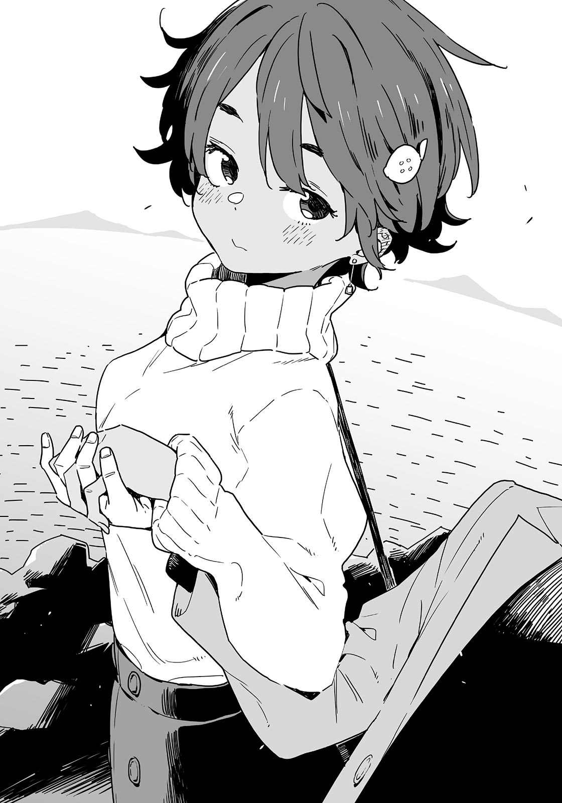

# Ch.48 — เล่ม 6 บทที่ 1-4

Ch.48 — เล่ม 6 บทที่ 1-4

By Monica

Published: 2025-04-23T17:54:08Z

Source: https://www.nekopost.net/novel/14560/48

เล่ม 6 บทที่ 1-4

[ นุกคุง ดูกลัวกว่าที่คิดนะ ลองแตะมันดูสิ? ]

[ แต่...ตอนที่จะทำเข้าจริงๆมันดูน่ากลัวจริงๆนะ ]

ผมลังเลและก้าวถอยหลังไป ยากิชิโอะเข้ามาใกล้พร้อมรอยยิ้มซุกซน-

เดทของเรายังคงดำเนินต่อไป และคราวนี้เรามาอยู่ที่ทัชพูล

/* บ่อที่เอามือไปจับๆแตะๆได้ */

ทัชพูลเป็นจุดที่ได้รับความนิยมจากผู้เยี่ยมชมเสมอ

[ ลองคิดดูสิ บ่อสัมผัสชอบมีปูเสฉวนหรือปลาดาวใช่มั้ย? การมีปูแมงมุมญี่ปุ่นในนี้ก็เหมือนกับมี โชเฮ โอตานิ มาเป็นพินซ์ฮิทเตอร์นั่นแหละ ]

/* โชเฮ โอตานิ เป็นนักเบสบอลมืออาชีพของญี่ปุ่น */

ใช่ ทัชพูลมีปูแมงมุมญี่ปุ่นที่มีความยาวเกินเมตรนึงแน่ๆ ซึ่งถือว่าไม่ธรรมดาเลย

มันดูแปลกตาราวกับมันเป็นลาสบอสในเกม

[ ถ้าเป็นโอตานิ ฉันก็โอเคที่จะจับมือด้วยนะ ดูสิ กระดองของมันเป็นหลุมบ่อ น่ารักดี ]

ยากิชิโอะจับมือผมแล้วจุ่มลงไปในน้ำอย่างแรง

ตามคาด กระดองของปูนั้นทั้งขรุขระทั้งสากมาก

[ แตะแล้วนะ ! แตะแล้วจริงๆ! ]

ผมรีบถอนมือออกมา หัวใจที่เต้นแรงเมื่อสักครู่เริ่มผ่อนคลาย เพราะสุดท้ายเธอก็ยังเป็นยากิชิโอะคนเดิม

[ ...เธอจับมือเป็นธรรมชาติโดยไม่ต้องดูโน้ตนั้นเลยเหรอ ]

[ โน้ต? ]

ยากิชิโอะที่แสดงสีหน้างุนงงอยู่พักหนึ่งหน้าแดงขึ้นทันที

[ นายอ่านจริงๆด้วย! ฉันบอกแล้วว่าแม่ให้มา- ]

เธอหยุดพูดไปครึ่งทางเมื่อรอยยิ้มแสนซนปรากฏขึ้นที่ริมฝีปาก

[ อะ-อะไรเหรอ? ]

[ ดูนั่นสิ มีไอโซพอดยักษ์อยู่ตรงนั้นด้วย !]

ไอโซพอดยักษ์เป็นสัตว์คล้ายเหาทะเลขนาดใหญ่เท่าฝ่ามือเด็ก ไม่เข้าใจเลยว่าทำไมถึงอยากแตะมัน หรือแม้แต่สนับสนุนให้คนอื่นทำด้วย

[ เราจับปูกันมา…น่าจะต้องล้างมือสักหน่อย ไปที่อื่นกันเถอะ ]

ผมพยายามเลี่ยงอย่างแนบเนียน แต่ยากิชิโอะจับมือผมไว้แน่น

[ ต่อไปเป็นแมลงสาบทะเลใช่มั้ย ?ไปกันเถอะ นุกคุง! ]

[ เดี๋ยว รอก่อน! ผมไม่ชอบพวกแมลงน่ะ เธอช่วยปล่อยมือสักหน่อยได้มั้ย? ]

[ เอ๋ แต่ปกติฉันก็จับมือเป็นธรรมชาติอยู่แล้ว ไม่ได้คิดอะไรเลยนะ! ]

เธอยังคงมีแค้นเกี่ยวกับโน้ตนั้นอยู่แหงๆ

[ ยากิชิโอะ มีขนมรุ่นพิเศษขายอยู่ที่ร้านของฝากนะ ไปดูกันมั้ย! ]

ทันทีที่ผมพูดออกมาเพื่อพยายามเปลี่ยนเรื่อง-

[ เอ๋ แล้วมันอร่อยมั้ย? ]

มีเสียงเด็กสาวคุ้นเคยตอบกลับมา

[ เสียงเมื่อกี้... ]

ผมหันไปทางต้นเสียง และมีใครบางคนรีบหลบอยู่หลังชั้นวางของในร้านของฝาก

[ นั่นยานะจังเหรอ? ]

ยากิชิโอะกับผมมองไปทางร้านของฝาก

[ เธอเห็นใครเหรอ? ]

[ ไม่รู้อะ เห็นแค่ด้านหลัง ]

เรามองหน้ากันและเงียบๆ แยกย้ายกันไปคนละทางเพื่อล้อมรอบร้าน

ขณะที่ผมรีบเดินอ้อมไป ยากิชิโอะก็ปรากฏตัวมาจากอีกด้านหนึ่ง

[ ไม่มีใครอยู่แถวนี้สินะ? ]

[ ไม่มีใครอยู่ อาจเป็นแค่จินตนาการของเราก็ได้ ]

เสียงนั้น คำพูดนั้น จะมีใครนอกจากยานามิที่พูดแบบนั้นได้ล่ะ...?

ยากิชิโอะหยุดหลังจากเรามองไปรอบๆด้วยความสงสัย

เธอหยิบพวงกุญแจจากชั้นวาง

[ ดูสิ เม็ดทรายดาว! ]

เธอหยิบพวงกุญแจที่มีชื่อพิพิธภัณฑ์สัตว์น้ำซึ่งมีเม็ดทรายดาวเล็กๆ อยู่ในแก้วตกแต่งอันเล็ก

[ ชอบอันนี้เหรอ? ]

ยากิชิโอะพยักหน้าพร้อมรอยยิ้มแบบเด็กน้อย

[ ตอนฉันยังเด็ก ฉันเคยได้ขวดเล็กๆ ที่มีทรายดาวอยู่ในนั้น ฉันอยากแตะมันมากก็เลยเปิดขวด แล้วสุดท้ายทรายก็หกเต็มรถ ]

จินตนาการถึงความวุ่นวายในรถตามมาทันที

ยากิชิโอะที่ดูเหมือนลังเล สุดท้ายก็วางพวงกุญแจกลับลงไปที่ชั้นวาง

[ จะไม่ซื้อเหรอ? ]

[ อืม ฉันอาจจะอยากเปิดมันอีกก็ได้ ]

เธอควรจะห้ามใจไว้บ้างนะ เราออกจากร้านของฝาก โดยที่ยากิชิโอะดูเหมือนจะรู้สึกเสียดายเล็กน้อย

[ ไม่รู้ว่าเข้าใจผิดไปหรือเปล่านะแต่เสียงนั้นฟังดูเหมือนยานะจัง เลย ]

โคมาริที่ปลอมตัวและเงาปริศนาที่เหมือนยานามิ...

ผมพูดกับยากิชิโอะพลางสอดส่ายสายตาไปรอบๆ

[ จริงๆ แล้ว ก่อนหน้านี้เพิ่งเจอโคมาริมา ]

[ โคมาริจังเหรอ? งั้นคนเมื่อกี้จริงๆแล้ว - ]

[ อ่า อาจจะเป็นยานามิซัง- โอ๊ย! ]

ยากิชิโอะจู่ๆ ก็ดึงหูผม

[ เฮ้ นุกคุง นายบอกคนอื่นเรื่องเดทของเราเหรอ? ]

[ ไม่นะ! ไม่ได้บอกใครเลย! ]

ยากิชิโอะดูเหมือนจะเชื่อคำอธิบายที่กระวนกระวายของผม สุดท้ายเธอก็ปล่อยหูของผม

[ ฉันก็ไม่ได้บอกใครเหมือนกัน แล้วทำไมสองคนนั้นถึงมาอยู่ที่นี่ล่ะ? ]

ผมเองก็ไม่รู้เหมือนกัน แต่แน่ใจได้เลยว่ายากิชิโอะคงอยากอยู่กับทุกคนมากกว่าจะอยู่แค่กับผม...

[ ถ้าเราถูกเจอตัว จะไปเจอพวกเขาแล้วเที่ยวด้วยกันเลยมั้ย ? ]

[ ฉันไม่ชอบแบบนั้นเท่าไหร่ ]

ยากิชิโอะพึมพำเบาๆ ก่อนจะเริ่มเดินไปยังโซนให้อาหาร

[ เอ๋? แล้วพวกนั้นรู้ได้ยังไงว่าเราอยู่ที่นี่ ไม่เข้าใจเลยจริงๆ- ]

[ ไม่ได้หมายถึงเรื่องนั้น ]

ยากิชิโอะเดินนำไปคนเดียว มือไขว้หลัง ขณะมุ่งหน้าไปยังโซนให้อาหาร

บริเวณพื้นที่ให้อาหารมีสระขนาดใหญ่เทียบเท่ากับเสื่อทาทามิ 10 ผืน เต็มไปด้วยปลาและเต่าทะเล สวนสัตว์น้ำนี้ดูเหมือนจะให้โอกาสสัมผัสกับสิ่งมีชีวิตหายากอย่างใกล้ชิดอยู่เสมอ

[ เอ่อ เธอหมายความว่ายังไง? ]

ยากิชิโอะหยอดเหรียญลงกล่องอย่างเงียบ ๆ แล้วหยิบภาชนะอาหารสองใบขึ้นมา

[ นี่ ]

เธอยื่นใบหนึ่งมาให้ผม ข้างในบรรจุกุ้งแห้งขนาดเล็ก พอผมถือไว้ เต่าทะเลก็ว่ายเข้ามาใกล้เราอย่างช้าๆ

[ ดูสิ ตัวนี้อยากได้มากเลยนะ ลองให้อาหารมันดูสิ นุกคุง ]

ผมโปรยกุ้งแห้งลงไป ปลาที่อยู่รวมกันต่างพากันแย่งกินทันที

นี่ ไม่ได้จะให้พวกเธอกินนะ! พวกเธอไม่ใช่ยานามิ หัดควบคุมตัวเองหน่อยสิ

[ นุกคุง โปรยลงใกล้ปากมันหน่อยสิ ]

ยากิชิโอะวเราะคิกคัก ดูเหมือนเธอจะให้อาหารหมดแล้ว ผมเลยเคาะถังจากอีกฝั่ง แล้วเต่าทะเลที่อยู่ใกล้เธอก็ว่ายมาทางผม

คราวนี้ผมระวังตัวมากขึ้น จินตนาการถึงปลาตัวน้อย ๆ เป็นยานะมิและค่อย ๆ หย่อนกุ้งแห้งทีละตัวลงใกล้ปากเต่าทะเล

[ เห็นมั้ยล่ะ ถ้าตั้งใจก็ให้อาหารเต่าทะเลได้ ]

[ นายนี่ช้าจัง มานี่ ฉันจะสอนให้เอง ]

ยากิชิโอะจับมือผมแล้วเทของที่เหลือลงไปทีเดียว

[ อะ อุตสาห์ทำได้ดีแล้วแท้ ๆ… ]

ผมบ่น ยากิชิโอะยังคงจับมือผมและพูดด้วยเสียงที่นุ่มนวลกว่าเดิม

[ จะให้คนอื่นรู้ก็ช่วยไม่ได้หรอก แต่นุกคุงจำไว้นะว่าวันนี้นายกำลังเดทกับฉันอยู่ ]

ดวงตาของเธอผสมผสานระหว่างความไม่พอใจและการหยอกล้อ ผมกลืนน้ำลายและพยักหน้าตอบอย่างเก้ ๆ กัง ๆ

[ อ่า… ถึงคนอื่นจะมา มันก็ไม่ได้เปลี่ยนว่าผมมาเดทกับเธอ ]

[ แน่นอนสิ นายนี่ซื่อจริง ๆ เลยนุกคุง ]

ยากิชิโอะวางถังเปล่าลงแล้วยิ้มแฝงความขี้เล่น

[ แต่ว่า... บางทีเราอาจสนุกกันได้อีกหน่อย ]

[ เอ๊ะ หมายความว่าไง? ]

[ ฉันเก่งเรื่องวิ่งไล่จับนะ ? ]

ยากิชิโอะขยิบสายตาและชี้นิ้วไปทางทางออกของอควาเรียม

◇

พวกเราซ่อนตัวหลังรถที่จอดอยู่ในมุมหนึ่งของย่านที่อยู่อาศัยตรงข้ามอควาเรียม

ผมกลืนน้ำลายแห้ง ๆ รอให้ใจที่เต้นรัวสงบลง เมื่อหันไปมอง ยากิชิโอะดูไม่ตื่นเต้น เธอยกมือขึ้นแนบหูฟังเสียงอย่างตั้งใจ

[ -ฉันคิดว่าพวกเขามาทางนี้นะ ว่าไงล่ะ โคมาริจัง? ]

เสียงของยานะมิ พวกเธอกำลังตามมาทางนี้ ยากิชิโอะย่อตัวลงให้ต่ำกว่าเดิม

เสียงพูดคุยและเสียงฝีเท้าดังสะท้อนก้องไปทั่วบริเวณ

[ ธ-เธอช่วยหยุดกินก่อนได้มั้ย? ]

[ ก็ข้าวเกรียบนี่มีผงไอโซพอดยักษ์ด้วยนะ จะลองมั้ยล่ะ โคมาริจัง? ]

[ ม-ไม่เอา…! บ-บอกแล้วว่าไม่อยากกิน! ]

พวกเธอทำเสียงเอะอะอยู่แถวนี้ ไปที่อื่นเถอะสาว ๆ

[ ...นี่ ทั้งคู่ว่าไงล่ะ กลับไปเอารถไปที่สถานีแล้วดักหน้าพวกเขาดีกว่ามั้ย? ]

...เดี๋ยวนะ เสียงนี้รุ่นพี่สึกิโนะคิ…เธอชอบทำให้เรื่องยุ่งตลอดเลย

[ เห็นด้วย! แต่เลม่อนจังเร็วมาก ไม่รู้ว่าจะตามทันมั้ย ]

[ ถ-ถ้ากับนุคุมิซึล่ะก็ ทันแน่นอน ]

[ อืมๆ รู้สึกอุ่นใจจริง ๆ ]

และพวกเธอก็ไว้ใจผมเช่นเคย

...เมื่อเสียงพวกเธอค่อย ๆ ห่างออกไป ยากิชิโอะก็บิดขี้เกียจแล้วยืนขึ้น

[ ดีล่ะ ได้ผลล่ะ ไปจากที่นี่กันเถอะ ]

[ แต่ผมต้องไปขึ้นรถไฟกลับบ้านที่สถานีนะ ]

ยากิชิโอะหยุดยืดเส้นยืดสายทันที

[ มีอะไรเหรอ? ]

[ ………… ]

เธอกอดอกอย่างเงียบ ๆ

[ เอ่อ… นี่- ]

[ นุกคุง เดตของเรายังไม่จบนะ ]

เธอพูดด้วยน้ำเสียงแฝงรอยยิ้มที่ดูเขินนิด ๆ

ใกล้อควาเรียมมีเกาะชื่อทาเคะชิมะ

มีสะพานยาวประมาณ 400 เมตรทอดยาวจากสวนทะเลไปถึงเกาะ สามารถเดินข้ามไปได้

[ นี่ เร็วเข้า! ]

ยากิชิโอะหันกลับมาโบกมือให้ผมพร้อมเดินนำไปก่อน

เราเพิ่งเดินมาได้ครึ่งทางของสะพานเท่านั้น แต่ผมก็อยากจะกลับแล้ว

[ ...หยุดวิ่งไปข้างหน้าที จะตายแล้ว… ]

ผมพิงราวสะพานและหันกลับไปมองทางที่เรามา สนามหญ้าทางเข้าเต็มไปด้วยครอบครัวที่มาเที่ยวเล่น

ยากิชิโอะวิ่งกลับมาแล้วตบหลังผม โอ๊ย

[ เป็นอะไรนุกคุง? ไปกันต่อเถอะ ]

[ เราวิ่งมาเยอะแล้วนะ…เหนื่อย ]

[ พูดอะไรน่ะ? ส่วนสำคัญยังไม่เริ่มเลยนะ ]

ยากิชิโอะชี้ไปที่เกาะด้วยสีหน้าตื่นเต้น

[ เห็นบันไดตรงนั้นมั้ย? บนยอดมีศาลเจ้านะ! ]

[ จริงเหรอ? เราต้องขึ้นไปเหรอ? ให้ศาลเจ้าลงมาหาเราได้มั้ย? ]

[ ไม่หรอก มันไม่ลงมาแน่ ไปกันเถอะ! ]

ยากิชิโอะไม่ยอมลดละ

เธอดึงแขนผมไป ผมแอบมองเธอข้าง ๆ เธอยังคงร่าเริงชี้ไปที่นกทะเลและหัวเราะสนุกสนาน

ตอนนี้ผมกำลังเดทกับยากิชิโอะคนเดิม แต่ทำไมมันยังไม่รู้สึกเหมือนไม่ใช่ความจริงเลย

พอเดินข้ามสะพานอย่างใจลอย เราก็ผ่านประตูโทริอิ และภาพบันไดชันข้างหน้าทำให้ผมตื่นตัวขึ้นทันที

[ มีคาเฟ่ตรงกลางทางขึ้นมั้ยน่ะ? ]

ผมถามด้วยความหวัง แต่ยากิชิโอะส่ายหน้าด้วยแววตาเปล่งประกาย

[ ไม่มีหรอก นี่นุกคุง วิ่งแข่งกันขึ้นไปข้างบนกันเถอะ! พร้อมนะ เริ่ม! ]

ยากิชิโอะวิ่งขึ้นบันไดไปก่อนที่ผมจะทันได้แย้งออกไป

◇

เมื่อขึ้นมาถึงยอด ผมหายใจหอบเหนื่อยและรู้สึกได้ถึงขาที่สั่นระริก

ทีแรกก็คิดว่าจะเดินช้าๆ สบายๆ แต่ยากิชิโอะกลับกระตุ้นให้ผมวิ่ง

[ ปกติ...ไม่ค่อยออกกำลังกาย...น่ะ… ]

[ แต่ได้ขยับตัวบ้างมันก็รู้สึกดีใช่มั้ยล่ะ? ]

ไม่ค่อยดีเท่าไหร่ ทั้งเหนื่อยทั้งลำบากอีกต่างหาก

แต่ไหนๆ ก็มาถึงแล้ว ขอไปไหว้ศาลเจ้าหน่อยก็แล้วกัน

ตามแผนที่แล้ว นอกจากศาลเจ้าหลักยามาโตมิแล้ว ยังมีศาลเจ้าอื่นๆ อยู่ในบริเวณนี้อีกหลายแห่ง

[ ดูสิ มีศาลเจ้าไดโกกุ ศาลเจ้าจิโตเซะ ศาลเจ้าอุกะ... ทั้งหมดนี้เป็นศาลเจ้าแห่งเทพแห่งอาหารทั้งนั้น ]

[ ถ้าเราพายานามิซังมาที่นี่ เธอคงจะดีใจสุดๆ… ]

ผมพึมพัมเสียงดัง ยากิชิโอะเริ่มเอานิ้วจิ้มแก้มผมรัวๆ

[ เฮ้ ทำอะไรน่ะ รอก่อนสิ- ]

[ ........... ]

ยากิชิโอะจิ้มแก้มผมไปเรื่อยๆ ดูท่าทางจะไม่พอใจเล็กน้อย เอ๊ะ นี่มันเริ่มเจ็บนิดๆ แล้วนะ

[ โอเค โอเค เข้าใจแล้ว ขอโทษนะ! ]

ในที่สุดเธอก็หยุดจิ้มแก้มผม

[ เข้าใจจริงๆ นะ? ]

[ ก็ แน่นอนสิ… ]

ยากิชิโอะทำแก้มป่องเหมือนจะบอกว่าผมไม่ได้เข้าใจอะไรเลย

[ คนส่วนใหญ่เขาไม่พูดถึงผู้หญิงคนอื่นตอนเดทกันหรอกนะ? ]

เดี๋ยว นี่มันเรื่องต้องห้ามเหรอ? มีอะไรต้องเรียนรู้อีกเยอะจริงๆ

[ ขอโทษนะ ความผิดผมเอง งั้นวันนี้จะพูดถึงแค่ยากิชิโอะ…. ]

[ ไม่หรอก แบบนั้นก็ไม่ใช่…. ]

แบบนั้นก็ไม่ใช่เหรอ ซับซ้อนจัง

ถึงผมจะผิด แต่ดูเหมือนจะทำให้อารมณ์ของเธอดีขึ้น เราสองคนอธิษฐานด้วยกันที่ศาลเจ้ายาโอโทมิ ในขณะที่รอยยิ้มของยากิชิโอะกลับมาอีกครั้ง

ผมอธิษฐานขอให้ครอบครัวปลอดภัยและขอให้รุ่นพี่ทามากิสอบผ่านได้ด้วย

แต่พอคิดดูอีกทีจะขอพรสองอย่างหลังจากใส่เงินแค่ 50 เยนแบบนี้มันได้ใช่มั้ย?

ในขณะที่กำลังคิดว่าจะใส่เพิ่มอีกดีมั้ย ยากิชิโอะก็อธิษฐานเสร็จแล้วและกำลังมองไปที่ธงของศาลเจ้าที่พริ้วไหวอยู่

[ นุกคุง ตั้งใจอธิฐานมากเลยนะ ]

[ ก็ใช่ กำลังคิดว่าจะขอพรอะไรดี แล้วเธอล่ะ ยากิชิโอะ? ขออะไรไปหรือเปล่า? ]

[ เวลามาที่แบบนี้ฉันไม่ค่อยขอพรอะไรหรอก ]

ยากิโชิโอะตอบอย่างไม่ใส่ใจ มือของเธอประสานอยู่หลังศีรษะ

[ ทำไมล่ะ? ]

[ ฉันรู้สึกว่าถ้าคำขอของฉันเป็นจริงขึ้นมา อาจจะทำให้คำขอของคนอื่นไม่เป็นจริง ]

เธอยิ้มเศร้านิดหน่อย

[ เพราะงั้น ฉันจะไม่ขออะไร ]

พูดจบเธอก็เดินต่อไป

ผมเดินตามพร้อมพยายามหาคำพูดเหมาะๆ

[ มีอะไรที่กวนใจเธออยู่หรือเปล่า? ]

[ ทำไมถึงถามแบบนั้นล่ะ? ]

คำถามทั่วไปของผมถูกปัดทิ้งอย่างง่ายๆ เราสองคนเดินไปตามทางหินที่ทอดยาวเข้าสู่บริเวณศาลเจ้า

[ จู่ๆ เธอก็ชวนมาเดท ก็เลยคิดว่าอาจมีเรื่องอะไรบางอย่างที่เธอไม่อยากให้ใครรู้ ]

[ งั้นเหรอ? ฉันเองก็ไม่แน่ใจเหมือนกัน ]

ยากิชิโอะค่อยๆ ชะลอความเร็ว

[ ช่วงนี้ฉันไม่ค่อยได้อยู่ที่ชมรมวรรณกรรมเท่าไหร่ ไม่ได้เขียนนิยายหรือทำอะไรที่เกี่ยวกับชมรมสักเท่าไหร่ ]

ผมกำลังจะปลอบใจเธอว่ายังไงก็ไม่เป็นไร แต่ก็หยุดตัวเองไว้

ไม่ใช่เรื่องของผมที่จะปฏิเสธความรู้สึกและความกังวลของเธอ

[ ทุกคนพูดถึงเรื่องที่ฉันไม่รู้ เวลาฉันกลับไปที่ชมรมหลังจากที่หายไปนาน ยานะจังกับโคมาริจังก็พูดถึงเรื่องที่ฉันไม่รู้ด้วยเหมือนกัน ]

ยากิชิโอะยักไหล่ด้วยรอยยิ้มที่ดูหมิ่นตัวเอง

[ ช่วงนี้น้องสาวของนายเข้าห้องชมรมบ่อยกว่าฉันอีก ]

[ จริงเหรอ? ]

รู้ว่าเธอไปที่สภานักเรียนเป็นบางครั้ง แต่เธอเข้าห้องชมรมบ่อยนาดนั้นเลยเหรอ?

ขณะที่ผมนึกย้อนไป ยากิชิโอะก็สะกิดไหล่ผมเบาๆ

[ เพราะงั้น วันนี้ฉันอยากจะก้าวไปข้างหน้านิดหน่อย ]

[ ...? แล้วที่มาเดทกับผมมันเกี่ยวกับอะไรด้วยหรอ? ]

[ อยากรู้มั้ย? ]

[ อยากสิ บอกมาเถอะ- เฮ้ย! ]

จู่ๆ ยากิชิโอะก็จับมือผมแล้วเริ่มวิ่งไป

[ เดี๋ยวสิ เราจะล้มกันนะ! ]

[ ฉันระวังอยู่! ]

ภาพความทรงจำของหน้าร้อนที่แล้วบนชายหาดแวบเข้ามาในหัว

ภายใต้การนำของยากิชิโอะ เราผ่านหลังบริเวณศาลเจ้าและพบกับบันไดหินที่ลาดลงไป

นี่ถ้าล้มขึ้นมาคงไม่ใช่เรื่องตลกแน่ๆ

ทิวทัศน์ขยายกว้างขึ้นเรื่อยๆ ขณะที่ผมกำลังลงบันไดที่พร้อมจะตายได้ทุกเมื่อ

แล้วทันใดนั้น ยากิชิโอะก็หยุด

[ ว้าว... ]

เธอเผลออุทานออกมา

เรามาถึงด้านล่างของบันได หันหน้าไปทางผืนน้ำที่สงบของอ่าวมิคาวะ

เส้นทางที่เราเดินมาทำให้เราได้พบกับอีกฝั่งของเกาะ มีทางเดินทอดยาวเลียบขอบเกาะจากจุดที่เรายืนอยู่

[ ดูสิ นุกคุง! ตรงนั้น! ]

ยากิชิโอะชี้ไปยังเกาะที่ลอยอยู่ในทะเล

[ นั่นคือที่ที่เราไปเมื่อปีที่แล้วใช่มั้ย? นั่นคือเกาะใช่มั้ย? ]

[ ชายหาดนั่นอยู่ฝั่งตรงข้ามของอ่าวมิคาวะ เพราะงั้นมันอยู่ไกลเกินไป ]

แล้วเราก็ไม่ได้ไปเกาะตั้งแต่แรกด้วย

[ อีกอย่าง ระยะที่มองเห็นขอบฟ้ามีแค่ประมาณ 5 กิโลเมตรเอง มองไม่เห็นชายหาดจากที่นี่หรอก บางทีถ้าเราเช็คความสูงแล้วลองคำนวณดู- ]

ขณะที่ผมค้นหาแอปคำนวณความสูงบนสมาร์ทโฟน ยากิชิโอะก็แย่งมันไปจากมือผม

[ เฮ้ เดี๋ยวสิ-]

[ เรากำลังเดทกันอยู่นะ มองทะเลสวยๆสิ ไม่คิดจะดูบรรยากาศหน่อยเหรอ? ]

ยากิชิโอะถอนหายใจขณะถือโทรศัพท์ของผม

[ เห้อ ถ้าจะเข้ามู๊ดแบบนั้นคงยาก คู่เดทของฉันคือนายด้วยสิ นายชอบผู้หญิง ผมยาว ที่ดูเป็นผู้หญิงมากกว่า ใช่มั้ยล่ะ? ]

[ ...เคยบอกเธอแบบนั้นเหรอ? ]

ยากิชิโอะมองผม ก่อนจะหยิบโทรศัพท์ของผมขึ้นมาโชว์วอลเปเปอร์ให้ดู

[ เพราะว่าวอลเปเปอร์โทรศัพท์นายมีแต่ตัวละครผมยาวทั้งนั้น ]

ผมเถียงไม่ออก แต่พอรู้ว่าเธอเคยเห็นวอลเปเปอร์โทรศัพท์ของผมแล้ว มันก็ทำให้ตกใจไม่น้อย หวังว่าเธอจะไม่ได้เห็นงานภาพใหม่ล่าสุดของโปโยตันเซ็นเซหรอกนะ...

หลังจากคืนโทรศัพท์ให้ผม ยากิชิโอะก็เริ่มเดินไปตามทางเดินริมทะเล

ทันใดนั้น เธอก็ออกนอกเส้นทาง กระโดดขึ้นไปบนโขดหินที่ยื่นออกไปในทะเล

[ เฮ้ ระวังหน่อย! ]

[ ไม่เป็นไรหรอก ก่อนหน้านี้ฉันเห็นมีคนถ่ายรูปอญุ่ ]

โขดหินนี้ยื่นออกไปในทะเลประมาณ 10 เมตร และถ้ากล้าพอ ก็น่าจะเดินไปถึงปลายสุดได้

ผมมองตามด้วยความกังวล ขณะที่ยากิชิโอะเดินไปถึงปลายสุดแล้วหันกลับมา

[ ดูสิๆ วิวตรงนี้สวยมากเลยนะ! มานี่สิ นุกคุง! ]

[ เอ่อ ไม่อะ มันอันตราย ]

เธอหัวเราะอย่างร่าเริงเมื่อได้ยินคำตอบที่สมเหตุสมผลของผม

[ ไม่เป็นไรหรอก ถ้านายตกทะเล ฉันจะช่วยเอง ]

ผมเริ่มเดินข้ามโขดหินไปอย่างไม่เต็มใจ พื้นผิวไม่เรียบทำให้เดินลำบาก…

[ อืม วิวดีจริงๆ เอาล่ะ กลับกันเถอะ ]

[ พูดแบบนั้นจากตรงนั้นเนี่ยนะ ? ]

ยากิชิโอะบ่น ขณะที่ยืนอยู่ห่างออกไปประมาณ 2 เมตรบนโขดหินอีกก้อนหนึ่ง

[ ถ้าไม่กระโดนข้ามร่องพวกนี้ก็ไปต่อไม่ได้น่ะสิ มันก็เหมือนเกมนั้นแหละ ถ้าพลาดคือตายได้ทันทีลย ]

[ ถ้านายระวังดีๆก็ไม่เป็นไรหรอก ดูสิ ปลอดภัยมากเลย... ว้าย! ]

ยากิชิโอะเสียการทรงตัวเล็กน้อยขณะที่เธอยืนทรงตัวขาข้างเดียว

[ เฮ้ย ! ประมาทเกินไปแล้วนะ! ]

ด้วยความตกใจ ผมรีบวิ่งเข้าไปและกระโดดขึ้นไปบนโขดหินก้อนที่เธออยู่ด้วย แต่ดันลื่นซะก่อน

[ นุกคุง ระวัง! ]

เธอจับมือผมไว้ทันก่อนที่ผมจะตก ดึงตัวผมขึ้นมาด้วยแรงที่น่าประหลาดใจ

[ นายโอเคมั้ย? ไม่ได้บาดเจ็บใช่มั้ย? ]

[ อืม ไม่เป็นไร แต่มันหวุดหวิดมากเลย... ]

ตลกดีที่สุดท้ายผมกลับเป็นฝ่ายต้องได้รับความช่วยเหลือทั้งที่ตั้งใจจะช่วยเธอ

สมกับที่ยากิชิโอะมีร่างกายแข็งแรงเสมอ—

[ เดี๋ยวนะ เมื่อกี้เธอแกล้งเสียหลักเหรอ?]

[ เอ่อ... ]

ยากิชิโอะที่ยังจับมือผมอยู่ และพยักหน้าอย่างเขินอาย

[ ขอโทษนะ... ]

เอาเถอะ ถ้าไม่มีอะไรเลวร้ายเกิดขึ้น ผมก็ไม่โกรธหรอก

ผมอดไม่ได้ที่จะหายเคืองเมื่อเห็นเธอทำหน้าสำนึกผิดขนาดนั้น

[ แต่ วิวจากปลายสุดมันแตกต่างจริงๆ นะ ใช่มั้ย? ]

เบื้องหน้าเป็นทะเลที่กว้างสุดลูกหูลูกตา ในระยะไกลคาบสมุทรอัตสึมิปรากฏเป็นสีขาวจางๆ

ผมมองออกไป เห็นนกนางนวลปากสีแดงบินโฉบลงต่ำเหนือทะเล

[ ขอบคุณที่พามาดูนะ อยากให้ผมเห็นวิวนี้เหรอ? ]

[ ...ใช่ ]

ยากิชิโอะจับมือผมแน่นขึ้นเล็กน้อย

มือของเรายังคงจับกันอยู่

[ เราปลอดภัยแล้ว เธอปล่อยมื... ยากิชิโอะ? ]

ทันใดนั้น ผมก็นึกถึงโน้ตที่เจอในพิพิธภัณฑ์สัตว์น้ำขึ้นมา

< ขั้นที่ 1 - จับมือ >

การจับมือไม่ควรเป็นเรื่องใหญ่สำหรับยากิชิโอะ

ดังนั้น ที่เธอไม่ยอมปล่อยมือ คงเป็นเพราะเธอเป็นห่วงผม...

แต่ราวกับจะขัดกับข้อสันนิษฐานของผม ยากิชิโอะสอดนิ้วเรียวบางของเธอเข้ามาประสานกับนิ้วของผม

[ !? ]

[ ...นี่คือ....ขั้นที่ 2 ]

เสียงกระซิบของยากิชิโอะที่ถูกสายลมทะเลพัดปลิวมากระทบหูผมเบาๆ

ผมยืนนิ่งไปกับความรู้สึกแปลกใหม่จากการที่นิ้วของเราประสานกัน ในขณะที่ยากิชิโอะเริ่มพูดด้วยเสียงเบาๆ

[ นายถามฉันก่อนหน้านี้ว่ามีอะไรกังวลมั้ย ใช่มั้ย? ]

[ อ่า ใช่ งั้นมีเรื่องอะไรหรือเปล่า? ]

เธอส่ายหัว

[ ไม่เชิงแบบนั้นหรอก ที่โรงเรียน เพื่อนๆ และคุณครูใจดีกับฉันมาก ชมรมกรีฑาก็เป็นมิตรดี ทุกคนให้กำลังใจและปฏิบัติกับฉันเป็นพิเศษมาก— ]

เธอหยุดนิ่งเล็กน้อย

[ ...แต่ว่านะ ได้รับการปฏิบัติเป็นพิเศษมันก็ทำให้เหนื่อยได้เหมือนกัน ]

น้ำเสียงของเธอแฝงความรู้สึกผิดเล็กน้อย เผยให้เห็นความอ่อนแอที่หาได้ยาก

ยากิชิโอะพูดด้วยเสียงที่แผ่วเบาฟังดูแหบแห้ง ขณะที่ผมยังคงเงียบ ไม่รู้จะตอบกลับยังไง

[ นี่ นุกคุง อยากเข้าชมรมกลับบ้านกับฉันมั้ย ? ]

...ห้ะ?

ชมรมกลับบ้าน มันไม่ใช่ชมรมลึกลับที่แข่งกันหาวิธีกลับบ้านหรอก...ใช่มั้ย...?

ที่จริงมันก็คือ การกลับบ้านหลังเลิกเรียนโดยไม่เข้าชมรมไหนเลย

[ ไม่หรอก พวกเราก็อยู่ชมรมกันแล้ว จะไปเข้าชมรมแบบนั้นไม่ได้หรอก? ]

ยากิชิโอะส่ายหัว

[ ฉันคิดจะลาออกจากชมรมกรีฑากับชมรมวรรณกรรม มาเริ่มชมรมกลับบ้านกันเองเถอะ แค่เราสองคน ]

ดวงตาสีเข้มของเธอมองมาที่ผมตรงๆ แสงอาทิตย์ที่สะท้อนผิวน้ำสาดส่องผมของเธอจนดูเจิดจ้า

ผมเบือนสายตาหนี ราวกับพยายามหลบเลี่ยงความเจิดจ้านั้น

หลังจากความเงียบชั่วขณะ ยากิชิโอะก็ปล่อยมือผมและเริ่มเดินกลับไปยังทางเดินริมทะเล

[ นี่ เรื่องจะลาออกจากชมรมน่ะ เธอล้อเล่นใช่มั้ย? ]

ยากิชิโอะหยุดเดิน

...ผมรู้ตัวช้าเกินไปว่าคำพูดของผมมันขี้ขลาด เลี่ยงที่จะเผชิญหน้าตรงๆ และสร้างระยะห่างออกไป

ยากิชิโอะรู้เรื่องนี้ด้วยหรือเปล่า? เธอหันมามองข้ามไหล่ น้ำเสียงของเธอดูจริงจัง

[ ลองคิดดูสิ ที่พูดก่อนหน้านี้ฉันไม่ล้อเล่นหรอกนะ ]

---
