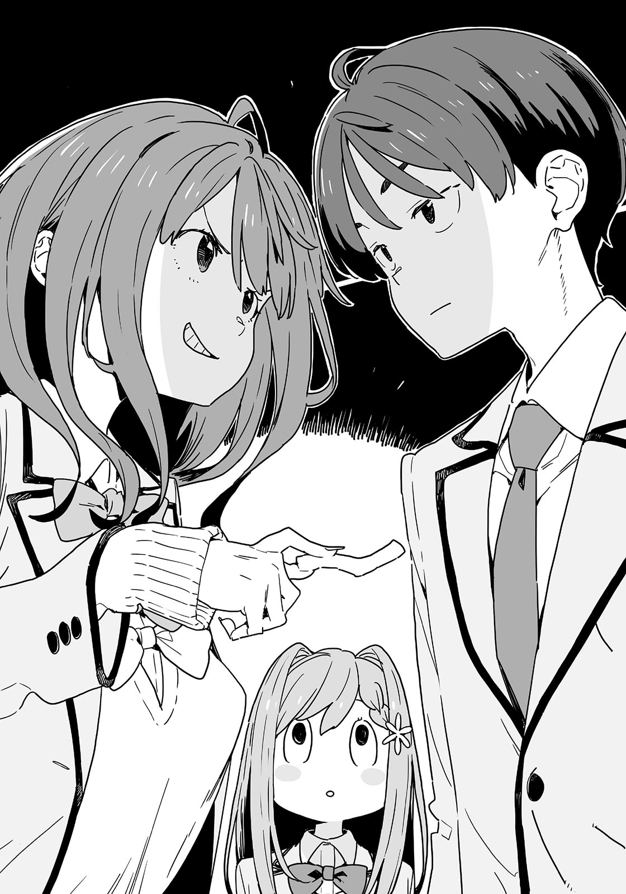

# Ch.50 — เล่ม 6 บทที่ 2-1

Ch.50 — เล่ม 6 บทที่ 2-1

By Monica

Published: 2025-04-23T17:54:23Z

Source: https://www.nekopost.net/novel/14560/50

เล่ม 6 บทที่ 2-1

วันจันทร์หลังวันหยุดรู้สึกหนักอึ้งเสมอ

ท่ามกลางความหนักหน่วงนี้ ผมก็มาถึงโฮมรูมหลังเลิกเรียนได้สำเร็จ บรรยากาศมืดมนปกคลุมทั้งห้องเรียน

[ เพื่อนของฉันคนหนึ่งเพิ่งบอกว่ามีแฟนใหม่แล้ว ]

เสียงพูดเปิดม่านเรื่องราวเศร้าหมองนี้มาจากอามานัตสึเซนเซ ครูประจำชั้นของเรา ซึ่งวันนี้เข้าสู่โหมดดำทมิฬเต็มตัว

อามานัตสึเซนเซพิงโพเดียม พร้อมม้วนผมตัวเองด้วยปลายนิ้ว

[ ฉันยังไม่ได้ยินเลยว่าเธอเลิกกับแฟนคนก่อนแล้ว มันแปลกมากเลยใช่มั้ยล่ะ? ไม่เคยมีเรื่องดีหรือร้ายอะไรเป็นพิเศษเลย แต่ทำไมเธอถึงได้ดีแล้วดีอีกตลอด? ]

พอจะเดาได้ว่า “เพื่อน” คนนั้นเป็นใคร

ในขณะที่ละครชีวิตของอามานัตสึเซนเซดำเนินไป ผมแอบเหลือบมองยากิชิโอะที่นั่งวางแก้มพิงมือของเธออยู่ริมหน้าต่าง

ยากิชิโอะมองออกไปข้างนอกเหมือนกำลังครุ่นคิดอะไรบางอย่าง

— เธอเพิ่งชวนผมเข้าชมรมกลับบ้าน

หลังจากนั้น ผมพูดอะไรแทบไม่ออก แล้วเราก็เดินเงียบๆด้วยกัน

นั่นก็คือจุดสิ้นสุดของเดทแรกที่หน้าพิพิธภัณฑ์สัตว์น้ำของผม

สิ่งเดียวที่ปลอบใจผมได้คือซากากิยะราเม็งที่ไปกินคนเดียวที่สถานีกามะโกริ

[ แม้เธอจะบอกว่าหนาวจนเหงา แต่ฉันจะทำอะไรได้ล่ะ ในเมื่อฉันก็หนาวอยู่ตลอด? แม้แต่แมวที่บ้านยังไปนัวเนียกับโคนุกิจังเลย—ฤดูหนาวของเซนเซจะจบลงเมื่อไหร่กันนะ? ]

ผมได้แต่หวังว่าโฮมรูมจะจบลงก่อนฤดูหนาวของอามานัตสึเซนเซ ตอนนี้เธอเริ่มไล่หาผมที่แตกปลายอยู่

หลังจากตัดปลายผมเสร็จเป็นครั้งที่เท่าไหร่แล้วก็ไม่รู้ ในที่สุดอามานัตสึเซนเซก็ดูพอใจและค่อยๆ ลุกขึ้นยืน

[ ตอนนี้ก็เดือนมีนาคมแล้ว วันศุกร์นี้มีพิธีจบการศึกษา และเดือนหน้า พวกเธอจะกลายเป็นรุ่นพี่ ]

แสงสว่างกลับคืนสู่สายตาของเพื่อนร่วมห้อง ขณะที่ละครของอามานัตสึเซนเซใกล้จะถึงตอนจบ

อามานัตสึเซนเซมองไปรอบๆ ด้วยสีหน้าจริงจังกว่าปกติ

[ ปีหน้าจะมีการเปลี่ยนแปลงห้องเรียน เราจะได้อยู่ด้วยกันอีกไม่นาน ปีนี้ที่ได้อยู่กับพวกเธอ ฉันสนุกมากจริงๆ ]

ครั้งหนึ่งอามานัตสึเซนเซเคยตั้งใจสอนพวกเรามาก แต่จากพรุ่งนี้ไป เธอจะไม่ได้สอนพวกเราอีกแล้ว คงจะลำบากสำหรับเธอ จะโอเคมั้ยนะ?

แม้ว่ามันจะไม่ใช่เรื่องของผม แต่ก็อดกังวลไม่ได้ เซนเซตีสมุดเช็กชื่อบนโพเดียมดัง “ปัง!”

[ โอเค วันนี้พอแค่นี้! กลับบ้านดีๆ กันล่ะ! ]

ในที่สุดโฮมรูมอันยาวนานก็จบลง ผมมองหายากิชิโอะท่ามกลางเพื่อนร่วมห้องที่เริ่มลุกขึ้นยืน

ผมไม่ได้พูดกับเธอตลอดทั้งวัน แต่ผมรู้สึกว่าต้องคุยกับเธอให้รู้เรื่อง

[ ยากิชิโอะ! ]

ยากิชิโอะดูตกใจเมื่อผมขวางทางเธอไว้

[ อะไรเหรอ นุกคุง? อยู่ๆก็ตะโกนมา ]

[ เปล่า คือ… เรื่องเมื่อวาน... ]

น่าอึดอัดจริง ๆ ผมเรียกเธอออกไปด้วยความวู่วาม แต่ตอนนี้กลับเริ่มพูดไม่ออก

ผมเงียบไป และยากิชิโอะก็เริ่มเล่นกับนิ้วของตัวเอง

[ ...ขอโทษที่พูดอะไรแบบนั้นออกไปกะทันหัน…คงทำให้เธอลำบากใจสินะ ]

[ ...ไม่ได้ลำบากใจขนาดนั้นหรอก แค่รู้สึกว่ามันกะทันหันไปหน่อยเท่านั้นเอง….. ]

คำพูดของเธอเมื่อวานหมายความว่ายังไงกันแน่? ถ้ามันเกี่ยวกับชมรม ผมอาจช่วยทำอะไรได้—

ผมมีคำถามมากมายในใจ แต่เธอแค่ยืนนิ่งและบิดนิ้วไปมาเมื่ออยู่ต่อหน้าผม

[ อาจจะกะทันหันไปสำหรับนาย แต่สำหรับฉันแล้ว...ไม่ใช่แบบนั้นเลย เพราะงั้น— ]

ยากิชิโอะเงยหน้ามองผมด้วยสายตาจริงจัง

[ ถ้านายคิดเรื่องนี้ให้ดี…ฉันจะดีใจมากเลย ]

[ อ๊ะ-อื้ม ]

ผมพยักหน้าแบบเก้ๆ กังๆ ยากิชิโอะจับชายกระโปรงของเธอเบาๆ

[ วันนี้ฉันมีธุระที่โรงยิม ต้องไปแล้วล่ะ ]

[ อ๋อ ไว้เจอกัน ]

ยากิชิโอะวิ่งออกจากห้องเรียนที่เงียบสงัดไป

ผมได้แต่มองตามเธอไป—เดี๋ยวก่อน ทำไมห้องเงียบขนาดนี้...?

เมื่อรู้ตัวและหันไปมองรอบๆ เพื่อนร่วมห้องทุกคนกำลังจ้องผมด้วยสีหน้าจริงจัง

แม้แต่ยานามิก็มองมาด้วยสายตาที่ผมไม่เคยเห็นมาก่อน

ตาโตขนาดนั้นตั้งแต่เมื่อไหร่... หรือเป็นแบบนั้นมาตลอด?

ขณะที่ผมยืนงงอยู่ เสียง BGM เบา ๆ ก็เริ่มเล่นในหัว และกลิ่นดอกไม้ก็ลอยคลุ้งไปทั่ว

ฮิเมมิยะ คาเรน ยืนอยู่ตรงหน้าผม มือเท้าเอว ขวางทางผมไว้

[ ขอคุยด้วยได้มั้ย นุคุมิซึคุง? ]

[ เอ๊ะ? ไม่ดีกว่า...]

ผมถอยหลังด้วยความกลัว แต่รู้สึกได้ว่ามีอะไรหนัก ๆ มาตัดทางหนีของผมจากด้านหลัง

[ โฮะ โฮ กล้าปฏิเสธคำเชิญของคาเรนจังอย่างงั้นเหรอ กล้ามากนะ นุคุมิซึคุง ]

แรงกดดันนั้นมาจากยานามิที่ยืนอยู่ข้างหลังผม

ประตูหน้า 8K และประตูหลัง 4K—

เมื่อเผชิญกับคอมโบ12Kสุดภาคภูมิใจของโรงเรียนซึวะบุกิผมไม่มีทางเลือกอื่นนอกจากต้องยอมรับ…

◇

ณ ร้านอาหารครอบครัวที่อยู่ห่างจากโรงเรียนเล็กน้อย

ผมจิบโคล่าพร้อมกับสั่นกลัวอยู่ในที่แห่งนี้

อีกฝั่งของโต๊ะที่เต็มไปด้วยเฟรนช์ฟรายส์จำนวนมาก ฮิเมมิยะ คาเรน นั่งยิ้มแย้ม ส่วนยานามิ อันนะ นั่งด้วยสีหน้าที่ดูว่างเปล่า

[ …นุคุมิซึคุง ฉันสงสัยเรื่องที่เธอพูดกับยากิชิโอะซังเมื่อกี้นิดหน่อยน่ะ ]

ฮิเมมิยะซังถามพร้อมกับรอยยิ้มที่เพิ่มแรงกดดันอย่างน่าประหลาด

ถึงจะบอกว่าอยากรู้ แต่เรื่องที่เกี่ยวข้องกับชมรมวรรณกรรมก็ไม่เกี่ยวอะไรกับฮิเมมิยะซังอยู่ดี…

[ เอ่อ ขอโทษนะ แต่ไม่ใช่เรื่องที่เกี่ยวกับฮิเมมิยะซังเลย และผมก็พูดรายละเอียดไม่ได้- ]

ปัง! ฮิเมมิยะซังตบโต๊ะอย่างแรง

[ ไม่เกี่ยวข้องอะไรกัน ! ถ้ามันเกี่ยวกับอันนะ เพื่อนสนิทที่สุดของฉันล่ะก็ฉันเมินเฉยไม่ได้หรอกนะ! ]

เอ๊ะ เรื่องของยากิชิโอะไปเกี่ยวอะไรกับยานามิ?

แถมเซ็ตติ้งที่เธอบอกว่าเป็นเพื่อนสนิทที่สุดนี่ คงต้องเตือนผมบ่อยๆ ไม่อย่างนั้นคงลืมแน่...

[ ก็มีแผนจะบอกยานามิซังอยู่แล้วล่ะ—แต่ผมออกไปกับยากิชิโอะเมื่อวาน ]

[ เดทใช่มั้ย? ]

ยานามิแก้ให้ผมด้วยสายตาคมกริบ

[ ก็...ใช่ แต่ไม่ได้สำคัญอะไรขนาดนั้น... ]

ผมพยายามพูดเลี่ยงไป แต่คราวนี้ฮิเมมิยะซังจ้องมาทางผม

[ สำคัญสิ! นายมีอันนะอยู่แล้วไม่ใช่เหรอ!? ]

[ [ หา ??!! ] ]

อย่างแรกเลย ผมไม่ได้ "มี" ยานามิ และอย่างที่สอง เธอพูดถึงอะไรอยู่?

แม้แต่ยานามิก็ดูสับสนกับเรื่องนี้

[ เธอมีอันนะเป็นแฟนอยู่แล้ว แต่ยังไปออกเดทกับผู้หญิงคนอื่นอีกเหรอ? แบบนี้ไม่โอเคแน่ๆ ! ]

เธอเริ่มกล่าวหาผมแบบจริงจังโดยไม่มีเหตุผล

[ เดี๋ยวสิ! ยานามิซังกับผมไม่ได้คบกันนะ! ]

[ เอ๊ะ? ]

คราวนี้เป็นตาของฮิเมมิยะซังที่จะตกใจ ตาเธอเบิกกว้าง ขณะที่เธอหันมองระหว่างยานามิกับผมไปมา

[ งั้น อันนะ นี่หมายความว่า….เธอถูกทิ้งอีกแล้ว— ]

เดี๋ยวก่อนนนไม่ควรไปทางนั้นมั้ย ? ผมรีบโบกมืออย่างรวดเร็วเมื่อเห็นสีหน้าของยานามิ

[ ไม่ๆๆๆ เราไม่เคยคบกันตั้งแต่แรกแล้ว! ยานามิซัง ช่วยพูดอะไรหน่อยสิ! ]

ยานามิหันมาหาผมช้า ๆ ด้วยเสียงเอี๊ยดดดดดดดดด

[ อืม อืมม...ที่คาเรนจังพูดอาจจะ..เข้าใจผิด? ]

[ ใช่ ๆ ]

[ แต่ถ้าจะให้พูดจริง ๆ ก็เหมือนว่าฉันเป็นคนที่ทิ้งนุคุมิซึคุงต่างหาก ]

[ ...หา? ฉันยังไม่เคยถูกทิ้งเลยสักครั้งนะ ? ]

เอาล่ะ ถ้างั้นก็คงต้องสู้กันหน่อยแล้ว ผมดื่มโคล่าจนหมดแล้ววางแก้วลงอย่างแรง

[ ถ้าพูดถึงเรื่องเมื่อเดือนกรกฎาปีที่แล้วล่ะก็ ยานามิซังเข้าใจผิดไปเต็มๆเลยนะ จากที่เข้าใจผิดครั้งนั้น มุมมองในเหตุการณ์อื่นๆหลังจากนั้นจะมีปัญหา ใช่มั้ยล่ะ? ]

[ ...มีปัญหา? ]

ยานามิเลิกคิ้วขึ้น พลางใส่เฟรนช์ฟรายส์เข้าปาก

ผมพยักหน้าและหยิบเฟรนช์ฟรายส์ที่เกือบหมดจานขึ้นมากิน

[ ตัวอย่างเช่น เหตุการณ์ที่จุดชมวิวตอนสิ้นปี เธอเป็นคนเสนอฝ่ายเดียวว่าผมควรสารภาพรัก โดยปกติแล้ว บทสนทนาแบบนั้นจะไม่มีทางเกิดขึ้น ถ้าไม่ได้มีความสนใจร่วมกันเรื่องการสารภาพ นั่นหมายความว่ามุมมองของเธอมันมีปัญหา พูดง่ายๆ ก็คือ- ]

ยานามิชี้เฟรนช์ฟรายส์ยาวๆใส่ผม ขัดจังหวะผมจะที่กำลังจะพูดต่อ

[ นายกำลังจะบอกว่าฉันเป็นคนที่มีความรู้สึกกับนายแค่ฝ่ายเดียวเหรอ นุคุมิซึคุง? ]

...คำตอบของผมคือความเงียบ ยานามิที่หรี่ตามองผมอยู่ก่อนหน้านี้ก็เริ่มยิ้มออกมา

[ โดยพื้นฐานแล้วมันผิดนะ นุคุมิซึคุง สถานการณ์ที่มีผู้หญิงกับผู้ชายอยู่ด้วยกันตามลำพัง และผู้ชายบอกว่ามีเรื่องสำคัญจะพูด— นั่นมันเข้าใจกันให้ทั่วแล้วว่าเป็นการสารภาพรัก ไม่ใช่เหรอ? ]

[ บอกแล้วไงว่ามันเป็นความเข้าใจผิด— ]

[ มันคือจิตไร้สำนึกไง นายคงไม่รู้สึกเองหรอก แต่นั่นมันคือการสารภาพรักนะ ]

จิตไร้สำนึก ...? เธอใช้คำที่ตัวเองไม่เข้าใจแน่ ๆ

[ และในเมื่อฉันปฏิเสธไปแล้ว นั่นก็แปลว่าฉันทิ้งนายไปแล้วไงล่ะ ]

[ ผมไม่คิดแบบนั้นนะ ? ]

[ เรื่องเมื่อปลายปีก็เหมือนปฏิเสธก่อนที่นายจะได้สารภาพจริงๆซะอีกไง ถ้าให้พูดตรง ๆ นายน่าจะขอบคุณฉันมากกว่า ]

เธอยังอยากให้ผมขอบคุณอีกเหรอ

เอาล่ะ ได้เวลาให้ยานามิกลับมาเผชิญหน้ากับความจริงแล้ว

[ งั้นก็ให้ฮิเมมิยะซังเป็นคนตัดสินสิ ]

[ จริงด้วย คาเรนจัง เธอน่าจะมีมุมมองจากคนนอกใช่มั้ย ? ]

[ เอ๊ะ? ฉันเหรอ? ]

ฮิเมมิยะซังสะดุ้งเมื่อเราโยนบอลให้เธออย่างกะทันหัน

หลังจากมองไปมาระหว่างเราสักพัก เธอก็เอียงคอแล้วพูดว่า—

[ งั้น...พวกเธอสองคนเลิกกันแล้วกลับมาคบกันใหม่ซ้ำๆ เหรอ? ]

[ [ ไม่ใช่ ! ! ] ]

พวกเราตอบพร้อมกัน

ยานามิส่งเสียงออกมาเบา ๆ แล้วจับหัวของตัวเอง

[ เอ่อ...สำหรับคำตัดสินของนุคุมิซึคุง เราคงต้องรอผู้พิพากษาคนที่สามก่อน ]

[ คนที่สามเหรอ? จะมีใครมาอีก? ]

[ นี่เกี่ยวข้องกับชมรมวรรณกรรมใช่มั้ย ? ฉันเรียกโคมาริจังมาด้วย ]

โคมาริกำลังจะมาเหรอ? ผมสังเกตเห็นหัวเล็ก ๆ โผล่ออกมาจากหลังต้นไม้ในร่ม ตอนที่มองไปรอบๆอย่างไม่ตั้งใจ

...ทำอะไรอยู่น่ะ?

ผมที่กำลังจะเอื้อมไปหยิบโทรศัพท์เพื่อโทรหาเธอ ข้อความก็เด้งขึ้นมาพอดี

<ใครนั่งอยู่ข้างยานามิ?>

มาคิดๆดู นี่เป็นครั้งแรกที่เธอจะได้เจอกับฮิเมมิยะซัง

ผมกำลังจะตอบ แต่ก็เปลี่ยนใจแล้วลุกขึ้นยืน ในเมื่อเธออยู่ที่นี่แล้ว ก็ควรพาเธอมาร่วมวงด้วย

---
