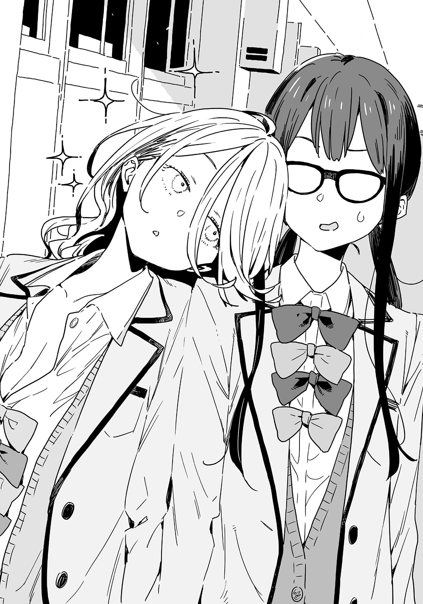

# Ch.57 — เล่ม 6 บทที่ 2-8 บทคั่น

Ch.57 — เล่ม 6 บทที่ 2-8 บทคั่น

By Monica

Published: 2025-04-24T07:51:30Z

Source: https://www.nekopost.net/novel/14560/57

เล่ม 6 บทที่ 2-8 บทคั่น

ห้องพยาบาลของโรงเรียนซึวะบุกิ สถานที่หลบภัยที่เคยต้อนรับนักเรียนผู้มีปัญหาและไม่มีปัญหามานับไม่ถ้วน

ผู้ที่เพิ่งเดินออกมาผ่านประตูที่เปิดออกคือ สึคิโนะกิ โคโตะ เธอหันกลับไปและโค้งเบา ๆ

[ งั้นรบกวนเซนเซดูแลเธอด้วยนะคะ อาการเลือดกำเดาของบาโซริซังไม่เป็นไรใช่มั้ย? ]

[ ไม่ต้องห่วง เด็กคนนั้นเป็นแบบนี้ประจำอยู่แล้ว ]

โคนุกิ ซาโยะ พยาบาลของโรงเรียนตอบอย่างสดใส แม้ว่าคำตอบของเธอจะฟังดูไม่น่าเชื่อถือเลยก็ตาม

โคโตะปิดประตูด้วยรอยยิ้ม

[ ยุ่งจนถึงวันสุดท้ายเลยนะ-อดีตรองประธาน ]

[ อย่าแซวมากสิ ฉันคิดทบทวนเรื่องนั้นมานานแล้วนะ ]

โคโตะพูดด้วยรอยยิ้มเจื่อน ๆ โคะนุกิเอื้อมมือมาช่วยจัดผมหน้าม้าให้เธอ

[ เธอเปลี่ยนไปมากเลยนะ สึคิโนะกิซัง เริ่มสนิทกับบาโซริซังตั้งแต่เมื่อไหร่กัน? ]

[ อืม สักพักแล้วล่ะค่ะ เธอเพิ่งมาหาฉันวันนี้ด้วยนะ ]

ใช่ ตอนที่บาโซริเดินมาหาโคโตะที่แถวต้นไม้ในสภาพเลือดกำเดาไหล ก็ไม่อาจปล่อยเธอไว้แบบนั้นได้จึงพามาที่ห้องพยาบาล แม้จนถึงวันสุดท้าย โคโตะก็ยังไม่สามารถเข้าใจสิ่งที่บาโซริคิดได้เลย

คำพูดเหมือนเพ้อเจ้อของเธอที่ว่า "ชินทาโร่ทำอะไรบางอย่างกับกระดุมเม็ดที่สองของนุคุมิซึคุง" หมายความว่าอะไรกันแน่?

[ ดีใจที่ได้เจอเซนเซเป็นครั้งสุดท้าย…ฝากชมรมวรรณกรรมด้วยนะคะ ]

[ ฝากไว้ได้เลย ฉันเริ่มสนุกกับมันมากขึ้นเรื่อย ๆ แล้ว ทั้งเรื่องดี ๆ และเรื่องแปลก ๆ ]

แม้จะกังวลเล็กน้อย แต่คนที่จากไปก็ทำได้เพียงเฝ้ามองพวกเขาอย่างเงียบ ๆ

หลังจากพูดคุยกับโคนุกิเล็กน้อย โคโตะก็ออกจากห้องพยาบาล

ได้เวลาไปที่ห้องชมรมแล้ว

แม้จะได้เจอกับรุ่นน้องอีก แต่การสวมชุดนักเรียนโรงเรียนซึวะบุกิเป็นครั้งสุดท้ายก็ให้ความรู้สึกถึงจุดสิ้นสุด

เธอเดินไปตามทางเดินพลางดื่มด่ำกับช่วงเวลานั้น ที่นั่นมีนักเรียนหญิงคนหนึ่งยืนราวกับละลายไปในเงามืด

ชิกิยะ ยูเมโกะ รุ่นน้องที่มีความสัมพันธ์ซับซ้อนระหว่างความขัดแย้งในอดีตและสายสัมพันธ์ในอนาคต

เธอกำลังรออยู่? เธอหันหน้ามาหาโคโตะและโอนอ่อนเบา ๆ

[ ...โคโตะซัง...?.....ไปห้องพยาบาลมา.....ไม่สบายเหรอ...? ]

[ ไม่เป็นไรหรอก เห็นบาโซริซังดูเหนื่อย ๆ เลยพาเธอไปส่งที่นั่นน่ะ ]

[ ยัยนั่น...เลือดกำเดาไหลบ่อยจริง ๆ……….เธอไม่เป็นแน่นะ..? ]

[ เซนเซก็พูดแบบนั้นเหมือนกัน แต่แบบนี้เรียกว่าไม่เป็นไรจริง ๆ เหรอ? คนที่ปกติเขาไม่เลือดกำเดาไหลขนาดนี้กันนะ ]

ชิกิยะพยักหน้าอีกครั้ง จากนั้นก็จับแขนเสื้อของโคโตะไว้

[ ...นี่ ฉันอยากจะ...ถ่ายรูป ]

[ ได้สิ จะไปถ่ายที่แถวต้นไม้กันมั้ย? ]

ชิกิยะส่ายหัวเบา ๆ

[ ไป...ห้องสภานักเรียนกันเถอะ... ]

...ห้องสภานักเรียน สถานที่ที่โคโตะใช้เวลาประมาณครึ่งปีในฐานะรองประธาน

ความทรงจำอันขมขื่นที่เกี่ยวข้องกับชิกิยะแวบเข้ามาในหัว แต่ตอนนี้มันค่อย ๆ กลายเป็นความทรงจำที่อบอุ่น การไปที่ห้องสภานักเรียนด้วยกันเพื่อทิ้งอดีตไว้เบื้องหลังก็ดูไม่ใช่ความคิดที่แย่

[ อืม ไปกันเถอะ โฮโคบารุจะมาด้วยมั้ย? ]

[ ไม่เป็นไร…แค่เราสองคนก็พอ ……ไม่มีใครขัดจังหวะ ]

ดูเหมือนวันนี้จะมีส่วนลดคำยืนยันเต็มไปหมด

ระหว่างที่เดินไปยังห้องสภานักเรียนพร้อมรอยยิ้มเจื่อน ๆ ชิกิยะก็เข้ามาใกล้และเอนตัวพิงไหล่ของโคโตะ

[ ...ขอจับมือได้มั้ย? ]

[ ได้สิ- แต่ต้องสอดนิ้วด้วยเหรอ? ]

[ ก็เพราะ...วันนี้เป็นวันสุดท้าย... ]

ชิกิยะพึมพำด้วยเสียงเบาจนแทบจะหายไป

โคโตะถอนหายใจราวกับจะบอกว่า "พอเถอะน่า"

[ เรายังเจอกันได้ตลอดนะ จำได้ว่าเราสัญญากันไว้ว่าจะไปกินข้าวด้วยกัน ฉันจะไปนาโกย่า แต่ก็จะกลับมาที่นี่เป็นครั้งคราว ]

[ .……ฉันไปหาเธอได้มั้ย...? ]

[ ได้เสมอ ฉันจะพาเที่ยวเอง ]

[ จริงเหรอ...? แล้วไปบ้านเธอได้มั้ย...? ]

[ ได้สิ อาจจะทำอาหารให้กินด้วยนะ ช่วงนี้กำลังฝึกอยู่ ]

[ …...ขอค้างเลยได้มั้ย...? ]

โคโตะหยุดนิ่งไปชั่วขณะ

[ เอ่อ อืม ไว้ค่อยว่ากันนะ ยังไงก็ต้องเตรียมฟูกไว้สำหรับแขกอยู่ดี ]

[ ……….ไม่ต้องก็ได้ …นอนฟูกเดียวกันก็ได้ ]

[ ฉันจะจองโรงแรมให้ ]

โคโตะตอบทันทีราวกับสัมผัสได้ถึงอันตรายที่คืบคลานเข้ามา ชิกิยะเอียงคออย่างงุนงง

[ ห้องเดียวกัน.…..? ]

[ ไม่อะ ฉันจะนอนห้องของฉันเอง เอ้า ถึงห้องสภานักเรียนแล้ว! ]

โคโตะตัดบทสนทนาและเปิดประตูห้องสภานักเรียน ข้างในว่างเปล่า

ขณะถูกชิกิยะลากเข้าไป โคโตะก็หยิบสมาร์ทโฟนขึ้นมากวัดแกว่งในมือ

[ โฮโคบารุตอบกลับมาแล้ว เธอกำลังมาห้องสภานักเรียน ]

[ ...ใจร้าย ]

