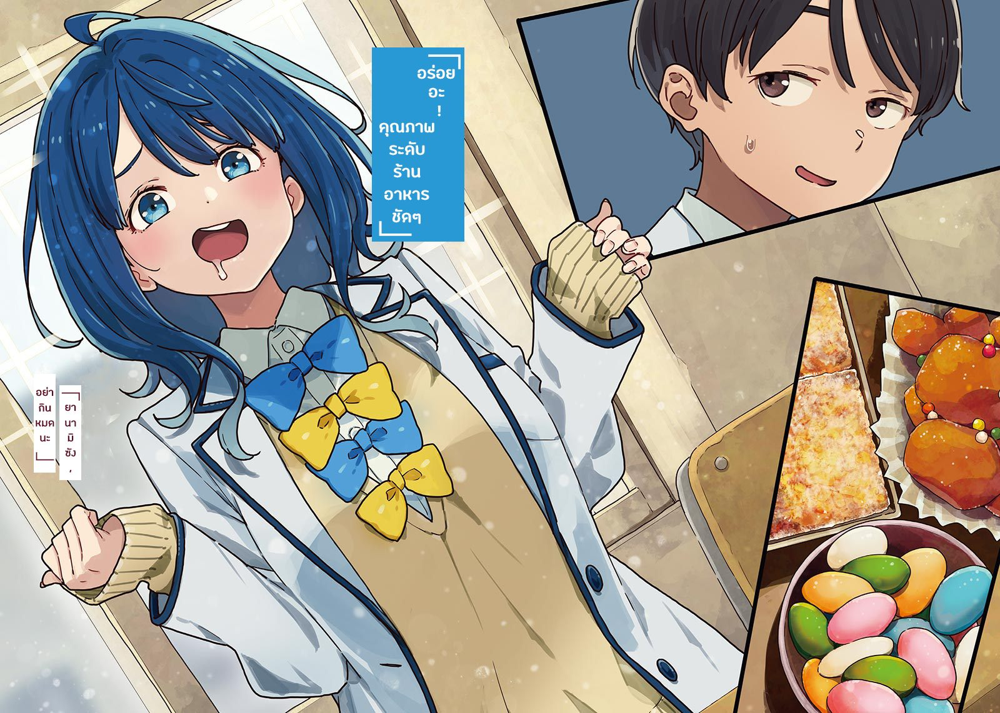

# Ch.61 — เล่ม 6 บทที่ 3-4

Ch.61 — เล่ม 6 บทที่ 3-4

By Monica

Published: 2025-04-24T07:51:56Z

Source: https://www.nekopost.net/novel/14560/61

เล่ม 6 บทที่ 3-4

เช้าวันใหม่เริ่มต้นขึ้น แสงอาทิตย์ค่อยๆ ส่องประกายทั่วเมือง ยากิชิโอะ เลม่อน กำลังดื่มด่ำกับช่วงเวลานี้ ช่วงที่เศษเสี้ยวสุดท้ายของราตรีเลือนหายไป

ริมฝั่งแม่น้ำโทโยกาวะถูกปกคลุมด้วยหมอกบางๆ ที่ค่อยๆ จางลงขณะที่เลม่อนวิ่งผ่าน ทิ้งเส้นทางไว้เบื้องหลัง

เธอหลงรักช่วงเวลาที่ราตรีค่อยๆเลือนหายไปจนหมด

เพียงแค่วิ่ง สูดลมหายใจเข้า แล้วปล่อยลมหายใจออก

อากาศยามเช้าแทรกซึมเข้าสู่ร่างกาย ทำให้เธอรู้สึกเหมือนตัวเองกำลังแปรเปลี่ยนเป็นคนใหม่ แตกต่างจากเมื่อวาน

ขณะวิ่งลอดใต้รางรถไฟชินคันเซ็น เธอครุ่นคิดว่าจะวิ่งไปไกลแค่ไหนในวันนี้ และพลันสังเกตเห็นเงาร่างหนึ่งที่ริมฝั่งแม่น้ำ

ร่างเล็กที่ดูเหมือนไม่เคยมั่นใจและมักกังวล แต่กลับมีความเข้มแข็งบางอย่างซ่อนอยู่

ไม่มีผิดแน่ หนึ่งในเพื่อนรักของเลม่อน

โคมาริ จิกะ

เธอยืนอยู่ตรงนั้น ตั้งตัวตรงเหมือนกำลังรอเลม่อน

ใบหน้าที่แสดงความกังวลของโคมาริทำให้หัวใจของเลม่อนเจ็บแปลบ

ความรู้สึกผิดที่เธอพยายามหลีกเลี่ยงมาตลอด บัดนี้กลับมาปรากฏตรงหน้าอย่างไม่อาจหลบเลี่ยงได้

เลม่อนลดความเร็วลง แล้วค่อยๆ ก้าวเข้าไปหาโคมาริ

[ โคมาริจัง ทำไมเธอถึงมาอยู่ที่นี่... ]

คำพูดของเธอค่อยๆ จางหายไป

[ พ-พักนี้..เธอหลบหน้าฉันช-ใช่มั้ย? ]

...โคมาริโกรธ

แน่นอน สำหรับเธอ ชมรมวรรณกรรมเป็นสถานที่สำคัญที่สุด และเธอกำลังพยายามปกป้องมันอย่างสุดความสามารถ

แม้เล่มอนจะรู้เรื่องนี้ดี แต่ตัวเธอกลับกำลังพยายามทำลายมัน

ด้วยความเห็นแก่ตัวและความรู้สึกที่ไม่แน่นอน ซึ่งแม้แต่เธอเองก็ไม่เข้าใจ

เลม่อนวางมือบนอกของตัวเอง พยายามควบคุมลมหายใจ

แต่กลับไม่มีคำพูดใดหลุดออกมา และเลม่อนก็ยังคงยืนนิ่งอยู่ตรงนั้น

[ ธ-เธอจะแข่งกับนุคุมิซึใช่มั้ย? ]

โคมาริทำลายความเงียบ เธอก้มหน้าลง นิ้วมือกำหมัดแน่นจนซีดขาว

[ ...ฉันขอโทษ ]

ความรู้สึกผิดเป็นเพียงสิ่งที่ไว้สำหรับตัวเอง

เลม่อนตำหนิตัวเองที่มักหาความสบายใจจากสิ่งเหล่านั้น และรอฟังคำพูดของโคมาริ

โคมาริสูดลมหายใจลึก พยายามทำตัวให้สงบ แล้วพูดขึ้น

[ ล-แล้วช่วงนี้เธอก็ไม่ไปทีมวิ่งแล้วด้วย ใช่มั้ย? ]

[ ...ใช่ ]

โคมาริเงยหน้าขึ้นมอง

[ เธอจะทำทุกอย่างคนเดียวเหรอ? ]

[ ฉันจะให้ใครเข้ามาเกี่ยวข้องไม่ได้ ]

โคมาริถอนหายใจ เธอกำลังจะพูดอะไรบางอย่าง แต่กลับค่อยๆ หายใจออกช้าๆ ก่อนจะพูดต่อด้วยเสียงแผ่วเบา

[ ท-ทำไมต้องเป็นนุคุมิซึด้วย? น่าจะขอให้คนอื่นช่วยแทน... ]

เลม่อนส่ายหน้า

[ ฉัน...ไม่รู้ว่าทำไมต้องเป็นนุคคุง แต่ฉัน... ]

เลม่อนกัดฟันแน่น พยายามกลั้นน้ำตา

ไม่ แบบนี้มันผิดแล้ว เธอกำลังร้องไห้ทั้งๆ ที่เป็นความผิดของเธอเอง ซึ่งนี่เป็นสิ่งที่ยอมรับไม่ได้

เธอต้องยอมรับคำพูดทุกอย่างที่ส่งถึงเธอ นั่นคือสิ่งเดียวที่เธอทำได้

[ ฉันขอโทษ แต่การแข่งครั้งนี้... ]

[ ..ยะ-หยุดพูดอะไรไร้สาระเถอะ ]

โคมาริที่กำลังสั่นเทาพูดออกมาด้วยความพยายาม

[ ฉ-ฉันจะช่วยเธอเอง ]

[ ...เอ๊ะ? ]

เลม่อนที่ตกใจกับคำพูดที่ไม่คาดคิด ถอยหลังออกไปเล็กน้อยด้วยความสับสน ก่อนจะส่ายหน้า

[ แต่โคมาริจัง ฉันทรยศทุกคนในชมรมวรรณกรรมนะ เธอไม่โกรธเหรอ? ]

[ ก-โกรธสิ! โกรธมาก! ต-แต่- ]

โคมาริก้าวเข้าไปหาเลม่อน

[ ถ-ถ้าเธอทรยศพวกเราก็เพราะเธอปรารถนาสิ่งนั้นมากจริงๆ ฉ-ฉันจะช่วยเธอ พ-เพราะเราเป็นเพื่อนกันไงล่ะ ! ]

หลังจากพูดทุกอย่างรวดเดียวจบ โคมาริก็เซเล็กน้อยเพื่อรักษาสมดุล

เลม่อนลังเลที่จะยื่นมือออกไป ก่อนจะดึงกลับมา

[ แต่โคมาริจัง แม้แต่ฉันก็ยัง... ]

.....ไม่ได้ผลเลย แม้ว่าเธอจะตัดสินใจแล้วว่าจะไม่ร้องไห้

แต่ความรู้สึกผิดที่เธอแบกรับ ความโดดเดี่ยวที่เธอเลือก ทั้งหมดนั้น เธอไม่เคยโอเคกับมันเลย

[ ว๊า!? ยะ-อย่านะ ยากิชิโอะ! อย่ามากอดฉัน! ]

ทุกอย่างเป็นความผิดของเธอ แต่เธอไม่สามารถบอกใครได้

เธอรู้สึกกระวนกระวายอยู่คนเดียวมาตลอด เธออยากจะร้องไห้เสมอ

[ โอ๊ย! จ-เจ็บนะ! เบาๆ หน่อยสิ! ]

แล้วบางสิ่งที่เหมือนในนิทานก็เกิดขึ้น

นั่นคือเหตุผลที่เธอทำได้เพียงกอดเพื่อนรักของเธอไว้แน่น

แม้ว่าเธอจะร้องไห้ เธอก็หวังว่าจะได้รับการให้อภัย

...

......................

เวลาผ่านไปนานแค่ไหนแล้ว?

เลม่อนหัวเราะแห้งๆ ขณะใช้ผ้าเช็ดหน้าซับน้ำตาของตัวเอง

[ ...ฮะฮะ เธอคงได้เห็นด้านที่แย่ที่สุดของฉันแล้วล่ะ ]

[ ก-ก็ตรงนี้มีแค่เราสองคนน่ะสิ ]

โคมาริพูดเสียงแข็งราวกับกำลังเขินอาย

จากนั้น เธอจึงเสริมขึ้นมาเบาๆ พร้อมกับสีหน้าที่ดูเหงาหงอย

[ ย-ยากิชิโอะ ธ-เธอดีเกินไปสำหรับนุคุมิซึ ต-แต่ถ้าเธอชอบเขา ก-ก็คงช่วยไม่ได้ ]

[ ...หืม? ]

เลม่อนขมวดคิ้วด้วยความงุนงงอีกครั้ง เธอกะพริบตาด้วยความประหลาดใจ

[ เดี๋ยวก่อนนะ โคมาริจัง ฉันชอบนุคคุงในฐานะเพื่อน แต่ไม่ได้มีความรู้สึกโรแมนติกกับเขานะ ]

[ เอ๊ะ...? ]

โคมาริขมวดคิ้วลึกอยู่ครู่หนึ่ง ก่อนที่ดวงตาของเธอจะเบิกกว้าง

[ ธ-เธอไม่ได้ชอบเขาเหรอ!? อะ-เอ่อ ไม่ได้รู้สึกแบบนั้นจริงๆ ใช่มั้ย? ]

เลม่อนพยักหน้าพร้อมสายตาที่ชัดเจน

[ ใช่ ความสัมพันธ์แบบนี้อาจทำให้เข้าใจผิดได้ นุคคุงไม่เคยกดดันอะไรฉัน ฉันเลยรู้สึกปลอดภัย และบางทีก็แอบตามใจตัวเองนิดหน่อยเวลาอยู่กับเขา ]

เลม่อนเกาทางแก้มของเธออย่างเขินอาย ก่อนจะเอียงคอเหมือนนึกอะไรบางอย่างออก

[ แต่โคมาริจังชอบนุคคุงใช่มั้ยล่ะ? ]

[ อุ๊นา!? ]

โคมาริกระโดดถอยหลังอย่างเว่อร์วัง

[ ม-ไม่ใช่นะ! ]

[ จริงเหรอ? แต่เธอก็ดูใส่ใจเขามากเลยนะ ]

โคมาริส่ายหน้ารัวๆ

[ ต-ตอนที่เป็นรุ่นพี่ทามากิ ห-หัวใจฉันมันเต้นแรง ล-แล้วอกก็รู้สึกแน่นๆ แต่กับนะ-นุคุมิซึ มันต่างกัน ฉันคะ-แค่หงุดหงิดที่เขาดูไม่ใส่ใจอะไรเลย กะ-ก็ คะ-แค่รำคาญนิดหน่อย คะ-คะ-แค่นั้นเอง! ]

เลม่อนยังคงเอียงคอด้วยความสงสัย

[ นั่นไม่ใช่ว่าอาการที่ชอบใครบางคนเหรอ? ]

[ ม -ไม่ใช่! มันต่างกับที่ฉันรู้สึกกับรุ่นพี่ท-ทามากินะ! ]

โคมาริยืนยันด้วยความมุ่งมั่นเต็มที่

เมื่อได้ยินเช่นนั้น เลม่อนจึงตัดสินใจกอดโคมาริอีกครั้ง

[ อ๊า~ โคมาริจังน่ารักจังเลย! ]

[ บ-บอกแล้วว่าอย่ากอดแรงไง ! ]

◇

วันธรรมดาวันสุดท้ายก่อนวันไวท์เดย์

ผมเผชิญหน้ากับยานามิที่นั่งอยู่ตรงข้ามโต๊ะในห้องชมรมหลังเลิกเรียน พร้อมยื่นถุงของขวัญสามถุงที่ห่อไว้อย่างดีให้เธอ

ยานามิพยักหน้าด้วยสีหน้าจริงจังและเปิดถุงแรก

[ นี่คือ...ลูกกวาดใช่มั้ย? โอ้ สวยจังเลย! เหมือนของในร้านเลยนะ! ]

ขนมชิ้นแรกที่คาจูทำคือ ลูกกวาดทรงรีที่มีอัลมอนด์เคลือบด้วยน้ำตาล

ยานามิค่อยๆ หยิบลูกกวาดหลากสีขึ้นมาพิจารณาอย่างใกล้ชิด

[ สวยเกินกว่าจะกินได้แน่ๆ ไม่มีเศษเล็บปลอมผสมอยู่ใช่มั้ย? ]

[ ไม่มีหรอก คาจูไม่ได้แต่งหน้าแต่งตัวอะไรแบบนั้น— ]

ยานามิไม่สนใจคำอธิบายอันตั้งใจของผมและโยนลูกกวาดเข้าปาก

[ อร่อยอะ ! คุณภาพระดับร้านอาหารชัดๆ ]

[ ยานามิซัง อย่ากินหมดนะ ]

ผมรีบดึงถุงกลับมาจากมือเธอขณะที่เธอยังกินต่อ

ยานามิทำท่าลิ้นเลียปลายนิ้วอย่างโอเวอร์ก่อนจะมองกระดาษที่มีชื่อขนมทั้งสามชนิดเขียนอยู่ด้วยสายตาจริงจัง

[ โอเค เข้าใจแล้ว ลูกกวาดนี่เรียกว่า... สตรูเซลใช่มั้ย? ] / /* TL : สตรูเซล กับ ครัมเบิ้ลน่าจะอันเดียวกัน */

[ ไม่ใช่ นี่เรียกว่าdragéeเป็นขนมฝรั่งเศส ]

[ แหม ทายผิดไปสินะ เสียดายจัง ]

ไม่เห็นน่าเสียดายอะไรเลย

ผมเปิดถุงอีกใบ

[ อันนี้คือคระ— ]

[ เดี๋ยว รอบนี้ขอเดาเอง ]

ยานามิก้มมองเข้าไปในถุงใบที่สองและดมอย่างมั่นใจ

[ โอเค รู้แล้ว ของที่หน้าตาเหมือนคาราอาเกะนี่แหละ สตรูเซลใช่มั้ย? ]

[ นั่นคือ Pignolataขนมอิตาเลียน สตรูเซล คือ ชิ้นนี้ต่างหาก ]

[ อันที่ดูเหมือนผิวหนังใต้กล้องจุลทรรศน์อิเล็กตรอนนี่เหรอ? ]

ช่วยอธิบายให้มันดูน่ากินหน่อยเถอะ

ยานามิหยิบเค้กแผ่นบางๆ ทรงสี่เหลี่ยมขึ้นมาอย่างสงสัยก่อนจะกัดคำหนึ่ง

[ อร่อย ! นี่ก็เหมือนมาจากร้านอีกแล้ว ดูเหมือนร้านที่สองจะเปิดแล้วนะ ]

ยานามิเคี้ยวขนมอย่างมีความสุข ดูพอใจกับของขวัญไวท์เดย์ที่ผมให้ไป

[ ว่าแต่ ฉันก็เอามาเหมือนกันนะ ผู้ชายอย่างนายมาข่มพลังใส่สาวชมรมวรรณกรรมไม่ได้หรอก ]

ผมไม่สนใจหรอก แต่ดูเหมือนเธอจะมั่นใจในตัวเองพอสมควร

ยานามิวางกระป๋องคุกกี้กลมๆ ไว้บนโต๊ะ

[ ...นี่มันของธรรมดาๆ ที่มีขายตามซูเปอร์ใช่มั้ย? ]

[ สุดท้ายแล้ว ฉันก็สรุปได้ว่า ขนมที่ซื้อจากร้านมันดีที่สุด ]

แล้วไอพลังสาวเมื่อกี้หายไปไหน? ยานามิเปิดกระป๋องคุกกี้และเริ่มกินทันที

[ สู้ของน้องสาวจังไม่ได้ แต่ก็ดีอยู่ พวกนี้หวานดีนะ ]

หวานใช่มั้ยล่ะ? ในขณะที่ผมเลิกคิดอะไรต่อและมองยานามิที่กำลังกินอย่างเมามัน ประตูห้องชมรมก็ถูกเปิดออกอย่างแรงชวนให้ตกใจ ผมนึกว่าเป็นยากิชิโอะ แต่กลับเป็นโคมาริที่ยืนอยู่ตรงนั้นแทน

[ จังหวะดีเลย โคมาริจัง มีขนมไวท์เดย์นะ ]

ไม่รู้ทำไม โคมาริกลับยืนอยู่หน้าประตูและมองผมด้วยสายตาขุ่นเคือง

[ น-นุคุมิซึ น-นายคือ... ศัตรู ]

เธอพูดอะไรนะ? เอ่อ ดูเหมือนว่าผมจะกลายเป็นศัตรูของโคมาริโดยไม่รู้ตัวแล้วสินะ

[ อ้า เข้าใจแล้ว ผมเป็นศัตรูของเธอสินะ เรากำลังเล่นเกมทายชื่อขนมอยู่ สนใจเข้าร่วมมั้ย โคมาริ? ]

[ เอ๊ะ...? เอ่อ ก-ก็ในเมื่อ น-นุคุมิซึเป็นศัตรู ฉันเลย... ]

ยานามิพยักหน้าเข้าใจในขณะที่โคมาริพูดตะกุกตะกัก

[ เข้าใจแล้วล่ะ โคมาริจัง นุคุมิซึคุงนี่เหมือนเป็นศัตรูของผู้หญิงทุกคนเลยนะ เอาคุกกี้ของฉันไปมั้ย? ]

[ ฉ-ฉันก็ทำคุกกี้ม-มาเหมือนกัน... ]

โคมารินั่งลงและหยิบกล่องทัพเพอร์แวร์ออกจากกระเป๋าของเธอ

ปาร์ตี้น้ำชายามหลังเลิกเรียนของพวกเราเริ่มครึกครื้นขึ้นอีกครั้งด้วยคุกกี้ทำเองของโคมาริ

ยานามิจิบชาหลังจากที่กินคุกกี้ไปเกือบหมดกล่อง

[ ว่าแต่ นุคุมิซึคุง การฝึกกับประธานเป็นยังไงบ้าง? ]

[ พึ่งวันที่สามเอง เลยยังไม่มีอะไรจะพูดมาก แต่เธอสอนอะไรหลายอย่างให้ รู้สึกขอบคุณจริงๆ ]

ผมตอบด้วยสีหน้าจริงจัง แต่การได้ฝึกกับรุ่นพี่สาวสวยมันก็ช่วยเพิ่มแรงจูงใจได้อยู่เหมือนกัน

ถึงแม้สายตาของเทียร่าซังจะดูน่ากลัว ผมก็อยากให้การฝึกนี้ดำเนินต่อไปแม้หลังจากการแข่งขันจะจบลงแล้วก็ตาม

และไม่รู้ทำไม ยานามิถึงจ้องมองผมด้วยสายตาคมกริบ

[ เอ่อ อะไรล่ะ...? ]

[ ก็แน่นอนอยู่แล้ว ถ้านายเอาแต่เคลิ้มกับประธานระหว่างการฝึกน่ะสิ ]

[ ป-ไปตายเถอะ ]

นี่มันหมิ่นประมาทชัดๆ

[ พวกเธอสองคน ไม่คิดว่ามันเป็นการไม่ให้เกียรติรุ่นพี่หรือไง? แน่นอนว่ามีการสัมผัสตัวบ้าง แต่นั่นเป็นส่วนหนึ่งของการฝึกนะ ]

ถึงผมจะอธิบายด้วยความจริงใจแค่ไหน ยานามิก็ยังคงจ้องเขม็งอยู่

[ อืม นายพูดถูก ฉันผิดเอง แต่ก็อย่าบอกนะว่านายไม่รู้สึกอะไรเลย นุคุมิซึคุง? ]

[ เอ่อ... ถ้าให้พูด ก็แน่นอนว่าการได้ใกล้ชิดกับรุ่นพี่สาวสวยย่อมกระตุ้นอะไรบางอย่าง และผมก็เป็นผู้ชายธรรมดาๆ คนหนึ่งด้วย จะบอกว่าไม่ได้รู้สึกอะไรเลยก็คงโกหก ]

ผมกระแอมก่อนพูดต่อ

[ ในอีกความหมายนึง มันช่วยเพิ่มแรงจูงใจให้ ไม่ปฏิเสธหรอก แต่เป้าหมายสุดท้ายคือการชนะการแข่งขันและรักษายากิชิโอะให้อยู่ในชมรมต่อไป ]

ยานามิเขินที่จะฟังคำพูดของผมที่ยืดยาวเกือบ 60 วินาทีเพียงแค่พูดว่า "ยาวไป!"

[ งั้นช้ามเรื่องนี้ไปก่อน แต่คิดว่านายมีโอกาสชนะมั้ย? ]

[ ก็ขึ้นอยู่กับว่าจากนี้จะเกิดอะไรขึ้นบ้าง ]

อาการเจ็บข้อเท้าของผมดีขึ้นมากแล้ว

หลังจากปรึกษากับประธาน ผมเพิ่มตารางการฝึกและเปลี่ยนมาใช้จักรยานแทนการเดินทาง

เหลืออีกสองสัปดาห์ก่อนถึงการแข่งขัน ผมจะไม่ยอมเสียเวลาไปแม้แต่วันเดียว—

[ อะ ลืมส่งรายงานประจำวัน ]

ยานามิมองผมอย่างสงสัยขณะที่ผมหยิบสมาร์ทโฟนออกมา

[ รายงาน? ]

[ ต้องรายงานสภาพข้อเท้ากับประธาน ]

[ ทุกวันเลย? ]

[ ใช่ ทุกวัน ]

ทำไมถึงสนใจเรื่องนี้กันล่ะ? ผมได้รับข้อความตอบกลับจากรุ่นพี่ประธานทันทีหลังจากส่งรายงาน

ดูสิ รุ่นพี่ถามว่าผมไปที่สปอร์ตคลับตอนนี้ได้มั้ย เพราะมีอุปกรณ์ให้ใช้

[ ประธานเรียกตัว จะไปล่ะนะ กินขนมกันต่อได้เลย ]

โคมาริเกือบสำลักสตรูเซล แต่เธอก็ยังห้ามผมไว้ได้ทันตอนที่ผมพูดแบบนั้น

[ ด-เดี๋ยวก่อน นุคุมิซึ เรื่องที่เป็นศัตรูนั่น... ]

...อ้อ เธอพูดอะไรประมาณนี้ตอนที่เข้ามาในห้องชมรมสินะ

[ หมายถึงเรื่องที่ผมเป็นศัตรูของเธอใช่ม้้ย? ]

โคมาริพยักหน้าแรงๆ หลังจากดื่มน้ำชาเพื่อล้างขนมลงคอ

[ ช-ใช่ ครั้งนี้ ฉ-ฉันอยู่ข้างย-ยากิชิโอะ ]

...หา?

เอ่อ ถ้าเธออยู่ฝ่ายยากิชิโอะ แล้ว ผมเป็นคู่แข่งกับเธอล่ะก็—

[ เดี๋ยวก่อน โคมาริ เธอรู้ใช่มั้ยว่าถ้าผมแพ้จะเกิดอะไรขึ้น ? ]

[ น-นายสองคนต้องออกจากช-ชมรมวรรณกรรม ใช่มั้ย? ]

ใช่ เธอรู้

[ ต-แต่ฉันไม่อยากให้เธอแพ้นี่ ]

โคมาริกำลังคิดอะไรอยู่? มีชมรมวรรณกรรมใต้ดินที่ผมไม่รู้หรือเปล่า แล้วชมรมวรรณกรรมบนดินก็ไม่สำคัญอีกต่อไป?

[ อร่อย ]

ยานามิยื่นถุงขนมให้โคมาริในขณะที่ผมยังคงสับสน

[ โคมาริจัง อันนี้มีอัลมอนด์เต็มเม็ดอยู่ด้วยนะ ]

กรุบ กรุบ กรุบ ยานามิและโคมาริเคี้ยวDragéesของฝรั่งเศสอย่างมีความสุข

[ ...งั้นโคมาริกลายเป็นศัตรูของพวกเราแล้วนะ ยานามิซังไม่ว่าอะไรใช่มั้ย? ]

ยานามิยื่นถุงขนมให้ผม

[ พวกเราเป็นคู่แข่งกันในการแข่ง แต่มันไม่ใช่การต่อสู้กันจริงๆหรอก ยังไงเลม่อนจังก็ยังเป็นเพื่อนของเราเรื่องนั้นจะไม่เปลี่ยนไป ]

ในขณะที่ผมยืนคิดอยู่ โคมาริก็ยุ่งกับการแพ็คขนมใหม่อีกครั้ง

[ น-นี่ เอาขนมพวกนี้ไปให้ย-ยากิชิโอะสิ น-นายอยู่ใกล้บ้านเธอไม่ใช่เหรอ ? ]

[ ผมเหรอ ไปบ้านยากิชิโอะอะนะ? ไม่ล่ะ แบบนั้นมัน... ]

[ เธอเป็นคนเอาไปให้เองไม่ดีกว่าเหรอ โคมาริจัง? ]

ยานามิที่ปกติไม่ค่อยเห็นด้วยกับผม กลับเห็นด้วยในครั้งนี้ แต่โคมาริส่ายหน้า

[ ม-ไม่ ถึงเธอจะดูแบบนั้น ย-ยากิชิโอะเป็นคนที่เหงาง่าย ถ้าปล่อยเธอไว้ค-คนเดียว ]

โคมาริยัดห่อขนมใส่มือผม

[ ...ต-แต่ นายเป็นศัตรูของพวกเรา น-นุคุมิซึ อย่ามาทำตัวได้ใจเกินไปล่ะ ? ]

◇

และแล้วก็มาถึงวันไวท์เดย์ วันอาทิตย์

ผมกำลังจ๊อกกิ้งเบาๆ แถวบ้าน จริงๆ แล้วมันก็แค่เดิน แต่ถ้าใส่ชุดวอร์มก็พอเรียกว่าจ๊อกกิ้งได้อยู่

— ผมเดินผ่านบ้านหลังนี้มากี่รอบแล้วนะ?

[ ก้าวแรกนี่มันยากจริงๆ... ]

ชื่อ "ยากิชิโอะ" ถูกเขียนอยู่บนป้ายชื่อหน้าบ้านที่ผมเพิ่งเดินผ่าน

หน้าที่ของผมก็แค่เอาขนมไปส่งแทนสมาชิกชมรมวรรณกรรมแค่นั้น

แต่แค่นี้เอง การกดกริ่งหน้าบ้านผู้หญิงมันเป็นอะไรที่รู้สึกว่าต้องใช้ความกล้าอย่างมาก…

ผมหยุดอยู่หน้าบ้านยากิชิโอะอีกครั้ง ก่อนจะเริ่มเดินต่อ

ดีล่ะ อย่างน้อยก็สำเร็จขั้นแรกคือ "หยุดหน้าบ้าน" ได้แล้ว

ต่อไปลองจินตนาการว่ากดกริ่ง แล้วค่อยๆ ปรับตัวให้ชินกับไอเดียนี้โดยไม่ฝืนตัวเองเกินไป—

[ อ๊ะ นี่เป็นเพื่อนของเลม่อนเหรอคะ? ]

เสียงนั้นทำให้ผมหยุดชะงัก เมื่อเงยหน้าขึ้นมองก็พบกับสาวสวยมากยืนอยู่ตรงหน้า

ยากที่จะเดาอายุของเธอ แต่ดูเหมือนจะอายุมากกว่าอามานัตสึเซนเซ เธอมีผมยาวประบ่า รูปร่างสมส่วนเหมือนนางแบบ และใบหน้าที่คมคาย สิ่งที่สะดุดตาที่สุดออร่าที่ทำให้รู้สึกเดจาวูแปลกๆ

[ เอ่อ... ผมมาจากโรงเรียนเดียวกัน อยู่ชมรมวรรณกรรม... ขอถามหน่อยนะครับ พี่สาวของเลม่อนซังหรือเปล่าครับ? ]

ผมเผลอถามออกไปโดยไม่ทันคิด แต่ก็ไม่เคยได้ยินยากิชิโอะพูดถึงพี่สาวเลย ดังนั้นเธออาจจะเป็น—

หญิงสาวยิ้มกว้างอย่างมีเสน่ห์

[ อาระๆ! เข้ามาก่อนสิ! ]

[ ไม่เป็นไรครับ ผมแค่มาส่งของแค่นั้น ]

แย่ละ ผมอาจไปเปิดธงเหตุการณ์บางอย่างเข้าแล้ว ผู้หญิงคนนั้นจับมือผมอย่างแน่นและดึงเข้าไปในบ้าน ความดื้อรั้นและแรงดึงนี้เป็นเอกลักษณ์ของตระกูลยากิชิโอะจริงๆ

ด้วยความตกใจและไม่ทันตั้งตัว ผมจึงถูกดึงเข้าไปในบ้านด้วยความยืนยันอันแน่วแน่ของเธอ เธอยิ้มอีกครั้ง

[ ยินดีต้อนรับนะ ! ฉันเป็นแม่ของเลม่อนเอง ไม่ใช่พี่สาว แต่เป็นแม่จ้ะ ]

---

T/N อันนี้คือมีคนจะเล่นแม่
