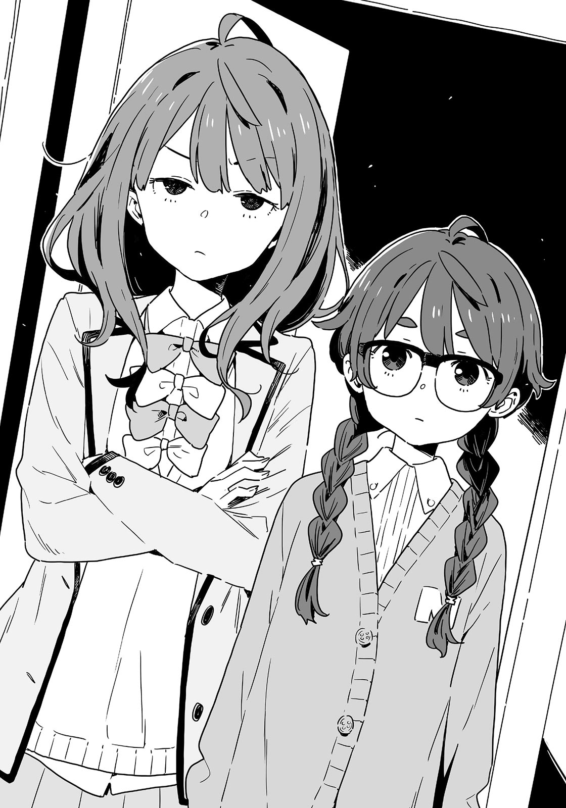

# Ch.62 — เล่ม 6 บทที่ 3-5

Ch.62 — เล่ม 6 บทที่ 3-5

By Monica

Published: 2025-04-24T07:52:01Z

Source: https://www.nekopost.net/novel/14560/62

เล่ม 6 บทที่ 3-5

แม่ของยากิชิโอะนั่งอยู่ฝั่งตรงข้ามผมที่โต๊ะในห้องนั่งเล่นด้วยท่าทางร่าเริง ไอน้ำลอยขึ้นมาจากถ้วยชาที่อยู่ตรงหน้าและมีเค้กชิ้นหนึ่งวางอยู่ข้างๆ

[ เอ่อ ผมแค่แวะเอาของมาให้เลม่อนซังน่ะครับ...]

[ เธอออกไปวิ่งอยู่น่ะจะ เธอรอที่นี้แล้วกินเค้กสักหน่อยมั้ย ? ]

ผมอยากกลับ แต่ถ้าเดินออกไปเฉยๆหลังจากได้รับการต้อนรับอย่างอบอุ่นแบบนี้มันก็ดูแปลกๆ...

ผมจิบชาแล้วมองแม่ของยากิชิโอะ

ผมอดไม่ได้ที่จะสังเกตเห็นความสวยของเธอ เธอถือถ้วยด้วยสองมือ แม้ว่าเธอจะอายุสี่สิบกว่าแล้ว แต่เธอก็ดูเหมือนคนอายุสามสิบได้สบายๆ

คิดๆดูแล้ว เธอนี่เองที่ใส่ชุดที่ยากิชิโอะยืมมาตอนเราไปเดทที่พิพิธภัณฑ์สัตว์น้ำสินะ... เข้าใจแล้ว...

ผมวางถุงกระดาษลงบนโต๊ะขณะที่ยังครุ่นคิดอยู่

[ ช่วยบอกเลม่อนซังด้วยว่ามาจากชมรมวรรณกรรมนะครับ ]

[ ขอบใจที่เอามาให้นะจ้ะ เลม่อนในชมรมเป็นยังไงบ้างล่ะ? ]

ยากิชิโอะในชมรมวรรณกรรมเหรอ? ภาพที่ผุดขึ้นมาในหัวก็มีแต่ภาพเธอเปลี่ยนเสื้อผ้า แต่นั่นไม่ใช่สิ่งที่ควรจะพูดถึงที่นี่...

[ เอ่อ เธอก็สดใสร่าเริงเสมอ แล้วก็...มีชีวิตชีวาดีครับ... ]

ผมรู้ตัวว่าผมพูดซ้ำไปซ้ำมา

แม้ว่าคำพูดของผมจะธรรมดา แต่แม่ของยากิชิโอะก็พยักหน้าพร้อมรอยยิ้ม

[ อืม... แล้วมีอะไรอีกมั้ยจ้ะ? เลม่อนเขียนนิยายอะไรบ้างหรือเปล่า? ]

[ เธอไม่เขียนนิยายหรอกครับ แต่เอ่อ... ลูกสาวคุณแม่วิ่งเร็วมาก แล้วก็...มีชีวิตชีวาดีครับ ]

การบรรยายยากิชิโอะของผมยิ่งแย่ลงเรื่อยๆ

[ ดีใจที่ได้ยินแบบนั้นนะ ช่วงนี้ฉันเป็นห่วงเธอนิดหน่อย ]

พูดจบ เธอก็พยายามดื่มชาลงอึกใหญ่ แต่ต้องชะงักเพราะความร้อน ซึ่งก็ดูน่ารักในแบบของเธอ

...เธอก็น่ารักดีนะ ถึงจะเป็นแม่ของคนอื่นก็เถอะ

ผมคิดว่าผมควรกลับก่อนที่ยากิชิโอะจะกลับมา ผมกำลังจะลุกขึ้น แม่ของยากิชิโอะมองมาที่ผมอย่างตั้งใจและพึมพำว่า

[ ...เป็นเพราะเธอหรือเปล่า? ]

หืม? เธอหมายความว่าไง? ในขณะที่ผมกำลังครุ่นคิดถึงคำพูดของเธอ ผมได้ยินเสียงฝีเท้าเข้ามาใกล้จากทางเข้าบ้าน

[ แม่คะ! ซักผ้าเสร็จหรือยัง? ]

ยากิชิโอะ เลม่อน เปิดประตูห้องนั่งเล่นทันทีหลังจากพูดจบ

เธอสวมเสื้อกล้ามกับกางเกงขาสั้นและกำลังเช็ดคอด้วยผ้าเช็ดตัว ยากิชิโอะยืนนิ่งทันทีที่เห็นผมในห้องนั่งเล่น

[ -เห!? ทำไมถึงอยู่ที่นี่ล่ะ นุคคุง!? ]

ผมก็ไม่รู้เหมือนกัน

[ เอ่อ ฉันเอาขนมวันไวท์เดย์มาให้แทนชมรมวรรณกรรม... ]

[ อ่า... เข้าใจแล้ว ขอบคุณนะ... ]

ยากิชิโอะเกาหลังแก้มของเธออย่างเก้ๆ กังๆ และหลบสายตาไปทางอื่น

จะอึดอัดก็เป็นเรื่องปกติ งานของผมเสร็จแล้ว ถึงเวลาต้องกลับจริงๆ แล้วล่ะ

แม่ของยากิชิโอะลุกขึ้นพอดีกับที่ผมกำลังจะบอกล่า

[ งั้นป้าขอตัวไปซื้อของหน่อยนะ! ตามสบายเลยนะจ้ะ นุคุมิซึคุง! ]

[ แม่คะ!? ]

[ ไม่ครับ ผมจะกลับแล้วเหมือนกัน ]

แม่ของยากิชิโอะเดินเข้ามาอย่างรวดเร็วและกดผมลงนั่งอีกครั้งตอนที่ผมพยายามจะลุกขึ้น

[ ไม่เป็นไร ไม่เป็นไร เค้กนี่มาจากมัทเทอร์ฮอร์นน่ะ อร่อยมากเลยนะ เลม่อน นั่งลงก่อนสิ ]

[ เดี๋ยวสิคะแม่!? ]

แม่ของยากิชิโอะพูดขึ้นหลังจากให้ลูกสาวของเธอนั่งลงตรงหน้าผม

[ งั้นขอตัวนะจ้ะ! ]

แม่ของยากิชิโอะรีบออกจากห้องไปก่อนที่ผมจะทันได้คัดค้าน พลังงานแบบนี้แหละที่บ่งบอกว่าเป็นแม่ของยากิชิโอะ

ผมยังคงรู้สึกอึดอัดที่ถูกทิ้งไว้ในบรรยากาศแบบนี้ แต่การกลับไปตอนนี้มันจะยิ่งทำให้แย่ลงกว่าเดิม...

ยากิชิโอะยิ้มแบบยอมแพ้เมื่อเห็นว่าผมลังเลอยู่

[ กินเค้กสิ นุคคุง ]

[ ...ก็ได้ งั้นกินกันเถอะ ]

ขณะที่ผมกำลังจิ้มเค้กมงบลองค์ ยากิชิโอะก็ตั้งใจมองมาที่ผมมาก

[ เอ่อ เธอมองฉันแบบนั้น มันรู้สึกแปลกๆ นะ ]

[ ...นายไปเรียนวิ่งกับประธานนักเรียนมาสินะ? ]

ผมหยุดมือที่กำลังยกเค้กขึ้น

[ ใช่ แต่ไม่ได้มีความคิดอะไรแปลกๆ หรอก ก็แค่ฝึกซ้อมเท่านั้นแหละ ]

[ ความคิดแปลกๆ? ฉันไม่ได้พูดถึงเรื่องนั้นเลยนะ ]

...ใช่ เธอไม่ได้พูด ผมแค่ขุดหลุมฝังตัวเอง

ยากิชิโอะเอามือทั้งสองข้างไว้หลังศีรษะแล้วมองมาที่ผมมด้วยสายตาแหลมคม

[ เห? งั้นนายมองประธานแบบนั้นเหรอ นุคคุง น่าสนใจดีนี่ ]

ผมไม่ได้มองประธานแบบนั้น แต่ผมรู้สึกว่า ถ้ายิ่งพูดก็ยิ่งจะพลาดหนักขึ้นไปอีก

ผมกินเค้กเงียบๆ แต่แล้วจู่ๆ ยากิชิโอะก็ขว้างผ้าเช็ดตัวมาที่ผม หยาบคายจริงๆ

[ ชิ คิดว่าจะสอนนายสักสองสามอย่างสักหน่อย ]

[ จะสอนเหรอ ? เธอเป็นคู่แข่งนะ จะดีเหรอ? ]

ผมเอาผ้าเช็ดตัวออกจากหน้าขณะที่ถามยากิชิโอะ เธอแค่ยักไหล่เหมือนมันเป็นเรื่องปกติธรรมดา

[ ถ้าฉันไม่สอนนายมันก็ไม่ใช่การแข่งด้วยซ้ำ ]

[ ถ้าเธอไม่ทำอะไรเลย ยังไงเธอก็ชนะได้แน่]

[ ใช่ ฉันไม่ทำอะไรเลยมันคงจะง่ายกว่า แต่ฉันก็ยังจะชนะอยู่ดีแหละ วันแข่งฉันจะฟิตเต็มร้อยแน่นอน ]

พูดจบ ยากิชิโอะก็ส่งสายตาที่บอกว่าเธอจะชนะได้แน่ๆ

...นี่แหละ ยากิชิโอะ เลม่อน มั่นใจ แน่วแน่ มองไปข้างหน้าเสมอ

แต่เธอก็มีช่วงเวลาที่เปราะบางเหมือนกัน อ่อนไหว ขี้โมโห

จู่ๆ ยากิชิโอะก็ก้มตัวข้ามโต๊ะเข้ามาใกล้ๆ

[ยากิชิโอะ? ]

ริมฝีปากของเธอยิ้มเล็กน้อยขณะที่เธอเข้ามาใกล้

[ เอ๊ะ เดี๋ยวสิ? ]

[ ขอกินบ้างสิ ]

...อ๋อ เค้กสินะ ผมตักเค้กด้วยส้อมแล้วยื่นไปที่ปากของเธอ

ยากิชิโอะค่อยๆ อ้าปากช้าๆ อย่างตั้งใจ ก่อนจะกัดเข้าไป

เธอเช็ดครีมเกาลัดที่ติดอยู่ที่ริมฝีปากเมื่อผมดึงส้อมออก

[ นายนี่ซุ่มซ่ามจริงๆ นุคคุง ]

[ อ่ะ ขอโทษนะ ]

ใจเย็นไว้ ตัวผม ถึงบทจะกลับกัน แต่ยากิชิโอะกับผมก็เคยแบ่งกันกินแบบนี้มาก่อน

แน่ล่ะ ที่นี่ไม่ใช่คาเฟ่ แต่เป็นบ้านของยากิชิโอะ และแม่ของเธอก็ออกไปเพื่อให้เราได้อยู่กันตามลำพัง... เกิดอะไรขึ้นกับสถานการณ์นี้กันแน่?

ผมกลืนน้ำลายลงคอด้วยความประหม่า แล้วก็ได้ยินเสียงหัวเราะเบาๆ ของยากิชิโอะ

[ นี่สำหรับวันวาเลนไทน์สินะ? ]

[ หืม? ขนมวันไวท์เดย์อยู่ตรงนั้นแล้วนี่ ]

[ ……ฉันไม่ชอบส่วนนั้นของนายเลย ]

ยากิชิโอะบ่นออกมาด้วยความไม่พอใจ

[ ผมพูดอะไรแปลกๆ ไปเหรอ? ]

[ ฉันอาจจะบอกถ้านายป้อนอีกคำ ]

ยากิชิโอะอ้าปากอีกครั้ง คราวนี้หลับตาลงด้วย

[ เอ๊ะ? เดี๋ยวนะ? ]

เกิดอะไรขึ้น? นี่ไม่เหมือนกับตอนที่เล่นเป็นพี่สาวนะ ? หรือว่าตอนนี้...กำลังเล่นเป็นน้องสาวอยู่ ?

ใช่สิ ผมคุ้นเคยกับเรื่องแบบนี้อยู่แล้ว

ผมค่อยๆ ยื่นส้อมไปที่ปากของยากิชิโอะขณะที่หาข้ออ้างให้ตัวเองไปด้วย—

[ เน่ซัง มีแขกมาหา ]

อะไรนะ!? ผมกับเลม่อนสะดุ้งถอยออกจากกัน

หันไปทางเสียงที่ได้ยิน ดูเหมือนว่าจะเป็นเด็กผู้หญิงที่อยู่ในช่วงประถมปลาย สวมแว่นตาหนาและผมถักเปีย มองมาที่เราด้วยสายตาเย็นชา

[ นางิ!? แล้ว- ]

[ ยานามิซัง!? ]

ใช่แล้ว คนที่ยืนอยู่ข้างหลังเด็กสาวที่น่าจะเป็นน้องสาวของเลม่อนก็คือยานามิ ที่ยืนกอดอก มองตรงมาที่พวกเรา.

[ พวกเธอทำอะไรกันอยู่? ]

[ [ ไม่มีอะไร ! ! ] ]

เราสองคนตอบพร้อมกันเป๊ะๆ ทำให้ยานามิเลิกคิ้วขึ้นด้วยความสงสัย

[ นี่มันแผน A ใช่มั้ย? ]

[ เอ๋ แบบแผนอะไรนะ? ]

ผมถามด้วยความงุนงงกับคำที่ไม่คุ้นเคย จากนั้นยานามิก็ทิ้งตัวลงนั่งข้างๆ ยากิชิโอะ

[ แผน A ก็คือสถานการณ์ที่พวกเธอสองคนตกลงเป็นแฟนกันไปเรียบร้อยแล้ว โดยที่ฉันไม่รู้เรื่องอะไรเลย พวกเธอทำอะไรกันสารพัดใต้ผ้าห่มตอนกลางคืนพลางคิดถึงเรื่องในอดีต นั่นแหละ ]

ผมกับยากิชิโอะส่ายหัวพร้อมกัน จากนั้นยานามิก็เอามือกุมหัวด้วยท่าทางปวดหัว

[ งั้นนี่มันแผน B สินะ... ]

[ ...หมายความว่าไง? ]

[ ก็คือการที่ฉันได้เห็นกระบวนการที่พวกเธอสองคนตกลงเป็นแฟนกันแบบสดๆ ต่อหน้าฉันเอง ฉันยังฝันร้ายจากเรื่องนี้อยู่เลยนะ ]

อา แบบของฮาคามาดะกับฮิเมมิยะสินะ ไม่สิ นั่นก็ไม่ใช่เหมือนกัน

[ จริงๆ แล้ว ไม่มีอะไรระหว่างผมกับยากิชิโอะเลยนะ ]

[ ใช่ๆ! ไม่มีอะไรเลยจริงๆ! ]

[ ถ้างั้นทำไมพวกเธอถึงทำท่าทางป้อนขนมกันแบบนั้นล่ะ ? ]

ยานามิจ้องผมเขม็ง เอ่อ คือ...

ผมหันไปมองยากิชิโอะเพื่อขอความช่วยเหลือ เธอก็พยักหน้าอย่างมั่นใจ

[ ก็ เห็นมั้ยล่ะ แบ่งอาหารกันมันเป็นเรื่องปกตินะ แค่นั้นเอง ]

[ ถึงเขาจะเป็นผู้ชายก็เถอะ? ]

ยากิชิโอะเอียงคออย่างสงสัย

[ ฉันทำแบบนี้กับกับมิตสึกิตลอดนะ ยานะจัง เธอไม่เคยทำกับฮาคามาดะเหรอ? ]

[ ฉัน...ไม่เคยทำหรอกนะ ]

ความเงียบปกคลุมโต๊ะอาหารในบ้านของยากิชิโอะทันที

ทันใดนั้น น้องสาวของยากิชิโอะก็นั่งลงที่เก้าอี้ข้างๆผม เก้าอี้ของเธอลากกับพื้นเสียงดัง

เธอเริ่มจิบแก้วนมของเธออย่างไม่สนใจใคร

[ นี่ๆ น้องสาวของเธออายุเท่าไหร่แล้ว? ]

ยานามิพยายามเปลี่ยนเรื่อง น้องสาวของยากิชิโอะจ้องมองเธอผ่านแว่นหนาๆ ของเธอ

[ -นางิ หนูอยู่ป.6 ]

[ เหรอ? จะขึ้นมัธยมปีนี้สินะ? มีผู้ชายที่ชอบบ้างหรือยัง ยากิอิโมะจัง? ]

น้องสาวของยากิชิโอะวางแก้วนมลงเสียงดังหลังจากดื่มเสร็จ

[ หนูไม่สนใจเรื่องแบบนั้นหรอก โอเน่ซัง หนูเอาผ้าที่ตากไว้ไปวางไว้บนเตียงของพี่แล้ว อย่าลืมพับแล้วเก็บด้วยล่ะ ]

หลังจากพูดจบ น้องสาวของยากิโอะก็หยิบแก้วของเธอแล้วออกจากห้องนั่งเล่นไป เหมือนกับว่าเธออยู่ในโลกของตัวเอง

[ เมื่อกี้คือน้องสาวของเธอเหรอ? ]

[ ใช่ เธอฉลาดกว่าฉันอีกนะ เธอรอจนถึงป้ายก่อนจะกดปุ่มให้รถรางจอดได้ด้วย ]

ยิ่งไปกว่านั้นคือ ทำไมเธอรอไม่ได้อะ ?

[ ...เอ่อ ยังไงก็เถอะ ยานามิซัง เธอมาที่นี่ทำไม? ]

[ อ้อ ใช่ ฉันมีเรื่องจะบอกพวกเธอทั้งสองคน ]

ยานามิลุกขึ้นและกระแอมเบาๆ

[ ฉันตัดสินใจอยู่ข้างเลม่อนจังด้วยเหมือนกัน! เพราะงั้นจากนี้ไป ฉันกับนายเป็นคู่แข่งกันแล้วนะ นุคุมิซึคุง! ]

อะไรนะ!? นี่มันกระทันหันมากๆ ยากิชิโอะก็ดูตกใจไม่แพ้กัน

[ เดี๋ยวก่อน ยานามิซัง เธอเข้าใจความหมายของการแข่งนี้มั้ย? ]

[ ฉันเข้าใจ แต่โคมาริยังอยู่ข้างเลม่อนจังเหมือนกันใช่มั้ย ? ถ้าต้องอยู่คนเดียวฉันคงเหงาแย่... ]

เธอจ้องมองผมอย่างเคร่งเครียด

[ แล้วนุคุมิซึคุง นายก็หลงประธานนักเรียนหัวปักหัวปำเลยนิ ? ฉันไปขัดขวางอะไรได้ยังไงอยู่แล้ว ]

ยากิชิโอะพยักหน้าเห็นด้วย

[ ใช่เลย นุคคุง นายดูเหมือนจะชอบประธานมากๆ เลยนะ ]

[ นี่คือที่เขาเรียกกันว่า ไม่แยกเรื่องส่วนตัวกับเรื่องงาน นะ ]

พวกเธอเริ่มร่วมมือกันโจมตีผมแล้ว แต่ผมก็ไม่ได้แสดงความรู้สึกออกมาอย่างชัดเจนเลย อย่างน้อยก็ไม่ที่ใบหน้า

ยานามิและยากิชิโอะดูเหมือนจะระบายความไม่พอใจในตัวผมเสร็จแล้ว เธอจัดทรงผมและนั่งลงอีกครั้ง

[ งั้นก็เป็นอันว่า ตกลง แต่กลับไปที่เรื่องการแบ่งเค้กกันก่อน ]

...จริงเหรอ? เราต้องกลับไปที่เรื่องนั้นอีกเหรอ?

[ บอกแล้วไงว่ามันไม่ได้มีความหมายอะไรเลย- ]

[ ใช่ ใช่ พอคิดดูแล้ว การแบ่งกันในหมู่เพื่อนมันก็เป็นเรื่องปกตินะ ]

ดีใจที่เธอเข้าใจนะ ถึงจะมีบรรยากาศขี้เล่นบ้าง แต่ก็ไม่ได้มีอะไรแปลกๆ หรอก

ผมรู้สึกโล่งใจในขณะที่เห็นยานามิใช้ปลายนิ้วเคาะโต๊ะเบาๆ พร้อมกับหันหน้าหนีไป

[ งั้นฉันจะขอลองชิมบ้างได้มั้ย...? ]

เคาะ เคาะ เคาะ นิ้วของเธอเคาะลงบนโต๊ะ

หือ...? ถ้าเธออยากลองชิมเธอก็แค่บอกสิ ผมผลักจานเค้กไปทางยานามิ

[ เธอกินที่เหลือได้เลย ไม่ค่อยหิวเท่าไหร่แล้ว ]

การทำความดีในแต่ละวัน การแสดงน้ำใจเล็กๆ น้อยๆ แบบนี้แหละคือสิ่งที่จะนำพาโชคดีมาสู่เกมกาชาน่ะ ผมเชื่อแบบนั้น

ในขณะที่ผมรู้สึกดีใจลึกๆ ยานามิกับยากิชิโอะกลับมองผมด้วยสายตาแหลมคม

[ เอ๋? มีอะไรผิดปกติหรอ? ]

ยากิชิโอะยักไหล่ด้วยท่าทีเหนื่อยหน่าย

[ ฉันไม่ชอบส่วนนั้นของนายเลยจริงๆ นุคคุง ]

เอ๋? ส่วนไหน? ยานามิยังเสริมด้วยน้ำเสียงไม่พอใจตามยากิชิโอะ

[ ฉันไม่ชอบส่วนนั้นของนายเลย นุคุมิซึคุง แต่เลม่อนจัง ฉันไม่ใช่อย่างที่เธอคิดหรอกนะ ]

[ ไม่ใช่เหรอ? ]

[ ไม่ใช่ ]

พวกเธอจ้องหน้ากันอย่างไร้อารมณ์ด้วยเหตุผลบางอย่าง

...งั้นส่วนนี้ หรือว่าไม่ใช่แบบนั้น

โลกนี้เต็มไปด้วยบทสนทนาที่ซับซ้อน

ผมยกถ้วยขึ้นมาดื่ม พอรู้ว่ามันหมดแล้ว ผมก็วางถ้วยกลับลงบนจาน

---
