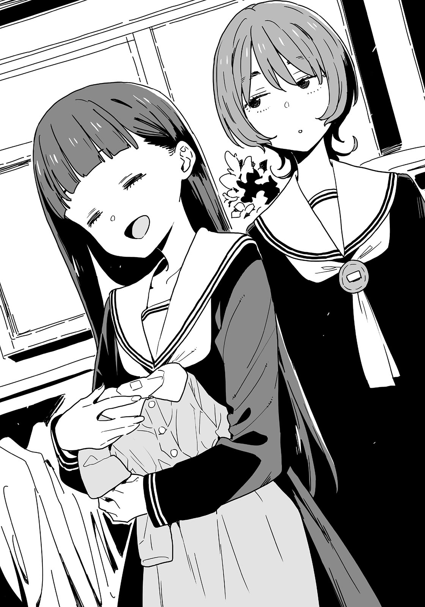

# Ch.63 — เล่ม 6 บทที่ 3-6 บทคั่น

Ch.63 — เล่ม 6 บทที่ 3-6 บทคั่น

By Monica

Published: 2025-04-24T07:52:07Z

Source: https://www.nekopost.net/novel/14560/63

เล่ม 6 บทที่ 3-6 บทคั่น

ในห้างคาลเมียที่ตั้งอยู่ในสถานีโทโยฮาชิ ซึ่งเต็มไปด้วยร้านขายเสื้อผ้าหลากหลาย สองสาวกำลังเดินไปด้วยกัน

หนึ่งในนั้นคือ นุคุมิซึ คาจู เธอหยุดเป็นครั้งคราวเพื่อมองดูหน้าร้านด้วยความสนใจ

ข้างๆ เธอ เด็กสาวที่สูงกว่า กอนโด อาซามิ หรือที่รู้จักกันในชื่อ กอนจัง เอื้อมมือมาแตะศีรษะของคาจูเบาๆ อย่างขี้เล่น

[ นุคุจัง ถ้าเธอสนใจอะไรล่ะก็ ทำไมไม่ลองเข้าไปดูใกล้ๆ ล่ะ? ]

[ คาจูสนใจ แต่คาจูไม่ได้อยากได้ไว้เองหรอกนะ คาจูไม่คิดจะใส่เสื้อผ้าเด็กหรอก ไม่ว่าจะยังไงก็ตาม ]

[ เสื้อผ้าเด็ก? ]

กอนจังมองตามสายตาของคาจูไปยังชุดที่เหมาะสำหรับเด็กวัยหัดเดินในตู้โชว์

[ ว้าว น่ารักดีนะ แล้วมันมีอะไรล่ะ? ]

คาจูเดินเข้าไปใกล้ราวแขวนเสื้อผ้าและสัมผัสเนื้อผ้าเบาๆ

[ แค่สงสัยว่าชุดแบบไหนจะเหมาะกับเด็กที่เพิ่งเริ่มเดิน ]

[ ...? ]

เธอหมายความว่าอะไง?

หน้าของกอนจังซีดลงเล็กน้อย ขณะพยายามปะติดปะต่อคำพูดของคาจู ใบหน้าของเธอดูสับสนมากขึ้นเรื่อยๆ

[ นุคุจัง!? อย่าบอกนะว่ามีอะไรเกิดขึ้นระหว่างเธอกับพี่ชายเธอน่ะ!? ]

[ ทำไมถึงตกใจขนาดนั้นล่ะ? ก็เหมือนเดิมนั่นแหละ คาจูกับท่านพี่สนิทกันมากอยู่แล้วนะ ]

…ดูเหมือนจะไม่มีอะไรน่าเป็นห่วง กอนจังถอนหายใจโล่งอก

[ งั้นมันเกิดอะไรขึ้นล่ะ? ]

[ ก็แค่ดูเหมือนว่าท่านพี่จะตัดสินใจอะไรบางอย่างได้แล้ว ]

[ อ๋อ อย่างนี้นี่เอง ก็ดีแล้วนี่…ใช่มั้ย? ]

หรือว่าท่านพี่ที่ "แสนเพอร์เฟกต์" ของเธอจะมีแฟนแล้วจริงๆ?

ขณะกอนจังคอยสังเกตปฏิกิริยาของคาจูด้วยความระมัดระวัง คาจูยกมือวางบนหน้าอกตัวเองและหลับตาลง

[ ใช่ คาจูเคารพการตัดสินใจของท่านพี่นะ และถ้าท่านพี่มีแฟนล่ะก็- ]

[ แล้วไง? ]

คาจูลืมตาขึ้นพร้อมกับสีหน้าที่เต็มไปด้วยความมุ่งมั่น

[ งั้นก็ถึงตาคาจูที่จะกลายเป็นคุณป้าแล้ว ]

[ ...เธอแน่ใจเหรอว่าเรียงลำดับถูกแล้ว? ]

คาจูพยักหน้าเงียบๆ

[ แต่ในเมื่อท่านพี่กับแฟนยังเรียนมัธยมอยู่ นั่นก็หมายความว่าคาจูต้องเป็นแม่ของลูกท่านพี่แทนใช่มั้ย? ]

[ ...จำเป็นเหรอ? ]

[ แน่นอนสิ ]

คาจูหยิบแจ็กเก็ตตัวเล็กจากราวแขวนขึ้นมา และอุ้มมันไว้เหมือนกำลังอุ้มทารก

[ คงรู้สึกแบบนี้สินะ ตอนที่คาจูอุ้มลูกของญาติเรา พอพวกเขาอายุเกินหนึ่งขวบ การอุ้มแนวนอนก็เริ่มยากขึ้นแล้ว- ]

กอนจังพยายามเลือกคำพูดอย่างระมัดระวังขณะที่คาจูพูดพึมพำกับตัวเอง

[ ถึงอย่างนั้น มันก็ยังเป็นเรื่องของอนาคตมั้ย? จำเป็นต้องกังวลเรื่องนี้ตอนนี้เลยเหรอ? ]

[ คาจูเริ่มฝึกตัวเองเพื่อเป็นเจ้าสาวตั้งแต่จำความได้เลยนะ งั้นตอนนี้ก็ถึงเวลาฝึกเป็นแม่แล้ว ]

[ ...หา? จำเป็นต้องเตรียมตัวตั้งแต่ตอนนี้เลยเหรอ? ]

[ แน่นอนสิ ]

พอคาจูตั้งใจทำอะไรแล้ว ก็ไม่มีใครหยุดเธอได้จริงๆ

ดูเหมือนว่าอาจมีการเข้าใจผิดบางอย่างเกี่ยวกับการ"ตัดสินใจได้แล้ว"ของทานพี่ของเธอ แต่กอนจังก็ไม่ได้คิดจะถามต่อ

เธอเพียงจินตนาการเห็นเด็กตัวเล็กๆ อยู่ในอ้อมกอดที่มองไม่เห็นของคาจู ก่อนจะสลัดหัวแรงๆ ไล่ความคิดนั้นออกไป

---
