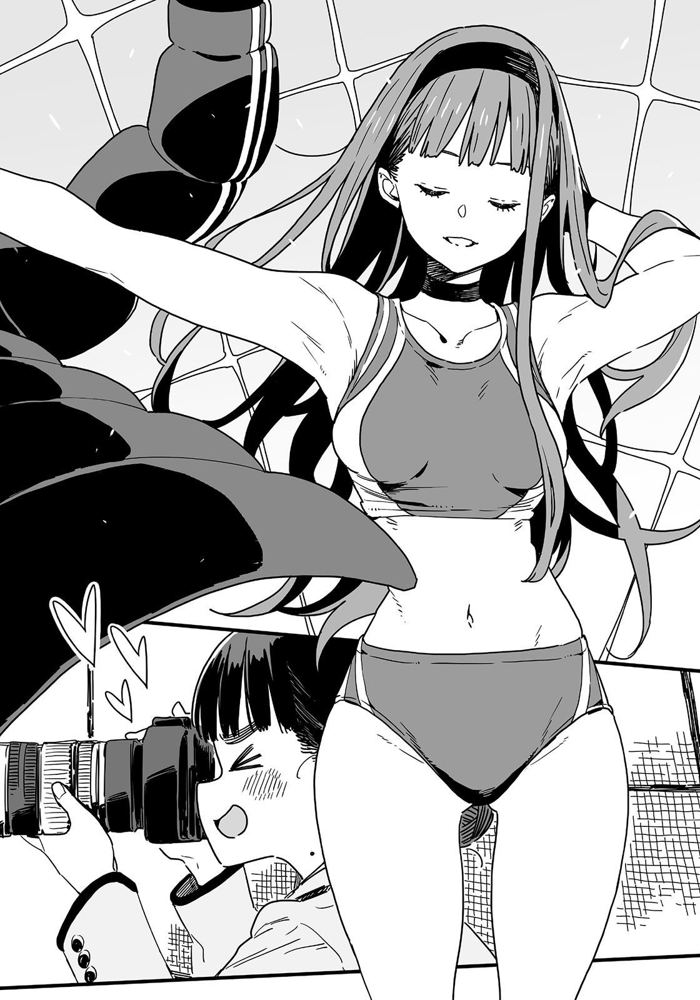

# Ch.65 — เล่ม 6 บทที่ 4-2

Ch.65 — เล่ม 6 บทที่ 4-2

By Monica

Published: 2025-04-24T07:52:23Z

Source: https://www.nekopost.net/novel/14560/65

เล่ม 6 บทที่ 4-2

ไม่ใช่แต่ประธานนักเรียนจะอยู่ที่นั่นในชุดโค้ทยาวบนม้านั่งแล้ว ยังมีเทียร่าซังและเหรัญญิกสภานักเรียน ซากุไรคุง อีก และ—

[ ท่านพี่! มองมาทางนี้สิคะ! ]

ไม่รู้ทำไม คาจูก็รู้เรื่องนี้ด้วย

เธอกำลังถือพัดสองอันและกระโดดโลดเต้นไปมา ซึ่งแค่นั้นก็ดูแปลกอยู่แล้ว แต่ข้อความบนพัดที่เขียนว่า "มองมาทางนี้สิ" และ "ท่านพี่ทำให้ใจเต้นแรง" นั้นก็ยิ่งทำให้แปลกกว่าเดิม

[ นุคุมิซึซัง ขยับไปทางซ้ายหน่อยได้มั้ย? ถ้าอยู่ข้างประธานน่าจะดูสมดุลมากกว่า ]

เทียร่าซังที่ทำหน้าที่เป็นช่างภาพกำลังเล็งกล้อง DSLR ที่มีเลนส์ขนาดใหญ่เท่ากระบองมาที่พวกเรา นั่นเอามาจากไหน ?

[ ...เลนส์แบบนั้นจำเป็นจริง ๆ เหรอ? ดูเหมือนจะถ่ายเห็นรูขุมขนพวกเราได้เลย ]

[ ไม่จำเป็นค่ะ ประธานสวยมากจนไม่มีรูขุมขนให้เห็นหรอก ]

เทียร่าซังพูดขึ้นอย่างจริงจัง ผมไม่พูดอะไรเพราะเธอชอบทำหน้าดุถ้าโดนแย้ง

ประธานนักเรียนพูดคุยกับซากุไรคุงที่เป็นผู้จับเวลาเสร็จแล้วโบกมือเรียกผม

[ นุคุมิซึคุง ถ้าวอร์มร่างกายเสร็จแล้ว เราเริ่มกันเลยก็ได้นะ พร้อมเมื่อไหร่ก็เริ่มเลย ]

[ อะ ครับ ]

ตอนนี้เท้าผมไม่เจ็บแล้ว และรู้สึกว่าร่างกายเบาขึ้นกว่าเมื่อสองสัปดาห์ก่อน

แต่ก็ยังสงสัยว่าหลังจากเน้นฝึกเพิ่มความแข็งแรง เวลาของผมจะดีขึ้นแค่ไหนกัน...

ผมเดินไปที่จุดเริ่มต้นและมองกลับไปที่กลุ่มสภานักเรียนพร้อมด้วยแขกรับเชิญพิเศษ

คาจูที่กำลังโบกพัด และเทียร่าซังที่ถือเลนส์ยักษ์เด่นจนแทบลืมไม่ลง

...ใช่ เธอบอกว่าผมเริ่มเมื่อไหร่ก็ได้

ผมสูดหายใจลึก ๆ ก้มตัวลง แล้วออกวิ่งไปข้างหน้า

สัมผัสได้ถึงสายตาที่มองมา ผมวิ่งจนถึงเส้นชัยแล้วทรุดตัวลงหอบหายใจ

[ เวลาเท่าไหร่...? ]

ผมถามพลางหอบหนัก ๆ และซากุไรคุงโชว์นาฬิกาจับเวลาพร้อมยิ้มออกมา

[ 15.2 วินาที ]

...ดีขึ้นมากจากสถิติเดิมที่ 16.5 วินาทีเลย ! ผมโน้มตัวเข้าไปดูนาฬิกาจับเวลาใกล้ ๆ ด้วยความตื่นเต้น—

แต่แล้วคาจูก็กระโดดเข้ามาหาผมด้วยความตื่นเต้น

[ ท่านพี่ เก่งมากเลยค่ะ! ]

[ คาจูจะเช็ดเหงื่อให้เอง ! ท่านพี่หิวน้ำมั้ยคะ? เดี๋ยวคาจูจะนวดตัวให้ครบทุกส่วนเลย เดี๋ยวกลับบ้านไปแช่น้ำด้วยกันคาจูจะร้องเพลงกล่อมให้ด้วยนะคะ— ]

[ คาจู ใจเย็น ๆ ก่อน หายใจเข้าลึก ๆ แล้วก็หายใจออกนะ เอ้า สูดเข้า— ]

[ โอเคค่ะ หายใจเข้า—หายใจออก— ]

เมื่อแน่ใจว่าเธอสงบลงแล้ว ผมหันกลับไปหาแววตาพอใจของประธานที่ยืนกอดอกอยู่

[ ...เอ่อ ทำไมเวลาถึงดีขึ้น ทั้งที่ไม่ได้วิ่งบ่อย ๆ เลยล่ะครับ? ]

[ มันก็ชัดเจนอยู่แล้ว ตอนที่จับเวลาครึ่งเดือนก่อน เธอหมดแรงตอนกลางทาง ตอนนั้นเธอแทบจะเดินตอนปลายทางด้วยซ้ำ ]

เอ๋ จริงเหรอ? คิดว่าตัวเองวิ่งได้เท่มากแล้วซะอีก

[ วันนี้เป็นครั้งแรกที่นายวิ่งเต็ม 100 เมตรจริง ๆ น่ะ นายก็เหมือนลูกกวางแรกเกิดนั่นแหละ จากนี้ไปจะเร็วขึ้นแน่นอน ไม่ว่าจะชอบหรือไม่ก็ตาม ]

คำว่า "เร็วขึ้น" ของประธานทำให้ผมรู้สึกฮึกเหิมขึ้นมา

จากผู้ชายที่วิ่ง 100 เมตรไม่ได้ ตอนนี้ผมพัฒนามาเป็นลูกกวางแรกเกิดที่ไม่มีช่องโหว่แล้ว

[ จะวัดเวลาอีกรอบเลยมั้ย? ]

[ ไม่ล่ะ รอบนี้จะเป็นครั้งสุดท้ายที่จับเวลาแล้ว ]

...อะไรนะ? ผมนิ่งไปด้วยความประหลาดใจ แต่ประธานวางมือบนไหล่ผมอย่างมั่นใจ

[ เป้าหมายของเราคือให้ร่างกายของนายอยู่ในสภาพดีที่สุดในวันแข่ง ถ้ามัวแต่ยึดติดกับตัวเลขมากเกินไประหว่างทาง อาจเกิดการถดถอยที่ไม่คาดคิดได้ ]

[ แต่ไม่รู้เวลาตัวเองที่ดีขึ้นเลยแบบนี้จะดีเหรอครับ?」

[ ไม่ต้องห่วง ฉันมีแผนอยู่แล้ว ]

ประธานค่อย ๆ รูดซิปโค้ทยาวลงแล้วโยนมันออกไปด้วยการเคลื่อนไหวอันรวดเร็ว

เสียงเชียร์กึ่งกรีดร้องของเทียร่าซังและเสียงชัตเตอร์ดังสนั่นไปทั่ว

[ ประธาน ชุดนั้นคือ— ]

ใช่แล้ว ใต้โค้ทของเธอคือชุดวิ่งของชมรมกรีฑาที่เป็นแบบแยกชิ้น

[ ครั้งต่อไป ฉันจะวิ่งพร้อมกับนาย เป้าหมายคือ 14.5 วินาที ]

หน้าท้องของเธอเผยให้เห็นกล้ามเล็ก ๆจาง ๆ ผมมองไปแวบหนึ่งก่อนจะเบือนสายตาไปทางอื่น

[ ยากิชิโอะคุงต้องทำลายสถิติของตัวเองแน่นอน เพราะงั้นต้องเอาชนะฉันให้ได้ถึงจะชนะ ]

[ อะ เอ่อ... ]

ผมรู้สึกกดดันจากผิวขาวๆของเธอ แต่ประธานก็ก้าวเข้ามาใกล้ผมสองก้าว

จากนั้นเธอจิ้มที่หน้าอกของผมด้วยนิ้วแล้วพูดขึ้น—

[ นี่คือบททดสอบของจริง ลูกกวางแรกเกิดจะวิ่งชนะเสือชีตาห์ได้รึเปล่านะ ? ]

◇

ห้าวันผ่านไปนับตั้งแต่เริ่มการฝึกซ้อมอย่างจริงจัง

หลังจากจบการฝึกซ้อมในช่วงเช้า ผมก็มาอยู่ที่ร้านเบเกอรี่ชื่อบอน เซนกะซึ่งอยู่ห่างจากสถานีโทโยฮาชิไม่กี่นาที

ร้านนี้ขึ้นชื่อเรื่องมุมกาแฟสไตล์เรโทรที่ดูเหมือนจะไม่เปลี่ยนไปเลยตั้งแต่สมัยพ่อแม่ผมยังเด็ก

ผมนั่งอยู่หน้าขนมปังบัตเตอร์ครีมและครีมโซดาและไตร่ตรองถึงการฝึกซ้อมที่หนักหน่วงในวันนี้

วันแรกที่เริ่มฝึก ประธานนักเรียนวิ่งนำผมไปไกล แต่หลังจากดูวิดีโอและภาพถ่ายเพื่อปรับปรุงท่าทาง ผมก็เริ่มไล่ตามเธอทัน

ช่วงบ่ายเป็นเวลาฝึกซ้อมอิสระ ผมควรตรวจสอบตารางฝึกพละกำลัง แล้วอาจวิ่งเบา ๆ สักรอบ

ระหว่างที่ผมค่อย ๆ ตักไอศกรีมจากครีมโซดาและวางแผนสำหรับช่วงบ่ายอยู่ สึกิโนะคิเซ็นไปก็เดินเข้ามาในร้าน

เธอแต่งตัวเรียบง่ายด้วยเสื้อสเวตเตอร์ถักและแจ็กเก็ตเบา ๆ

เธอนั่งตรงข้ามผม พลางไขว้ขาที่อยู่ในกางเกงเข้ารูป

[ ขอโทษที่โทรมากะทันหัน มีแผนอะไรอยู่หรือเปล่า? ]

[ ไม่เป็นไร แค่กำลังจะกลับบ้านจากโรงเรียน แล้วรุ่นพี่ทามากิล่ะ? ไม่ได้มาด้วยเหรอ? ]

[ เขาลืมไปรับเอกสารย้ายเลยต้องรีบไปสำนักงานเทศบาล เดี๋ยวเขาก็มา ]

รุ่นพี่สึกิโนะคิสั่งกาแฟกับเค้กคาสเทลล่าจากพนักงานเสิร์ฟที่ดูใจดี ก่อนจะหยิบการ์ดใบหนึ่งออกมาจากกระเป๋า

[ นี่ ที่อยู่ใหม่ของฉัน แวะมาได้ทุกเมื่อเลยนะ ]

[ ขอบคุณที่อุตส่าห์ลำบากมานะครับ เอาจริง ๆ แค่ส่งเมลมาก็พอแล้ว ]

[ ฉันอยากบอกทุกคนในชมรมวรรณกรรมด้วยตัวเอง ]

เธอดูเขิน ๆ กับคำพูดของตัวเองจึงถอดแว่นตาออกแล้วเริ่มเช็ดมันอย่างตั้งใจ

[ ฉันคิดจะไปหาที่ห้องชมรมเหมือนกันนะ แต่พอเรียนจบแล้วมันก็แปลกๆที่จะเข้าโรงเรียนอีก ]

[ ทำไมล่ะ? ]

[ ก็ลองคิดดูสิ ใส่ชุดธรรมดาเข้าไปก็เด่นแปลก ๆ หรือถ้าใส่ชุดนักเรียนกลับไปก็เหมือนคอสเพลย์ใช่มั้ยล่ะ? ถึงฉันจะไม่กล้าใส่ชุดคอสเพลย์เข้าโรงเรียนเก่าก็เถอะ ]

[ ...อืม แต่บางทีก็เห็นคนกลับไปใส่ชุดนักเรียนที่โรงเรียนเก่านะ ]

[ ในกรณีไหนล่ะ? นอกจากถ่ายวิดีโอแปลก ๆ? ]

เธอพูดมีเหตุผล ผมเองก็เคยต้องทำแบบนั้นสมัยเกิดเรื่องที่โรงเรียนมัธยมต้นโมโมโซโนะ

[ แล้วรุ่นพี่ได้ติดต่อคนอื่น ๆ จากชมรมวรรณกรรมบ้างหรือยัง? ]

[ นายเป็นคนสุดท้ายที่ฉันเจอเลยนะ นุคุมิซึคุง แล้วก็ ฉันเจอยากิชิโอะจังเมื่อวันก่อน ]

เธอใส่แว่นกลับเข้าไป พลางยิ้มแปลก ๆ ใส่ผม

[ ...อยากรู้ล่ะสิ? ]

[ ก็ใช่ พรุ่งนี้ต้องเจอกันแล้วนี่ ]

พรุ่งนี้วันเสาร์คือวันที่จะดวลกับยากิชิโอะ จากที่ยานามิเล่ามา เธออยู่ในสภาพที่ฟอร์มดีสุด ๆ

[ ผมจะไปพักที่บ้านของประธานในคืนก่อนหน้านั้น ไม่รู้เหมือนกันว่าทำไม ]

[ ที่บ้านโฮโคบารุเหรอ? บ้านเธออยู่อิโคเบะไม่ใช่เหรอ? ทำไมต้องไปไกลขนาดนั้น? ]

[ เธอบอกว่าอยากปรับสภาพครั้งสุดท้ายพร้อมดูแลร่างกายของผมไปด้วย ดูเหมือนซากุไรคุงจากสภานักเรียนก็จะไปพักด้วย ]

[ การแข่งมีวันเสาร์ใช่มั้ย? ฉันกับชินทาโร่จะออกจากโทโยฮาชิวันถัดจากนั้น ]

บทสนทนาหยุดลงชั่วครู่เมื่อพนักงานเสิร์ฟนำกาแฟและเค้กมาเสิร์ฟ

ผมพยักหน้าขอบคุณขณะที่รุ่นพี่สึกิโนะคิรับของหวานไปวางตรงหน้า

[ ขอโทษนะ ช่วงนี้ยุ่งมากจนไม่ได้ฉลองการเริ่มต้นใหม่ของรุ่นพี่เลย ]

[ ไม่เป็นไร จริง ๆแล้วฉันรู้สึกโล่งใจด้วยซ้ำไป ยังไงฉันต้องย้ายไปอยู่แล้ว- ]

เธอพูดพร้อมกับเทนมลงในกาแฟและคนมันอย่างเงียบ ๆ

[ การได้เห็นพวกเธอพยายามในที่ที่ฉันไปไม่ถึง มันทำให้ฉันสบายใจขึ้นนิดหน่อย ]

เธอส่งยิ้มบาง ๆ ที่ดูเศร้าอย่างบอกไม่ถูก

[ นุคุมิซึคุง ตอนแรกเริ่มต้นจากสมาชิกในเงาใช่มั้ย? แต่ตอนนี้นายได้เป็นประธานชมรม คอยสนับสนุนโคมาริจัง และบางทีตอนนี้ก็อาจจะสนับสนุนยากิชิโอะจังด้วย? ]

[ ...ไม่แน่ใจ…ผมแค่เหมาะเพราะไม่มีสายสัมพันธ์กับชมรมวิ่งต่างหาก ]

รุ่นพี่สึกิโนะคิยิ้มในขณะที่ผมจัดการครีมโซดาที่กำลังละลาย

[ แค่นั้นเองเหรอ? อาจมีโอกาสก็ได้นะ ]

[ ไม่มีทางหรอก เรากำลังพูดถึงยากิชิโอะกับผมเลยนะ ]

[ ไม่แน่นะ กับคู่ที่ไม่น่าจะเกิดก็เกิดได้ แล้วถ้าเธอไม่มีความสนใจอะไรเลย ทำไมเธอถึงชวนนายออกไปเดทล่ะ ? บางทีคนเราก็ไม่รู้ความรู้สึกตัวเองหรอก ]

เธอพูดเหมือนเดิมทุกที ผมดูดน้ำผ่านหลอดและหัวเราะเบา ๆ

ความคิดที่ว่ายากิชิโอะ สาวที่อยู่จุดสูงสุดของลำดับชั้นในโรงเรียน จะมีความรู้สึกอะไรกับผม มันช่างห่างไกลจากความเป็นจริงเหลือเกิน

...แต่เดี๋ยวนะ แม้ว่าเธอจะนิสัยแย่สุด ๆ แต่รุ่นพี่สึกิโนะคิก็ยังเป็นผู้หญิงคนหนึ่งเหมือนยากิชิโอะ

บางทีเธออาจมองเห็นสิ่งที่ผมกับรุ่นพี่ทามากิไม่เห็น

[ จริงเหรอ? ยากิชิโอะเนี่ยนะ มี...แบบนั้น? ]

[ เอ่อ... ]

รุ่นพี่สึกิโนะคิที่ดูเหมือนจะคิดหนัก ทันใดนั้นก็ตบมือเข้าด้วยกันแล้วก้มหัวขอโทษอย่างจริงจัง

[ ขอโทษนะ ฉันแค่พูดลอย ๆ ฉันเองก็เดายากิชิโอะจังไม่ออกเหมือนกัน ]

[ ...อ่า เข้าใจแล้ว ]

แน่แหละ ผมตัดสินใจสนใจครีมโซดาต่อโดยไม่พูดอะไรอีก

— รุ่นพี่ทั้งสองกำลังจะออกจากโทโยฮาชิและเริ่มต้นชีวิตใหม่ในสุดสัปดาห์นี้

แม้ว่านาโกย่าจะอยู่ในจังหวัดเดียวกัน แต่มันก็ไม่ใช่ระยะทางที่จะไปหากันง่าย ๆ

ผมรู้สึกว่าต้องคิดถึงพวกเขาแน่ ๆ แต่ในขณะเดียวกัน ผมก็เริ่มตระหนักถึงอนาคตที่รออยู่ข้างหน้าหลังการลาจากครั้งนี้

ทางเลือกของยากิชิโอะ อนาคตของชมรมวรรณกรรม และตัวผมเองในฐานะนักเรียนปีสอง-

ทำไมผมถึงพยายามมากมายเพื่อท้าทายยากิชิโอะ? หรือทำไมผมถึงสั่งครีมโซดาที่ไม่ใช่แนวผมเลย-

ความคิดมากมายหมุนวนในหัว ผมจ้องมองฟองเล็ก ๆ ในโซดา รู้สึกว้าวุ่นเล็กน้อย

◇

บ่ายวันศุกร์ ก่อนการแข่งที่จะมีขึ้นในวันพรุ่งนี้ ผมพบว่าตัวเองอยู่ในสนามของโรงเรียนมัธยมต้นแห่งหนึ่งที่ไม่มีความเกี่ยวข้องอะไรกับผมเลย

โรงเรียนเก่าของประธานโฮโคบารุ โรงเรียนเทศบาลซาซายูริ ล้อมรอบไปด้วยทุ่งกะหล่ำปลี

กลิ่นไอทะเลผสมกับสายลมที่พัดมา บอกชัดเจนว่านี่ไม่ใช่สภาพแวดล้อมที่ผมคุ้นเคย

ช่วงนี้เหมือนผมจะผูกพันกับโรงเรียนมัธยมต้นมากเป็นพิเศษ

ผู้หญิงคนหนึ่งในชุดวอร์มกำลังคุยกับประธานอยู่ ดูเหมือนเธอจะเป็นครูของโรงเรียนนี้

ซากุไรคุงยืนอยู่ข้างๆผมในขณะที่ผมกำลังเข้าสู่เซตที่สองของการออกกำลังกายตามวิทยุ

[ ขอโทษที่ลากนายมาถึงที่นี่นะ ถ้าฮิบะเน่ตัดสินใจแล้วจะไม่ยอมฟังใครเลย ]

[ ไม่เป็นไร มีเรื่องแบบนี้ในชมรมวรรณกรรมบ่อยๆ ชินแล้วล่ะ ]

เรายิ้มแห้ง ๆ ให้กัน ก่อนที่ประธานจะเดินมาหาพวกเราพร้อมกับถอดโค้ตตัวหนาออก

[ พอได้แล้วน่า อย่ามานินทาฉันเลย วันนี้เรามาเช็คการเคลื่อนไหวก็พอ อย่าหักโหมเกินไป ]

[ ถ้าอย่างนั้น ผมมีอะไรบางอย่างที่อยากลองทำดู ]

[ โอ้? ลองพูดมาสิ ]

ประธานฟังข้อเสนอของผมเงียบ ๆ แล้วพยักหน้าอย่างหนักแน่น

[ งั้นลองทำดูเลย ฮิโรโตะ ช่วยถ่ายการเคลื่อนไหวใกล้ ๆประตูให้หน่อย ]

[ ได้เลย สู้ ๆ นะ นุคุมิซึคุง ]

พูดจบ ซากุไรคุงก็วิ่งไปยังบริเวณประตู

เขาเป็นคนดีนะ อาจจะเป็นคนปกติคนเดียวในกลุ่มนี้ด้วยซ้ำ

...จริง ๆ ทำไมรอบตัวผมถึงมีแต่พวกแปลก ๆ นะ?

พอคิดดูแล้ว หลังจากรุ่นพี่ทามากิที่ค่อนข้างปกติเรียนจบไป เหมือนจะเหลือแต่คนประหลาด ๆ อยู่รอบตัวผม

[ มีอะไรเหรอ? มองหน้าฉันทำไม ]

[ อ๋อ เปล่า ๆ งั้นเริ่มวิ่งกันเลยดีกว่า ]

...อืม ก็ว่าไป ประธานเองถ้าเทียบกับคนอื่น ๆ แล้ว ก็อาจจะจัดว่าอยู่ในฝั่ง "ปกติ" ก็ได้มั้ง

---
