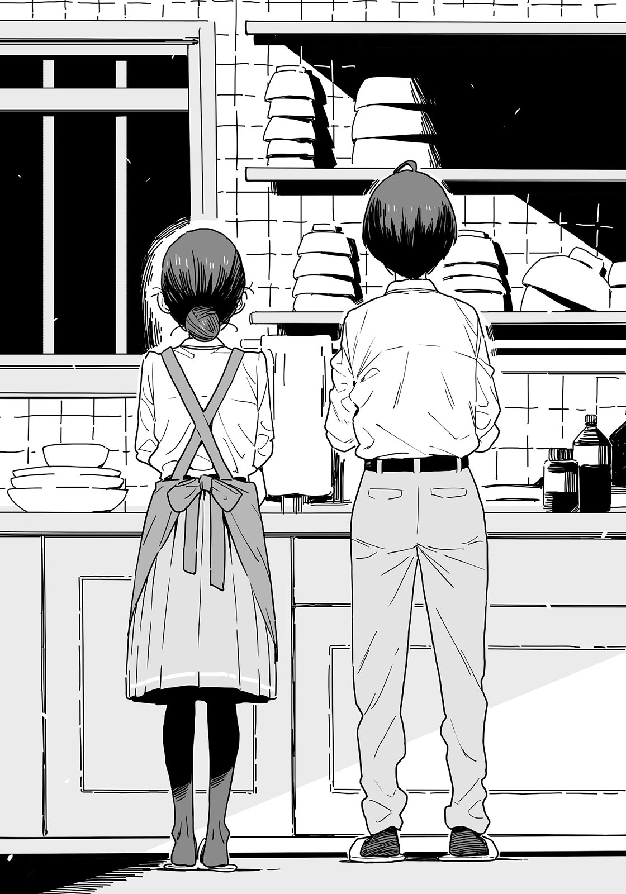

# Ch.66 — เล่ม 6 บทที่ 4-3

Ch.66 — เล่ม 6 บทที่ 4-3

By Monica

Published: 2025-04-24T07:52:28Z

Source: https://www.nekopost.net/novel/14560/66

เล่ม 6 บทที่ 4-3

หลังจาก "การปรับเบา ๆ" สองชั่วโมง เราก็มุ่งหน้าไปยังบ้านของประธาน

ผมรู้สึกแปลกใจที่ไม่ค่อยรู้สึกเหนื่อยล้าเลย

บ้านของประธานเป็นบ้านไม้ชั้นเดียวสไตล์ญี่ปุ่นหลังใหญ่ พร้อมโรงเก็บของกระจายอยู่ทั่วลานกว้าง

ผมเดินตามประธานไปพลางมองรอบ ๆ ลานด้วยความสนใจ

[ ครอบครัวรุ่นพี่ทำอะไรเหรอครับ ? ]

[ เราดูแลไร่เล็ก ๆ ไม่กี่แปลง และทำงานกับสหกรณ์น่ะ พ่อแม่ฉันไปทำงานอยู่ตอนนี้ ต้องขอโทษด้วยที่ต้อนรับได้ไม่ดีเท่าที่ควร ]

เมื่อประธานเลื่อนบานประตูหน้าบ้านออก ก็เห็นรองเท้าหลายคู่เรียงอยู่ในพื้นที่ทางเข้ากว้างขวาง

ผมรู้ว่าเธออาศัยอยู่กับพ่อแม่ แต่ก็อดสงสัยไม่ได้ว่ามีผู้หญิงคนอื่นอาศัยอยู่ที่นี่ด้วยหรือเปล่า

[ ประธาน ! กลับมาแล้วเหรอคะ ]

เสียงของเทียร่าซังดังมาจากหลังบ้าน ขณะที่เธอเดินออกมาพร้อมกับสวมผ้ากันเปื้อน เสียงรองเท้าแตะดังแปะ ๆ

[ เอ๊ะ ทำไมเธอถึงอยู่ที่นี่? ]

คำถามที่หลุดออกมาจากความคิดของผม แต่แทนที่จะต่อว่าผม เทียร่าซังก็ยืดอกด้วยความภูมิใจ

[ ในฐานะรองประธาน มันก็ธรรมดาที่จะต้องช่วยเหลือประธานน่ะสิ เข้ามาเลยทุกคน ]

[ อย่าเกรงใจเลยนะ เข้ามาข้างในเถอะ ฮิโรโตะ ช่วยพานุคุมิซึคุงไปดูรอบ ๆ หน่อยสิ ]

[ ได้เลย นุคุมิซึคุง ทางนี้ ]

ซากุไรคุงพาผมไปยังห้องสไตล์ญี่ปุ่นขนาดประมาณสิบเสื่อทาทามิ

ห้องนั้นเชื่อมต่อกับระเบียงไม้ตรงหน้าต่าง แม้จะเก่าแต่ก็สะอาดและดูสงบ

[ ใช้ห้องใหญ่ขนาดนี้ได้เหรอ? ]

[ ปู่ย่าของพวกเราไปอยู่ในตัวเมืองแล้ว เลยมีห้องว่างเหลือ ]

[ พูดถึงแล้ว นายกับประธานเป็นลูกพี่ลูกน้องกันใช่มั้ย? ]

ซากุไรคุงพยักหน้าในขณะที่วางสัมภาระลง

[ แต่ห้องอื่น ๆ มีของเก็บเต็มหมดแล้ว ที่นี่เป็นห้องเดียวที่โล่ง ]

เข้าใจแล้ว ซากุไรคุงก็คงพักอยู่ห้องนี้ด้วย ผมนี่ลำบากเวลาต้องนอนร่วมกับคนอื่นจริง ๆ...

แต่เอาเถอะ จะเรื่องมากไม่ได้ ผมวางกระเป๋าลงแล้วเดินออกไปที่ระเบียง

มองออกไปนอกหน้าต่างก็เห็นสวนที่มีต้นพลับอยู่ต้นหนึ่ง

ผมเคยฝันไว้เสมอว่าตอนเกษียณจะได้นั่งอยู่บนระเบียงแบบนี้ อาบแดด และจิบชาอย่างสงบ...

ผมกำลังจมอยู่ในความคิด พอก้าวเท้าออกไป และทันใดนั้นก็รู้สึกถึงความนุ่มหยุ่นเหมือนเนื้อดิบใต้ฝ่าเท้า

[ ชิกิยะซัง!? ]

สิ่งที่ผมเหยียบไม่ใช่เนื้อดิบ แต่คือชิกิยะซัง

เธอนอนอยู่บนระเบียง ลืมตาขึ้นพลางขยี้ตา แล้วลุกขึ้นนั่ง

[ ขอโทษครับ ! ไม่คิดว่าจะมีใครมาอยู่ตรงนี้ ]

[ ...ไม่เป็นไร ...ระเบียง ...อุ่น ]

ชิกิยะซังมองผมด้วยความสงสัยเล็กน้อยก่อนจะค่อย ๆ ลุกขึ้นยืน

[ นุคุมิซึคุง...? ทำไม…….มาอยู่ที่นี่? ]

[ ผมมาค่ายฝึกเตรียมแข่งพรุ่งนี้ แล้วรุ่นพี่กับบาโซริซังมาทำอะไรที่นี่ล่ะ? ]

[ ค่าย...ดูสนุกดีใช่มั้ย...? ]

อืม การสนทนาดูจะหลุดโลกไปหน่อย ขณะที่ผมกำลังคิดว่าจะตอบยังไง—

[ เวลามีคนมารวมตัวกันเยอะ ๆ ฮิบะเน่ชอบมากเลยล่ะ เธอจะตื่นเต้นมากช่วงเทศกาลโอบ้งหรืออะไรทำนองนั้น ]

ซากุไรคุงช่วยอธิบายให้ผมเข้าใจ

พูดง่าย ๆ คือประธานชอบบรรยากาศที่มีคนอยู่เยอะ ๆ เลยเรียกคนในสภานักเรียนมาด้วยหมด

ชิกิยะซังยังคงแกว่งตัวไปมา ก่อนจะดึงชายชุดวอร์มของผมเบา ๆ

[ ทำอาหาร...ด้วยกัน? ]

หือ อาหาร? อ้อ ใช่—

[ ผมเห็นบาโซริซังใส่ผ้ากันเปื้อนอยู่เมื่อกี้นี่ไม่ใช่เหรอ? เธอกำลังทำอาหารอยู่ใช่มั้ย? ]

[ อาหารของเธอ...ไม่อร่อย……มันแปลก ๆ... ]

งั้นเหรอ? ก็คิดไว้แล้วล่ะ

[ แต่ประธานก็อยู่กับเธอไม่ใช่เหรอ? อาหารของเธอน่าจะ— ]

ปัง! เสียงดังลั่นมาจากด้านหลังบ้าน

ซากุไรคุงที่เงียบ แล้วเดินออกจากห้องไปตามเสียงกรีดร้องของเทียร่าซัง

...ว่าไปแล้ว ประธานเองก็เป็นคนซุ่มซ่ามอยู่เหมือนกัน

นี่มันค่ายฝึกกับพักผ่อนเพื่อเตรียมแข่งวันพรุ่งนี้ไม่ใช่เหรอ...?

ผมถอนหายใจแล้วเดินตามซากุไรคุงไป ขณะที่ชิกิยะซังยังคงดึงชุดวอร์มของผมไว้ไม่ยอมปล่อย

◇

มื้อเย็นจบลงตอนหกโมงเย็น ตอนนี้ผมกำลังล้างจาน

เทียร่าซังยืนอยู่ข้าง ๆ คอยเช็ดจานที่ล้างแล้วให้แห้ง

วันนี้เธอเงียบผิดปกติ แต่ไม่นานก็เริ่มพูดขึ้นอย่างลังเล

[ ...นุคุมิซึซัง นายทำอาหารเก่งเหมือนกันนะ? ]

[ ไม่ขนาดนั้นหรอก แค่ทำเป็นนิดหน่อย เพราะพ่อแม่ทำงานทั้งคู่ ]

ตอนแรกตั้งใจจะทำหม้อไฟ แต่ประธานดันทำทุกอย่างหลุดมือไปหมด เลยต้องเริ่มต้นกันใหม่

โชคดีที่เรามีกะหล่ำปลีเยอะ ผมเลยดองกะหล่ำปลีแบบง่าย ๆ และใช้หมูบดในช่องฟรีซมาทำกะหล่ำปลียัดไส้แบบไม่ยัดไส้แทน

[ แค่ 'นิดหน่อย' เองเหรอ? นายยังทำคินปิระจากเปลือกแครอทระหว่างรออาหารอีกนะ ]

[ ก็แค่ฆ่าเวลาไปพลาง ๆ ระหว่างรอให้ทุกอย่างอุ่นขึ้นน่ะ ]

คาจูคงจะทำอาหารจานหลักเพิ่มได้อีกสองอย่างในเวลาเดียวกัน และยังมีของหวานให้หลังมื้ออาหารด้วย ผมยังต้องเรียนรู้อีกเยอะ

[ ซุปมิโสะที่บาโซริซังทำก็.…..อร่อยดีนะ ]

[ .…..ฉันทำให้อร่อยกว่านี้ได้อีก ]

[ ก็ถือว่าใช้ได้เลยนะ ถ้าไม่นับว่าเธอลืมทำดาชิ ]

[ .....ปกติก็ทำถูกวิธีนั่นแหละ ]

ผมควรหยุดพูดจาขัดใจกว่านี้ได้แล้ว

เทียร่าซังรับจานที่ผมส่งให้เงียบ ๆ

หลังจากเราล้างจานเสร็จและเช็ดซิงค์เรียบร้อย ประธานก็เข้ามาในครัว

[ โอเค ก่อนที่พ่อแม่ฉันจะกลับมา ไปอาบน้ำกันก่อนดีกว่า นายเป็นแขกวันนี้ เพราะงั้น ไปก่อนเลยนะ ]

[ ผมไปก่อนได้จริงเหรอ? ]

[ นายเป็นแขกคนสำคัญของเรา แต่ช่วยไปพร้อมกับฮิโรโตะได้มั้ย? วันนี้คนเยอะน่ะ ]

[ เอ๊ะ!? ]

จู่ ๆ คนที่ส่งเสียงตกใจกลับเป็นเทียร่าซัง

เธอสั่นเล็กน้อยและขยับเข้าไปใกล้ประธาน

[ ม-มันไม่ขัดต่อศีลธรรมหรือคะ!? ]

[ ทำไมล่ะ? ]

ใบหน้าของเทียร่าซังแดงก่ำทันทีเมื่อประธานถามกลับอย่างง่าย ๆ

[ แต่….แบบนี้มันจะดีจริงเหรอ? สองคนไปอยู่ในพื้นที่ปิด แถมไม่มีเสื้อผ้า… ]

[ แน่นอนว่าต้องเปลือยสิ จะอาบน้ำนี่นา ]

ปิดจบอย่างเด็ดขาด ผมเลยพูดขึ้นอย่างเก้อเขิน

[ เอ่อ ผมไม่ติดอะไรหรอก… ]

[ นุคุมิซึซัง!? ไม่สิ แต่... ]

เทียร่าซังที่ยังคงตัวสั่นและทำตาเบิกกว้างเหมือนจะตัดสินใจอะไรบางอย่างได้ ก่อนพยักหน้า

[ งั้นฉันจะไปด้วย! ]

...นี่เธอกำลังพูดอะไรน่ะ?

แม้แต่ผมก็ยังอึ้งกับความไร้สาระนี้ และดูเหมือนคนอื่น ๆ จะได้ยินเสียงวุ่นวายเช่นกัน ซากุไรคุงที่ปรากฏตัวอย่างไม่ทันรู้ตัว วางมือลงบนไหล่ของเทียร่าซัง

[ ใจเย็น ๆ บาโซริจัง เธอไปด้วยไม่ได้หรอก ]

[ ตะ-แต่ฉันอยากดู- เอ่อ…. หมายถึง... ถ้าไม่มีคนคอยดูแล ต้องเกิดเรื่องวุ่นวายแน่ๆ….ใช่มั้ย? ]

นี่ ถ้าอย่างนั้นทำไมไม่จับเธอมัดแล้วโยนเข้าตู้เก็บของไปเลยล่ะ?

ซากุไรคุงที่ใจเย็นสุด ๆ ยังคงพูดต่อโดยไม่เปลี่ยนสีหน้า

[ ไม่เป็นไร บาโซริจัง เธอไปอาบพร้อมกับฮิบะเน่ก็ได้นะ แบบนี้โอเคมั้ย ฮิบะเน่ ? ]

[ เอ๊ !? อ-อาบน้ำกับ...ประธาน!? ]

ดวงตาของเทียร่าซังยิ่งเบิกกว้างขึ้นไปอีก และประธานก็โอบแขนรอบตัวเธอ

[ เธออยากอาบน้ำกับฉันสินะ? เอาล่ะ บาโซริคุง ไปด้วยกันเถอะ ]

[ อะ...อะ-อะไรนะ! อะไร... ]

ขณะที่เทียร่าซังกำลังตัวสั่นอีกครั้ง ซากุไรคุงก็กระซิบกับผมเบา ๆ

[ นี่เป็นโอกาสแล้ว ไปกันเถอะ ]

[ เอ๊ะ? อ๋อ...ได้สิ… ]

นี่สินะวิธีจัดการกับเทียร่าซัง ซากุไรคุงนี่เก่งจริง ๆ

ผมได้แต่ทึ่งในความสามารถของเขา ขณะฉวยโอกาสหนีออกจากสถานการณ์นี้

---
