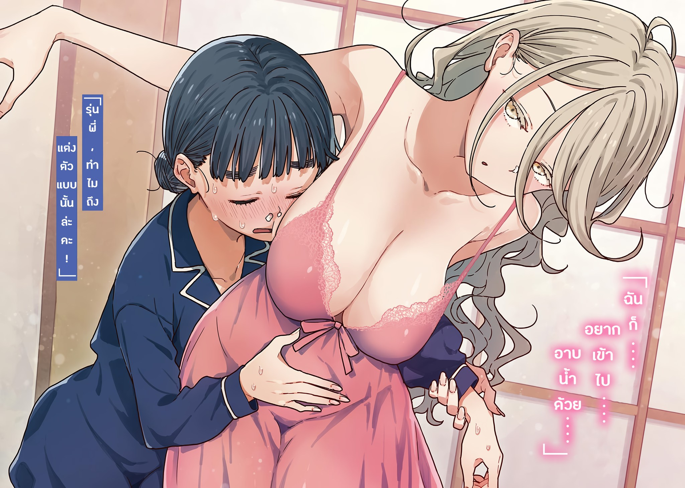

# Ch.67 — เล่ม 6 บทที่ 4-4

Ch.67 — เล่ม 6 บทที่ 4-4

By Monica

Published: 2025-04-24T07:52:33Z

Source: https://www.nekopost.net/novel/14560/67

เล่ม 6 บทที่ 4-4

หยดน้ำหยดหนึ่งร่วงลงจากเพดานกระทบไหล่ของผม ทำให้สะดุ้งขึ้นมาโดยไม่ตั้งใจ

ห้องอาบน้ำของบ้านโฮโคบารุเป็นแบบกระเบื้องสไตล์ดั้งเดิม อ่างน้ำใหญ่พอให้สองคนยืดขาได้สบาย ๆ

ผมล้างตัวก่อน แล้วจึงเปลี่ยนให้ซากุไรคุงลงไปแช่ในอ่างแทน

...รู้สึกเหนื่อยล้าเกินเหตุ ผมแช่น้ำจนถึงระดับไหล่ในน้ำอุ่น

ระหว่างนั้น ผมมองซากุไรคุงล้างตัวอย่างผ่าน ๆ ร่างกายของเขาดูบอบบางผิดปกติ

ผมมักจะโดยบอกว่าผอม(โดยเฉพาะจากยานามิ) แต่โครงร่างของซากุไรคุงมัน...ไม่เหมือนผู้ชายทั่วไปเลย แน่ใจนะว่าเขาไม่ใช่เด็กผู้หญิงอกแบนปลอมตัวมา?

ซากุไรคุงหันมามองผมขณะที่ผมนึกถึงไลท์โนเวลหลายเล่มที่เคยอ่าน

[ นุคุมิซึคุง เป็นประธานชมรมวรรณกรรมใช่มั้ย? ดูเหมือนจะลำบากอยู่นะ ]

[ เหรอ? ผมว่าดูแลพวกกรรมการนักเรียนยังหนักกว่านะ ]

คำตอบจริงใจของผมทำให้ซากุราอิคุงยิ้มเจื่อนในกระจกสะท้อน

[ ทุกคนก็เป็นคนดี แค่ต้องการการสนับสนุนนิดหน่อย ]

ผมสงสัยว่ามันเป็นแค่ "นิดหน่อย" จริงเหรอ โดยเฉพาะในกรณีของประธาน ดูเหมือนจะเกินกว่าการสนับสนุนธรรมดาไปแล้ว

ดูเหมือนว่าพวกเขาเรียนมัธยมต้นที่เดียวกัน สงสัยว่าเธอจัดการปีก่อนที่ซากุไรคุงจะเข้าโรงเรียนซึวะบุกิยังไง

[ ประธานเคยอยู่ชมรมกรีฑาจนถึงมัธยมต้นใช่มั้ย? ขอถามได้มั้ยว่าทำไมถึงเลิก? ]

[ อืม ไม่ได้เลิกเพราะบาดเจ็บอะไรหรอก เธอแค่ทำชมรมกรีฑาจนครบสามปี แล้วตัดสินใจมุ่งเน้นไปที่งานกรรมการนักเรียนตอนมัธยมปลาย ก็เท่านั้น ]

ซากุไรคุงเทน้ำจากขันล้างตัว

[ แน่นอน มีหลายอย่างที่เธอต้องจัดการด้วยตัวเอง ตอนหนึ่งคนเราต้องขีดเส้นแบ่ง และสำหรับฮิบะเน่ เส้นแบ่งนั้นก็คือตอนเข้าเรียนมัธยมปลาย ]

หลังจากล้างฟองออก ซากุไรคุงก็นั่งลงข้าง ๆ ผมในอ่างน้ำที่กว้างขวาง

[ นายสนใจฮิบะเน่เหรอ? ]

[ ไม่ใช่เชิงว่าสนใจ ทั้งๆที่รู้ว่าเธอใส่ใจยากิชิโอะมาก แต่ไม่เข้าใจว่าทำไมเธอต้องทำอะไรขนาดนั้น ]

[ เมื่อก่อนได้ยินเรื่องยากิชิโอะซังจากฮิบะเน่บ่อยๆน่ะ ]

ซากุไรคุงพูดขณะยืดตัวและประสานนิ้วมือ

[ ตอนนี้มาคิดดู ยากิชิโอะซังอาจจะเป็นหนึ่งในจุดเปลี่ยนของฮิบะเน่ก็ได้ แน่นอน มันไม่ใช่ความผิดของเธอ ]

— จุดเปลี่ยนงั้นเหรอ?

กิจกรรมชมรมเป็นเรื่องสำคัญสำหรับแต่ละคน แต่ก็มีเวลาที่ต้องวางมือ สำหรับหลายคน เวลานั้นคือวันจบการศึกษา แต่บางคนก็มีอนาคตที่ไปไกลกว่านั้น

ผมไม่รู้ว่ายากิชิโอะจะไปได้ไกลแค่ไหนในฐานะนักกีฬา แต่จากที่คนพูดกัน เธออาจเป็นหนึ่งในคนที่มีอนาคตก็ได้...

ในขณะที่จมอยู่ในความคิด ผมมองซากุไรคุงปัดผมที่ติดหน้าผากออก

[ ผมรู้สึกขอบคุณนายนะ นุคุมิซึคุง ฮิบะเน่ดูมีความสุขขึ้นช่วงนี้ ราวกับว่าเธอกลับไปเป็นเหมือนตอนอยู่ชมรม ]

[ รู้แบบนี้ผมก็โล่งใจไปหน่อย ผมกังวลว่าการให้ทุกคนมาค้างกันคืนนี้จะรบกวนหรือเปล่า ]

ซากุไรคุงยิ้มเบา ๆ

[ ถึงเธอจะดูแบบนั้น แต่จริง ๆ ฮิบะเน่ตื่นเต้นมากเลยนะ ปกติเธอแทบไม่เข้าครัวด้วยซ้ำ ]

เข้าใจแล้ว หม้อที่ล้มคว่ำทุกวันคงไม่ใช่เรื่องปกติ ผมถอนหายใจโล่งอก

[ ฟังนายพูดแล้ว ดูเหมือนนายใส่ใจประธานมากเลยนะ ]

[ เราสองคนเป็นญาติกัน และสนิทกันมานาน ถ้านายพูดแบบนั้น งั้นนายเองก็ใส่ใจชมรมวรรณกรรมมากเหมือนกัน ผมคงดูแลสมาชิกชมรมไม่ได้ขนาดนั้นถ้าอยู่ในตำแหน่งเดียวกับนาย ]

[ การจัดการกรรมการนักเรียนพร้อมดูแลสามคนยังดูแย่กว่าอีก ]

ซากุไรคุงดูขำกับคำพูดของผม

[ ลองสลับหน้าที่กันดูมั้ย ? ]

[ เอ๊ะ? หมายถึงให้ผมไปทำงานกรรมการนักเรียน แล้วนายก็... ]

[ มาเป็นประธานชมรมวรรณกรรมแทน สมาชิกอีกสามคนเป็นเด็กปีหนึ่งสินะ? ]

…อืม ให้ผมไปเป็นกรรมการนักเรียน

ลองนึกภาพดูหน่อย จัดการความป่วนของเทียร่าซัง ความแปลกของชิกิยะซัง และดูแลประธาน...

หลังจากลองนึกภาพสักพัก เราหันไปมองหน้ากันแล้วพูดพร้อมกัน

[ [ อย่าเลยดีกว่า ] ]

◇

การประชุมวางแผนสำหรับงานหลักในวันพรุ่งนี้เริ่มต้นขึ้น

บรรยากาศในห้องเสื่อทาทามิสิบเสื่อที่ใช้จัดประชุมอบอวลไปด้วยความตึงเครียดและกลิ่นหอมสดชื่นจากการอาบน้ำ

ประธานโฮโคบารุ ในชุดนอนพร้อมผมที่มัดรวบไว้ และมีแก้มสีชมพูจางๆ

ใช่เลย...เธอช่างเป็นคนที่งดงามจริงๆ…

เมื่อรู้ตัวว่าถ้ามองไปมันจะไม่สุภาพ ผมเลยหันหน้าหนี แล้วก็เห็นเทียร่าซังนอนราบกับพื้น

[ ...เอ่อ เกิดอะไรขึ้นกับเทียร่าซังเหรอครับ ? ]

[ รู้สึกว่าตอนอาบน้ำเธอจะร้อนเกินไปน่ะ เทียร่าคุง เธอโอเคมั้ย? ]

[ อย่าเรียกฉันด้วยชื่อจริงแบบนั้นสิ... ]

เทียร่าซังตอบกลับมาอย่างอ่อนแรง

ดูจากทิชชู่ที่ยัดไว้ในจมูกของเธอ ดูเหมือนว่ายาจีนจะไม่ได้ผลเมื่อเทียบกับการที่เธออาบน้ำกับประธาน

เทียร่าซังและซากุไรคุงก็อยู่ในชุดนอนเหมือนกัน ทำให้รู้สึกเหมือนเป็นปาร์ตี้ชุดนอนจริงๆเลย เสียดายที่ผมไม่ได้เปลี่ยนเป็นชุดนอนและยังคงใส่ชุดวอร์มอยู่

ขณะที่ผมกำลังเสียใจ ประตูบานเลื่อนก็แง้มออกเล็กน้อย ซึ่งผมก็ไม่ได้สังเกตมาก่อนเลย

เมื่อมองไปทางนั้น ก็เห็นดวงตาสีขาวคู่หนึ่งส่องแสงผ่านช่องว่างของประตู

[ ฉันก็….อยากเข้าไป….อาบน้ำด้วย....]

ชิกิยะซังเข้ามาผ่านทางประตูบานเลื่อนในชุดนอนของเธอ โดยไม่มีเสียงใดๆ

ชุดที่เธอใส่อยู่ดูเหมือนจะเป็นชุดนอนลูกไม้คอต่ำ—ไม่สิ หรือว่าเป็นชุดชั้นใน!?

มันคล้ายกับชุดคลุมนอน แต่ก็แตกต่างกันเล็กน้อย ตามที่ผมเรียนรู้จากเกมกาชาเมื่อเร็วๆ นี้ มันเรียกว่า "เบบี้ดอลล์" ซึ่งเป็นชุดชั้นในประเภทหนึ่ง-

[ รุ่นพี่ , ทำไมถึงแต่งตัวแบบนั้นล่ะคะ! ]

เทียร่าซังกระโดดขึ้นมาอย่างกะทันหันและพยายามปิดหน้าอกของชิกิยะซัง

แต่เธอเลือกคู่ต่อสู้ผิดคนไปหน่อย ชิกิยะซังหลบอย่างชำนาญและกอดเทียร่าซังแน่น

[...เทียร่าจัง ช่าง...กล้าหาญจริงๆ…]

[ นี่ !! เฮ้ !! มันโดนหน้าฉันนะ! มันโดนจริงๆ นะ! ]

...อืม นี่มันเป็นฉากที่ผมไม่ควรดูแน่ๆ ผมมันแค่พวกสายฟรีเอง

ประธานหยิบโปรเจ็กเตอร์ออกมาในขณะที่ซากุราไรคุงกับผมเบือนหน้าหนี

[ เอาล่ะ มาทบทวนสิ่งที่เราฝึกกันมาจนถึงวันนี้กัน ฮิโรโตะ ช่วยปิดไฟให้หน่อย ]

เราจะเริ่มกันในสถานการณ์แบบนี้จริงเหรอ? แต่ถ้าประธานบอกว่าโอเค งั้นก็คงโอเค...มั้ง

เมื่อซากุไรคุงปิดไฟ วิดีโอของผมที่กำลังวิ่งก็ปรากฏบนบานประตูเลื่อนสีขาว

[ นี่คือการวิ่งของนายเมื่อวาน การเปลี่ยนมาใช้การออกตัวแบบยืนช่วยให้นายเร่งความเร็วได้อย่างราบรื่น และการทรงตัวของร่างกายช่วงบนก็ดีขึ้นเมื่อเทียบกับตอนเริ่มต้น อย่างไรก็ตาม— ]

ประธานปรับวิดีโอให้ช้าลงบนสมาร์ทโฟนของเธอ

ภาพของผมที่พยายามวิ่งไปจนถึงเส้นชัยดูไม่ค่อยน่าชื่นชมเท่าไหร่

[ ช่วงสุดท้ายยังเป็นปัญหาอยู่ นายคิดมากเกินไปตอนวิ่งสปรินต์สุดท้าย ทำให้เสียฟอร์ม และความอึดก็ยังไม่พอ ]

[ ครับ วันนี้ผมลองฝึกแบบ— ]

[ กลั้นหายใจตอนช่วงสุดท้ายใช่มั้ย? มันช่วยทำให้การสปรินต์ของนายมั่นคงขึ้นจริง และเวลาที่ได้ก็ดีขึ้นเล็กน้อยด้วย ]

[ ครับ ตอนแข่งจริงคิดว่าจะลองใช้วิธีนี้ ]

แม้ผมจะเริ่มตื่นเต้นเล็กน้อย แต่ประธานกลับดูครุ่นคิดและกังวล

[ ฉันเคยกลั้นหายใจตอนออกตัวมาก่อน แต่มันต้องทำด้วยการฝึกที่เหมาะสมและเข้าใจร่างกายตัวเอง การทำแบบสุ่มสี่สุ่มห้าหรือไม่รู้ขีดจำกัดของร่างกาย อาจทำให้บาดเจ็บได้ ]

[ ...เอ่อ งั้นไม่ควรทำใช่มั้ยครับ? ]

โอเค งั้นล้มเลิกดีกว่า ถึงหน้าตาผมจะดูแบบนี้ แต่ก็เป็นคนยอมคนง่าย

[ ไม่ใช่เลย ในห้าครั้งที่วิ่งวันนี้ มีสองครั้งที่นายทำเวลาเทียบกับฉันได้ตอนกลั้นหายใจ การแข่งจริงมีแค่ครั้งเดียว ลองทำดูก็ไม่เสียหาย ]

[ เอ๋ จริงเหรอครับ? ]

ประธานโฮโคบารุพยักหน้าอย่างหนักแน่น

[ แต่ว่า กลั้นหายใจเฉพาะช่วง 5 เมตรสุดท้ายเท่านั้น วิ่งไปจนถึงเส้นชัยให้ได้ แม้ว่าจะถึงขั้นข้อเท้าพลิกหรือหัวใจวายก็ตาม ]

นั่นมันกระโดดข้ามจากข้อเท้าพลิกไปไกลเกินไปแล้วนะ

หลังจากนั้นพวกเราก็ใช้เวลาในการทบทวนวิดีโอและทำการฝึกจินตนาการ

ในขณะที่จิบชาที่ซากุราอิคุงเตรียมไว้ ฉันหันไปมองเห็นว่าเทียร่า-ซังยอมแพ้ไปแล้ว เธอนอนหมดแรงอยู่ในอ้อมกอดของชิกิยะ-ซัง

[ เราทำทุกอย่างที่ทำได้แล้วล่ะ พรุ่งนี้ก็ทุ่มสุดตัวเลยนะ ]

ประธานโฮโคบารุพูดพร้อมยิ้มอย่างสบาย ๆ ขณะจิบชา

ผมยิ้มตอบกลับอย่างเก้อเขินในขณะที่จิบชาเช่นกัน

[ แต่สุดท้ายผมก็ยังเอาชนะประธานไม่ได้อยู่ดี รู้สึกผิดหวังที่ทำเวลาไม่ได้ตามเป้าเลย ]

[ หือ นายไม่สังเกตเหรอ? ฉันเพิ่มความเร็วทุกครั้งที่นายเกือบไล่ตามทัน ]

อะไรนะ? ไม่ได้สังเกตเลย

[ เดี๋ยวนะ งั้นหมายความว่า— ]

[ ใช่ นายทำเวลาได้ตามเป้าแล้ว ที่เหลือก็ขึ้นอยู่กับว่ายากิชิโอะคุงจะดันตัวเองไปได้ไกลแค่ไหน ]

ประธานดื่มชาหมดแก้วในครั้งเดียว

[ เอาล่ะ พรุ่งนี้ต้องเริ่มแต่เช้า ไปนอนเตรียมตัวเถอะ เอาฟูกในตู้มาใช้ได้เลยนะ ]

[ ครับ งั้นเดี๋ยวผมจะไปเอาฟูก— ]

ผมเหลือบมองนาฬิกาแขวนผนัง ตอนนี้เพิ่งจะเลยสองทุ่มไปนิดเดียวเอง ...มันเร็วไปหน่อยนะ

แต่ผมไม่ได้พูดอะไรออกมา เพราะผมเป็นคนที่ยอมรับคำสั่งง่าย ๆ อยู่แล้ว

◇

เพดานที่ไม่คุ้นเคยปรากฏขึ้นท่ามกลางความมืด

แม้ว่าผมจะเข้านอนตั้งแต่หลังสองทุ่ม แต่ก็เผลอหลับไปอย่างรวดเร็ว

...และตื่นขึ้นมาอีกครั้งหลังตีสอง

ข้าง ๆ ผม ซากุไรคุงกำลังหายใจเบา ๆ ในฟูกของเขา เรื่องวุ่นวายเล็ก ๆ น้อย ๆ เกี่ยวกับการแบ่งห้องพัก (เพราะเทียร่าซัง) จบลงไปแล้ว และมันน่ารำคาญมากจนผมไม่อยากจำมันอีก

เสียงแมลงดังมาจากหลังบานประตูเลื่อน

ผมอยากปล่อยให้ความง่วงเข้าครอบงำ แต่การนอนพักก่อนหน้านี้กลับทำให้ตื่นเต็มตา

ความคิดเกี่ยวกับการแข่งขันพรุ่งนี้ทำให้ผมกระสับกระส่าย

เมื่อยอมแพ้ที่จะนอนต่อ ผมใช้แสงจากโทรศัพท์เดินไปห้องน้ำ

<บ้านเราไม่ล็อกประตูเลยนะ จำไว้ล่ะ>

สีหน้าภูมิใจแบบแปลก ๆ ของเธอในตอนนั้น ตามมาด้วยรอยยิ้มเจื่อน ๆ ของซากุไรคุง

ตอนนั้นผมไม่เข้าใจว่าเธอหมายถึงอะไร แต่ความหมายคือ ประตูหน้าบ้านไม่ได้ล็อก...

หลังจากคิดอยู่ครู่หนึ่ง ผมก็ใส่รองเท้าแล้วค่อย ๆ เปิดประตูหน้าออกไป

◇

การเดินเล่นยามค่ำคืน โดยเฉพาะในสถานที่ที่มาเยือนครั้งแรก ย่อมทำให้รู้สึกตื่นเต้นเล็กน้อย

ผลก็คือ ผมมาหยุดยืนอยู่บนชายหาดทราย

ปลายใต้สุดของโทโยฮาชิหันหน้าไปทางมหาสมุทรแปซิฟิก เป็นส่วนหนึ่งของชายหาดทรายทอดยาวสุดลูกหูลูกตาจากฮามามัตสึในจังหวัดข้างเคียงจนถึงปลายแหลมมิฮามะ บริเวณนี้อยู่ห่างจากบ้านโฮโคบารุเพียง 15 นาที เป็นที่รู้จักในชื่อชายฝั่งโอโมเทฮามะ

ผมนึกถึงชายหาดที่เคยวิ่งไปกับยากิชิโอะเมื่อฤดูร้อนที่แล้ว ขณะที่เดินบนชายฝั่งที่เงียบสงัด ท่ามกลางท้องฟ้ายามค่ำคืนที่เต็มไปด้วยดวงดาวจนสุดขอบฟ้า

ทางลงชายหาดค่อนข้างชัน ผมคิดจะหันหลังกลับถึงห้าครั้ง แต่ก็ดีใจที่ไม่ล้มเลิก...

ผมเดินเข้าไปใกล้สิ่งของสีขาวที่อยู่ด้านหลังชายหาด

มันคือโครงสร้างสีขาวคล้ายกำแพง สูงกว่าสามเมตร ดูเหมือนขนมปังปิ้งทรงตั้งที่วางอยู่บนพื้น มีรูทรงเมฆคล้ายฟองคำพูดในการ์ตูนให้มองผ่านไปอีกด้าน

เมื่อเดินเข้าไปใกล้ โครงสร้างนั้นดูใหญ่กว่าที่คิด รูทรงเมฆถูกวางตำแหน่งค่อนข้างสูง ทำให้สายตาของผมเผลอมองขึ้นไปตามธรรมชาติ

ดวงดาวดูเหมือนจะหลอมรวมเข้ากับท้องฟ้ายามค่ำคืน

...จ้องมองท้องฟ้านี้เพียงลำพังดูจะเป็นการกระทำที่เปล่าประโยชน์

ความคิดแปลก ๆ ผุดขึ้นมาในใจ แต่สำหรับค่ำคืนนี้ที่เงียบเหงานี้ก็เหมาะสมดีแล้ว

ในขณะที่ผมกำลังปล่อยตัวไปกับความเงียบสงบ—

แปะ

มือสีขาวคู่หนึ่งเอื้อมขึ้นจับขอบรูจากอีกฝั่งของโครงสร้าง

[ หา!? ]

แปะ

มือสีขาวอีกคู่หนึ่งคว้าขอบไว้

ผมยืนนิ่งด้วยความตกใจ ขณะที่มือคู่นั้นอ่อนแรงลื่นกลับไปอีกฝั่ง

[ ...สูงเกิน...ปีนไม่ไหว… ]

เสียงแผ่วเบานั้น ผมจำได้ทันที

เมื่อเดินอ้อมไปอีกด้านของโครงนั้น ผมก็เห็นเด็กสาวคนหนึ่งนั่งคุกเข่าชิดกำแพง

ผมยาวเป็นลอน ผิวซีดที่ลอยเด่นในความมืด—ชิกิยะซัง

[ มาทำอะไรที่นี่เหรอ? ]

[ ฉัน……ปีนไม่ไหว... ]

แน่นอน สำหรับเธอเป็นไปไม่ได้หรอก แต่ที่สำคัญกว่านั้น ทำไมถึงอยู่ที่นี่เวลานี้?

ขณะที่ผมกำลังครุ่นคิด ชิกิยะซังก็ตบพื้นข้าง ๆ เธอ

[ อย่าแค่...ยืนสิ มานั่ง...ตรงนี้... ]

[ เอ๊ะ? อ่า ครับ ]

ผมนั่งลงห่างจากเธอประมาณหนึ่งเมตร จากนั้นชิกิยะซังก็ตบพื้นอีกครั้ง

ผมลังเลอยู่ครู่หนึ่งก่อนจะขยับเข้าไปนั่งข้าง ๆ

[ แล้วทำไมรุ่นพี่ถึงมาอยู่ที่นี่ล่ะ? ]

[ ฉัน...สงสัยว่า...นายจะไปที่ไหน... ]

หมายความว่า—เธอตามผมมา

[ ขอโทษนะ ผมปลุกหรือเปล่า? ]

[ ไม่เป็นไร...ฉันมี...พลังเยอะ...ตอนกลางคืน... ]

แปลกแต่ดูน่าเชื่อถือ ชิกิยะซังค่อย ๆ เงยหน้ามองท้องฟ้าที่เต็มไปด้วยดวงดาว

บนใบหน้าที่ไร้อารมณ์ของเธอ ริมฝีปากเผยอขึ้นเล็กน้อยด้วยความประหลาดใจ

[ ...สวยมากเลย……..ว่ามั้ย? ออกมา……ที่นี่……มาดูนี่เหรอ? ]

[ ผมแค่ตื่นมาเดินเรื่อยเปื่อยเอง- ]

ผมมองตามสายตาของชิกิยะซังขึ้นไปยังท้องฟ้ายามค่ำคืน

[ แค่ได้นั่งอยู่ตรงนี้ก็เหมือนกับได้อะไรบางอย่างเลย ]

[ ...ใช่ ฉันก็...เหมือนกัน... ]

เรายังคงนั่งอยู่ตรงนั้นโดยไม่ได้พูดอะไรมากนัก

ผมไม่รู้อะไรเกี่ยวกับกลุ่มดาวเลย แต่การถูกล้อมรอบด้วยท้องฟ้ายามค่ำคืนที่แตกต่างจากปกติ…

มันรู้สึกเหมือนก้าวออกจากชีวิตประจำวัน เหมือนได้จินตนาการถึงการเดินทางไปยังเมืองที่ไม่รู้จัก

ผมเหลือบมองด้านข้างของชิกิยะซัง ขนตายาวของเธอสั่นไหวภายใต้สายลมทะเล และดวงตาของเธอที่ปกติแล้วดูต่างออกไป กลับให้ความรู้สึกใหม่ที่ผมต้องใช้เวลาสักพักกว่าจะรู้ว่าทำไม

— เธอไม่ได้ใส่คอนแทคเลนส์สีขาวตามปกติ

แม้ว่าจะมืด แต่ดวงตาที่มีเม็ดสีอ่อนของเธอเปล่งประกายไปด้วยแสงดาวและแสงริบหรี่ของคลื่นทะเล

เธอคงสังเกตว่าผมกำลังจ้องอยู่ เพราะก่อนที่ผมจะรู้ตัว ผมก็เห็นเงาสะท้อนของตัวเองในดวงตาของเธอ

[ มีอะไร…หรือเปล่า…? ]

[ อ๊ะ เปล่า พึ่งเห็นว่าวันนี้รุ่นพี่ไม่ได้ใส่คอนแทคเลนส์ ]

[ ฉันกำลัง…จะนอน… ]

ชิกิยะซังใช้ผมหน้าม้าปิดตาของเธอ

[ นายจ้องฉัน…แบบนั้น…มันน่าอาย ]

[ อ๊ะ ขอโทษ! ]

พลาดแล้วจ้องผู้หญิงตอนที่ไม่ได้แต่งหน้าแทบจะเรียกได้ว่าเป็นการล่วงละเมิดทางสายตาเลยทีเดียว

ขณะที่ผมก้มศีรษะด้วยความรู้สึกผิด เสียงกระซิบเบา ๆ ก็ลอยมาถึงหูผม

[ ...นุคุมิซึคุง ขอถาม…อะไรหน่อย…ได้มั้ย…? ]

[ อ๊ะ ได้สิ! ถามได้เลย! ]

[ ทำไมถึง…พยายามหนัก…ขนาดนั้น…? ]

...หืม? ดูเหมือนจะไม่เกี่ยวกับเรื่องที่ผมพลาดไป เอ่อ-

[ พูดถึงการแข่งกับยากิชิโอะหรือเปล่า? ]

เธอพยักหน้าเล็กน้อย

[ นาย…ชอบยากิชิโอะซัง…หรือเปล่า…? ]

[ เอ๊ะ !? ไม่ใช่แบบนั้นสักหน่อย ]

ผมกระแอมเบา ๆ เพื่อปัดเป่าความเข้าใจผิด และอธิบาย

[ คือ ปกติคนมักเข้าใจผิดเกี่ยวกับความสัมพันธ์ระหว่างผู้ชายกับผู้หญิง แต่ผมกับยากิชิโอะเป็นแค่เพื่อนกันจริง ๆ ไม่มีอะไรมากไปกว่านั้น การแข่งขันครั้งนี้มีขึ้นเพื่อสนับสนุนการตัดสินใจของเธอเกี่ยวกับการอยู่ต่อในชมรม ไม่ใช่เพราะผมอยากมีความสัมพันธ์หรืออยากใกล้ชิดกับเธอ- ]

ผมหยุดหายใจลึก ๆ ก่อนพูดต่อ

[ ผมเป็นเพื่อนของเธอ และเป็นประธานชมรมวรรณกรรม ]

ชิกิยะซังมองผมด้วยสีหน้าสงสัยเล็กน้อย

[ …นายใจดี…กับทุกคนเลยนะ… ]

ใจดี? เอ่อ นั่นคือคำชมใช่มั้ย…?

[ เอ่อ ก็ไม่ได้มากขนาดนั้นหรอก ]

[ นาย…พยายามมาก…กับฉันตอนนั้น…ด้วย… ]

ชิกิยะซังเหมือนจะพูดอะไรบางอย่าง แต่ก็เงียบไป

[ หืม? มีอะไรหรือเปล่า? ]

[ ฉัน…จะกลับแล้ว… ]

ชิกิยะซังค่อย ๆ ลุกขึ้นยืนเซไปเซมา

[ โอ๊ะ งั้นผมไปด้วย ]

[ ไม่เป็นไร…ฉันกลับ…เองได้… ]

เธอพูดพร้อมกับเดินเซ ๆ กลับไป แต่ทางกลับจากชายหาดนี้เป็นทางชันขึ้นเขา ซึ่งหมายความว่าการเดินกลับมันจะลำบากมาก

[ เอ่อ ไหวแน่นะ? ]

หลังจากเงียบไปครู่หนึ่ง ชิกิยะซังก็หันกลับมาและพูดขึ้นทันที-

[ ...แบกหน่อยสิ ]

เธอยื่นมือออกมา

[ ห๊ะ!? เอ่อ แบกอาจจะยากไปนะ หมายถึง เคยแบกแค่น้องสาวตัวเล็ก ๆ เอง- ]

ในขณะที่ผมกำลังอ้ำอึ้ง ชิกิยะซังก็ทำเสียงขัดใจและยื่นมือออกมาอีกครั้ง

[ เอ่อ…..งั้นขี่หลังมั้ย ? ]

ข้อเสนอที่ดีที่สุดของผมดูเหมือนจะทำให้เธอคิดอยู่พักหนึ่ง แต่ในที่สุดเธอก็เหมือนจะยอมรับ แม้จะดูไม่พอใจเล็กน้อย และพยักหน้าอย่างหนักแน่น

...ไม่ต้องบอกก็รู้ว่ากิจกรรมฝึกกำลังกะทันหันนี้ทำให้ผมหลับสนิทจนถึงเช้า

---
