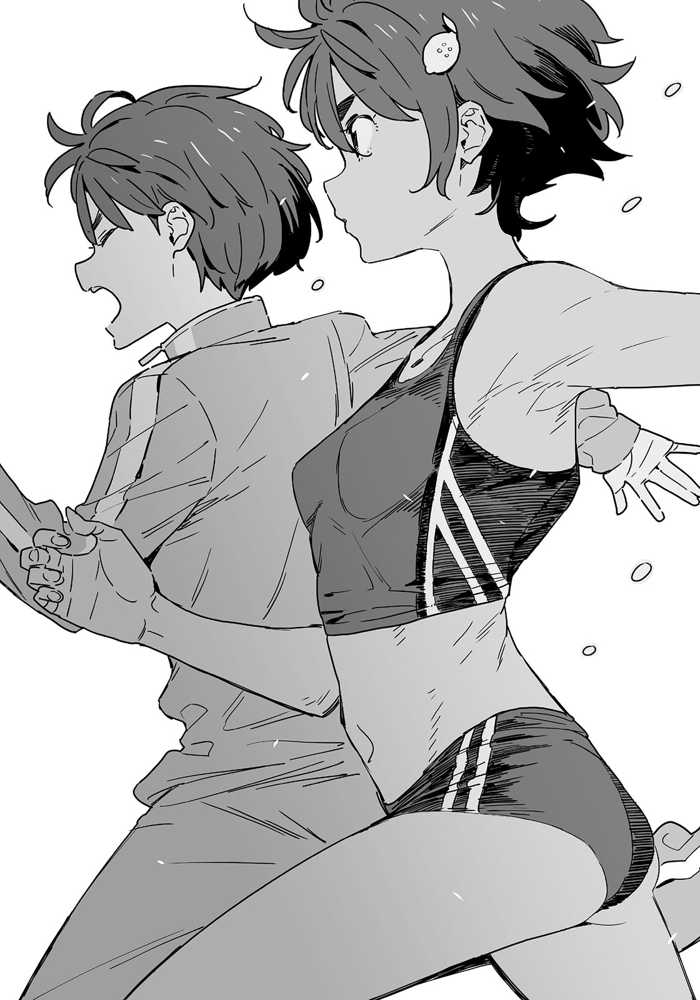

# Ch.68 — เล่ม 6 บทที่  4-5

Ch.68 — เล่ม 6 บทที่  4-5

By Monica

Published: 2025-04-24T07:52:40Z

Source: https://www.nekopost.net/novel/14560/68

เล่ม 6 บทที่  4-5

วันเสาร์ที่ 27 มีนาคม เวลา 8:00 น. ณ สนามโรงเรียนมัธยมปลายซึะบุกิ

หลังจากผ่านไปประมาณ 20 วัน ในที่สุดเวลาสำหรับการแข่งขันที่ตัดสินก็ได้มาถึง

ตรงหน้าผมคือสมาชิกทั้งสามคนของทีมยากิชิโอะ

ยานามิที่ยืนอยู่ตรงกลางจ้องมองผมด้วยสายตาที่เหมือนท้าทาย

[ นุคุมิซึคุง มาคนเดียวเหรอ? ประธานไม่ได้มาด้วยเหรอ? ]

[ นี่เป็นการแข่งกันระหว่างยากิชิโอะกับผมโดยตรง ผมแข่งคนเดียว ยากิชิโอะ วันนี้เรามา— ]

ยานามิพูดแทรกขึ้นมาก่อนที่ผมจะได้พูดกับยากิชิโอะ

[ โอ้ พูดมาอย่างดี แต่ดูเหมือนจะสนิทสนมกับประธานมากเลยนะ? แบบนั้นคือการพิสูจน์ว่า 'นุ' ในนุคุมิซึย่อมาจาก 'ลับหลัง'(นุเกะคาเกะ) ใช่มั้ย? ถ้าประธานชมรมวรรณกรรมเป็นแบบนี้ พวกเราจะมั่นใจได้ยังไงตอนขึ้นปีสองล่ะ— ]

คำพูดของยานามิพรั่งพรูออกมาเรื่อยๆ ช่วยเลิกสร้างความรำคาญสักทีได้มั้ย...?

ขณะที่ผมกำลังคิดว่าจะโต้กลับยังไง โคมาริก็ลากยานามิออกไป

[ ย-ยานามิ เธอข-ขวางทางอยู่ ]

[ เดี๋ยวสิ โคมาริจัง ฉันยังพูดกับนุคุมิซึคุงไม่จบเลย— ]

[ ป-ไปประจำที่จุดส-สตาร์ทได้แล้ว ย-ยานามิ เธอรับผิดชอบที่จุดเริ่มต้นใช่มั้ย? ]

[ โอเคๆ เข้าใจแล้ว โคมาริจัง ]

โคมาริลากยานามิไปจนได้ โคมาริ แข็งแกร่งขึ้นนะเนี่ย

ผมหันกลับมาสบตากับยากิชิโอะอีกครั้ง

เธอสวมชุดนักกีฬาของชมรมกรีฑา ร่างกายของเธอมีไอร้อนลอยออกมาเหมือนว่าเธออบอุ่นร่างกายเรียบร้อยแล้ว

[ วันนี้ฉันไม่แพ้แน่ นุคคุง ]

[ เหมือนกัน อย่ามาเสียใจทีหลังที่ให้แต้มต่อเยอะขนาดนี้ก็แล้วกัน ]

ยานามิโบกมือเรียกเราไปที่จุดเริ่มต้น ยากิชิโอะกับผมจึงเดินไปหาเธอ

[ ไม่คิดเลยนะว่าจะเอาจริงขนาดนี้ ]

[ แน่นอน ไม่มีทางยอมให้เธอลาออกจากชมรมวรรณกรรมได้หรอก ]

[ มั่นใจขนาดนั้นเลยเหรอ? ]

เดินไปเคียงข้างกัน ยากิชิโอะกระแทกไหล่ผมเบาๆ

[ ตอนแรกฉันก็คิดว่าท้าทายนายแบบนี้อาจจะดูเกินไปหหน่อย แต่พอถึงจุดนี้แล้ว ฉันไม่ออมมือแน่ ]

ยากิชิโอะทำท่าจะหยอกล้อผมอีกครั้ง แต่ทันใดนั้นเธอก็หันหน้าหนีแล้วถามขึ้น

[ ...นุคคุง เมื่อคืนไปพักที่อื่นมาเหรอ? ]

[ หา!? เอ่อ... ทำไมถึงถามล่ะ? ]

ผมตกใจจนเผลอสบตายากิชิโอะที่กำลังจ้องมองผมอย่างคาดคั้น

[ ฉันเห็นนายลงจากสายอัตสึมิเมื่อเช้านี้ มุ่งหน้าไปทางโทโยฮาชิ ปกตินายมาจากอีกทางไม่ใช่เหรอ? ]

หรือว่าเธอเห็นผมกลับจากบ้านประธาน...?

แต่ผมไม่ได้ทำอะไรน่าสงสัยเลยนะ ถึงแม้เมื่อคืนจะต้องแบกชิกิยะซังกลางดึก แต่ทั้งหมดนั้นก็เหมือนกับการดูแลคนป่วย ส่วนเรื่องสัมผัสนุ่มๆ ที่หลังนั่นก็.……..อีกเรื่องหนึ่ง

[ ไม่มีอะไรสำคัญหรอก แล้วก็...ไม่มีเรื่องแปลกๆ เกิดขึ้นด้วย ]

[ หืม... ]

ยากิชิโอะกระแทกไหล่ผมอีกครั้งแถมแรงขึ้น แล้วเร่งฝีเท้าเดินนำไป

[ ถ้าฉันชนะ ต้องเล่าให้ฟังทั้งหมดเลยนะ ]

เดิมพันของการแพ้เหมือนจะเพิ่มขึ้นแบบไม่ทันตั้งตัว

ยานามิยื่นหน้าจอโทรศัพท์ให้เราดูเมื่อถึงจุดเริ่มต้น

[ เราจะใช้แอปสำหรับสัญญาณเริ่มต้น ตอนที่แอปพูดประมาณว่า 'เตรียมพร้อม' ก็จัดท่าให้พร้อม—หืม? 'เซ็ต’ หมายถึงอะไร? แล้วจะเริ่มตอนไหน? ]

ยานามิทำหน้างงจนมีเครื่องหมายคำถามลอยอยู่เหนือหัว ยากิชิโอะจึงอธิบายแทน

[ ยานามิจัง 'เซ็ต' คือเตรียมตัว นั่นแหละ แล้วเสียงปืนหมายถึงเริ่มวิ่ง เข้าใจมั้ย? ]

[ โอเคใช่เลย ]

ยานามิหันมายิ้มให้ผมอย่างภูมิใจด้วยเหตุผลบางอย่าง

[ เสียงปืนแรกเป็นสัญญาณให้คุณนุคุมิซึเริ่ม ส่วนเสียงปืนที่สองจะดังอีก 2.5 วินาทีให้หลัง เป็นสัญญาณให้เลม่อนจังเริ่ม ใครถึงเส้นชัยก่อนเป็นฝ่ายชนะ ]

ยานามิชี้ไปที่เส้นชัยที่โคมาริกำลังถือสมาร์ทโฟนอยู่

[ โอเค ทุกคนพร้อมหรือยัง? งั้นทั้งสองคนไปประจำที่จุดสตาร์ท ]

มีบล็อกตั้งท่าสำหรับวิ่งอยู่ที่เท้าของยากิชิโอะ แสดงให้เห็นว่าเธอเอาจริง

[ ฉันพร้อมทุกเมื่อแล้ว ]

ยากิชิโอะยืดแขนขาให้ผ่อนคลาย ยานามิดูโทรศัพท์ของเธอก่อนพูดขึ้น

[ นี่ เลม่อนจัง แน่ใจนะว่าไม่อยากโกง? เราแอบเปลี่ยนการตั้งค่าได้ นุคุมิซึคุงไม่มีทางรู้หรอก ]

[ ยานามิซัง อย่าพูดแบบนั้นต่อหน้าผมสิ ]

...เกือบไป นี่คงเป็นกลยุทธ์นอกเกมอีกแบบหนึ่ง พฤติกรรมแปลกๆ เพื่อก่อกวนสมาธิศัตรูและสร้างความได้เปรียบในการแข่งขัน ซึ่งเป็นเอกลักษณ์ของยานามิ

นั่นคงเป็นเหตุผลที่ยานามิหยิบปลาตัวเล็กแห้งออกจากกระเป๋าแล้วกินเป็นระยะๆ มันคงเป็นส่วนหนึ่งของกลยุทธ์ของเธอแน่ๆ

[ อืม จะลองกินดูมั้ย นุคุมิซึคุง? ]

...นี่มันกลยุทธ์นอกเกมชัดๆ ผมส่ายหัวแล้วเริ่มสควอตสักสองสามครั้ง

[ พร้อมแล้ว บอกมาได้เลยว่าเมื่อไหร่— ]

< “ON YOUR MARK” >

หา!? เสียงผู้หญิงสำเนียงเจ้าของภาษาดังออกมาจากสมาร์ทโฟนของยานามิ อะไรกันเนี่ย? จังหวะเป๊ะเกินไปแล้ว

[ อุ๊ย เผลอกดไปน่ะ เตรียมตัวกันได้เลยนะ ทั้งสองคน! ]

ยากิชิโอะกับผมรีบเข้าสู่ท่าเตรียมพร้อม

< "SET" >

เสียงเจ้าของภาษาเรียกตามมาอย่างรวดเร็ว

ผมย่อตัวลง สูดหายใจลึก และทันใดนั้น เสียงปืนก็ดังขึ้น

ไม่มีเวลาคิดอะไรแล้ว ผมเพียงแค่ถีบตัวออกจากพื้นโดยไม่ลังเล

แปลกที่ความกังวลไม่จำเป็นทั้งหมดหายไปจากตัว ผมรู้สึกว่าร่างกายเคลื่อนไหวได้อย่างราบรื่น

อาจพูดได้ว่านี่คือสภาพที่ดีที่สุดที่ผมเคยมีมา

ทำได้แน่— และแล้วเสียงปืนที่สองก็ดังขึ้น

ระยะห่างระหว่างฉันกับยากิชิโอะที่เพิ่งเริ่มออกวิ่งอยู่ที่ประมาณหลายสิบเมตร ผมไม่น่าจะรู้สึกถึงเธอได้ในตอนนี้

ผมสลัดความกดดันที่ด้านหลังออกไป และเร่งร่างกายไปข้างหน้าเหมือนที่เคยฝึก

เมื่อผ่านจุด 50 เมตร มันไม่ใช่แค่ความรู้สึกไปเองอีกต่อไป ผมสัมผัสได้ถึงแรงกดดันจากด้านหลังอย่างแน่นอน

...เดี๋ยวนะ เธอเร็วเกินไปมั้ย ? นี่เธอเป็นสัตว์หรือไง?

เสียงฝีเท้าดังชัดเจนขึ้นเรื่อยๆ เหงื่อผุดออกมาทั่วร่าง

— ผมนำอยู่เท่าไหร่? จะรักษาความเร็วนี้ไปจนถึงเส้นชัยได้มั้ย ?

ระยะทางที่เหลืออีก 20 เมตรเริ่มใกล้เข้ามา

เสียงฝีเท้าอยู่ข้างหลังผมแล้ว ฉันได้ยินแม้กระทั่งเสียงลมหายใจของยากิชิโอะ

— กลั้นหายใจที่ 5 เมตรสุดท้าย -

คำพูดของประธานชมรมแวบเข้ามาในหัวผม

ทันทีที่ผมเห็นเส้น 10 เมตร ผมกลั้นหายใจและทุ่มแรงที่เหลือทั้งหมดลงไปที่ขา

ผมกัดฟันแน่น ขับเคลื่อนขาไปข้างหน้าอย่างสุดกำลัง ประสาทสัมผัสในร่างกายเริ่มเลือนลาง

จากหางตา ผมเห็นเงาของยากิชิโอะพุ่งเข้ามา เธอกำลังไล่ตามมาเคียงข้างผม

เส้นชัยอยู่ตรงหน้า แต่กลับรู้สึกเหมือนอยู่ไกลเหลือเกิน

ทันทีที่การมองเห็นของผมเริ่มพร่าขาว เส้นชัยก็เลื่อนผ่านสายตาผมไป

เกือบจะพร้อมกันนั้น ยากิชิโอะพุ่งผ่านหน้าผมไป และทันใดนั้น ลมแรงก็ปะทะร่างผม—

…………

...ใครชนะ?

ขาของผมหมดแรง และผมก็ล้มลงตรงจุดนั้น

ในขณะที่การมองเห็นเริ่มเบลอ ผมมองไปรอบๆ เห็นยากิชิโอะหอบหนักๆ และกำลังก้มดูสมาร์ทโฟนของโคมาริ

ยากิชิโอะขยี้ผมของตัวเองแรงๆ แล้วหยิบกระป๋องออกซิเจนขึ้นมาสูดลมหายใจลึก

[ ค...ค...ใคร...ชนะ...? ]

ผมแทบจะหายใจไม่ทัน เสียงของผมขาดห้วง ผมพยายามลุกขึ้น แต่ขาไม่ขยับเลย

ยากิชิโอะหันมามองผมด้วยสีหน้าตกใจ

[ นุคคุง! หน้าซีดมากเลยนะ!? เอ้านี่ เอาออกซิเจนไป! ]

ยากิชิโอะโยนกระป๋องออกซิเจนมาให้ผมอย่างไม่ระมัดระวัง

กระป๋องหลุดมือผม—แล้วกระแทกตรงหน้าผากเข้าเต็มๆ

และแล้วการมองเห็นของผมก็ขาวโพลนไปหมด

---
