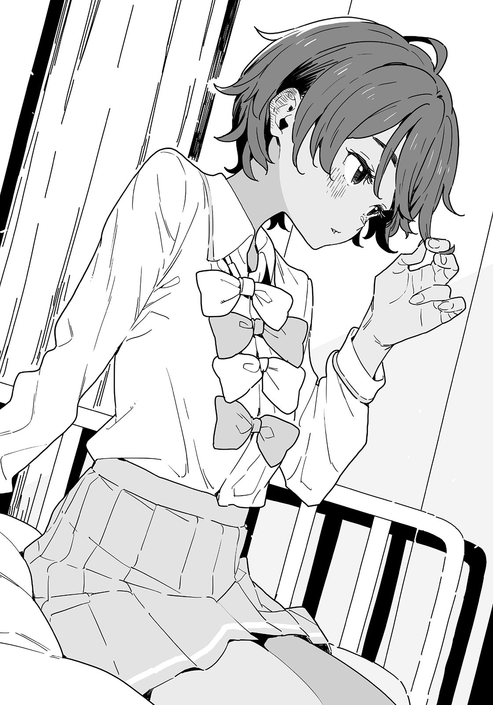

# Ch.69 — เล่ม 6 บทที่  4-6

Ch.69 — เล่ม 6 บทที่  4-6

By Monica

Published: 2025-04-24T07:52:48Z

Source: https://www.nekopost.net/novel/14560/69

เล่ม 6 บทที่ 4-6

ห้องแสงสลัวและเงาจางๆของคราบบนเพดานที่คุ้นเคย

ผมใช้เวลาสักพักกว่าจะเข้าใจสถานการณ์ของตัวเอง

นี่คือห้องพยาบาลของโรงเรียนซึวะบุกิ ผมนอนอยู่บนเตียง จ้องเพดานอยู่

หลังจากแข่งกับยากิชิโอะผมก็จำอะไรไม่ได้เลย สิ่งสุดท้ายที่จำได้คือ...การโจมตีสุดท้ายจากกระป๋องออกซิเจนที่เธอขว้างมา—

[ นุคคุง ตื่นแล้วเหรอ? ]

เสียงที่เต็มไปด้วยความเป็นห่วง ขณะที่ผมพยายามจะลุกขึ้นนั่งโดยไม่ทันคิด

[ โอ๊ย!? ]

ผมร้องออกมาโดยไม่ตั้งใจ เพราะความเจ็บปวดที่แผ่ไปทั่วทั้งตัว

จากนั้น ยากิชิโอะที่นั่งอยู่บนเก้าอี้กลมข้างเตียงก็วางมือลงบนหลังของผม

[ ไหวมั้ย? เจ็บหัวหรือเปล่า? ]

[ หัวไม่เป็นไร แค่หน้าผากมันเจ็บๆ แล้วก็ปวดทั้งตัวเพราะ— ]

ผมตอบพลางหันไปมองยากิชิโอะอีกครั้ง

เธอเปลี่ยนกลับไปใส่ชุดนักเรียนแล้ว และกำลังยิ้มอย่างโล่งอก มือวางอยู่ที่อก

[ โล่งใจจัง ฉันคงเสียใจมากถ้านายตายเพราะกระป๋องออกซิเจนที่ฉันขว้างไป ]

ใช่ ผมก็โล่งใจที่ไม่ตายและทำให้ยากิชิโอะรู้สึกแย่

[ เอ่อ...ว่าแต่ การแข่งล่ะ ผลเป็นยังไง...? ]

ผมถามออกไปอย่างระมัดระวัง ยากิชิโอะยู่ปากเล็กน้อยเหมือนจะบ่น

[ เละเทะไปหมดเลย โชคดีที่โคนุกิเซ็นเซอยู่ด้วยตอนแข่ง แต่ทุกคนก็ต้องช่วยกันหามนายมาที่ห้องพยาบาล ]

[ หา? โคนุกิเซ็นเซอยู่ที่นี่เหรอ? แล้วตอนนี้อยู่ไหน? ]

ผมมองไปรอบๆ อย่างตื่นตระหนก แต่ยากิชิโอะดีดหน้าผากผมเข้าเต็มๆ เจ็บมากนะ

[ ใจเย็นๆ น่า เธอแค่ไปข้างนอกแป๊บเดียว ]

ยากิชิโอะไขว้ขาเรียวยาวของเธอ พลางมองมาที่ผมด้วยสายตาจริงจัง

[ อย่าลืมขอบคุณโคมาริจังกับยานะจังด้วยนะ โคมาริจังตกใจจนขว้างโทรศัพท์ทิ้ง ส่วนยานะจังก็สับสนจนพยายามจะป้อนปลาแห้งให้นาย ฉันเหนื่อยมากที่ต้องห้ามพวกเธอ ]

ดูเหมือนจะมีเรื่องวุ่นวายมากมายตอนที่ผมหมดสติไป ขอบคุณพระเจ้าที่เธอหยุดยานามิได้ทัน

[ แล้วสองคนนั้นอยู่ไหน? ]

[ พวกเธอไปไหนแล้วไม่รู้ บางทีอาจตั้งใจปล่อยให้เราอยู่กันสองคน ]

ยากิชิโอะเริ่มแหย่ผมอีกแล้ว

ขณะที่ผมกำลังจะพูดสวน ผมสังเกตเห็นสายตาจริงจังของยากิชิโอะ

[ ...แล้วสรุปใครชนะ? ]

จำได้ว่าตอนเข้าเส้นชัยเป็นการจบที่ยุ่งเหยิง

ยากิชิโอะวางคางไว้บนมือด้วยสีหน้าเหนื่อยล้า

[ พูดตรงๆ ฉันคิดว่ามันจะเละไปกว่านี้ด้วยซ้ำ เกือบจะได้ชัยชนะโดยไม่มีคู่แข่งแล้ว ]

เธอพึมพำด้วยน้ำเสียงไม่พอใจที่แสร้งทำ

[ —ฉันพลาดที่จะได้เข้าชมรมกลับบ้านแล้วล่ะ ]

[ งั้นแสดงว่า—]

ยากิชิโอะละทิ้งท่าทีไม่พอใจนั้น และเผยยิ้มขี้เล่น

[ นุคคุง นายต้องรับผิดชอบแล้วนะ ]

หมายความว่ายากิชิโอะจะอยู่ในทีมกรีฑาและชมรมวรรณกรรมต่อไป พร้อมทั้งทุ่มเทให้มากกว่าเดิม

นั่นคือสิ่งที่ผมหวังไว้ แต่ภาระของยากิชิโอะคงไม่ใช่เรื่องเล็ก

เพราะแบบนั้น พอการแข่งขันจบลง ผมจึงถามคำถามที่เป็นไปได้แค่ในช่วงเวลานี้

[ ...ถ้าผมแพ้ เธอจะเลิกเข้าชมรมจริงๆ เหรอ? ]

[ ฉันจริงจังนะ ]

ยากิชิโอะตอบเบาๆ สายตาของเธอล่องลอยไปไกล

[ ฉันคิดจะออกจากชมรม แล้วใช้ชีวิตมัธยมปลายเหมือนในละครหรือมังงะ ใช้เวลากับเพื่อนหลังเลิกเรียน พูดคุยเรื่องความรัก อ่านหนังสือสอบที่ร้านอาหาร ]

เธอพึมพำราวกับพูดกับตัวเอง ดวงตาปิดลง

[ ...และสักวันหนึ่ง อาจได้พบคนที่ฉันรัก ถึงจะไม่ใช่ในทันทีก็เถอะ ]

ความเงียบสงบโรยตัวลง เหมือนสายลมอ่อนโยน

—ในโลกที่ยากิชิโอะเลือกทางเดินที่ต่างออกไป เธอคงกังวลเรื่องคะแนนสอบแทนเวลาวิ่ง และพูดคุยเรื่องหนุ่มๆ กับเพื่อนๆ

และเธอคงยื่นมือออกไปหาคนอื่น คนที่ไม่ใช่ผม

ช่วงชีวิตธรรมดาแต่แสนพิเศษ เหมือนในละคร

ยากิชิโอะค่อยๆ ลืมตาขึ้นช้าๆ

[ อีกอย่างนะ ถ้าฉันเลิกเข้าชมรม ฉันก็ไม่ได้จดหมายแนะนำเข้ามหาวิทยาลัย ดังนั้นคงต้องไปเรียนกวดวิชาหรืออะไรสักอย่าง บางทีอาจไปที่เดียวกับจิฮะกับมิตสึกิก็ได้ ]

…จะทำแบบนั้นทำไม? เธอต้องมีรสนิยมชอบอะไรที่ลำบากแน่ๆ

[ สองคนนั้นเขาเป็นแฟนกันไม่ใช่เหรอ? ถ้าเธอไปเรียนที่เดียวกับพวกเขา มันจะไม่อึดอัดเหรอ? ]

[ แน่นอนสิ นั่นแหละเหตุผลที่ฉันต้องมีนายไปด้วยไง นุคคุง ]

[ หา? ผมต้องไปเรียนกวดวิชาด้วยเหรอ? ]

ยากิชิโอะยักไหล่ราวกับมันเป็นเรื่องที่ชัดเจนอยู่แล้ว

[ ถ้าฉันชนะน่ะสิ พวกเราจะได้อยู่ชมรมกลับบ้านด้วยกัน ]

[ ไม่รู้มาก่อนเลยว่าชมรมกลับบ้านมีกฎแบบนี้... ]

ถึงจะชื่อว่า 'ชมรมกลับบ้าน' แต่มันดูเข้มข้นกว่าที่คิด

[ ถ้าเป็นนายอยู่ด้วย ฉันก็ไม่ต้องอยู่ตรงกลางระหว่างสองคนนั้น มันคงไม่แปลกเท่าไหร่หรอก ? ]

[ พวกเขาไม่สนใจหรอกว่าเราจะอยู่หรือเปล่า ก็แค่จะโชว์หวานใส่กันแค่นั้นแหละ ]

ยากิชิโอะยิ้ม เผยให้เห็นฟันขาวสะอาด

[ งั้นพวกเราแค่บ่นเกี่ยวกับมันด้วยกันเยอะๆ ก็พอ ]

[ นี่ต้องมาฟังเธอบ่นด้วยเหรอ? ]

[ ฉันก็จะฟังที่นายบ่นเหมือนกันนะ นุคคุง ]

ทำไมเราต้องไปเรียนกวดวิชาที่เดียวกับสองคนนั้นด้วย?

เราต้องเจอพวกเขาหวานใส่กันตลอดเวลาแน่ๆ

ยากิชิโอะกับผมคงตั้งชมรมคนโดนแกล้ง บ่นเรื่องพวกเขาไปตลอดทางกลับบ้าน—

[ ...ฟังดูสนุกดีเหมือนกันนะ ]

เป็นช่วงเวลาธรรมดาในชีวิตวัยรุ่นที่เรียบง่าย

ดวงตาของยากิชิโอะเป็นประกาย และเธอเอนตัวเข้ามาใกล้เมื่อได้ยินคำพูดลอยๆ ของผม

[ ใช่มั้ยล่ะ ? พวกเราสี่ไปด้วยกัน และต้องทนดูพวกเขาโชว์หวานใส่กัน ]

[ อุวะ เจ็บนะ ]

[ คงมีเรื่องให้พูดเยอะจนพวกเราตั้งใจเรียนไม่ได้เลย ]

[ ช่วยตั้งใจเรียนหน่อยเถอะ ]

เรามองหน้ากันแล้วหัวเราะแค่เพราะกิจวัตรที่เหมือนจะเป็นไปได้แต่ไม่เคยเกิดขึ้นจริง

[ เธออยากใช้ชีวิตวัยรุ่นธรรมดาๆ และตกหลุมรักเหมือนคนอื่นๆใช่มั้ย? ถ้าต้องอยู่กับผมตลอดเวลา เธอคงหาแฟนไม่ได้หรอก ยากิชิโอะ ]

[ อืม ก็ไม่ใช่ว่าฉันอยากรีบมีแฟนหรอก ]

ยากิชิโอะดูเหมือนกำลังเลือกคำพูดอย่างระมัดระวัง สายตาของเธอลอยไปที่อื่น

[ มิตสึกิเป็นคนพิเศษสำหรับฉัน และมันก็ยังไม่เปลี่ยนแปลง ดังนั้นจนกว่าฉันจะพบคนที่ฉันรักมากกว่าเขา—ฉันก็ไม่รีบมีแฟนหรอก ]

[ แต่ไม่ได้หมายความว่าเธอต้องมายุ่งกับผมนี่ ]

[ ...แต่ว่านะ พวกเรายังมีเวลาอีกสองปีในโรงเรียนนี้ ]

จู่ๆ ยากิชิโอะก็ลุกขึ้นจากเก้าอี้ แล้วมานั่งที่ขอบเตียง

เสียงเตียงดังเอี๊ยดเบาๆ จากน้ำหนักของเธอ และกลิ่นผสมระหว่างน้ำหอมกับสเปรย์ดับกลิ่นตัวลอยแตะจมูกผม

เธอเล่นผมตรงข้างหูตัวเองแล้วพูดว่า

[ ฉันมีเวลาอีกสองปีใช่มั้ย? บางทีผมของฉันอาจจะยาวขึ้นด้วย ]

เธอก้มหน้าลงอย่างเขินอาย

ทุกครั้งที่เธอหายใจ โบว์ตรงอกเธอไหวเล็กน้อย และเตียงก็ส่งเสียงดังอีกครั้ง

[ หืม? กัปตันทีมวิ่งยังมัดผมหางม้าเลยนี่ ไว้ยาวก็ไม่น่ามีปัญหานะ ]

คำพูดธรรมดาๆของผมทำให้ยากิชิโอะชะงักไป

เธอถอนหายใจยาวออกมาหลังจากนิ่งไปสักพัก

[ ...เพราะแบบนี้ไง ฉันไม่ชอบส่วนนี้ของนายเลย นุคคุง ]

ยากิชิโอะลุกขึ้นจากเตียง ยืดแขนทั้งสองข้างก่อนจะประสานนิ้วมือ

[ หมายความว่ายังไง? ]

[ คิดเรื่องเรียนเรื่องสอบ เรื่องที่อาจจะมีแฟนในสักวัน ฉันคิดว่าอนาคตแบบนั้นมันก็เป็นไปได้เหมือนกัน นั่นแหละที่ฉันหมายถึง ]

ยากิชิโอะเดินเบาๆ ไปที่หน้าต่างก่อนจะดึงม่านเปิดออก

[ แต่ฉันสัญญา ฉันจะไม่เลิกชมรมกรีฑา หรือชมรมวรรณกรรม ]

แสงแดดยามเช้าส่องสว่างกระทบด้านข้างใบหน้าของเธอ ทำให้มันเปล่งประกาย

จากนั้นเธอก็หันมาหาผมด้วยรอยยิ้มสดใส

[ เพราะงั้น—ฉันจะเลิกวิ่งระยะสั้น แต่เปลี่ยนไปวิ่งระยะกลางแทน ]

[ แต่เธอ— ]

ยากิชิโอะส่ายหัวเมื่อฉันพยายามพูดแย้ง

[ ฉันเคยทำทุกอย่างโดยคิดถึงคนอื่นมาตลอด แต่คราวนี้ฉันจะทำตามใจตัวเองบ้าง ฉันจะชนะในแบบของฉันเอง และไม่มีใครกล้าว่าฉัน ถ้ามีใครว่า ฉันก็จะบดขยี้พวกเขา ]

ด้วยรอยยิ้ม ยากิชิโอะประกาศความตั้งใจของเธอ

[ ฉันไม่ต้องการชีวิตวัยรุ่นแบบอื่นเลย ไม่อยากได้ด้วยซ้ำ ]

ไม่ใช่ทั้งความใจน้อนหรือการท้าทาย

แสงแห่งความไม่แน่นอนที่เคยสะท้อนในดวงตาสีน้ำตาลเข้มของยากิชิโอะได้หายไปจนหมด

[ งั้นเธอจะมุ่งไประดับประเทศจริงๆ แล้วเหรอ ][

[ ไม่ใช่ ฉันไม่ได้พูดว่าจะมุ่งไประดับประเทศ ]

ยากิชิโอะหัวเราะเบาๆ ทางจมูก

[ หา? ถ้างั้น— ]

[ ฉันจะคว้าชัยระดับประเทศมา เพราะฉันทำได้ ]

หมายความว่าเธอตั้งเป้าหมายที่จะเป็นอันดับหนึ่งของประเทศงั้นเหรอ? สูงสุดเลยเหรอ?

ในขณะที่ผมกำลังตกใจกับความมุ่งมั่นอันยิ่งใหญ่ของเธอ ยากิชิโอะก็ชี้ตรงมาที่ผม

[ เพราะงั้น นุคคุง ห้ามละสายตาจากฉันเด็ดขาดนะ ]

◇

รายงานชมรมวรรณกรรม - ฉบับพิเศษ

< ฉันเลือกนาย > โดย ยานามิ อันนะ

ฉันยืนอยู่หน้าร้านสะดวกซื้อที่คุ้นเคย

แต่ฉันเข้าไปไม่ได้ ป้ายของร้านถูกเอาลงไปแล้ว และหน้าต่างก็ถูกปิดด้วยแผ่นผ้า

มีคนพูดกับฉันขณะที่กำลังจ้องมองอาคารนั้น

[ อาโกะซัง ร้านสะดวกซื้อที่นี่ปิดไปแล้วเหรอ? ]

เจ้าเด็กที่ไม่รู้อะไรเลยนี่ก็คือ XX-คุง โถ่ เขาไม่รู้อะไรเลยจริงๆ

เมื่อเย็นฉันเห็นพวกเขากำลังเอาชั้นวางสินค้าใหม่เข้ามาในอาคาร

นั่นหมายความว่าร้านสะดวกซื้อจะเปิดอีกครั้งหลังจากที่ปรับปรุงเสร็จ

ฉันหยิบไก่ไร้กระดูก 3 แบบออกมาจากกระเป๋าหลังจากตอบเขาแบบขอไปที

XX-คุงเบิกตากว้าง ก็นะ ฉันรู้อยู่แล้วว่าเขาไม่เข้าใจแน่นอน

ป้ายขนาดใหญ่ริมถนนก็ถูกเอาลงไปด้วย เพราะอาจจะเป็นเครือร้านอื่นที่เข้ามาแทนหลังจากการปรับปรุงเสร็จ

นั่นคือเหตุผลที่ฉันตื่นเช้ามาและซื้อไก่ไร้กระดูกจากร้าน 3 เครือที่ต่างกัน

ฉันตั้งใจจะเปรียบเทียบและทำนายว่าร้านไหนจะมาเปิดใหม่ที่นี่

เริ่มจากชิ้นแรกกันก่อน

เมื่อฉันกัดเข้าไป กลิ่นเครื่องเทศก็อบอวลในปาก แต่รสชาติไม่แพ้กันเลย หลังจากที่กลิ่นหอมเล็ดลอดผ่านจมูก รสชาติของเนื้อก็กระจายเต็มปาก ใช่แล้ว อันนี้แหละ ฉันตัดสินใจแล้ว

แต่ถึงจะตัดสินใจไปแล้ว ฉันก็ต้องประเมินชิ้นที่สองอย่างยุติธรรม

ความกรอบตั้งแต่คำแรกน่าตื่นเต้นมาก เนื้อฉ่ำยิ่งทำให้ฉันที่อารมณ์ดีอยู่แล้วยิ่งฟินขึ้นไปอีก นี่แหละ ตัดสินใจแล้ว

แต่ถึงอย่างนั้น ฉันก็ไม่ควรปล่อยให้ชิ้นที่สามเย็นลง

แม้ภายนอกจะกรอบ แต่เกล็ดขนมปังเนื้อเนียนเต้นระบำบนลิ้นของฉัน

ทุกครั้งที่เคี้ยว เนื้อสัมผัสและกลิ่นก็เปลี่ยนไปเรื่อยๆ มันมีเสน่ห์จริงๆ อันนี้ก็เป็นตัวเลือกที่ตัดสินใจแล้วเช่นกัน

...เอาล่ะ ดูเหมือนฉันจะตัดสินใจเลือกทั้งหมดเลย

ในเมื่อไม่มีทางเลือก ฉันจึงเริ่มวางแผนการประเมินรอบที่สอง แต่ XX-คุงจ้องฉันอยู่

บางทีเขาก็คงอยากกินบ้าง? ช่างโลภอะไรอย่างนี้นะ

แต่เพราะเขามักจะแบ่งอาหารให้ฉัน ฉันก็เลยคิดว่าครั้งนี้ควรจะแบ่งให้เขาบ้าง

แต่ XX-คุงส่ายหัวเมื่อฉันบอกว่าเขากินคำหนึ่งก็ได้

[ ผมไม่ค่อยชอบกินต่อจากคนอื่นน่ะ ขอผ่านละกัน ]

หมอนี่มันอะไรกันเนี่ย? หยาบคายจริงๆ

ด้วยความหงุดหงิด ฉันเลยเอาไก่สามชิ้นมาวางซ้อนกันแล้วกัดคำใหญ่

เขายังจ้องฉันตอนที่กำลังเพลิดเพลินกับอาหารเลิศรสที่เหมาะกับราชาอยู่เลย

[ อาโกะซัง ถ้าร้านนี้ปิดแล้วหลังจากนี้เธอจะไปกินข้าวเช้าที่ไหนล่ะ ]

ฉันจะกินที่บ้าน

เพราะเหตุผลเดียวที่ฉันมาที่นี่ก็เพราะอยากไปโรงเรียนพร้อมกับ OO-คุง แต่ตอนนี้เขาไปคบกับจิโกะจังแล้ว ฉันก็ไม่มีเหตุผลที่จะมาที่นี่อีกต่อไป

แต่ฉันกลับรู้สึกดีขึ้น ดีขึ้น เมื่อเห็นใบหน้าที่กังวลของ XX-คุง

ฉันไม่สนใจเขาและยัดไก่ที่เหลือเข้าปาก

ปล่อยให้เขากังวลไป เขาจะเข้าใจทุกอย่างเองเมื่อร้านใหม่เปิด

◇

วันถัดจากการแข่งขัน ตรงกับวันอาทิตย์สุดท้ายของเดือนมีนาคม

ผมยืนอยู่คนเดียวหน้าประตูทางใต้ของโรงเรียนมัธยมซึวะบุกิ มองดูเมฆที่ลอยผ่านไปมา

อากาศเริ่มมีความรู้สึกเหมือนฤดูใบไม้ผลิ

ไม่มีร่องรอยของฤดูหนาวหลงเหลืออยู่เลย ฤดูกาลกำลังเปลี่ยนผ่านไป

ผมพยายามฝืนร่างกายที่ยังคงปวดเมื่อยมาถึงที่นี่ เพียงเพราะรุ่นพี่ทามากิและรุ่นพี่สึกิโนะคิตั้งใจจะแวะมาที่นี่ก่อนออกจากโทโยฮาชิ

[ อ้าว มาถึงไวเชียวนะ นุคุมิซึคุง ]

ยานามิเดินมายืนข้างผม พลางเคี้ยวสาหร่ายแผ่นเล็ก ๆ อยู่ในปาก อาจจะเป็นวิธีลดน้ำหนักใหม่ของเธอที่ใช้อมสาหร่ายแทนจุกนมเด็ก—

[ นั่นมันสาหร่ายไว้ต้มซุปไม่ใช่เหรอ? ระวังฟันเสียเอานะ ]

[ มันคือไก่ทอด ]

...หา? ผมถึงกับต้องหันมองซ้ำ แต่ยานามิกำลังเคี้ยวสาหร่ายอยู่จริง ๆ

[ เอ่อ เธอได้ยินเสียงอะไรแปลก ๆ จากกำแพงตอนกลางคืนบ้างมั้ย? โอเคมั้ยเนี่ย? ]

[ ฉันไม่ได้ยินอะไรหรอก นุคุมิซึคุง คนเราน่ะโดนช้อนเย็นลวกได้ถ้าคิดว่ามันร้อนพอ สาหร่ายก็เป็นไก่ทอดหรือเนื้ออบได้ถ้าคิดมากพอ ]

ถ้าเป็นแบบนั้น คนเราคงกินสาหร่ายแล้วอ้วนขึ้นได้ด้วยความคิดสินะ

ยานามิมองผมตาขวาง ขณะที่ยังเคี้ยวสาหร่ายอยู่ในปาก

[ ...เมื่อวานคุยอะไรกับเลม่อนจังในห้องพยาบาลเหรอ? ]

[ บอกไปทางโทรศัพท์แล้วไม่ใช่เหรอ? เธอจะเปลี่ยนไปวิ่งระยะกลางแล้วตั้งเป้าหมายให้สูงขึ้น ]

[ เรื่องนั้นฉันรู้แล้ว นุคุมิซึคุง แต่ฉันไม่ได้หมายถึงเรื่องนั้น ]

ดูเหมือนว่านั่นจะไม่ใช่ประเด็นที่เธอหมายถึง

ยานามิขบสาหร่ายด้วยฟันหน้า

[ เลม่อนจังขอให้เราให้เธอสองคนอยู่ตามลำพัง แล้วยังจะบอกว่ามีแค่เรื่องพวกนั้นที่คุยกันเหรอ? ]

[ ก็แค่คุยธรรมดา ไม่มีอะไรสำคัญหรอก ]

[ ถ้าไม่มีอะไรสำคัญจริงก็บอกมาได้ใช่มั้ย ? นุคุมิซึคุง ห้ามแอบนำหน้าฉันไปนะ เข้าใจมั้ย? ]

...ทำไมคราวนี้ถึงเรื่องมากจัง ?

ผมนึกถึงการสนทนากับยากิชิโอะในห้องพยาบาลขณะที่ตอบยานามิไปอย่างส่ง ๆ

เธอดูต่างไปจากปกติเล็กน้อย แต่ก็เป็นส่วนหนึ่งของตัวเธอเหมือนกัน

สิ่งที่ผมสัมผัสได้ในวันนั้นเป็นเพียงเศษเสี้ยวของตัวเธอ

ถ้าผมลองเอื้อมมือไปอีกนิด ผมจะได้เห็นอะไรอีก?

แต่จนถึงตอนนี้ ผมก็ยังไม่รู้อะไรเลยเกี่ยวกับเด็กสาวที่ชื่อยากิชิโอะ เลม่อน —

[ ...นี่ มีอะไรเกิดขึ้นใช่มั้ย? ]

ยานามิจ้องหน้าฉผม ขณะที่ผมกำลังคิดฟุ้งซ่าน

[ บอกแล้วไงว่าไม่มีอะไร แล้วยากิชิโอะควรจะมาด้วยไม่ใช่เหรอ? รู้มั้ยว่าไปไหน ]

[ คนที่กำลังปิดบังอะไรบางอย่างอยู่ชอบพูดแบบนั้นแหละ ! ]

ผมเมินเด็กผู้หญิงจอมจุกจิกตรงหน้า แล้วหันไปมองสาวตัวเล็กจากโรงเรียนซึวะบุกิที่เดินออกมาจากตัวอาคาร

เธอคือโคมารินั่นเอง

[ พ-พวกเธอสองคนคุยอะไรกันเสียงดัง? ]

[ ฟังฉันนะ โคมาริจัง! นุคุมิซึคุงกำลังปิดบังอะไรบางอย่างที่เกิดขึ้นเมื่อวานแน่ ๆ! ]

โคมาริหรี่ตาอย่างดูแคลนใส่ยานามิที่เกาะติดผมเป็นตุ๊กแก

[ จ-ใจเย็น น-นุคุมิซึไม่มีน้ำยาอยู่แล้ว ]

[ ...นั่นสินะ ก็เป็นนุคุมิซึนี่นา ]

ยานามิที่อยู่ ๆ ก็เชื่อแบบนั้น ปล่อยให้ผมรู้สึกแปลก ๆ นิดหน่อย

[ โคมาริ เธอเห็นยากิชิโอะมั้ย? ]

ผมถามออกไป พยายามเปลี่ยนเรื่อง และโคมาริก็พยักหน้า

[ ย-ยากิชิโอะกำลังเย็บเล่มนิตยสาร ด-เดี๋ยวก็มา ]

[ เลม่อนจังเขียนต้นฉบับเสร็จแล้วเหรอ ! ]

ยานามิยกมือขึ้นประสานด้วยความโล่งใจ

ดูเหมือนว่ายากิชิโอะจะยอมรับที่จะเขียนบทความให้นิตยสารชมรมที่เตรียมไว้ให้รุ่นพี่ และเราก็รอให้เธอเขียนต้นฉบับเสร็จ

ดูเหมือนว่าจะเสร็จทันเวลา

[ นี่ พวกรุ่นพี่มาแล้ว! ]

ยานามิโบกมืออย่างกระตือรือร้น

ตามสายตาของเธอ ผมเห็นรถมินิแวนขับมาจอดตรงหน้าเรา…

[ ขอบคุณที่มาส่งนะทุกคน! ]

รุ่นพี่สึกิโนะคิเดินออกจากที่นั่งคนขับด้วยท่าทีตื่นเต้นและทักทายเรา

เธอสวมกางเกงยีนส์ทรงตรง เสื้อเชิ้ตเรียบ ๆ และมีผ้าขนหนูคล้องอยู่ที่คอ

[ โคโตะ ขอบคุณทุกคนให้ดี ๆ ด้วยนะ ขอบคุณที่มารวมตัวกันนะทุกคน ]

รุ่นพี่ทามากิลงมาจากที่นั่งข้างคนขับ พลางกลอกตาเหมือนเหนื่อยใจ เป็นภาพลักษณ์ของแฟนหนุ่มที่ดูเหมือนถูกภาระถ่วงไว้

โคมาริกับยานามิกระโดดกอดรุ่นพี่สึกิโนะคิส่วนผมยื่นมือไปจับมือกับรุ่นพี่ทามากิอย่างรวดเร็ว

[ ฉันได้ยินมาแล้วนะ นุคุมิซึ นายชนะยากิชิโอะได้สินะ ]

[ ก็แค่แข่งแบบมีแต้มต่อ ก็เหมือนโดนออมมือให้นั่นแหละ ]

รุ่นพี่ทามากิเหลือบมองพวกผู้หญิงแล้วเอนตัวมาพูดใกล้ผม

[ ฉันไม่ถามหรอกว่าเกิดอะไรขึ้นระหว่างนายกับเธอ— ]

[ ไม่มีอะไรเกิดขึ้นหรอก โอเค๊ ? ]

[ ก็ถ้าทั้งสองคนสบายใจกับมัน ฉันก็ไม่ถามหรอก ]

[ บอกว่าไม่มีอะไรไงล่ะ ]

...สบายใจกับมันสินะ? ผมเองก็ไม่รู้ว่ายากิชิโอะได้อะไรจากการแข่งขันของเรา

ในโลกที่มีทั้งผู้ชนะและผู้แพ้ การหลีกเลี่ยงการทำร้ายหรือแย่งชิงจากใครบางคนเป็นเรื่องที่เลี่ยงไม่ได้

บางครั้ง คนคนนั้นอาจเป็นคนสำคัญของคุณก็ได้

และถึงอย่างนั้น เธอก็เลือกที่จะก้าวต่อไป

[ นุคุมิซึ ดูแลทุกคนให้ดีนะ ]

รุ่นพี่ทามากิตบบ่าผม มันดังเสียงดังพอสมควรแต่ไม่ได้เจ็บ

[ รุ่นพี่ก็เหมือนกันนะ ช่วยดูแลแฟนตัวเองด้วย ]

[ ไม่รู้ว่าจะทำได้มั้ยนะ ]

เรายิ้มให้กัน

ผมอาจจะยังได้เจอรุ่นพี่อีกในอนาคต

แต่เวลาที่เราใช้ร่วมกันในช่วงมัธยมปลายมันจบลงแล้ว และเราจะพบกันใหม่ในฐานะคนธรรมดาที่เท่าเทียมกัน

การสร้างความสัมพันธ์ใหม่จากจุดยืนที่ต่างไปเป็นเรื่องที่น่าอึดอัด แต่ผมก็ตั้งตารอเหมือนกัน

[ ว่าแต่ ยากิชิโอะซังยังไม่มาอีกเหรอ? ]

[ เอ่อ เธอติดอะไรบางอย่างเลยมาช้านิดหน่อย... ]

ผมมองไปรอบ ๆ ขณะที่นกกระจอกบินออกจากตัวอาคาร

จากนั้นยากิชิโอะก็พุ่งออกมาจากด้านหลังอาคารเรียน เธอวิ่งมาหาเราพร้อมยื่นเอกสารที่เย็บเล่มเรียบร้อยแล้ว

[ ขอโทษที่ให้รอนะ! ฉันทำวารสารชมรมฉบับนี้ให้รุ่นพี่ทั้งสองคนโดยเฉพาะเลย! ]

เหงื่อไหลลงมาตามหน้าผากของเธอ แต่ก็ไม่อาจกลบรอยยิ้มสดใสของเธอได้

[ พวกเธอทำให้เราสองคนเหรอ? ]

รุ่นพี่สึกิโนะคิดูไม่อยากเชื่อขณะที่รับวารสารอย่างลังเล...

[ รุ่นพี่ ทามากิเอาสักไปเล่มด้วยสิคะ! ]

[ ขอบใจมากนะ……ว้าว นี่มีความหมายกับฉันมากเลยล่ะ ]

รุ่นพี่สึกิโนะคิเปิดนิตยสารพร้อมถอดแว่นออกและเช็ดน้ำตา

[ อือ ฉันพยายามจะไม่ร้องไห้แล้วนะ สุดท้ายก็เล่นงานฉันจนได้ ]

รุ่นพี่สึกิโนะคิเปิดดูเนื้อหาในนิตยสารพร้อมกับตาที่เปียกชื้น ก่อนที่สีหน้าของเธอจะเปลี่ยนไปในทันที

[ โคมาริจัง เธอไม่ได้เขียนเรื่องคู่ตรงข้ามแบบ 'ดาไซ' อีกใช่มั้ย? ]

[ อ-อุแหะๆ ฉันแค่อยากเขียน... มันอดไม่ไหวน่ะ... ]

โคมาริหน้าแดงด้วยรอยยิ้มเขินอาย ส่วนรุ่นพี่สึกิโนะคิยิ้มมุมปากอย่างเจ้าเล่ห์

[ โคมาริจัง คราวหน้ามาคุยเรื่องนี้กันดี ๆหน่อยนะ โอเคมั้ย? ]

[ ค-ค่ะ ]

โคมาริตอบกลับด้วยรอยยิ้มเจ้าเล่ห์ที่ไม่ต่างจากรุ่นพี่สึกิโนะคิ

รุ่นพี่สึกิโนะคิเหลือบมองนาฬิกา จากนั้นจึงหันกลับมาหาผม

[ งั้นฝากดูแลชมรมวรรณกรรมด้วยนะ ประธานนุคุมิซึ ฉันกำลังจะเริ่มต้นใหม่แล้ว แต่กลัวว่าจะซ้ำชั้นในที่ใหม่….. ]

[ อย่าไปสนเรื่องซ้ำชั้นเลย หวังว่ารุ่นพี่จะตั้งตารอชีวิตใหม่ของตัวเองนะครับ ]

รุ่นพี่สึกิโนะคิทำหน้าลำบากใจเล็กน้อยกับคำพูดลอย ๆ ของผม

[ พูดตรง ๆ ฉันกังวลมากกว่าตื่นเต้นน่ะ เพิ่งตัดสินใจย้ายออกจากโทโยฮาชิเมื่อฤดูใบไม้ร่วงเอง ]

[ หา จริงเหรอ? ]

[ ใช่ จริง ๆ ฉันรักบ้านเกิดมากเลยนะ คิดว่ามันคงดีถ้าได้อยู่ที่นี่ตลอดไป แค่ให้คนพูดว่า 'อ้าว เธอมาอีกแล้วเหรอ' ตอนเดินเข้าห้องชมรม— ]

รุ่นพี่สึกิโนะคิค่อย ๆ มองดูหน้าพวกเราทุกคน

[ หลังจากเห็นพวกเธอฉันรู้สึกมีแรงผลักดันเพื่อมุ่งสู่เป้าหมาย….ฉันอยากเป็นตัวอย่างที่ดีในฐานะรุ่นพี่ ]

รุ่นพี่สึกิโนะคิพยายามหัวเราะเบา ๆ แต่ในไม่ช้าก็ก้มหน้าลงพร้อมสีหน้าจริงจัง

รุ่นพี่ทามากิวางมือบนไหล่ของเธอ

[ ได้เวลาไปแล้ว โคโตะ เดี๋ยวค่อยอ่านนิตยสารของทุกคนทีหลัง ]

[ อ่า ใช่ เรามีเวลาไม่เยอะ ขอบคุณทุกคนมากนะ เดี๋ยวหลังจากย้ายบ้านเสร็จแล้วจะอ่านอย่างละเอียดเลย ]

รุ่นพี่สึกิโนะคิเงยหน้าขึ้นพร้อมกับรอยยิ้มเจ้าเล่ห์ประจำตัวขณะโบกมือแล้วเดินไปขึ้นรถมินิแวน เธอหันกลับมาและชี้นิ้วมาที่พวกเรา

[ ทุกคน วันที่จะสำเร็จการศึกษามันมาไวมาก ! เพราะงั้น ทำในสิ่งที่ตัวเองรักจะได้ไม่ต้องมาเสียใจภายหลังนะ! ]

พวกเรายืนมองรถมินิแวนที่ขับออกไปอย่างรวดเร็ว เงียบงันอยู่กับที่

พวกเขาอยู่ที่นี่ไม่ถึง 10 นาที

แต่มันให้ความรู้สึกเหมือนทุกอย่างปิดฉากลงอย่างสมบูรณ์แบบด้วยการจากลาของพวกเขา

[ โอเค งั้นฉันจะไปวิ่งสักหน่อยละ ยานะจัง ไปด้วยกันมั้ย? ]

ยากิชิโอะทำลายความเงียบด้วยข้อเสนอแบบปุบปับ

ยานามิเบิกตาโพลงขณะเคี้ยวสาหร่ายชิ้นที่สอง

[ ทำไมต้องเป็นฉันด้วยล่ะ!? ]

[ ก็เธอกินสาหร่าย แสดงว่ากำลังไดเอตอยู่ใช่มั้ยล่ะ? การวิ่งเป็นวิธีที่ดีที่สุดในการลดน้ำหนักนะ ]

[ วิ่งเหรอ? ไม่มีทาง ฉันปวดเข่าอยู่เลยช่วงนี้ ]

...ยานามิหนักขนาดนั้นเลยเหรอ ถึงขั้นกระดูกเข่าเริ่มรับน้ำหนักไม่ไหวแล้ว?

ขณะที่ทั้งสองคนทะเลาะกัน ผมก็แอบเดินออกมาเล็กน้อยและสังเกตเห็นโคมาริที่ยืนอยู่ห่างออกไปแล้ว

ผมเดินเข้าไปหาเธออย่างเงียบ ๆ และยื่นของขวัญที่ห่อเรียบร้อยให้

[ อ-อะไรเหรอ? ]

[ พรุ่งนี้วันเกิดเธอใช่มั้ยล่ะ? เธอเคยให้ของขวัญผมตอนวันเกิดนี่นา ]

[ อุเเอ๊ะ!? อ-อันนั้น... ]

ผมหันหน้าหนีเพื่อซ่อนความเขิน หลังจากที่ดันของขวัญใส่มือเธอ

[ ถึงมันจะแค่พวงกุญแจ แต่ข้างในมีทรายดาวนะ อย่าเปิดขวดออกละกัน ]

[ ข-ขอบคุณ... ]

โคมาริพึมพำเบา ๆ ก่อนจะนิ่งไป

ผมไม่รู้อะไรหรอก….แต่ก็หวังว่าเธอจะพอใจกับของขวัญนี้

รู้สึกอึดอัดกับสถานการณ์นี้ ผมจึงหันหลังจะเดินจากไป แต่โคมาริกลับจับชายเสื้อแจ็กเก็ตของผมไว้ด้วยนิ้วมือของเธอ

[ ...มีอะไรเหรอ? ]

[ ฉ-ฉันโกรธอยู่นะ ร-รู้มั้ย? ]

บางทีการให้ของที่ได้มาจากการเดทกับยากิชิโอะเป็นของขวัญวันเกิดอาจไม่ใช่ความคิดที่ดีเท่าไหร่

โคมาริกำชายเสื้อผมแน่นขึ้นและก้มหน้าลง ขณะที่ผมทบทวนการเลือกของขวัญในใจ

[ ท-ทำอะไรแปลก ๆ โดยไม่บอกใคร แถม ถะ-ถ้าแพ้ก็บอกว่าจะออกจากชมรม... ]

...อ๋อ เรื่องนั้นเอง

[ แต่ก็ยังชนะนะ- โอเค ๆ ขอโทษละกัน ]

ครั้งนี้ผมไม่มีข้อโต้แย้งจริง ๆ

ผมขอโทษอย่างจริงใจ โคมาริพึมพำท่าทางงอนเล็กน้อย

[ จ-จำไว้นะ อย่าทำแบบนี้อีกล่ะ ]

ถึงจะเป็นแค่การลองผิดลองถูก แต่ผมก็ไม่ได้ไปเข้าชมรมกลับบ้านนี่นา

บางครั้งการนิ่งเงียบก็ดีกว่า ผมปล่อยให้เธอจับชายเสื้อไว้อย่างนั้นเงียบ ๆ แต่ในขณะเดียวกัน ผมก็รู้สึกถึงสายตาที่จ้องมองมาอย่างแรงกล้า

[ พวกเธอกำลังคุยอะไรกัน? แล้วไอ 'แบบนี้' หมายความว่าไง? ]

[ เราคุยกันเรื่องชมรมวรรณกรรมน่ะ ใช่มั้ย โคมาริ? ]

ผมโยนเรื่องให้โคมาริหวังว่าเธอจะหันมาบ่นใส่ผมเหมือนทุกที—

[ ม-ไม่ใช่เรื่องที่ฉ-ฉันจะบอกใครได้น่ะ... ]

แต่โคมาริดันเอามือเกาแก้มด้วยท่าทีเขินอายซะอย่างนั้น

เฮ้บ ทำท่าทางน่าสงสัยแบบนั้นทำไม ?

ยานามิที่เมื่อกี้กำลังกินสาหร่ายอยู่ถึงกับหน้าบึ้ง ส่วนยากิชิโอะที่ยืนอยู่ด้านหลังก็โอบเธอเอาไว้พร้อมกับพูดว่า

[ นุคคุงนอกใจเหรอ? กับฉันงั้นเหรอ? แบบนี้เมื่อวานก็นับว่าเป็นการนอกใจสินะ!? ]

[ หา!? อะไรของเธอ ยากิชิโอะ!? ]

คำพูดเหลวไหลของยากิชิโอะทำให้สีหน้ายานามิยุ่งเหยิงไปหมด

[ พวกเธอไปทำอะไรกันในห้องพยาบาลใช่มั้ย!? นี่นายนอกใจเหรอ นุคุมิซึคุง! ]

[ บอกแล้วว่าไม่มีอะไรจริง ๆ! ใช่มั้ย ยากิชิโอะ? ]

...ผมรู้ตัวทันทีว่าพลาดไปแล้วตอนหันไปหายากิชิโอะเพื่อขอความช่วยเหลือ

ยากิชิโอะยิ้มเจ้าเล่ห์พร้อมมองผมผ่านไหล่ของยานามิ

[ อืม... ฉันว่า มันไม่ใช่เรื่องที่เราควรจะบอกใครนะ เก็บไว้เป็นความลับเล็กๆของเราดีมั้ย? ]

เธอพูดด้วยรอยยิ้มเจ้าเล่ห์

โคมาริจับชายเสื้อผมแน่นขึ้นหลังจากได้ยินแบบนั้น

[ ...ป-ไปตายซะ ]

ทำไมผู้หญิงพวกนี้ถึงได้ตั้งใจเล่นงานผมกันแบบนี้นะ?

ยานามิเอาสาหร่ายชี้มาที่หน้าผม

[ นายยังมีเวลาสารภาพความผิดอยู่นะ นุคุมิซึคุง ]

[ ส-สารภาพแล้วก็ไปตายซะเถอะ ]

[ นุคคุง ฉันจะเก็บความลับของเราไปจนตาย นายไม่ต้องกังวลไปหรอก ]

ผมได้แต่เงยหน้ามองท้องฟ้าในขณะที่ถูกล้อมรอบด้วยผู้หญิงสามคนที่สร้างความวุ่นวายไม่หยุด

เมฆปุย ๆ เหล่านั้นดูเหมือนจะมองลงมาจากเบื้องบนอย่างสบายอารมณ์

ผมจ้องมองเมฆที่ลอยล่องไปและถอนหายใจเบา ๆ

...ต่อจากนี้ผมต้องดูแลพวกเธอคนเดียวใช่มั้ย?

บางที ผมน่าจะแพ้ตั้งแต่ตอนนั้นเลย…..

◇

รายงานชมรมวรรณกรรม - ฉบับพิเศษ

<วิ่ง วิ่ง วิ่ง> โดย ยากิชิโอะ เลม่อน

วิ่ง วิ่ง วิ่ง

ฉันวิ่งเร็ว

เร็วกว่าเพื่อน เร็วกว่าพ่อ ฉันเร็วที่สุด

เมื่อฉันหันกลับไป แม่ยิ้มกว้างมาก

ฉันมีความสุขมากจนวิ่งเร็วขึ้นอีก และกลายเป็นคนที่เร็วยิ่งกว่าเดิม

วิ่ง วิ่ง วิ่ง

เพื่อให้แม่ยิ้มมากขึ้น ฉันวิ่งไปกับทุกคนในเมือง

มีหลายคนที่วิ่งเร็ว แต่ฉันยังเร็วที่สุด

เมื่อหันกลับไป ทุกคนยิ้ม ฉันมีความสุขและพยายามให้หนักขึ้น

วิ่ง วิ่ง วิ่ง

อยากให้คนยิ้มมากขึ้น ฉันไปวิ่งในเมืองใหญ่

แต่ในเมืองใหญ่ มีคนมากมายที่วิ่งเร็วกว่า

ฉันไม่อยากแพ้ จึงวิ่งมากขึ้น แต่ทุกคนก็ยังแซงหน้าฉันไป

ไม่ว่าฉันจะพยายามแค่ไหน ทุกคนก็ยังแซงฉันได้ตลอด

ฉันกลัวจนไม่กล้าหันกลับไป

ถ้าทุกคนไม่ได้ยิ้มอีกต่อไปล่ะ?

แค่คิดเรื่องนี้ก็ทำให้ฉันกลัวจนวิ่งไม่ไหว น้ำตาก็เริ่มไหล

ขณะที่ฉันนั่งร้องไห้อยู่ใต้ต้นไม้ เต่าก็มาท้าแข่งวิ่งกับฉัน

แม้เขาจะช้ากว่าฉันมาก แต่เต่าก็ยังท้าฉันแข่งซ้ำแล้วซ้ำเล่า

ฉันถามเขาว่า "นายไม่กลัวแพ้เหรอ? แพ้ทุกครั้งแล้วยังท้าแข่งอีก"

"มันน่ากลัวนะ แต่ฉันวิ่งเพราะเธอกำลังร้องไห้" เขาตอบ

วิ่งกับเต่าซ้ำไปซ้ำมา น้ำตาของฉันก็แห้งไปหมด

ก่อนจะรู้ตัว ฉันก็สามารถวิ่งคนเดียวได้อีกครั้ง

ฉันหยุดหันกลับไปมอง

ไม่ใช่เพราะกลัว แต่เพราะฉันรู้โดยไม่ต้องหันกลับไป—

ทุกคนต่างช่วยผลักดันฉันให้ก้าวไปข้างหน้า

ดังนั้นตอนนี้ ฉันเพียงแค่วิ่งไปข้างหน้า

วิ่ง วิ่ง วิ่ง

---
