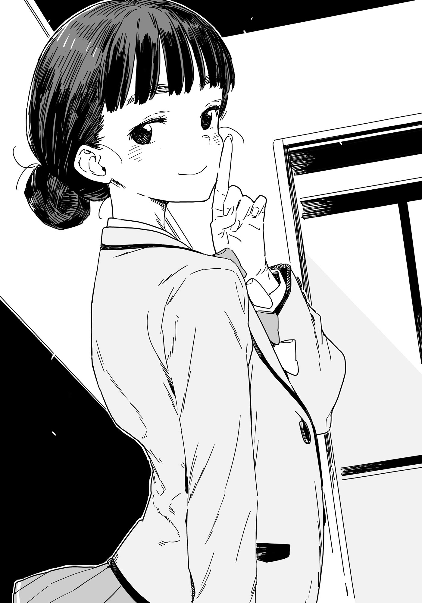

# Ch.73 — เล่ม 7 บทที่ 1-2

Ch.73 — เล่ม 7 บทที่ 1-2

By Monica

Published: 2025-05-16T13:46:00Z

Source: https://www.nekopost.net/novel/14560/73

เล่ม 7 บทที่ 1-2

[ ดอกสวีทร็อคเก็ทที่ริมแม่น้ำตอนนี้สวยมากเลยค่ะ ]

[ เหรอ? ฟังดูดีจังเลย ]

[ ค่ะ ครั้งหน้ามาด้วยกันกับทุกคนเลยนะคะ ]

ชิราทามะพูดขณะกิน อันมิตสึคำสุดท้ายเสร็จ เธอประนมมือแล้วพูดเบาๆ ว่า "ขอบคุณสำหรับอาหารค่ะ"

ผมมองเธอพร้อมจัดระเบียบความคิดเกี่ยวกับสิ่งที่เธอเล่า

— งานอดิเรกของเธอคือการเย็บปักถักร้อย ซึ่งเริ่มต้นเพราะพี่สาว และเธอชอบของหวานมาก เธอไม่ชอบที่คนพลุกพล่าน ดังนั้นงานอดิเรกปัจจุบันของเธอคือการเดินเล่นตอนเช้าตรู่ในช่วงเวลาที่เงียบสงบ

จากทั้งหมดนี้ สิ่งที่สรุปได้คือ ชิราทามะซังน่ารักอย่างไม่น่าเชื่อ

ในขณะที่ผมกำลังจดจำเรื่องนี้ในใจ ชิราทามะซังก็มองขึ้นมาที่ผมด้วยดวงตากลมโตที่แวววาว

[ ขอโทษนะคะ ฉันเอาแต่พูดเรื่องของตัวเองมาตลอดเลย คงเบื่อใช่มั้ยคะ? ]

[ ไม่ๆ ไม่เบื่อเลย จริงๆ รู้สึกโล่งใจที่เธอพูดเก่งมากกว่าอีก ]

[ อาจจะเป็นเพราะรู้สึกว่าคุยกับประธานมันง่ายมั้งคะ ]

เธอแลบลิ้นขี้เล่นนิดๆ น่ารักและแสนเจ้าเล่ห์ในเวลาเดียวกัน

[ ...นุคุมิซึคุง ครีมเซ็นไซของนายกำลังละลายนะ ]

ผมเกือบลืมผู้หญิงคนนี้ไปสนิทเลย เธอกินราเม็งชามที่สองเสร็จเรียบร้อยแล้ว

เธอดื่มน้ำหมดแก้วก่อนวางมันลงบนถาดพร้อมเสียงดังกริ๊ง

[ ชิราทามะจัง แน่ใจนะว่าไม่อยากจบมื้อนี้ด้วยราเม็งอีกหน่อย? หรือข้าวโกโมคุก็ได้นะ ]

[ ไม่เป็นไรค่ะ อีกอย่าง ฉันควรจะกลับบ้านแล้วด้วย เพราะต้องรอโทรศัพท์เช็กอินกับคุณครูน่ะค่ะ ]

...ใช่ เธอยังถูกพักการเรียนอยู่

ชิราทามะซังลุกขึ้นพร้อมถาดของเธอ โค้งศีรษะอย่างสุภาพแล้วเดินไปยังจุดคืนจาน

เธอกำลังพยายามคืนถาดที่สถานีคืนจานของร้านผิดร้าน และดูวุ่นวายตอนถูกบอกให้ไปคืนให้ถูก...

ผมพูดขึ้นเบาๆ เมื่อเธอเดินลับไป

[ ตอนแรกก็เป็นห่วงนะ แต่เธอก็เป็นเด็กดีนี่ ว่ามั้ย ยานามิซัง? ]

ยานามิที่กำลังจ้องมองก้นชามของเธอเงยหน้าขึ้นมาจ้องผมอย่างดุเดือด

[ ...เมื่อกี้นายคุยแต่กับชิราทามะจังตลอดเลยไม่ใช่หรือไง? ]

[ เรามาที่นี่เพื่อพบเธอไม่ใช่เหรอ? ยานามิซังก็ควรจะอ่อนโยนกับเธอบ้างนะ ]

[ ฮึ่ม งั้นนุคุมิซึคุง นายชอบผู้หญิงแบบนั้นสินะ? ]

ยานามิชี้ส้อมราเม็งมาที่ผมพร้อมกับทำหน้าบูดบึ้ง

[ เอ๊ะ หมายความว่ายังไง? ]

[ ก็อย่างที่พูดแหละ อ้า ผู้ชายก็ชอบสาวน้อยกันทั้งนั้นแหละใช่มั้ยล่ะ? ]

...จริงเหรอ? รุ่นพี่ปีสองหึงหวงความเป็นสาวน้อยของรุ่นน้องปีหนึ่ง? ช่างเล็กน้อยจริงๆ

ผมวางชามครีมเซ็นไซตรงหน้ายานามิ

[ ผมยังไม่ได้แตะชามนี้เลย อยากกินมั้ย? ]

[ ...อืม ]

ยานามิพยักหน้าอย่างไม่เต็มใจนัก

ผมเคยอ่านในหนังสือว่าเวลานำสุนัขตัวใหม่เข้ามาในบ้าน ต้องใส่ใจสุนัขตัวเก่ามากเป็นพิเศษ สถานการณ์นี้ก็ดูคล้ายกัน

แม้จะลำบาก แต่ผมก็ดื่มน้ำแก้วสุดท้ายในแก้วจนหมด

◇

เมื่อยานามิกับผมก้าวออกมาจาก JAS ท้องฟ้าก็เริ่มมืดแล้ว

[ ฉันแค่คิดว่ามันไม่ดีหรอกที่จะทำตัวหวานแหววเพียงเพราะมีเด็กปีหนึ่งที่น่ารักเข้ามา ]

[ ผมไม่ได้ทำตัวหวานแหววนะ ยานามิซัง เธอจะไม่ใจร้ายกับชิราทามะซังเกินไปหน่อยเหรอ? ]

ราเม็งชามใหญ่สองชาม ครีมเซ็นไซ แล้วก็ราเม็งของผมที่ยังไม่หมด นั่นคือแคลอรี่เยอะมาก แต่ดูเหมือนอารมณ์ของยานามิจะยังไม่ดีขึ้นเลย

ยานามิหันมองนาฬิกาข้อมือของเธอก่อนจะเร่งฝีเท้าทิ้งผมไว้ข้างหลัง

[ แต่เด็กคนนั้นถูกพักการเรียนไม่ใช่เหรอ? มันต้องมีอะไรมากกว่านั้นสิ ]

[ มั่นใจว่าเป็นแค่เรื่องเข้าใจผิด เธอดูเรียบร้อยและน่ารักขนาดนั้น คงไม่ทำอะไรผิดหรอก ]

[ ความน่ารักเกี่ยวอะไรด้วยล่ะ? ]

ยานามิจ้องผมด้วยสายตาแหลมคม

...อ่า ผมควรจะเอาใจ "ลูกหมาตัวเก่า" สักหน่อย ผมกระแอมเล็กน้อยแล้วพยายามเปลี่ยนเรื่อง

[ เอ่อ มันไม่ได้เกี่ยวกับเธอโดยตรงหรอก ยานามิซัง ต่อให้เป็นเธอที่โดนพักการเรียนผมก็ยังเชื่อใจเธอนะ ]

[ ฉันไม่โดนพักการเรียนหรอกนะ!? ]

จริงเหรอ? ผมกังวลว่าเธออาจจะทำอะไรบุ่มบ่ามสักวันหนึ่ง

ตอนนั้นเอง ในขณะที่เรากำลังมุ่งหน้าไปยังที่จอดจักรยาน ยานามิก็ดึงเสื้อแจ็กเก็ตของผม

[ นุคุมิซึคุง นั่นชิราทามะจังหรือเปล่า...ในรถคันนั้น? ]

[ เอ๊ะ? ]

ผมมองตามสายตาของยานามิไปที่ประตูฝั่งผู้โดยสารของรถที่จอดอยู่ ซึ่งกำลังเปิดออก

ชิราทามะซังก้าวลงมาจากรถ ดูเหมือนเธอกำลังโต้เถียงกับใครบางคนที่อยู่ในที่นั่งคนขับ

ดูเหมือนว่ามีอะไรผิดพลาด เธอรีบเดินออกมาจากรถ และชายในชุดสูทก็ลงมาจากที่นั่งคนขับ มีบางอย่างที่ดูคุ้นเคยเกี่ยวกับเขา

[ นั่นใช่ทานากะเซ็นเซหรือเปล่า? ]

[ หา? ครูสอนวรรณคดีญี่ปุ่นน่ะเหรอ? ]

ผมจ้องมองชายในชุดสูท ไหล่ลาดและท่าทางที่ดูเหนื่อยล้า...ใช่เลย นั่นทานากะเซ็นเซแน่ๆ

เขามักจะสนใจชมรมวรรณกรรมอยู่เสมอ และบางครั้งก็เอาใบปลิวงานวรรณกรรมมาให้เรา

แต่ทำไมชิราทามะซังถึงลงมาจากรถของทานากะเซ็นเซล่ะ?

ทานากะเซ็นเซเดินตามเธอไป แต่เธอก็ดูเหมือนไม่สนใจเขา ก่อนที่เขาจะเดินกลับไปที่รถด้วยท่าทีลังเล

เมื่อรถของเขาขับออกจากลานจอด ยานามิที่เงียบมาตลอดก็พูดขึ้น

[ ทำไมสองคนนั้นถึงอยู่ด้วยกัน? ]

[ เอ่อ...อาจจะเป็นครูประจำชั้นของเธอหรือเปล่า... ]

[ ทานากะเซ็นเซเป็นครูประจำชั้นของห้อง 2-F นะ ]

ทานากะเซ็นเซเป็นที่รู้จักในเรื่องความจริงจังและความห่วงใยนักเรียนของเขา ชั้นเรียนของเขาก็มีชื่อเสียงว่าเข้าใจง่าย

แต่การได้เห็นเขาทะเลาะกับชิราทามะซังมันช่างน่าตกใจ

[ ...คิดว่าเราคงเห็นอะไรที่ไม่ควรเห็นเข้าแล้วล่ะ ]

ยานามิพูดเบาๆ

ผมพยายามหาคำพูดมาปฏิเสธ แต่สุดท้ายก็ทำได้แค่ยิ้มแห้งๆ อย่างลำบากใจ

◇

สองวันหลังจากเห็นการทะเลาะกันระหว่างชิราตามะซังและทานากะเซ็นเซ

หลังเลิกเรียน ผมเดินไปตามทางเดินของอาคารเก่าอย่างเงียบๆ พยายามหลีกเลี่ยงไม่ให้ใครสังเกตเห็น

หลังจากมั่นใจว่าไม่มีใครมองอยู่ ผมก็เล็ดลอดเข้าไปในมุมมืดใต้บันได

[ …มาตรงเวลาเลยนะ นุคุมิซึซัง ]

ผู้ที่รออยู่คือทิอาร่า บาโซริ รองประธานสภานักเรียนจากห้อง 2-F เธอเป็นคนที่ไม่ได้เจอมานานตั้งแต่แยกชั้นกัน

เธอมองซ้ายมองขวาอย่างระมัดระวัง จากนั้นจึงก้าวลึกเข้าไปในเงามืด

[ ขอโทษที่ให้มาทำเรื่องแปลกๆ แบบนี้นะ ]

[ ไม่เป็นไรหรอก นายเองก็ช่วยฉันเรื่องเรียนอยู่ตลอดนี่ ]

ถึงแม้จะไม่ใช่ "ตลอด" จริงๆ แต่พูดออกไปก็ดูใจแคบเกินไป

เทียร่าซังส่งเอกสารรายงานให้ผมหลายแผ่น

[ นี่คือรายงานการสืบสวนที่ขอมา จะทำอะไรก็ระวังด้วยล่ะ ]

หัวข้อบนหน้าปกเขียนว่า <รายงานการสืบสวนทานากะ ยูจิ แห่งโรงเรียนซึวะบุกิ>

ผมพยักหน้ารับเอกสาร เปิดหน้าปกอย่างช้าๆ

ทานากะเซ็นเซเป็นครูสอนภาษาญี่ปุ่นที่โรงเรียนซึวะบุกิ และเคยสอนห้องเราตั้งแต่ปีที่แล้ว เขาดูมีอายุมากกว่าอามานัตสึเซ็นเซและโคนุกิเซ็นเซเล็กน้อย

[ อืม เคยเป็นครูที่โรงเรียนมิโคชิมาก่อนย้ายมาที่นี่ ]

[ ใช่ ดูเหมือนเขาจะมีชื่อเสียงด้านดีที่นั่นเหมือนกัน ห้องเราก็ไม่มีใครพูดถึงเขาในแง่ไม่ดีเลย ]

ผมขอให้เทียร่าซังช่วยหาข้อมูลเพราะอยากรู้เกี่ยวกับเหตุการณ์กับชิราทามะซัง แต่บางทีอาจจะคิดมากไปเอง

อย่างไรก็ตาม ฉากในวันนั้นไม่ดูเหมือนการพูดคุยธรรมดาระหว่างครูกับนักเรียนเลย…

มือผมหยุดพลิกหน้ารายงาน

[ ...ทานากะเซ็นเซเคยเป็นที่ปรึกษาชมรมวรรณกรรมเหรอ? ]

[ ใช่ค่ะ จนถึงช่วงหนึ่งของปี ก่อนที่พวกเราจะเข้าเรียน ]

คิดดูแล้ว รุ่นพี่ทามากิเคยพูดถึง "ปัญหาต่างๆ" เกี่ยวกับการขาดที่ปรึกษา…

เทียร่าซังขยับเข้ามาใกล้ก่อนจะกระซิบเบาๆ

[ …นี่แค่ข่าวลือนะ แต่เหมือนว่ามีการกล่าวหาว่าเขาเคยมีปฏิสัมพันธ์ไม่เหมาะสมกับนักเรียนหญิงคนหนึ่ง ]

หา? ครูที่ดูจริงจังแบบนั้นน่ะเหรอ?

ถึงจะยากที่จะเชื่อ แต่เหตุการณ์ล่าสุดกับชิราทามะซังก็ทำให้ปัดความคิดนี้ออกไปไม่ได้

[ ทานากะเซ็นเซเป็นที่นิยมขนาดนั้นเลยเหรอ? ]

[ ไม่แน่ใจ แต่ช่วงหนึ่งนักเรียนหญิงจะชอบคุณครูผู้ชายที่ยังหนุ่มอยู่ ]

[ จริงเหรอ? เธอเองเคยมีช่วงแบบนั้นมั้ย บาโซริซัง— ]

[ ไม่มีค่ะ ]

เทียร่าซังตัดบทอย่างหนักแน่น

[ ครูที่อ่อนโยนมักจะมีคนแอบปลื้มแน่ๆ แน่นอนว่าไม่ได้เกี่ยวกับฉัน ]

เข้าใจล่ะ เคยคิดว่าคุณครูที่ร่าเริงสดใสจะได้รับความสนใจมากกว่า แต่ดูเหมือนคุณครูที่ดูเหนื่อยหน่ายกับชีวิตก็มีคนแอบชอบเหมือนกัน ความชอบนี่ก็หลากหลายจริงๆ

แต่เดี๋ยวก่อน ถ้าข่าวลือเรื่องการมีปัญหากับนักเรียนหญิงเป็นความจริง อาจเป็นเหตุผลที่เขาลาออกจากการเป็นที่ปรึกษาชมรมวรรณกรรม และอาจเกี่ยวข้องกับการพักการเรียนของชิราทามะซัง?

เทียร่าซังจ้องหน้าผมขณะที่ฉันกำลังครุ่นคิด

[ ...เอ๋? มีอะไรเหรอ บาโซริซัง? ]

[ นุคุมิซึซัง มีปัญหาอะไรกับทานากะเซ็นเซหรือเปล่า? ]

[ เปล่าเลย ไม่มีอะไร— ]

ผมไม่สามารถพูดถึงเรื่องของชิราทามะซังได้

[ แค่สงสัยเรื่องเขานิดหน่อยเท่านั้น ]

[ ส-สงสัยเหรอ!? ]

ด้วยเหตุผลบางอย่าง เทียร่าซังดูตกใจเมื่อได้ยินคำอธิบายที่ดูไร้เดียงสาของผม

[ ค-คือ ฉันถือว่าตัวเองเข้าใจได้นะ แต่… ]

[ หืม? ]

เทียร่าซังเริ่มกระวนกระวาย เขียนลวดลาย "の" บนพื้นด้วยเท้า

[ แต่ถึงจะเป็นเพศเดียวกัน ฉันก็ยอมรับความสัมพันธ์ไม่เหมาะสมระหว่างคุณครูกับนักเรียนไม่ได้…"

[ ...พูดเรื่องอะไรน่ะ? ]

[ นุคุมิซึซัง นายจะสารภาพกับทานากะเซ็นเซเหรอ? ]

[ ไม่ใช่แล้ว! ]

[ ไม่ต้องห่วง ฉันจะไม่บอกใครนะ! แล้วถ้าขึ้นอยู่กับสถานการณ์ ฉันก็จะไม่แทรกแซงด้วย— ]

[ ไม่มีสถานการณ์แบบนั้นแน่นอน! ]

ให้ตายสิ ผมคุยกับคนผิดจริงๆ ต้องเคลียร์เรื่องนี้ให้ได้

[ คือ แค่คิดว่าเราน่าจะลองเปลี่ยนที่ปรึกษาชมรมวรรณกรรมบ้าง ทานากะเซ็นเซดูเหมาะสมดี ]

[ โคนุกิเซ็นเซมีปัญหาเหรอคะ— ]

เทียร่าเซังขมวดคิ้วขณะครุ่นคิด

[ ….เข้าใจแล้วค่ะ ฉันเข้าใจความรู้สึกของนาย ]

เธอเข้าใจ แม้ว่าผมจะโกหกไป แต่ความรู้สึกนี้ก็ไม่ใช่ความเท็จทั้งหมด

[ ขอโทษที่เข้าใจผิดนะ เพราะนายมาปรึกษาฉันแทนที่จะไปหาซากุไรคุง ฉันเลยคิดว่า… ]

[ คือ ซากุไรคุงมีตำแหน่งในสภานักเรียน ถ้าเกิดมีเรื่องร้ายแรงขึ้นมา เขาคงเก็บเงียบไม่ได้ ]

[ …ฉันเองก็เป็นสมาชิกสภานักเรียนนะคะ ]

จริงสิ ใช่ เธออยู่ในนั้นด้วย

ผทปั้นเรื่องโกหกอีกครั้งเพื่อหลบหนีสายตาของเทียร่าซัง

[ เอ่อ เทียร่าซัง คิดว่าเธอเหมาะกับการเก็บความลับ เพราะ…เธออยู่ห้อง F… ]

[ ก็จริงค่ะ ฉันค่อนข้างเก็บความลับได้นะ— ]

เทียร่าซังที่กำลังครุ่นคิดอยู่ก็ยิ้มออกมาอย่างอารมณ์ดี

[ ตกลง ถ้ามีอะไรก็มาปรึกษาฉันได้เสมอนะคะ ]

[ เอ๋ แน่ใจเหรอ? ]

เทียร่าซังก้าวออกจากมุมมืดใต้บันได

[ นายบอกว่าอาจมีเรื่องร้ายแรงใช่มั้ยล่ะ? ]

ใช่ ผมพูดไปแบบนั้น ฉันพยักหน้าอย่างจริงจัง

ขณะที่เธอหันกลับไป กระโปรงพลิ้วไหว เทียร่าซังก็เอานิ้วจรดริมฝีปาก

[ เก็บเป็นปันความลับแบบนี้ก็ดีเหมือนกันนะคะ? ]

