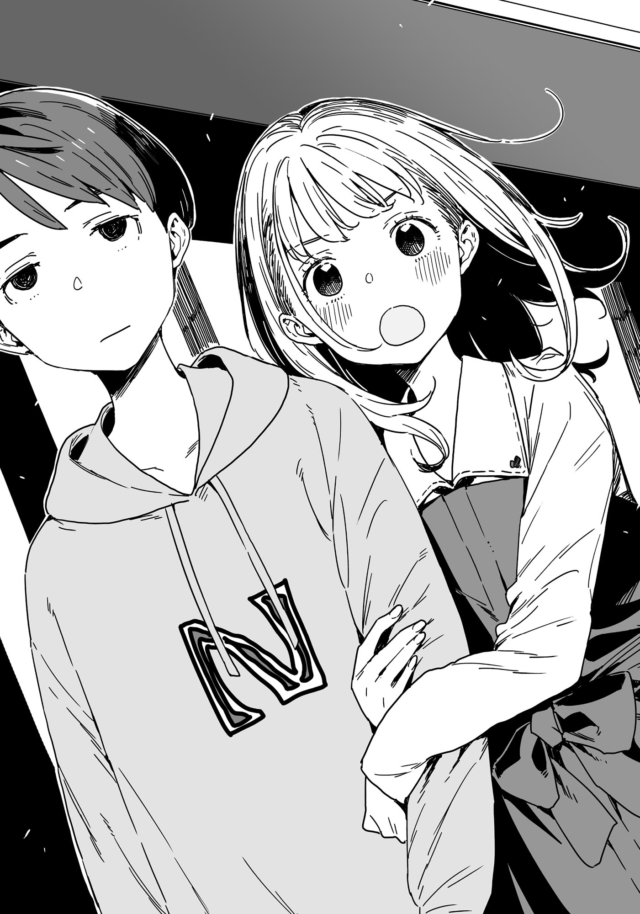

# Ch.78 — เล่ม 7 บทที่ 2-3

Ch.78 — เล่ม 7 บทที่ 2-3

By Monica

Published: 2025-05-16T13:48:07Z

Source: https://www.nekopost.net/novel/14560/78

เล่ม 7 บทที่ 2-3

เบื้องหน้าเราคือเครื่องประดับหรูหรามากมายที่ถูกจัดแสดงในตู้กระจก

ขณะที่เรามองไปพร้อมกัน ชิรทามะซังก็อุทานเบา ๆ ด้วยความชื่นชม

[ ว้าว สวยจัง… สร้อยคอนั่นทำจากอเมทิสต์หรือเปล่า? ]

[ เอ่อ... น่าจะใช่นะ ]

เธอพาผมมาที่ร้านเครื่องประดับในห้างเดียวกัน

รู้สึกกดดันเล็กน้อยกับบรรยากาศหรูหราในร้าน แต่สังเกตเห็นว่าชิราทามะซังดูจะรู้สึกผิดนิดหน่อย

[ ขอโทษนะคะที่อยู่ ๆ ก็พามาที่นี่ คงไม่ได้สนใจอะไรแบบนี้ใช่มั้ย? ]

[ ไม่หรอก จริง ๆ ไม่ค่อยมีโอกาสมาที่แบบนี้เองซะด้วยซ้ำ เลยรู้สึกสนุกดี ]

[ จริงเหรอ? ประธานนี่ใจดีจังเลย ]

เธอยิ้มให้ฉันอย่างอบอุ่น

— แค่ให้รู้ไว้ ผมไม่ได้ตอบรับคำชวนของชิราทามะซังด้วยเจตนาอื่นเลย แค่ต้องการช่วยเธอแก้ปัญหาที่มีกับยานามิและโคมาริ… จริง ๆ นะ

ขณะที่ผมพยายามย้ำความคิดนี้กับตัวเอง ผมก็แอบมองชิราทามะซัง

เธอยิ้มเบา ๆ พลางจ้องมองเครื่องประดับผ่านกระจก

ใบหน้าของเธอที่ผสมผสานระหว่างความไร้เดียงสาแบบเด็กสาวกับความงดงามแบบผู้ใหญ่ ถูกล้อมกรอบด้วยผมยาวประบ่า

เธอสูงพอ ๆ กับยานามิ แต่ร่างกายที่ดูบอบบางนั้นเหมือนจะหักได้ถ้าเผลอสัมผัสแรงเกินไป

แม้จะดูผอมบาง แต่ต่างจากโคมาริ เธอมีรูปร่างที่ดูเป็นผู้หญิงอย่างชัดเจน แม้จะอยู่ภายใต้เสื้อผ้าก็ตาม

ใบหน้าของเธอและแขนขาที่เรียวยาวทำใหผมนึกถึงยากิโช ส่วนผิวขาวเนียนละเอียดทำให้ฉันนึกถึงชิกิยะซัง

...ใช่เลย เธอคนนี้น่ารักมาก

ไม่แปลกใจเลยที่ยานามิจะรู้สึกอิจฉา ถึงเธอคนนั้นจะดูมีเสน่ห์ แต่ก็มีบางอย่างที่ทำให้ไม่สามารถชื่นชมได้อย่างเต็มที่

[ ประธานเกิดเดือนอะไรเหรอคะ ? ]

[ เอ๊ะ? เกิดเดือนธันวาคม เพราะงั้น... ]

ผมมองตารางหินประจำเดือนเป็นครั้งที่สี่ ก่อนที่โทรศัพท์ในกระเป๋ากางเกงจะสั่นขึ้น

...ขอเดาเลยว่าต้องเป็นยานามิแน่ ๆ

ขณะที่กำลังเอื้อมมือไปหยิบโทรศัพท์ ชิราทามะซังกลับเอามือของเธอวางทับมือผมไว้

[ หา!? ]

[ ขอเวลาของประธานอีกสักหน่อยได้มั้ยคะ? ]

[ ถ้าพอจะช่วยอะไรได้ ก็…ได้เสมอ ]

[ งั้นช่วยอยู่ด้วยกันอีกสักพักนะคะ ]

เธอสะกิดไหล่ผมเบา ๆ แล้วพาผมเดินลึกเข้าไปในร้าน

[ หินประจำเดือนเกิดของประธานคือแทนซาไนต์ ที่หมายถึงความเฉลียวฉลาดและความสุขุม เยี่ยมเลยค่ะ เหมาะกับประธานมาก ]

[ เอ่อ... ใช่ ก็มีคนพูดแบบนั้นอยู่ ]

ผมตอบขณะกลืนน้ำลายลงคอ

นี่มัน... กำลังเข้าสู่เหตุการณ์โรแมนติกเหรอ ?

หรือว่ายุคทองที่ผมรอคอยกำลังมาถึงแล้ว?

...ไม่มีทาง. ตั้งสติหน่อย นุคุมิซึ.

ไม่มีทางที่รุ่นน้องน่ารักแบบนี้จะเข้าหาคนจืดชืดอย่างผมแน่ ๆ

สถานการณ์แบบนี้มันควรจะเป็นของพวกหนุ่มหล่อที่ดูมีชีวิตชีวามากกว่า

งั้นเรื่องนี้คงเป็นส่วนหนึ่งของเรื่องราวของชิราทามะซังเอง—

[ ไหนดูสิ….แล้วหินประจำเดือนเกิดของฉันล่ะ ? ]

[ ...ชิราทามะซัง มีอะไรอยากจะพูดกับผมหรือเปล่า? ]

รอยยิ้มของเธอสะดุดเล็กน้อย

แต่เพียงชั่วครู่ รอยยิ้มนั้นก็ถูกแทนที่ด้วยรอยยิ้มที่น่ารักและดูเจ้าเล่ห์ยิ่งกว่าเดิม

[ ไม่เป็นไรค่ะ เมื่อกี้ฉันพูดไปหมดแล้ว ประธานลืมหรือเปล่าคะ ? ]

[ ถ้าไม่ใช่เรื่องนั้น เธอกำลังรอใครอยู่หรือเปล่า? ]

คราวนี้รอยยิ้มบนใบหน้าของเธอเลือนหายไปหมด

สีหน้าของชิราทามะซังซีดลงอย่างเห็นได้ชัด เธอดูเริ่มกระวนกระวายมากขึ้นเรื่อย ๆ

[ เอ่อ... คือว่า... ]

[ เธอมองไปรอบ ๆ บ่อยมากตอนที่ดูเครื่องประดับ เหมือนกำลังรอใครบางคนอยู่ เธอกำลังรอใครมาที่นี่หรือเปล่า? ]

[ คือ... ]

ปากของเธอเปิดราวกับพยายามหาคำพูด ก่อนจะปิดลงอีกครั้ง

ขาของเธอสั่นเล็กน้อย เหมือนพยายามระงับตัวเองไม่ให้หนีไป

[ ขอโทษนะ ไม่ได้จะกล่าวหาอะไรเธอหรอก แค่อยากช่วยแค่นั้น ถ้าเธอบอกว่าเกิดอะไรขึ้น บางทีอาจช่วยเธอได้ ]

[ ............ ]

เธอกำมือทาบหน้าอกทั้งสองข้างและก้มหน้าลงโดยไม่พูดอะไร

ขณะที่ผมกำลังจะพูดอะไรบางอย่างเพื่อทำลายความเงียบที่แสนอันอึดอัด—

[ —ริโกะ ใช่เธอหรือเปล่า? ]

เสียงที่ชัดเจนดังขึ้น

ชิราทามะ ริโกะ เงยหน้าขึ้นทันทีราวกับมีสวิตช์เปิดปิด

เบื้องหน้าเราคือหญิงสาววัยยี่สิบกลาง ๆ

แม้ใบหน้าของเธอจะดูสมบูรณ์แบบ แต่คำว่า "น่ารัก" กลับเป็นสิ่งแรกที่ผมนึกถึง เธอเป็นผู้หญิงที่มีเสน่ห์มาก

พวกเธอคล้ายกันมาก

เสียงของชิราทามะซังดังขึ้นเบา ๆ ราวกระซิบ

[ พี่... ]

เธอคือพี่สาวของชิราทามะ ริโกะ

แต่สิ่งที่ทำให้ผมประหลาดใจไม่ใช่แค่การปรากฏตัวของพี่สาวของชิราทามะซัง

คนที่ยืนข้าง ๆ พี่สาวในท่าทางเหมือนคอยปกป้องคือ—

[ เธอคือนุคุมิซึคุงจากห้อง C ใช่มั้ย? ทำไมมาอยู่กับริโกะจังล่ะ? ]

เขาคือทานากะเซ็นเซ ครูสอนวรรณคดีญี่ปุ่นจากโรงเรียนซึวะบุกิ

สองพี่น้องชิราทามะ ทานากะเซ็นเซ และ...ผม ที่มาอยู่ในเหตุการณ์นี้ด้วยเหตุผลอะไรก็ไม่รู้

ความเงียบที่แสนอึดอัดถูกทำลายลงโดยชิราทามะซังเอง

เธอคว้าแขนผมแน่นและดึงตัวเข้าไปใกล้

[ —หนูคบกับเขาอยู่ค่ะ! ]

หา!? พวกเราคบกันตั้งแต่เมื่อไหร่!?

ผมไม่มีความทรงจำเกี่ยวกับความสัมพันธ์นี้เลย แต่ถ้าเป็นจริง ทุกอย่างก็ดูจะลงตัว— การที่ชิราทามะซังแยกผมออกมา และเวลาสบาย ๆ แปลก ๆ ที่เราใช้ร่วมกัน’\

ใช่ ตอนนี้ควรปล่อยให้ทุกอย่างเป็นไปตามน้ำ

พี่สาวของชิราทามะที่ดูอึ้งกับคำประกาศของน้องสาว ในที่สุดก็พูดขึ้นมา

[ ริโกะ เธอมีแฟนแล้วเหรอ? ทำไมพี่ไม่เคยได้ยินเรื่องนี้เลย... ]

[ ขอโทษค่ะ พี่กับทานากะเซ็นเซยุ่งกับการเตรียมงานแต่งงานจนหนูไม่มีโอกาสบอก ]

เธอพูดพร้อมรอยยิ้มสดใส

รอยยิ้มนั้นคงทำให้พี่สาวของเธอถามต่อไม่ลง สีหน้าที่เต็มไปด้วยความมึนงงของพี่สาวหันมามองผมแทน

[ แล้วเธอล่ะ คบกับริโกะมานานแค่ไหนแล้ว? ]

[ เอ่อ... ก็ไม่ได้เกี่ยวกับเวลาสักเท่าไหร่ มันเหมือนสถานการณ์แมวของชโรดิงเจอร์... ]

[ พี่คะ อย่าถามคำถามแปลก ๆ กับแฟนหนูสิ ]

ชิราทามะซังทำปากยื่นก่อนจะกอดแขนผมแน่นขึ้นกว่าเดิม

[ ขอโทษนะ ริโกะ แค่จู่ ๆ มันกะทันหัน ฉันเลยตกใจนิดหน่อย แต่… ]

[ หนูอยู่ม.ปลายแล้วนะ แล้วตอนพี่อายุเท่าหนู พี่ก็ชอบทานากะเซ็นเซเหมือนกันไม่ใช่เหรอ? ]

[ ริโกะ!? ]

ใบหน้าของพี่สาวชิราทามะแดงก่ำ …เอ่อ ก็ต้องยอมรับว่าเธอก็น่ารักเหมือนกัน

ทานากะเซ็นเซวางมือเบา ๆ บนไหล่ของพี่สาวชิราทามะ พร้อมกับยิ้มอ่อนโยน

[ มิโนริซัง ไปกันเถอะนะ ]

[ แต่...ยูจิซัง...]

[ ขอโทษที่มาขัดจังหวะนะครับ พวกเราขอตัวก่อน ]

ทานากะเซ็นเซพาพี่สาวชิราทามะออกไปจากสถานการณ์นั้น ด้วยท่าทีเหมือนกำลังปลอบเด็ก

แม้พวกเขาจะลับสายตาไปแล้ว ผมยังคงยืนนิ่งด้วยความงุนงงกับเหตุการณ์ที่พลิกผันอย่างรวดเร็ว

แต่แล้ว ความรู้สึกที่แขนของผมก็เรียกสติกลับมา ทั้งสัมผัสที่นุ่มนวลและกลิ่นหอมที่อบอวล...

[ เอ่อ นั่นคือ… ]

ชิราทามะซังพยักหน้าอย่างช้า ๆ

[ ค่ะ เธอเป็นพี่สาวฉันเอง ]

[ แล้วการที่ทานากะเซ็นเซอยู่กับเธอ หมายความว่า... ]

[ พวกเขาหมั้นกันแล้วค่ะ ]

...นี่สินะที่ทำให้ชิราทามะซังรู้จักกับทานากะเซ็นเซ

แล้วเรื่องที่พวกเขาทะเลาะกันตรงลานจอดรถในห้าง… เป็นเพราะเรื่องนี้เหรอ?

ขณะที่ผมพยายามเรียบเรียงชิ้นส่วนที่ขาดหายของปริศนา ชิราทามะซังก็จับแขนผมแน่นขึ้น

เธอกอดแขนผมไว้ และพูดเสียงเบาจนแทบไม่ได้ยิน

[ ไปที่ที่……เราอยู่กันแค่สองคนได้มั้ยคะ ? ]
