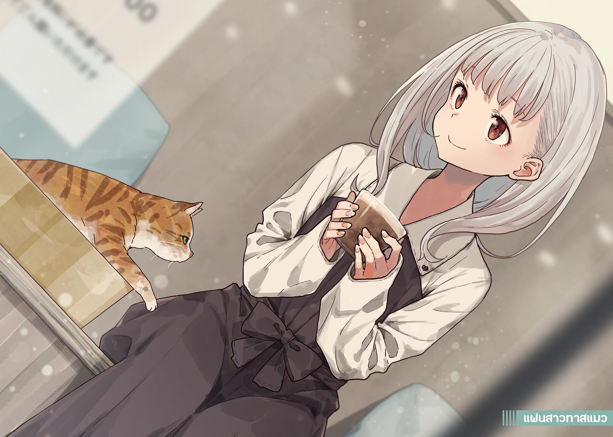

# Ch.79 — เล่ม 7 บทที่ 2-4

Ch.79 — เล่ม 7 บทที่ 2-4

By Monica

Published: 2025-05-16T13:48:23Z

Source: https://www.nekopost.net/novel/14560/79

เล่ม 7 บทที่ 2-4

ตึก ตึก...

แมวสีน้ำตาลขนยาวตัวหนึ่งวิ่งผ่านหน้าเราไปอย่างรวดเร็ว มันหมอบตัวต่ำราวกับกำลังซุ่มโจมตี

ตอนนี้ผมกับชิราทามะซังอยู่ที่คาเฟ่แมวในห้าง

เรานั่งเคียงข้างกันบนม้านั่งไม้ มือทั้งสองถือแก้วลาเต้เพื่อเพิ่มความอบอุ่น

นี่สินะ…ที่ที่เราจะอยู่ด้วยกันตามลำพังได้

[ ...ขอโทษนะคะ ที่พูดโกหกประหลาด ๆ แบบนั้น ]

[ หา? อ่า ไม่เป็นไรหรอก คือแมวไม่ใช่คน เพราะงั้นการอยู่ด้วยกันสองคนก็ไม่ได้หมายถึงว่าเราอยู่ลำพังจริง ๆ ใช่มั้ย- ]

[ ไม่ใช่เรื่องนั้นค่ะ หมายถึงเรื่องที่ว่าเราเป็นแฟนกันน่ะ ]

ความสัมพันธ์ของเรามันเป็นแค่เรื่องโกหก

จะว่าไป ผมก็ไม่ได้คาดหวังอะไรอยู่แล้ว และก็พอเดาได้ว่าต้องมีเหตุผลที่เธอพูดแบบนั้น เพราะงั้นมันไม่ได้กระทบอะไรกับผมเลย…จริง ๆ นะ แต่เธอน่าจะเล่นบทนั้นนานกว่านี้หน่อย

...บ้าจริง คิดแบบนี้แล้วทำไมถึงรู้สึกแย่ขึ้นเนี่ย

ผมจิบลาเต้อีกคำ พยายามรวบรวมความคิดก่อนจะถามออกไปอีกครั้ง

[ แล้วทำไมตอนนั้นเธอถึงพูดโกหกแบบนั้นไปล่ะ ? ]

[ ฉันอยากโชว์ให้พวกเขาเห็นว่าฉันมีแฟนค่ะ อยากให้พวกเขาประหลาดใจ ฉันรู้ว่าพวกเขามารับแหวนแต่งงานที่ร้านนั้น ]

เธอเงียบไปอีกครั้ง

[ แล้วทำไมต้องทำแบบนั้นด้วย? ]

[ พวกเขาชอบปฏิบัติกับฉันเหมือนเป็นเด็ก เลยอยากอวดบ้างค่ะ ]

ผมพยักหน้าเข้าใจ... นี่สินะเหตุผลที่เธอลากผมออกมาจากโซนเกม

ก็แน่ล่ะ ก็พอจะเดาได้อยู่แล้ว…ใช่ เดาได้ตั้งแต่แรกเลย…

[ พอจะเข้าใจความรู้สึกของพี่สาวเธออยู่บ้างนะ ]

[ ฉันดูเหมือนเด็กขนาดนั้นเลยเหรอคะ? ]

เธอทำหน้ามุ่ยอย่างชัดเจน ผมหลุดหัวเราะแล้วส่ายหน้า

[ ไม่ใช่ในความหมายแบบนั้น ผมเองก็มีน้องสาวนะ แม้เราจะห่างกันแค่สองปี แต่ก็ยังมองว่าเธอเป็นเด็กน้อยเหมือนเดิม ]

[ แต่ฉันอายุน้อยกว่าพวกเขาตั้งสิบปีเลยนะ ]

ชิราทามะซังจิบกาแฟโอเลต์ช้า ๆ แล้วถอนหายใจออกมาเบา ๆ

[ พี่สาวเป็นคนใจดีและชอบเอาใจใส่ฉันมาก ฉันรักเธอมากเลยค่ะ ]

[ ดูเหมือนเธอจะเป็นพี่สาวที่ดีนะ ]

ชิราทามะซังพยักหน้า ยิ้มออกมาด้วยความจริงใจมากกว่าที่ผมเคยเห็น

[ ใช่ค่ะ ตอนเด็ก ๆ ฉันเคยคิดว่าฉันมีแม่สองคนด้วยซ้ำ เด็ก ๆชอบคิดอะไรแปลก ๆ แบบนั้นแหละ ]

เธอหัวเราะเบา ๆ อย่างคิดถึงความหลัง

แต่เสียงหัวเราะของเธอเงียบลงอย่างรวดเร็ว เธอก้มหน้าลงและพูดเสียงเบาเหมือนพูดกับตัวเอง

[ เพราะแบบนั้น ฉันถึงต้องสนับสนุนพี่สาว ถ้าเธอเลือกทานากะเซ็นเซ… ]

มันเหมือนเธอกำลังพยายามพูดเพื่อโน้มน้าวตัวเองมากกว่าจะพูดให้ผมฟัง

[ ...มีอะไรเกิดขึ้นระหว่างเธอกับทานากะเซ็นเซเหรอ? ]

[ ค่ะ มันมี... หลายอย่างที่เกิดขึ้น ]

[ หา!? ]

ผมว่าผมได้ยินอะไรที่น่าตกใจมากๆ

ผมกำแก้วกาแฟแน่นด้วยมือที่สั่นเล็กน้อย แต่ชิราทามะซังรีบส่ายหน้า

[ ไม่ใช่ในความหมายแปลก ๆ ค่ะ ทานากะเซ็นเซเป็นเพื่อนบ้านของเราตั้งแต่ฉันยังเด็ก เขาช่วยฉันเรียนและดูแลฉันเสมอ ]

...อย่างนี้นี่เอง

โล่งอกที่ไม่มีอะไรซับซ้อน

คนตรงหน้าผมเป็นแค่เด็กสาวธรรมดาที่สนิทกับพี่สาวของเธอ

[ งั้น ทานากะเซ็นเซก็กำลังจะเป็นพี่เขยของเธอสินะ? ]

ไหล่ของชิราทามะซังสะท้านเล็กน้อย

[ ...ชะ-ใช่ค่ะ เพราะเขาจะแต่งงานกับพี่สาวของฉันนี่คะ ]

เธอตอบด้วยน้ำเสียงเงียบ ๆ แล้วก็เงียบไปอีกครั้ง

...เอ๊ะ ผมพูดอะไรแปลก ๆ ไปหรือเปล่า?

[ ...เอ่อ ชิราทามะซัง เธอสนิทกับทานากะเซ็นเซใช่มั้ย? ]

เมื่อผมพูดออกไป เธอค่อย ๆ เงยหน้าขึ้นมา

[ ...ช่วยฟังหน่อยได้มั้ยคะ? ]

เมื่อผมพยักหน้า เธอก็เริ่มพูดด้วยสีหน้าที่ดูเป็นผู้ใหญ่มากกว่าปกติเล็กน้อย

[ ทานากะเซ็นเซเป็นเพื่อนบ้านของเรา และเขามักจะดูแลเราตอนที่พ่อแม่กลับบ้านดึกเสมอ ]

[ งั้นก็หมายความว่าเขาดูแลพี่สาวของเธอด้วยเหรอ? พวกเขาห่างกันมากมั้ย? ]

[ เซ็นเซแก่กว่าพี่สาวฉันห้าปีค่ะ เขาเพิ่งอายุสามสิบปีนี้เอง ถือว่าแก่แล้วใช่มั้ยล่ะ? ]

เธอพูดพร้อมรอยยิ้มที่ดูไม่ค่อยขำสักเท่าไหร่

[ พวกเขาใช้เวลาอยู่กับฉันมาตลอดตั้งแต่เริ่มจำความได้ พวกเขามักจะมารับฉันที่โรงเรียนอนุบาลด้วยกัน ]

เธอยิ้มออกมาอย่างคิดถึง ราวกับกำลังนึกถึงบางอย่าง

[ ตอนนั้นพวกเขายังเป็นนักศึกษาและเด็กมัธยมต้นกันอยู่เลย เลยมีข่าวลือแปลก ๆ ออกมาบ้าง แต่ตอนนั้นพวกเขายังไม่ได้คบกันค่ะ ]

[ งั้นแปลว่าพวกเขาสนิทกันมาตั้งแต่ตอนนั้นสินะ ]

[ ฉันเคยอิจฉาที่พวกเขาสนิทกันมากจนพยายามเข้าไปแทรกกลางระหว่างพวกเขาตลอดเลยค่ะ บางครั้งฉันก็จะงอแงใส่พี่สาวว่าอย่าเข้าใกล้เขา หรือบางทีก็บอกพี่เขาว่าอย่าเข้าใกลพี่ชายของฉันด้วย ]

เธอยิ้มอ่อน ๆ ราวกับกำลังหวนคิดถึงช่วงเวลาที่มีค่าของเธอ

[ ...เธอรักพวกเขามากสินะ? ]

[ ค่ะ ฉันรักพี่สาวของฉันมากจริง ๆ ]

เข้าใจแล้ว โล่งอกไปที

ชิราทามะซังเป็นแค่เด็กสาวที่มีจิตใจบริสุทธิ์และรักพี่สาวของเธอ ไม่ใช่คนที่มีเจตนาแอบแฝงเหมือนที่ยานามิหรือคนอื่น ๆสงสัย

ผมพยายามพูดต่อเพื่อขจัดความรู้สึกกังวลลาง ๆ ที่ยังค้างอยู่

[ แล้วเธอก็สนิทกับทานากะเซ็นเซด้วยใช่มั้ย ? ]

[ ...ฉันเกลียดเขาค่ะ คนอย่างเขาแย่ที่สุด ]

[ เอ๊ะ… ]

ความเงียบอันอึดอัดเข้าปกคลุมพวกเรา

ผมเหลือบมองนาฬิกา ตอนนี้ใกล้จะเที่ยงแล้ว

พอได้ยินคำว่า ‘เที่ยง’ ก็พลันนึกถึงหน้ายานามิขึ้นมา-

ตุบ

แมวลายสีน้ำตาลตัวหนึ่งกระโดดขึ้นมาตักของชิราทามะซัง มันขดตัวอย่างสบายใจ โดยไม่สนใจบรรยากาศตึงเครียด

[ เขาเห็นว่าฉันเป็นน้องสาวของเขาจริง ๆ ]

ชิราทามะซังลูบขนแมวด้วยใบหน้าตึงเครียด

[ ในขณะที่ฉันยังคงเป็นเด็กผู้หญิงข้างบ้าน พี่สาวของฉันกลับเริ่มเรียกเขาว่า ยูจิซัง ตั้งแต่เมื่อไหร่ก็ไม่รู้ ]

แมวลายสลิดขยับหูหนึ่งครั้งอย่างพอใจจากการลูบของชิราทามะซัง ก่อนจะเริ่มครางเบาๆ

[ ...ฉันเรียกเขาว่า’เซ็นเซ’มาตั้งแต่นั้น ]

เธอพูดพลางลูบหลังแมวต่ออย่างอ่อนโยน

งั้นแปลว่า ทานากะเซนเซเป็นครูอยู่แล้วตอนที่พวกเขาเริ่มคบกัน ซึ่งก็คือ...

[ พวกเขาเริ่มคบกันช้าสินะ? ]

[ ใช่ พวกเขาเริ่มคบกันอย่างเป็นทางการหลังจากพี่สาวของฉันจบมัธยมปลาย ฉันรู้ว่าเขาใจดีกับพี่สาวมาก ]

ชิราทามะซังยิ้มบางๆ อย่างเจ็บปวด

[ ...อยู่ช่วงหนึ่ง ฉันเคยคิดว่าเขาอาจรอให้ฉันโตขึ้นอีกสักหน่อยตอนที่ฉันยังเรียนประถม ฟังดูโง่เง่าใช่มั้ยล่ะ ]

เธอพยายามหัวเราะ แต่กลับทำไม่ได้ เพียงก้มหน้าและพูดด้วยเสียงแผ่วเบา

[ ...ฉันสงสัยว่าถ้าฉันเกิดก่อนพี่สาว ฉันจะเรียกทานากะเซ็นเซว่าอะไรนะ ]

ผมเงียบ ไม่รู้จะพูดอะไรออกไป

ไม่ว่าจะเป็นความรักหรือความฝัน มันก็เป็นเรื่องปกติที่เราจะไปไม่ถึง

ในขณะที่เราคว้าสิ่งที่ล้ำค่าไว้ได้ สิ่งอีกมากมายก็หลุดลอยไปจากมือเรา—

ขณะที่เสียงหายใจของแมวค่อยๆ เป็นจังหวะสม่ำเสมอ ชิราทามะซังก็พูดขึ้นอีกครั้ง

[ พวกเขาจะแต่งงานกันวันเสาร์ถัดจากนี้ เป็นงานแต่งในสวนสวยเลยล่ะ ]

[ เอ๊ะ? อ้อ เข้าใจแล้ว ]

[ แล้วก่อนหน้านั้นฉันแอบเข้าไปที่สถานที่จัดงานตอนกลางคืน ]

เดี๋ยวนะ เธอพูดอะไรน่ะ ?

[ ขอโทษนะ คงจะฟังผิดไป เกิดอะไรขึ้นที่สถานที่จัดงานนะ ? ]

[ ฉันบอกว่าฉันแอบเข้าไปตอนกลางคืน แล้วตำรวจก็เข้ามา ]

งั้นผมไม่ได้ฟังผิด...

สิ่งที่ผมคิดว่าเป็นเรื่องความรักข้างเดียวของรุ่นน้อง กลายเป็นคำสารภาพอาชญากรรมไปแล้ว

[ เอ่อ...ทำไมถึงทำแบบนั้นล่ะ? ]

[ ก็เพราะพี่สาวของฉันมักได้ทุกอย่างที่ฉันต้องการก่อนเสมอ ฉันอยากจะทิ้งร่องรอยอะไรไว้บ้าง—อยากสร้างความลับอะไรสักอย่าง ฉันอยากให้มันจบลงตรงนั้น ]

ถ้าฟังแค่ตรงนี้ มันฟังดูเหมือนเรื่องของรักแรกของเด็กสาวที่น่าประทับใจ แต่คราวนี้มันช่างวุ่นวายเสียจริง

[ แต่ทำไมต้องแอบเข้าไปล่ะ? ]

[ ฉันอยากสวมชุดแต่งงานของพี่สาว แล้วถ่ายรูปในโบสถ์ ก่อนที่เธอจะได้สวมมัน ]

[ ...ถึงอยากจะสร้างความลับ แต่ก็น่าจะเลือกอะไรที่ไม่ผิดกฎหมายหน่อยมั้ย? เอาที่ดูสงบสุขกว่านี้น่ะ ]

[ ใช่ ตอนนั้นฉันมีตัวเลือกอยู่ห้าข้อ และฉันเลือกข้อที่สงบที่สุดแล้ว ]

ถ้านั่นคือข้อที่สงบที่สุด งั้นผมก็ต้องยอมรับมันสินะ ผมจิบลาเต้ของตัวเองเงียบๆ

ชิราทามะซังดูเหมือนจะเป็นคนปกติ แต่ผู้หญิงจริงๆ เป็นแบบนี้กันหรือเปล่านะ? ผมคิดว่าระหว่างทางกลับบ้าน คงต้องแวะซื้อไลท์โนเวลสักเล่ม

ชิราทามะซังยิ้มอย่างอ่อนแรงให้ผม ขณะที่ผมกำลังดื่มด่ำกับโลกสองมิติ

[ ขอโทษสำหรับเรื่องประหลาดๆนะคะ หลังได้พูดออกไปแบบนี้ รู้สึกดีขึ้นนิดหน่อย ]

มันเป็นเรื่องที่ประหลาดจริงๆ

[ เอ่อ ไม่ต้องกังวลหรอก จะไม่บอกใครแน่นอน ]

[ ถ้าจำเป็น ประธานจะบอกใครก็ได้ค่ะ ฉันทำให้ประธานและรุ่นพี่คนอื่นลำบากมาก… ]

ชิราทามะซังเริ่มเล่นกับคอของแมวด้วยปลายนิ้ว

ขณะที่ผมมองดูแมวที่ดิ้นอย่างพอใจ ผมก็เริ่มจัดระเบียบเรื่องราวที่ได้ยินมา

...มั่นใจว่าทานากะซังและพี่สาวของเธอมีความรู้สึกที่ดีต่อกันมานานแล้ว

ชิราทามะซังที่อายุน้อยกว่ามาก คงมีความรู้สึกหลากหลาย ทั้งชื่นชมและเหงาในขณะอยู่ใกล้ๆ พวกเขา

[ เธอชอบทานากะเซนเซมาตลอดเลยใช่มั้ย ? ]

นิ้วของชิราทามะซังหยุดลงเมื่อผมพูดจาแบบไม่คิดไป

[ ฉันบอกไปว่าฉันเกลียดคนแบบเขาไม่ใช่เหรอคะ? ]

[ ขอโทษนะ นั่นไม่ได้คิดก่อนพูด- ]

[ ก็เพราะว่า ! ]

เธอพูดแทรกคำขอโทษของผม พลางสูดหายใจเข้าลึกและเริ่มพูดตะกุกตะกัก

[ ผู้ชายคนนั้นมองฉันด้วยสายตาเดียวกับพ่อของฉันเสมอ แต่เวลาที่เขามองพี่สาวของฉัน สีหน้าของเขากลับเปลี่ยนไป และเขาไม่เคยทำหน้าที่แบบนั้นให้ฉันเลย พี่สาวของฉันเป็นคนที่น่าทึ่งและเป็นที่ชื่นชอบเสมอ และเขาก็ไม่เหมาะสมกับเธอเลย เขาเคยเป็นพี่ชายของฉัน แต่แล้วจู่ๆ ก็กลายเป็นทานากะเซนเซ ]

เธอสูดหายใจอีกครั้ง คราวนี้พูดด้วยเสียงแผ่วเบา

[ ...อีกไม่นาน ฉันคงต้องเรียกเขาว่าพี่เขยแล้ว ]

ไหล่บางๆของชิราทามะซังเริ่มสั่น

[ เอ่อ เธอโอเคมั้ย? ถ้ามันเจ็บปวดเกินก็ไม่จำเป็นต้องพูดต่อก็ได้ ]

เธอส่ายหน้า

น้ำตาไหลลงมาจากดวงตาคู่โตของเธอ

[ รู้มั้ย พี่ยูจิมักพูดว่าเขาดีใจที่ริโกะจังจะได้เป็นน้องสาวจริงๆ ของเขา—เพราะเขามองแต่พี่สาวของฉันมาโดยตลอด ]

...คนที่เธอเฝ้าฝันถึงกำลังจะกลายเป็นพี่เขยของเธอ

เธอคงต้องเก็บซ่อนความรู้สึกที่แท้จริงทั้งหมดเอาไว้

ทุกความรู้สึกที่เธอมีมาจนถึงตอนนี้ต้องถูกปิดบังไว้ภายใต้ความรักแบบพี่น้อง

น้ำตาที่เธอไม่สามารถกลั้นไว้ได้หลั่งไหลออกมาไม่หยุด

[ ...แล้วฉันเองก็พยายามมากทำตัวให้น่ารัก ฉันอ่านแมกกาซีนและเครื่องสำอางของพี่สาว ฉันมองกระจกมากกว่าหนังสือเรียน พยายามจะน่ารักขึ้นเพื่อที่...สักวัน...พี่ชาย...จะมองฉัน...มากกว่า... ]

หลังของเธอสั่นเทิ้มขึ้นเรื่อยๆ ขณะที่เธอก้มหน้า พยายามกลั้นน้ำตาเอาไว้

[ ฉันเกลียดเขา ฉันเกลียดเขาจริงๆ ฉันเกลียดเขามาก... ]

[ เฮ้! อย่าเอาแมวมาซับน้ำตาสิ! ]

[ ...งั้น ให้ฉันซบไหล่หน่อย ]

[ หา!? ]

ชิราทามะซังก็พุ่งตัวเข้ามาซบไหล่ของผม โดยไม่รอคำตอบ ฝังใบหน้าของเธอลงกับไหล่ของผม

ผมสัมผัสได้ถึงน้ำหนักเบาๆ ที่กดลงบนไหล่

ชิราทามะซังเกาะไหล่ของผม ร้องไห้ออกมา

...ไม่มีทางเลือกอื่น นอกจากปล่อยให้เธอร้องไห้ออกมาแบบนี้

ผมมองไปรอบๆ อย่างเลื่อนลอยขณะที่รับรู้ถึงความอบอุ่นจากไหล่ของเธอที่พิงมา

การเลือกนั่งตรงนี้เป็นความผิดพลาดจริงๆ

ผนังที่หันหน้าไปทางทางเดินของห้างเป็นกระจกบานใหญ่ ทำให้พวกเราถูกมองเห็นจากด้านนอกได้ชัดเจน

ถึงแม้จะไม่มีอะไรที่ดูน่าสงสัย แต่ถ้ามีคนรู้จักมาเห็นเข้า—

ผมเงยหน้าขึ้น และแทบจะกลั้นเสียงกรีดร้องไว้ไม่อยู่

เด็กสาวสองคนที่มีสายตาดุจนักฆ่ากำลังแนบหน้าเข้ากับกระจก จ้องมาที่พวกเรา

— ยานามิ อันนะ กับ โคมาริ จิกะ

พวกเธอดูคล้ายตุ๊กแกที่เกาะติดกระจกอย่างไรอย่างนั้น…

ผมลดสายตาลงมอง ชิราทามะ ริโกะ เด็กสาวที่กำลังร้องไห้ซบไหล่ของผม และครุ่นคิดถึงเรื่องนั้น

ชิราทามะ ริโกะ นางเอกที่โชคชะตาเล่นตลกกับความรักของเธอ

และเธอยังเป็นความหวังเพียงหนึ่งเดียวที่จะกอบกู้ชมรมวรรณกรรมไม่ให้ถูกยุบ—

