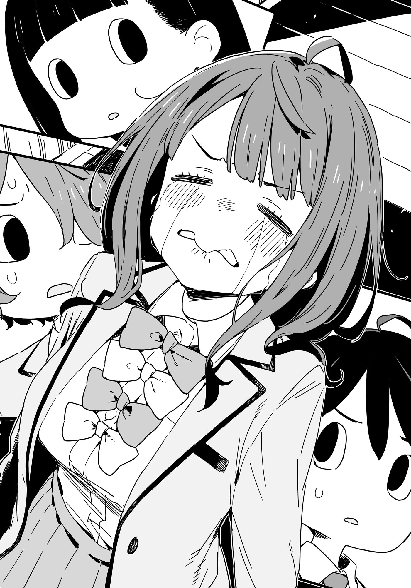

# Ch.80 — เล่ม 7 บทที่ 2-5

Ch.80 — เล่ม 7 บทที่ 2-5

By Monica

Published: 2025-05-16T13:48:52Z

Source: https://www.nekopost.net/novel/14560/80

เล่ม 7 บทที่ 2-5

วันถัดมาหลังเหตุวุ่นวายที่ห้าง AEON Mall Toyokawa (?)

หลังเลิกเรียน ผมเดินตรงกลับบ้านทันทีโดยไม่แวะที่ห้องชมรม

— คำสารภาพทั้งน้ำตาของชิราทามะซัง ความรู้สึกที่เธอมีต่อทานากะเซ็นเซ และความลับของเธอ

ต้องใช้เวลาอีกสักหน่อยเพื่อทำความเข้าใจกับเรื่องทั้งหมดนี้

[ ยินดีต้อนรับกลับค่ะ ท่านพี่ ]

เสียงฝีเท้าเบาๆ ของรองเท้าแตะดังขึ้น เป็นสัญญาณว่าคาจูกำลังเดินมาหา

[ กลับมาแล้ว คาจู วันนี้กลับบ้านเร็วเหรอ? ]

[ ใช่ค่ะ งานสภานักเรียนของโรงเรียนโมโมโซโนะเพิ่งเบาลงนิดหน่อย ]

[ เข้าใจแล้ว เธอคงยุ่งมากเลยสินะ ]

คาจูยืนขวางทางตอนที่ผมกำลังจะเข้าไปในห้องนั่งเล่น

[ ท่านพี่ จะไม่เปลี่ยนเสื้อผ้าก่อนเหรอคะ? ]

[ อยากดูอนิเมะที่อัดไว้—แต่ทำไมไม่ให้พี่เข้าไปในห้องนั่งเล่นล่ะ? ]

[ เดี๋ยวจะชงชาอุ่นๆ ให้ค่ะ ทำไมท่านพี่ไม่ไปเปลี่ยนเสื้อผ้าก่อนล่ะ? มีขนมข้าวเกรียบด้วยนะคะ ]

[ เดี๋ยวก่อนสิ— ]

คาจูกันผมเหมือนผู้เล่นบาสที่ป้องกันคู่แข่ง พร้อมกับพาผมเดินขึ้นบันไดไป

คาจูทำถึงขนาดนี้ ต้องมีอะไรบางอย่างในห้องนั่งเล่นแน่ๆ

ผมเดินไปที่ห้องของตัวเองอย่างเชื่อฟัง แต่ก็หยุดมือที่กำลังจับลูกบิดประตูไว้

— มีอะไรบางอย่างในห้องของผมเหรอ?

จากพฤติกรรมของคาจู คิดว่าน่าจะมีอะไรในห้องนั่งเล่น แต่ตอนนี้ก็มีอีกความเป็นไปได้หนึ่งแวบเข้ามาในหัว

เธออยากให้ผมไปที่ห้องของตัวเอง

หรือว่า…เธอเจอบางอย่างในห้องของผม ?

ไม่นะ หวังว่าไอ้ของที่อยู่ใต้พรมนั่นจะยังปลอดภัยอยู่

ผมเปิดประตูเข้าไปอย่างรีบร้อน

[ โอ๊ะ ในที่สุดก็กลับมาแล้ว นุคุมิซึคุง ]

[ นะ-นายมีความกล้ามากเลยนะ ที่มาปรากฏตัวในห้องนี้ได้ ]

คนที่ผมไม่อยากเจอที่สุดกำลังยืนอยู่ตรงนั้น

ยานามิ อันนะ และ โคมาริ จิกะ ทั้งคู่ก็กำลังรื้อชั้นหนังสือของผมอยู่ ได้โปรดหยุดเถอะ

[ พวกเธอสองคนมาทำอะไรที่นี่? ]

ผมเดินเข้าไปในห้อง พยายามทำตัวให้ใจเย็น ทั้งคู่หันมามองผมด้วยสายตาเรียบเฉย

[ ดูไม่ชัดหรือไง? นายหนีไปเมื่อวานโดยไม่อธิบายอะไรเลย เกิดอะไรขึ้นกับชิราทามะจัง? ]

[ น-นายคือศัตรูของผู้หญิง ]

ครั้งนี้ผมคงเถียงไม่ได้จริงๆ

...แต่เอาเข้าจริงๆ พอคิดดูแล้ว ผมก็ไม่ได้ทำอะไรผิดนี่ ใช่ ไม่ได้ทำอะไรผิดเลย

[ เดี๋ยวก่อนนะ ทั้งสองคน มันก็จริงที่ผมออกไปกับชิราทามะซังโดยไม่ได้พูดอะไร แต่มันมีเหตุผลนะ]

[ เหรอ? งั้นก็บอกมาสิว่ามีเหตุผลอะไรที่เธอซบไหล่ร้องไห้ในคาเฟ่แมว? ]

ผมพยักหน้าอย่างจริงจังตอบยานามิ

[ ใช่ มันมีเหตุผลว่าทำไมเธอถึงร้องไห้แถมซบไหล่… ]

[ -คาจูก็อยากฟังเหตุผลนั้นเหมือนกันค่ะ ]

[ อึก! ]

ผมสะดุ้งเมื่อได้ยินเสียงจากข้างหลัง หันไปก็เจอคาจูกำลังยิ้ม ถือถาดใส่ชาและขนมข้าวเกรียบ

[ คาจู มาตั้งแต่เมื่อไหร่? ]

[ เพิ่งมาค่ะ เอาชาอุ่นๆ มาให้แล้วค่ะ ท่านพี่ ]

คาจูเริ่มจัดชาบนโต๊ะ

[ ขอบใจนะ แต่พวกเรากำลังคุยเรื่องของผู้ใหญ่กันอยู่ ช่วยให้พื้นที่ส่วนตัวหน่อยได้มั้ย? ]

[ ไม่ต้องห่วงค่ะ คาจูเป็นผู้ใหญ่แล้ว ]

คาจูวางถ้วยชาถ้วยที่สี่ลงก่อนจะนั่งลงอย่างสบายๆ

ยานามิและโคมาริก็นั่งล้อมโต๊ะโดยที่ผมยังไม่ได้พูดอะไรเลย

[ เอ้า นุคุมิซึคุง มานั่งสิ ]

[ ยะ-ยอมแพ้เถอะ ]

[ ท่านพี่ ชากำลังจะเย็นนะคะ ]

โคมาริและคาจูตบเบาะเชิญชวน ยานามิกำลังเคี้ยวขนมข้าวเกรียบเงียบๆ พร้อมกับพยักหน้าให้ผม

...เอาจริงๆ ผมไม่อยากนั่งท่ามกลางพวกเธอเลย

แม้แต่คาจูที่ผมคิดว่าน่าจะช่วยกัน ก็ยังเข้าร่วมวงล้อมไร้ความปรานีนี้ด้วย

สุดท้าย ผทก็นั่งลงอย่างจำยอม ยานามิกลืนขนมข้าวเกรียบที่เหลือในปากลงไป ขอร้องเคี้ยวให้ละเอียดด้วยเถอะ

[ เอาล่ะ นุคุมิซึคุงใช้เวลาหนึ่งนาทีเต็มกว่าจะนั่งลง ]

ยานามิเริ่มพูดเหมือนครูใหญ่

[ เอ๋ หมายความว่ายังไง...? ]

[ นายขโมยเวลาเราไปสามนาที สามนาทีเท่ากับเวลาที่ใช้ต้มบะหมี่กึ่งสำเร็จรูปเลยนะ คิดดูสิ? ]

ไม่เห็นเหตุผลว่าทำไมต้องคิด และรู้อยู่แล้วว่าเธอจะเริ่มกินมันหลังผ่านไปแค่สองนาที

พอได้ยินยานามิพูดอะไรบ้าๆ แบบเดิม ผมก็เริ่มผ่อนคลาย พลางจิบชาร้อนช้าๆ

[ งั้นเริ่มจากตรงไหนดี? ถามอะไรก็ได้เลย ]

ยานามิหยิบขนมข้าวเกรียบชิ้นที่สองขึ้นมา แล้วเริ่มพูด

[ ก่อนอื่นเลย เมื่อวันอาทิตย์ พวกนายสองคนแอบหนีไปทำอะไรกัน? ]

[ อืม นั่นมันเรื่องส่วนตัว มีคำถามอื่นมั้ย ? ]

[ …… ]

กรอบแกรบ เสียงข้าวเกรียบในปากยานามิดังอย่างน่าพอใจเมื่อเธอกัดมัน

หลังจากที่เหลือบมองยานามิที่เงียบไปอย่างรวดเร็ว โคมาริก็โน้มตัวเข้ามาใกล้

[ ถ-ถ้างั้น ทำไมนายถึงทำให้ธะ-เธอร้องไห้ล่ะ? ]

อืม ยิงคำถามได้คมกริบเลยนะ โคมาริ

[ นั่นเป็นเรื่องระหว่างผมกับชิราทามะซัง เป็นสิ่งที่อยากเก็บไว้ลึกๆ ในใจ คำถามต่อไปเลย ]

ขณะที่ผมเอื้อมไปหยิบข้าวเกรียบ คาจูก็เลื่อนถ้วยข้าวเกรียบออกไปจากผม

[ ...หนูรู้สึกเสียใจมากเลยค่ะ ท่านพี่ ]

[ เอ๋? อะไรเหรอ? ]

คาจูส่งถ้วยข้าวเกรียบให้ยานามิพร้อมกับทำหน้าหม่นหมอง

[ ท่านพี่ หนูเสียใจที่ท่านเย็นชากับคาจู ท่านพี่ เคยบอกว่า สมาชิกชมรมวรรณกรรมก็เหมือนครอบครัว- ]

[ นายเคยพูดอะไรแบบนั้นด้วยเหรอ!? ]

ยานามิสะดุ้งจนกลืนข้าวเกรียบชิ้นที่สามลงไปโดยไม่ได้เคี้ยวให้ละเอียด

[ ...ไม่มีทาง ]

[ ท่านพี่ไม่ได้พูด แต่ดวงตามันบอกความจริงค่ะ ]

เข้าใจละ ดวงตาผมนี่เชื่อไม่ได้เลย

ตอนนี้สายตาสามคู่ที่เชื่อใจผมน้อยยิ่งกว่ากำลังจ้องมองมาที่ผม

[ มันไม่ใช่ว่าทำอะไรไม่ดีกับชิราทามะซัง... ]

ผมเริ่มพูดแก้ตัวไปแบบงงๆ แต่สีหน้าของพวกเธอไม่มีท่าทีเปลี่ยนเลย

ยานามิถอนหายใจแล้วหยิบการ์ดสีดำเล็กๆ ออกมาจากกระเป๋าของโคมาริ

[ ถ้าจะเล่นแบบนี้นะ นุคุมิซึคุง พวกเราก็คงไม่มีทางเลือกแล้ว ]

[ ...? นั่นอะไร? ]

[ SD Card มันถูกแปะไว้ใต้พรมในห้องนี้ ]

อ๊ะ เอามานี่เลย

ขณะทีผมเอื้อมไปคว้าการ์ดนั้น ก็สังเกตเห็นสายตาของคาจูและทำเป็นมองไปทางอื่นอย่างเนียนๆ

[ ...มันก็แค่ข้อมูลสำหรับจัดการเกรดของผม มันมีรหัสผ่านป้องกันไว้ ]

ยานามิส่งSD Card ให้คาจูโดยสีหน้าไม่เปลี่ยน

[ น้องสาวจัง พอจะมีไอเดียเกี่ยวกับรหัสผ่านมั้ย? ]

[ รหัสผ่านของท่านพี่ปกติจะเป็นวันเกิดของนักพากย์ที่เขาชอบ ให้หนูใช้เวลาสักหน่อยนะคะ ]

[ หา!? ]

แย่ละ ไม่ใช่แค่เพราะรูปภาพที่ผมสะสมไว้ แต่ชื่อโฟลเดอร์ที่จัดระเบียบไว้มันก็...มีปัญหาเหมือนกัน พอนึกดูดีๆ ชิราทามะซังก็พูดไว้ว่าผมเล่ารายละเอียดได้ถ้าจำเป็นที่คาเฟ่แมว ดังนั้น บอกพวกเธอไปคงไม่เป็นไร ใช่ ไม่มีปัญหาเลย...มั้ง

[ ...โอเคๆ งั้นจะพูดเอง จะเล่าทุกอย่างที่เกิดขึ้นในวันนั้นเลย ]

ผมทำสีหน้าจริงจังแล้วมองไปรอบๆ ใบหน้าของทั้งสามคน

พวกผู้ขู่แบล็กเมล์กลืนน้ำลายอย่างประหม่า

— และผมไม่ได้ขายน้องปีหนึ่งเพราะถูกแบล็กเมล์แน่นอน ไม่มีทาง

◇

[ …ปะ-ไปตายซะ ]

นั่นคือคำแรกที่มุ่งตรงมาหาผมหลังจากที่อธิบายจบ

โคมาริมองผมเหมือนเป็นเศษขยะขณะที่กำลังเคี้ยวข้าวเกรียบ

[ ฟังเรื่องที่เล่าไปบ้างมั้ยเนี่ย? เห็นชัดเจนเลยว่าไม่ผิด ผมเป็นรุ่นพี่ที่ดีที่คอยปลอบใจรุ่นน้องผู้กล้าหาญต่างหาก ]

ไม่มีใครเข้าใจผมเลยจริงๆ

ผมถอนหายใจพร้อมกับเอื้อมมือไปหยิบข้าวเกรียบ แต่คาจูก็หยิบชิ้นสุดท้ายไปก่อน

[ ท่านพี่ คนๆ นั้นไม่เหมาะสมกับท่านค่ะ มันเร็วเกินไปสำหรับท่านพี่ ]

[ แต่— ]

[ คาจูบอกว่าไม่ก็คือไม่ค่ะ ]

คาจูเบือนหน้าหนีพร้อมกับพองแก้มด้วยความขุ่นเคือง

ทำไมคาจูถึงเป็นแบบนี้ด้วยล่ะ? เฮ้อ ยานามิก็คงจะไม่พอใจถ้ายังเป็นแบบนี้ต่อไป

ผมเตรียมใจรับสิ่งที่แย่ที่สุด และหันไปหายานามิ แต่กลับพบว่าเธอกำลังซับน้ำตาด้วยผ้าเช็ดหน้า

[ …ฮึก นี่มันเกิดอะไรขึ้นกันแน่ ]

ผมประหลาดใจที่เห็นยานามิร้องไห้หนักมาก น้ำตาไหลจริงจัง

[ เอ๊ะ? ยานามิซัง เป็นอะไรเหรอ? ]

ยานามิเอนตัวมาข้างหน้าแล้วทุบโต๊ะต่ำเสียงดัง

[ นุคุมิซึคุง นายไม่รู้สึกอะไรบ้างเลยเหรอ? ฉันรู้สึกแย่มากๆกับชิราทามะจังนะ ! เราจะปล่อยให้คนทำลายความสัมพันธ์มาพรากเพื่อนสมัยเด็กของเธอไปไม่ได้! เราควรเขียนกฎหมายเรื่องนี้เลยนะ! ]

[ พี่สาวของชิราทามะซังก็เป็นเพื่อนสมัยเด็กเหมือนกัน ถ้าจะพูดจริงๆ ชิราทามะซังนั่นแหละที่เป็นตัวทำลายความสัมพันธ์ที่ควรโดนลงโทษตามกฎหมาย ]

[ หา? การลงโทษเพื่อนสมัยเด็กมันไม่แปลกไปหน่อยเหรอ…? ]

เพื่อนสมัยเด็กไม่ใช่อาวุธโกงแบบในเกมหรอกนะ

ยานามิสูดน้ำมูกพลางทำหน้าใช้ความคิดและเอียงคอด้วยความงุนงง

ถ้าจะปิดเรื่องนี้ลงก็ต้องตอนนี้แหละ นี่คือโอกาสเดียวของผม

[ ทั้งหมดที่อยากพูดก็พูดหมดแล้ว เราจบกันแค่นี้เถอะ ]

ผมพยายามลุกขึ้นยืน แต่โคมาริกับคาจูก็ดึงเสื้อผมไว้จากทั้งสองด้าน

[ ท่านพี่ คาจูยังฟังไม่หมดเลยค่ะ ]

[ หา? แต่พี่เล่าทุกอย่างที่เกิดขึ้นวันนั้นหมดแล้วนี่ ]

[ น-นายรู้ใช่มั้ยว่าทำไมเธอถึงโดนพักการเรียน? ]

โคมาริจ้องมาที่ผมด้วยสายตาเอาจริงเอาจังผ่านเส้นผมที่ปรกหน้า

[ อ่า ผมบอกว่าจะเล่าเรื่องที่เกิดขึ้น แต่ไม่ได้บอกว่าจะเล่าทุกอย่าง…เอาเถอะ จะเล่าหมดก็ได้ ]

ยอมแพ้ไปเลยดีกว่า

ผมอธิบายเหตุการณ์ทั้งหมดเกี่ยวกับชิราทามะซังที่แอบเข้าไปในสถานที่จัดงานแต่งงาน ก่อนจะดื่มชาที่เย็นชืด

[ นั่นแหละคือทุกอย่างที่รู้ ไม่มีความลับอะไรอีกแล้ว ]

[ ยอดเยี่ยมเลยค่ะ ท่านพี่ ]

คาจูลูบหัวผมด้วยท่าทางเอ็นดู น้องสาวของผมนี่ช่างใจดีจริงๆ

ส่วนยานามิที่ฟังอยู่ด้วยสีหน้าไม่อยากจะเชื่อ ก็เป่าจมูกเสียงดังแล้วโยนกระดาษทิชชูที่ใช้แล้วลงถังขยะ

[ นี่เธอโดนแค่พักการเรียนเองเหรอ? นั่นมันอาชญากรรมเลยนะ ]

ยานามิพูดสิ่งที่ดูมีเหตุผลขึ้นมาครั้งแรกอย่างน่าประหลาดใจ

แต่เธอโยนพลาด มันไม่เข้าถังขยะน่ะ …ช่วยเก็บหน่อยเถอะ

[ เธอแค่อยากใส่ชุดแต่งงานของพี่สาวแล้วถ่ายรูปในโบสถ์ มันเป็นความปรารถนาที่น่ารักมาก ดูเป็นผู้หญิงสุดๆ ]

[ ถึงอย่างนั้น การแอบเข้าไปในสถานที่จัดงานแต่งงานมันก็ไม่ปกติอยู่ดี ]

ใช่ มันไม่ปกติเลย ยานามิดูเหมือนจะใช้โควต้าคำพูดที่มีเหตุผลสำหรับปีนี้หมดแล้ว

ชิราทามะซังน่ารักก็จริง แต่เธอไม่ปกติเลย

นี่คือคำพูที่มาจากปากคนที่รายล้อมไปด้วยสาวแปลกๆเลยนะ

ไม่อาจปฏิเสธได้ว่าผมเมินความผิดปกติของชิราทามะซังไป เพราะอยากได้สมาชิกชมรมเพิ่ม

[ เอาล่ะ คิดว่าความกังวลของยานามิซังมีเหตุผลนะ ]

[ ใช่ การบังคับให้เธอเข้าชมรมอาจไม่ดีต่อทั้งสองฝ่าย— ]

[ ต-แต่! ]

ยานามิโดนโคมาริตัดบทด้วยเสียงแหลมสูง

พวกเราหันไปมองโคมาริด้วยความตกใจ เธอก้มหน้าและเริ่มขยับตัวอย่างประหม่า

[ ก-การพักการเรียนของเธอก็จบแล้ว ถ-ถ้าเรามุ่งไปที่อดีตของเธอมากไป มันอาจจะไม่ดี… ]

แม้จะดูขี้อาย แต่คำพูดของโคมาริก็หนักแน่น ผมพยักหน้าเห็นด้วย

[ ใช่ นั่นแหละสิ่งที่ผมอยากจะพูด ]

ยานามิมองผมด้วยสายตาที่บอกว่า “นายโกหกใช่มั้ย?”

แน่นอนว่าผมโกหก แต่ยังคงทำหน้าแน่วแน่ขณะมองพวกเธอทั้งสามคน

[ พวกเราไม่ควรตัดสินใคร เราเป็นนักเรียนโรงเรียนเดียวกัน และชิราทามะซังก็เป็นรุ่นน้องที่เราต้องดูแลตามคำขอของโคนุกิเซ็นเซ เราควรช่วยเธอเท่าที่จะทำได้ ]

ห้องเงียบไปทันที ผมพูดอะไรผิดหรือเปล่า?

ผมรู้สึกไม่สบายใจ ขณะที่มองยานามิที่หันไปสบตากับโคมาริ แล้วพูดขึ้น

[ อย่างที่ว่าไป เราเข้าใจสถานการณ์แล้ว งานแต่งยังไม่เกิดขึ้นใช่มั้ย? ถ้าเธอทำอะไรขึ้นมา ชมรมวรรณกรรมอาจต้องรับผิดชอบ ]

[ นั่นอาจจะจริง แต่ก็ยัง… ]

ขณะทีผมลังเล ยานามิก็ยักไหล่เหมือนจะบอกว่า “เอาเถอะ”

[ ถ้าอย่างนั้น เราจะคุยกับเธอเองดีๆ ]

[ เอ๊ะ จริงเหรอ? ]

[ ใช่ บางครั้งผู้หญิงก็เข้าใจกันเองได้ดีกว่า แบบนี้โอเคมั้ย? ]

ผมพยักหน้าและยานามิก็ยืดตัวอย่างสดชื่น

[ โอเค! เลิกคุยเรื่องเครียดๆ กันเถอะ ฉันเริ่มหิวแล้ว! ]

คาจูลุกขึ้นทันทีเมื่อได้ยินแบบนั้น

[ คาจูจะไปเอาชาเพิ่มแล้วก็เอาขนมมาด้วยค่ะ ]

[ ขอโทษนะจ๊ะน้องสาว ดูเหมือนจะเร่งเธอเลย ]

ยานามิโบกมือไปมาอย่างไม่ใส่ใจ

บอกว่า เหมือน เหรอ? เธอกำลังเร่งเธอจริงๆ น่ะสิ…

ผมหันไปหายานามิด้วยสีหน้าจริงจังหลังจากที่คาจูออกไปจากห้อง

[ แล้วยานามิซัง เรื่องSD Card นั่น… ]

[ อ๊ะ ]

ยานามิคลานไปหยิบกระดาษทิชชูที่ยับยู่ยี่จากพื้น

[ ฉันพันมันไว้กับทิชชูที่ฉันใช้สั่งน้ำมูกแล้ว นายยังอยากได้มันอยู่มั้ย? ]

ยานามิมองมาด้วยสายตาใสซื่อ ขณะที่ผมกลั้นความรู้สึกหลากหลายอย่างสุดความสามารถแล้วส่ายหัว

ยานามิยังคงมองมาด้วยสีหน้าไร้เดียงสาก่อนจะโยนทิชชูลงถังขยะอีกครั้ง
