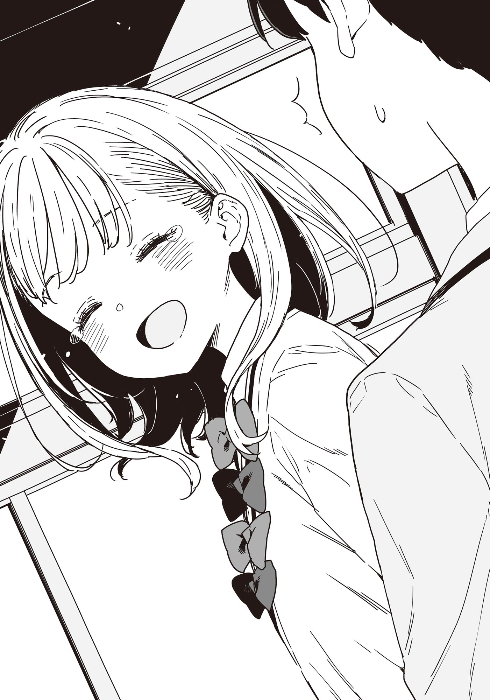

# Ch.81 — เล่ม 7 บทที่ 2-6

Ch.81 — เล่ม 7 บทที่ 2-6

By Monica

Published: 2025-05-16T13:49:03Z

Source: https://www.nekopost.net/novel/14560/81

เล่ม 7 บทที่ 2-6

บันทึกการสัมภาษณ์ ชิราทามะ ริโกะ ผู้สัมภาษณ์ ยานามิ อันนะ

ผู้ถูกสัมภาษณ์ ชิราทามะ ริโกะ (ต่อไปจะเรียกว่า ชิราทามะจัง) นั่งตัวเกร็งอยู่ตรงหน้าฉัน ความตึงเครียดของเธอทำให้ฉันเองก็รู้สึกเกร็งไปด้วย

ฉันยื่นถุงเยลลี่รวมให้เธอ และชิราทามะจังหยิบเยลลี่รูปทรงสี่เหลี่ยมขึ้นมา มือของเธอดูเล็กและบอบบาง ผิวขาวเนียนสวย สมกับชื่อของเธอจริงๆ

แต่บอกเลยนะว่าตอนอยู่ปีหนึ่งฉันเองก็สวยขนาดนี้ เชื่อฉันเถอะ

[ ขอบคุณค่ะ รุ่นพี่ นี่คือเยลลี่ที่มีเปลือกบางๆ กินได้ใช่มั้ยคะ? ฉันชอบพวกนี้มากเลย ]

ชิราทามะจังยิ้มอย่างมีความสุขขณะเปิดถุงเยลลี่

จริงๆ แล้วฉันก็เคยกินมาเยอะเหมือนกัน แต่เยลลี่ที่มีเปลือกบางๆ กินได้แบบนี้มันดีกว่าเยลลี่ที่เคลือบน้ำตาลธรรมดานะ

เพราะมันติดอยู่ในปากได้นาน เลยทำให้เพลิดเพลินกับรสชาติได้นานกว่า

[ พวกนี้ดังในโทโยฮาชิมากที่ใช่มั้ยคะ? ตอนแรกก็แปลกใจที่ที่อื่นส่วนมากมีแต่แบบเคลือบน้ำตาล ]

...หา? แบบที่เคลือบน้ำตาลน่ะ เป็นของหรูไว้กินในโอกาสพิเศษเท่านั้น คุณพ่อของฉันจะให้เป็นของขวัญวันเกิดตอนฉันยังเด็กเสมอ

ชิราทามะจังหัวเราะคิกเมื่อฉันเล่าเรื่องนี้ให้ฟัง

[ นี่เป็นครั้งแรกเลยค่ะที่ได้ยินแบบนั้น คุณพ่อของรุ่นพี่ดูสนุกดีนะคะ ]

ชิราทามะจังยิ้มพลางหยิบเยลลี่ใส่ปาก

ฉันควรจะเรียกประชุมครอบครัวเร็วๆ นี้แล้วล่ะ เอาล่ะ กลับมาที่เรื่องสำคัญก่อน

[ นี่ ชิราทามะจัง เรื่องเมื่อวันอาทิตย์... ]

ชิราทามะจังหยุดการเคลื่อนไหวทุกอย่างทันที

ขณะที่ฉันเริ่มพูดอีกครั้ง ชิราทามะจังก็โค้งหัวลงอย่างรวดเร็ว

[ ค่ะ ขอโทษที่ผูกขาดประธานเอาไว้ ฉันเสียใจกับสิ่งที่ทำไปค่ะ ]

[ ...ไม่เป็นไรนะ เธอจะทำอะไรก็ได้กับนุคุมิซึคุง ฉันก็ไม่ว่าอะไรหรอก ]

[ จริงเหรอคะ? ฉันนึกว่าตัวเองอาจจะล้ำเส้นไป เพราะประธานเป็นคนที่ยอดเยี่ยมมาก วันนี้ ฉันเตรียมใจโดนรุ่นพี่ยานามิดุมาแล้วค่ะ ]

...หา? เธอพูดอะไรออกมาเนี่ย?

เรียกนุคุมิซึคุงว่ายอดเยี่ยมเนี่ยนะ? เธอคงโดนบังคับให้พูดแบบนั้นแน่ๆ

ในฐานะรุ่นพี่ ฉันต้องชี้แนะรุ่นน้องให้ถูกทาง ฉันยืดตัวตรงและทำหน้าจริงจัง

[ ชิราทามะจัง ใจเย็นๆ แล้วฟังฉันดีๆ นะ เรากำลังพูดถึงนุคุมิซึคุงอยู่ใช่มั้ย? แน่ใจเหรอว่าเธอไม่ได้เข้าใจผิดไป? เขาน่ะเป็นพวกเข้าสังคมไม่เก่ง แถมยังเป็นพี่ชายที่คลั่งน้องสาวที่หนักกว่าฉันอีก- เอ่อ ช่างเถอะ ลืมประโยคสุดท้ายไปซะ ]

ชิราทามะจังเอียงหัวน่ารักๆ อย่างงุนงง

[ ...เอ่อ ฉันว่าประธานก็ดีอยู่นะคะ หรือว่า รุ่นพี่ยานามิกำลังคบกับประธานอยู่เหรอคะ? ]

อะไรนะ!? เธอพูดอะไรออกมาเนี่ย? ฉันลุกพรวดขึ้นทันที

[ เราไม่ได้คบกันอยู่นะ ! ทำไมถึงคิดแบบนั้นล่ะ? ฉันทำอะไรผิดไปหรือเปล่า? ]

...โอ๊ะ เผลอเสียอาการไปแปปนึง การระเบิดอารมณ์ของฉันทำให้ชิราทามะจังดูตกใจ

ถึงอย่างนั้นเธอก็ดูน่ารักอยู่ดี แต่เมื่อก่อนฉันก็เคยน่ารักแบบนี้เหมือนกันนะ

ฉันนั่งกลับลงไปและกัดเยลลี่เพื่อสงบสติอารมณ์

[ คือว่า ชิราทามะจัง ในชมรมวรรณกรรมของเราน่ะมีกฎห้ามคบกันอยู่ ดังนั้นมันไม่มีอะไรแบบนั้นหรอก แล้วอีกอย่าง นุคุมิซึคุงน่ะเป็นพวกลังเลจนน่ารำคาญ… เดี๋ยว เรากำลังพูดถึงอะไรอยู่นะ? ]

เอ่อ เรื่องอะไรนะ……….?

ชิราทามะจังเอานิ้วชี้แตะขมับ ทำหน้าลำบากใจ

เธอน่ารักมาก น่ารักจริงๆ แต่ตอนฉันเข้ามัธยมปลายใหม่ๆ ฉันก็น่ารักแบบนี้เหมือนกันนะ เชื่อสิ!

◇

ห้องโสตฯ หลังเลิกเรียน

ผมค่อยๆ เบือนสายตาออกจากหน้าจอมอนิเตอร์หลังจากอ่านรายงานของยานามิ

นี่มันรายงานอะไรกันเนี่ย?

[ ...ยานามิซัง ผมทำอะไรผิดไปเหรอครับ ? ]

[ การมีตัวตนของนายทั้งหมดนั่นแหละที่ผิดพลาด นุคุมิซึคุง ]

[ ศ-ศัตรูของผู้หญิง ]

ยานามิและโคมาริตำหนิผมด้วยเหตุผลอะไรบางอย่าง

ไม่ใช่ว่าพวกเธอควรจะไปคุยกันตัวต่อตัวกับชิราทามะซังเพื่อทำความเข้าใจเธอเหรอ...?

[ เอ่อ โคมาริ เธอคิดว่าไง? ชิราทามะซังบอกว่าผมยอดเยี่ยม ผมว่ามันแสดงว่าเธอมีสายตาที่เฉียบคมในการมองเห็นความจริงนะ ]

[ ต-ตาเธอก็คงเป็นรูโบ๋นั่นแหละ ]

โคมาริหันหน้าหนีอย่างไม่สบอารมณ์

ยานามิกลับมานั่งลงหน้าคีย์บอร์ดและเริ่มพิมพ์อีกครั้ง

[ ไม่ต้องเพิ่มเรื่องความนิยมของเธอลงไปในรายงานหรอก ยานามิซัง เรากำลังพยายามทำความเข้าใจตัวตนของชิราทามะซังอยู่ เรื่องพวกนี้ไม่สำคัญตอนนี้ใช่มั้ย? ]

ยานามิหยุดพิมพ์และหันมาจ้องผมเขม็ง

[ ทั้งหมดนี่มันเป็นความผิดของนาย นุคุมิซึคุง การที่นายหลงตัวเองเกินไปทำให้เธอเข้าใจผิดและคิดว่านายยอดเยี่ยม ]

การมีคนเข้าใจผิดว่ายอดเยี่ยมแบบนี้สักครั้งในชีวิตมันผิดมากเหรอ?

ขณะที่ผมกับยานามิยังเถียงกัน โคมาริก็ลุกขึ้นอย่างมุ่งมั่น

[ ฉ...ฉันจะไปคุยกับเธอเอง ]

...โคมาริ? เธอมองพวกเราจากด้านบนด้วยท่าทางมั่นอกมั่นใจ ทำเอาพวกเราประหลาดใจไปหมด

[ ผู้หญิง...ขะ-เข้าใจกันได้ดีกว่าอยู่แล้ว ]

[ เหมือนประโยคที่ได้ยินมาจากที่ไหนสักแห่งเมื่อวานนี้เลย ]

แต่ถ้าเธอมีแรงจูงใจแล้ว เราก็ควรปล่อยให้เธอจัดการ สู้ๆ นะ รองประธาน

◇

บันทึกการสัมภาษณ์ ชิราทามะ ริโกะ ผู้สัมภาษณ์ โคมาริ จิกะ

เธอกำลังทำการบ้านอยู่ตอนที่ฉันเดินเข้าไปในห้องชมรม

ฉันนั่งลงบนเก้าอี้ฝั่งตรงข้าม แต่ดูเหมือนเธอจะไม่ทันสังเกตเห็น

...ไม่มีทางเลือก ฉันเลยหยิบโทรศัพท์ขึ้นมาอ่านหนังสือ

[ อ๊ะ รุ่นพี่โคมาริ อยู่ที่นี่เอง น่าจะพูดอะไรสักหน่อยนะคะ ]

ผ่านไปเพียงไม่กี่นาทีเท่านั้น

เธอยิ้มอย่างเขินอายก่อนจะเก็บเครื่องเขียนใส่กล่องดินสอ เมื่อเห็นฉัน

[ วันนี้ทุกคนเป็นอะไรกันเนี่ย? พากันเข้าห้องชมรมทีละคน เหมือนกำลังถูกสัมภาษณ์เลย ]

เบื้องหลังรอยยิ้ม เธอกำลังซ่อนสายตาเหมือนสำรวจบางอย่าง

เธอรู้ตัวแน่ๆ ฉันจึงแสร้งทำเป็นอ่านโทรศัพท์ต่อด้วยท่าทางไม่ใส่ใจ

[ รุ่นพี่อยากคุยเรื่องวันอาทิตย์ใช่มั้ยคะ? ถามมาได้เลย ]

เธอเอ่ยขึ้นเอง บางทีอาจเป็นเพราะความกระวนกระวาย

ปกติแล้วนี่คงเป็นจุดเริ่มต้นที่ดีที่สุดในการสนทนา

แต่ในฐานะสมาชิกชมรมวรรณกรรม ฉันต้องเผชิญหน้ากับความเที่ยงตรงของคำพูดอยู่เสมอ

ในขณะที่ฉันกำลังคิดจะเปลี่ยนไปใช้การสื่อสารผ่านโทรศัพท์แทนบทสนทนา สถานการณ์ที่ไม่คาดคิดก็เกิดขึ้น

[ เอ่อ แบตโทรศัพท์จะหมดเหรอคะ? จะใช้สายชาร์จของฉันมั้ย? ]

แน่นอนว่าแบตโทรศัพท์ฉันใกล้หมดแล้วจริงๆ

ฉันไม่มีทางเลือก ต้องออกจากห้องไป—

◇

แล้วนี่รายงานอะไรอีก ?

หลังจากอ่านรายงานของโคมาริจบ ผมก็สบตากับยานามิที่ดูเหมือนจะมีอะไรจะพูด

[ โคมาริ อย่าบอกนะว่าเธอแค่นั่งเงียบๆ อยู่อย่างนั้น? ]

โคมาริสะดุ้งและพึมพำตอบด้วยเสียงสั่นๆ

[ ฉะ-ฉันทำดีที่สุดแล้ว... ]

[ ใช่ เธอทำดีที่สุดแล้วล่ะ นุคุมิซึคุง นายพูดแรงไปหน่อยหรือเปล่า? ]

ยานามิลูบหัวโคมาริเบาๆ

...จริงๆ นะ ยานามิ ผมรู้ว่าเธอก็คิดเหมือนกันนั่นแหละ

ผมสูดลมหายใจเข้าและหันมาทั้งคู่

[ เอาล่ะ ผมให้พวกเธอไปสัมภาษณ์ชิราทามะซัง แต่ดูเหมือนจะไม่ได้ผลตามเป้าหมายเลยนะ ]

[ เป้าหมาย? นายไม่ได้บอกเราเลยว่าเป้าหมายคืออะไร ]

ยานามิไขว้ขาแล้วมองผมด้วยสายตาท้าทาย

[ ก็ชัดเจนแล้วไม่ใช่เหรอ? เป้าหมายคือทำให้เธอเปิดใจ และให้เธอรู้ว่าเรายืนอยู่ข้างเธอ การรักษาด้วยการความเชื่อมโยงกับสังคมจะช่วยป้องกันไม่ให้เกิดเหตุการณ์ซ้ำรอยได้ ]

[ เดี๋ยวนะ ภารกิจของเราจริงจังขนาดนั้นเลยเหรอ? ]

ก็ใช่น่ะสิ ผมต้องการให้พวกเธอจริงจังมากกว่านี้นะ

[ เอาล่ะ ชิราทามะซังกำลังรออยู่ในห้องชมรม พวกเราควรจะ— ]

ผมหยุดพูดกลางคันเมื่อสังเกตเห็นสายตาของทั้งคู่

[ อะไรอีกล่ะ? ]

พวกเธอเอาแต่จ้องผมแทนที่จะตอบ

[ นี่ ถ้าพูดแบบนั้นล่ะก็ นุคุมิซึคุง นายเองนั่นแหละ ]

[ เอ๊ะ? หมายความว่าไง? ]

[ ต-ต่อไปเป็นตานายแล้ว ]

...ตาผม? หมายความว่าผมต้องไปสัมภาษณ์ชิราทามะซังงั้นเหรอ?

ผมโบกมือปฏิเสธทันที

[ ไม่มีทางหรอก ก็พูดตลอดนะว่าไม่เก่งเรื่องผู้หญิง ตอนนั้นไม่มีทางเลือกเพราะสถานการณ์บังคับ แต่การคุยกับเธอแบบตัวต่อตัวน่ะเป็นไปไม่ได้... เอ่อ พวกเธอเป็นอะไรเนี่ย? ]

ยานามิและโคมาริยืนขึ้นช้าๆ มองลงมาที่ผม

[ ห๊ะ? หา!? นี่คือคนที่บอกว่าไม่เก่งเรื่องผู้หญิงเหรอพวกนายดูสนิทกันดีเลยนี่ !? ]

[ ข-ขอโทษแมวซะ ]

เดี๋ยวนะ ทำไมพวกเธอถึงมาหาเรื่องผมล่ะ...?

[ แต่ชิราทามะซังคงไม่เปิดใจกับผู้ชายอย่างผมหรอก จริงมั้ย? ]

[ ในเมื่อเธอบอกว่านายเป็นประธานชมรมที่ยอดเยี่ยม เธอก็คงเหมาะกับนายที่สุดแล้วล่ะ ]

[ ศ-ศัตรูของผ-ผู้หญิง... ]

...สองคนนี้ชักจะกวนประสาทขึ้นเรื่อยๆ แล้วนะ

◇

ก๊อก ๆ ผมเคาะประตูห้องชมรม และเสียงของชิราทามะซังก็ดังออกมาจากข้างใน

[ เข้ามาได้เลยค่ะ ]

ผมเปิดประตูอย่างช้า ๆ และชิราทามะซังก็ต้อนรับผมด้วยรอยยิ้มที่ดูเป็นทางการ

[ เชิญนั่งตรงนั้นค่ะ ]

[ อ่า ครับ ]

ผมนั่งลงฝั่งตรงข้ามเธอตามที่เธอชี้

[ งั้นบอกชื่อและเหตุผลที่สมัครเข้ามาภายในหนึ่งนาทีด้วยค่ะ ]

หา? ผมจ้องเธอด้วยความงุนงง ขณะที่ชิราทามะซังยกมือขึ้นปิดปากแล้วหัวเราะเบา ๆ

[ ขอโทษนะคะ ฉากแบบนี้ทำให้นึกถึงตอนสัมภาษณ์สอบเข้าก็เลยอดล้อเล่นไม่ได้ ]

อ๋อ เข้าใจแล้ว เด็กน่ารักก็ทำเรื่องล้อเล่นน่ารัก ๆ แบบนี้เหมือนกัน

...ไม่สิ ตอนนี้ไม่ใช่เวลาจะมาชื่นชมเธอแล้ว

[ ขอโทษที่ทำให้บรรยากาศแปลกไปด้วยนะคะ ]

[ ไม่หรอก เป็นเรื่องธรรมดาที่รุ่นพี่จะเป็นห่วง บอกพวกเขาไปแล้วใช่มั้ย? ]

จู่ ๆ ชิราทามะซังก็ทำหน้าจริงจังขึ้นมา ผมเลยยิ้มแหย ๆ อย่างเลี่ยงไม่ได้

[ อืม ใช่ ฉันต้องบอกพวกเขาน่ะ... ]

[ ไม่ต้องห่วงหรอก แม้แต่ผมเองก็ยังคิดเลยว่าคนอย่างผมก็น่ากลัวจริง ๆ ]

เธอหัวเราะตัวเองเล็กน้อย ทำให้ผมชะงัก

...นี่มันเริ่มไม่ดีแล้ว ผมปรับสีหน้าให้จริงจังและหันไปหาชิราทามะซัง

[ อย่าเข้าใจผิดนะ พวกเราไม่ได้มาตำหนิเธอหรอก ชิราทามะซัง พวกเราแค่อยากรู้จักเธอมากขึ้น แล้วก็อยากทำให้ชมรมวรรณกรรมเป็นที่ที่เธอรู้สึกเหมือนอยู่บ้าน เอ่อ... ]

ผมพยายามหาคำพูดที่เหมาะสม แต่ก็ไม่มีคำพูดอะไรที่เข้าท่าโผล่มา

ในความรู้สึกเหมือนยอมแพ้ ผมตัดสินใจพูดต่อ

[ ทั้งโคมาริหรือผมเอง ตอนปีหนึ่งก็ไม่มีที่ของตัวเองในห้องเรียน ]

พอผมพูดเรื่องตัวเองขึ้นมา ชิราทามะซังก็เหมือนจะพูดอะไรบางอย่าง แต่สุดท้ายก็ปิดปากเงียบ

[ ไม่ได้บอกว่านั่นเป็นเรื่องไม่ดีหรอกนะ แต่ชมรมวรรณกรรมทำให้เรามีที่อยู่ มีเพื่อน และผ่านมันไป พอมองย้อนกลับไป ตอนนั้นก็ไม่ได้แย่เท่าไหร่ ]

ผมเกาแก้มตัวเองด้วยความอายหลังจากพูดจบ

หลังจากความเงียบ ชิราทามะซังก็พึมพำเบา ๆ

[ ...ทุกคนใจดีจังเลยนะคะ ]

[ ไม่หรอก มันไม่ได้ใจดีอะไรขนาดนั้นหรอก แค่ตอบแทนสิ่งที่เราได้รับก็เท่านั้นเอง... ]

ชิราทามะซังพยายามจะยิ้ม แต่สุดท้ายก็ทำไม่ได้

[ แต่...ฉันยอมแพ้กับความรู้สึกตัวเองไม่ได้ ]

[ เอ่อ หมายความว่า... ]

[ ฉันไม่ได้พยายามจะแย่งตัวพี่ชายไปหรอกค่ะ ...ฉันรู้ว่ามันเป็นไปไม่ได้ ]

น้ำเสียงเธอเจือด้วยความน้อยใจอีกครั้ง

[ แต่ฉันไม่อยากเสียใจทีหลัง อยากทำเต็มที่ ทิ้งร่องรอยไว้ แล้วก็ยอมรับความรู้สึกตัวเอง ]

เสียงของเธอต่ำและไร้อารมณ์

เมื่อการพึมพำที่แสนเงียบงันของเธอเติมเต็มห้องชมรม ผมจึงพูดขึ้น

[ งั้น... เธอกำลังวางแผนจะทำอะไร ? ]

ผมจำเป็นต้องถาม แม้ว่ามันจะดูไร้มารยาทก็ตาม

เด็กคนนี้มีประวัติทำผิดมาแล้วครั้งหนึ่ง ผมจะนั่งเฉย ๆ ไม่ได้ถ้าเธอคิดจะทำผิดอีก

[ ...ครั้งก่อน ฉันตั้งใจจะใส่ชุดของพี่สาวแล้วไปถ่ายรูปในโบสถ์ค่ะ แต่มีสองอย่างที่คำนวณพลาดไป ]

[ คำนวณพลาด? ]

ชิราทามะซังกระพริบตาก่อนจะกลับมาส่งยิ้มลึกลับแบบเดิม

[ อย่างแรกก็คือชุดนั้นไม่ได้ถูกนำมาที่สถานที่จัดงานจนกระทั่งใกล้เริ่มพิธี มันเลยเป็นการเดินทางที่เปล่าประโยชน์ ]

อ๋อ อย่างนี้นี่เอง รู้ไว้ก็ดี...

ผมปิดสมองแล้วพยักหน้าไป

[ อย่างที่สองคือฉันคิดว่าถ้าแอบเข้าไปตอนกลางคืนคงไม่มีใครสนใจ แต่พอเข้าไปปุ๊บ บริษัทรักษาความปลอดภัยก็มาทันที มืออาชีพนี่สุดยอดจริง ๆ นะคะ แป๊บเดียวฉันก็ถูกล้อมไว้ แล้วตำรวจก็ตามมา- ]

[ เดี๋ยว! เธอเข้าไปในอาคารได้ยังไง? ประตูมันล็อกไม่ใช่เหรอ? ]

ผมรีบเปลี่ยนเรื่องและชิราทามะซังก็ทำตาเป็นประกาย

[ ใช่ค่ะ ฉันใช้เครื่องมือทำเองไขประตู- ]

ให้ตายสิ เหมือนยืนอยู่กลางทุ่งระเบิดเลย

[ โอเค เปลี่ยนเรื่องกันเถอะ! ทำให้คนอื่นเดือดร้อนไม่ใช่เรื่องดีหรอกนะ ว่ามั้ย? ]

[ ค่ะ ฉันได้บทเรียนจากครั้งก่อนแล้วค่ะ ครั้งหน้าจะลองทำอะไรที่สงบกว่านี้ ]

เธอแตะหัวเบา ๆ พร้อมกับทำเสียง "เอะเฮะ"

รู้สึกแปลก ที่คิดว่าเธอไม่ได้สำนึกจริง ๆ แต่ขณะเดียวกันก็อดคิดว่าเธอน่ารักไม่ได้ อย่างไรก็ตาม สิ่งสำคัญคือเธอห้ามทำผิดกฎหมายอีกจริง ๆ นะ ขอร้องล่ะ

[ ไม่ต้องห่วงค่ะ ฉันจะไม่ทำให้ชมรมวรรณกรรมเดือดร้อน—ฉันจะรักษาระยะห่างเอง ]

[ ...เอ๊ะ? ]

เหมือนมีบางอย่างหลุดลอยไปจากมือผม ความรู้สึกไม่สบายใจก็เข้ามาแทน

[ เดี๋ยวก่อน- ]

[ จะให้ชมรมวรรณกรรมเดือดร้อนจากสิ่งที่ฉันจะทำไม่ได้ เพราะงั้น จากนี้ไปฉันจะจัดการเอง ]

เธอยืนขึ้นอย่างเงียบ ๆ พร้อมกับถือกระเป๋าไว้ในมือ

[ ไม่สิ เดี๋ยวก่อน- ]

[ ...ถ้าทุกอย่างผ่านไปด้วยดี แล้วยังอยู่ที่ซึวะบุกิได้ ฉันจะกลับมาที่นี่อีกครั้งได้มั้ยคะ ? ]

— ถ้าเธอยังอยู่ที่ซึวะบุกิได้

พูดอีกนัยหนึ่งคือเธอพร้อมจะทำบางอย่างที่อาจทำให้เธอถูกไล่ออก

ผมลุกขึ้นทันทีจนเก้าอี้แทบจะล้ม

[ เดี๋ยวสิ ชิราทามะซัง เธอไม่ควร...ทำแบบนั้นคนเดียวนะ ]

[ งั้น —ประธานจะมาทำเรื่องแย่ ๆ ด้วยกันมั้ยคะ ? ]

[ เอ่อ นั่นมัน... ]

— ผมเองก็เคยเป็นแบบนั้นมาก่อน

การรักษาระยะห่างจากคนอื่น พยายามที่จะอยู่คนเดียว

สมาชิกชมรมวรรณกรรมก็เหมือนกัน

มักจะตัดสินใจทุกอย่างด้วยตัวเอง พยายามแบกรับทุกสิ่งไว้เพียงลำพัง

แต่คนที่ยุ่งยากเหล่านั้นคือคนที่ยื่นมือมาหาผม—

ผมรีบก้าวเข้าหาเธอทันที แล้วจับแขนของเธอไว้

[ ไม่ได้นะ ชิราทามะซัง ]

คำพูดของผมทำให้ร่างของชิราทามะซังเกร็งขึ้น

[ ...ฉันไม่อยากสร้างปัญหาให้ทุกคน ]

เธอพูดเสียงเบา มองลงต่ำ

[ เธอจะสร้างปัญหาให้พวกเราเท่าไหร่ก็ได้ ]

ยานามิ ยากิชิโอะ โคมาริ รุ่นพี่คนอื่น ๆ และแน่นอน ผมด้วย

พวกเราต่างสร้างปัญหาให้กันมานับครั้งไม่ถ้วน

และถึงจะเป็นอย่างนั้น เราก็ยังอยู่ด้วยกัน และไม่เคยคิดเลยว่า—

เอ่อ บางทีอาจจะคิดว่า "น่ารำคาญ" ซักห้าหรือหกครั้ง แต่ไม่เคยเกลียดจริง ๆ

[ เวลาที่รู้สึกแบกรับบางอย่างไว้หนักเกินไป นั่นแหละคือเวลาที่ไม่ควรอยู่คนเดียว ผมจะอยู่ตรงนี้ และชมรมวรรณกรรมก็จะอยู่กับเธอด้วย เพราะงั้น... ]

ความเกร็งในแขนของชิราทามะซังก็ค่อย ๆ คลายลง

[ อยู่กับฉัน... แบบนี้จะดีจริง ๆ เหรอคะ...? ]

[ ใช่ แน่นอนสิ ]

ชิราทามะซังหันกลับมาอย่างรวดเร็ว

ดวงตาของเธอคลอด้วยน้ำตา ราวกับพร้อมจะไหลลงมา

[ งั้นพวกรุ่นพี่จะช่วยฉันใช่มั้ยคะ!? ]

ใช่ แน่นอ— เดี๋ยวก่อน ผมพูดแบบนั้นเหรอ?

สิ่งที่ผมหมายถึงคือ เธอไม่ควรอยู่คนเดียว และชมรมวรรณกรรมจะอยู่กับเธอ แต่เดี๋ยวก่อน ผมเผลอสัญญาว่าจะช่วยเธอไปจริง ๆ เหรอ...?

[ เอ่อ ก็ใช่อยู่ที่พูดว่าเราจะอยู่ด้วยกัน แต่ เอ่อ... ]

[ ขอบคุณค่ะ ฉันกังวลมากเลย ไม่คิดว่าจะมีใครพูดอะไรแบบนี้กับฉันได้เลย อ๊ะ ตายจริง ถ้าร้องไห้ตอนนี้จะดูเหมือนว่าแสร้งทำมั้ยคะเนี่ย? ]

ชิราทามะซังหัวเราะเบา ๆ ขณะที่เธอเช็ดน้ำตา

เธอน่ารักจริง ๆ แต่เดี๋ยวก่อน นั่นไม่ใช่สิ่งที่ผมหมายถึง—

ปัง! ประตูห้องชมรมเปิดออกอย่างแรง สองสมาชิกชมรมตัวเก๋าก็พุ่งเข้ามา

[ ชิราทามะจัง ขอยืมไอนี่หน่อยนะ! ]

[ อ-ออกมาเดี๋ยวนี้เลย! ]

[ เอ๊ะ- เดี๋ยว ]

ตัวผมที่ถูกเรียกว่าไอนี่ถูกลากออกไปในทางเดินอย่างไม่มีทางขัดขืน

[ นุคุมิซึคุง นายพูดจริงเหรอ!? นายจะช่วยเธอก่ออาชญากรรมจริง ๆ เหรอ!? ]

[ น-นายจะทำแบบนั้นจริง ๆ เหรอ!? ]

ยานามิใช้ปลายนิ้วจิ้มหน้าอกผม ขณะที่ผมที่มัดอยู่ของโคมาริดูจะขยับไปมาอย่างแรง

[ เอ่อ มันไม่ใช่ความตั้งใจของผมหรอก แต่รู้มั้ย บางครั้งมันก็...ไหลไปตามสถานการณ์ แบบว่า...บ-บรรยากาศน่ะ ]

[ นายไม่เคยอ่านบรรยากาศเลย แล้วทำไมต้องมาทำตอนนี้ด้วย!? นี่แหละคือเหตุผลที่นายต้องเรียนรู้การอ่านสถานการณ์นะ นุคุมิซึคุง! ]

[ ค-คิดถึงสิ่งที่นายทำด้วย ! ]

ช่วยหยุดวิจารณ์ผมทีเถอะสาวๆ

ขณะที่กำลังคิดหาทางรับมือ สุดท้ายประตูห้องชมรมก็เปิดออกช้า ๆ และชิราทามะซังก็โผล่ออกมามอง

[ ...เอ่อ ฉันสร้างปัญหาให้อยู่หรือเปล่าคะ? ]

ใบหน้าของชิราทามะซังแสดงความกังวล

พวกเราต่างสบตากันเงียบ ๆ และส่ายหัวอย่างจนปัญญา
