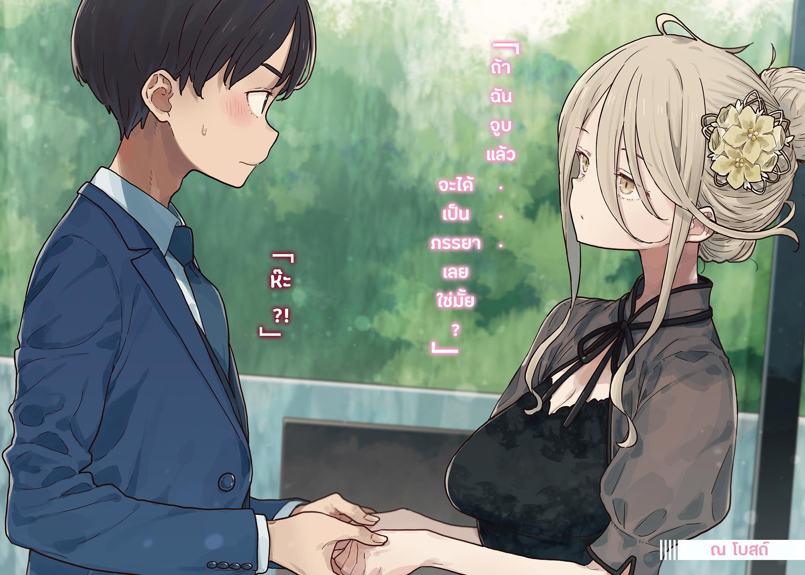

# Ch.85 — เล่ม 7 บทที่ 3-3

Ch.85 — เล่ม 7 บทที่ 3-3

By Monica

Published: 2025-05-16T13:50:32Z

Source: https://www.nekopost.net/novel/14560/85

เล่ม 7 บทที่ 3-3

ช่วงพลบค่ำที่สนามหญ้าในโรงเรียน หลังจากหลุดพ้นจากการไปเจอกับโคนุกิเซ็นเซ ผมถอนหายใจลึกๆ

...ผมเหนื่อยมาก อย่าถามรายละเอียดเลย ผมเหนื่อยสุดๆ

ผมประทับใจในความอดทนของอามานัตสึเซ็นเซและพี่สาวของชิราทามะซังที่ยังเป็นเพื่อนกับเธอได้

ขณะที่ผมยืนอยู่ที่นั่นและรับลม-

จิ๊บ จิ๊บ จิ๊บ…

ผมได้ยินเสียงนกจากที่ไหนสักแห่ง

มันไม่ใช่เสียงที่ไพเราะอะไรนัก แต่กลับมีความสงบในตัว

ถึงจะมองไม่เห็น แต่นกน่าจะมาจากพุ่มไม้ในสนามหญ้า

สักพักหนึ่ง ผมคิดจะไปตามหานก แต่ก็เลือกที่จะไม่ไป

แค่ได้ยินเสียงมันก็ทำให้รู้สึกสงบดีแล้ว ระยะห่างก็พอดี

สนามหญ้าเงียบๆ หลังเลิกเรียน ผมปิดตาลง ท่ามกลางเสียงนกและเสียงใบไม้พลิ้วไหว รู้สึกเหมือนหัวใจที่สกปรกจากเหตุการณ์ในห้องพยาบาลกำลังได้รับการชำระล้าง โอ๊ะ นั่นนกหัวขวานหรือเปล่า...?

ขณะที่ผมฟังเสียงอย่างตั้งใจ รู้สึกเหมือนยืนอยู่ในทุ่งหญ้าฤดูใบไม้ร่วง

ผมเหมือนจะได้กลิ่นหญ้าคลุ้งไปกับลม และค่อยๆ เปิดตาขึ้น

พอมองไปรอบๆ ก็เห็นชายในชุดสูทยืนเงียบๆ ประมาณสองเมตรจากผม

เขาคือทานากะเซ็นเซ คู่หมั้นของพี่สาวชิราทามะซัง

...เขากำลังมองผมอยู่เหรอ? ไม่ เขายืนอยู่ที่นั่น เหมือนคิดอะไรอยู่

นี่เป็นครั้งแรกที่ผมเห็นเขานอกเวลาเรียนนับตั้งแต่ที่ห้างสรรพสินค้าวันสุดสัปดาห์

ขณะที่ผมลังเลว่าจะเดินไปดีหรือไม่ ทานากะเซ็นเซก็ดูเหมือนจะสังเกตเห็นผม เขาดูตกใจเล็กน้อย

[ โอ๊ะ นุคุมิซึคุง มาทำอะไรที่นี่เหรอ ? ]

[ แค่คิดอะไรไปเรื่อยเปื่อยครับ แล้วเซ็นเซล่ะ? ]

[ พอดีได้ยินเสียงนกร้องเลยหยุดดู อาจจะเป็นนกไนติงเกลกลางพุ่มไม้ก็ได้ ]

เดี๋ยวนะ นั่นคือนกไนติงเกลเหรอ?

เมื่อเห็นผมสนใจ ทานากะเซ็นเซก็พูดเพิ่มขึ้นอีก

[ ปกติแล้วช่วงนี้ของปี พวกมันจะอยู่ในภูเขานี่คงจะเป็นตัวที่ค่อนข้างจะขี้เกียจหน่อย ]

[ รู้สึกคุ้นดีนะครับ ]

[ การไม่แสดงตัวออกมาเลยก็ดูสง่างามดีใช่มั้ยล่ะ ? ]

[ อ่า ครับ เข้าใจเลย ]

เรายืนอยู่ตรงนั้น ฟังเสียงนกไปสักพัก ก่อนที่ทานากะเซ็นเซจะพูดขึ้น

[ เกี่ยวกับวันนั้น... ]

[ อ๋อ ครับ ]

ผมรู้สึกตึงเครียดและรอฟัง และทานากะเซ็นเซก็ดูเหมือนจะลังเลอยู่พักหนึ่งก่อนจะพูดออกมา

[ .…..ขอโทษที่ขัดจังหวะนะ ]

มันเป็นคำพูดที่ธรรมดามากจนทำให้ผมรู้สึกแปลกๆ

[ ไม่เป็นไรครับ เอ่อ แล้วหลังจากนั้นพี่สาวคนนั้นเป็นยังไงบ้างครับ? ]

[ หมายถึงมิโนริซังใช่มั้ย? เธอก็ประหลาดใจเหมือนกัน ผมก็เหมือนกัน ]

เขาพยายามหัวเราะแต่ว่ากลับไอออกมา

[ ผมควรไปเอาน้ำมาให้มั้ยครับ? ]

[ ไม่ต้องหรอก ตอนนี้ไม่เป็นไรแล้ว... ]

เราทั้งสองคนยิ้มให้กันในบรรยากาศที่อึดอัด

[ งานแต่งงานของเซ็นเซสัปดาห์หน้าคงยุ่งน่าดูเลยสินะครับ? ]

[ อ่า ก็เดินไปมาอยู่แบบนี้แหละ เพราะไม่รู้จะสงบใจยังไง ]

เขามองปฏิกิริยาผมอยู่พักหนึ่งก่อนจะพูดออกมาอีกครั้งด้วยท่าทางยอมแพ้

[ นุคุมิซึคุง เธอได้ยินเรื่องริโกะจังบ้างมั้ย? ]

[ ได้ยินเรื่องการพักการเรียนของเธอกับเรื่องพี่สาวเธอครับ ]

ทานากะเซ็นเซพยักหน้าและเดินเข้ามาใกล้ผม

[ ..รู้สึกว่าริโกะจังดูห่างเหินมากขึ้นเรื่อยๆ เธอไม่ค่อยเห็นด้วยเรื่องที่ผมจะแต่งงานกับพี่สาวเธอ ]

ผมไม่ตอบอะไร แต่ก็ฟังทานากะเซ็นเซพูดต่อเหมือนพูดกับตัวเอง

[ เราทั้งสองคนเคยเหมือนพี่น้องกันมา ตอนนี้ผมจะไปแต่งงานกับคนที่เธอรักมาก มันก็เป็นเรื่องธรรมดาที่เธอจะรู้สึกขัดแย้ง ]

[ ...ก็ใช่ครับ มันก็คงจะซับซ้อนอยู่… โดยเฉพาะในช่วงวัยรุ่นของเธอ ]

ผมพยายามทำให้การสนทนาเบาๆ แต่มันก็ยังมีบางอย่างที่ทำให้มันติดอยู่ในหัว จนต้องพูดต่อไป

[ ...คิดว่าเธอแค่ต้องให้เวลาตัวเองสักพัก ]

ผมพูดออกไป ขณะที่ความคิดของผมเริ่มเป็นรูปเป็นร่าง

[ เรายังเป็นนักเรียนมัธยมกันอยู่ พอมีการเปลี่ยนแปลงในความสัมพันธ์กับพ่อแม่หรือพี่น้อง มันก็เหมือนกับโลกที่กำลังเปลี่ยนไป และรู้สึกว่ามันเป็นเรื่องใหญ่ ]

— จริงๆ ผมไม่สามารถเข้าใจการกระทำของชิราทามะซังได้เลย ผมไม่เข้าใจเลย

[ สำหรับริโกะจัง พี่สาวของเธอคือคนที่คอยมองเธออยู่เสมอ และเซ็นเซก็เหมือนพี่ชายใจดีจากย่านเดียวกันที่เป็นเหมือนครอบครัว ตอนนี้ความสัมพันธ์ทั้งสองนั้นกำลังเปลี่ยนไปพร้อมกัน มันก็เป็นเรื่องธรรมดาที่เธอจะรู้สึกไม่มั่นคง ]

— แต่ผมสัมผัสได้ว่าอะไรเป็นแรงผลักดันให้เธอเป็นแบบนั้น

ผมยิ้มให้ทานากะเซ็นเซด้วยรอยยิ้มที่คล้ายกับรอยยิ้มของชิราทามะซัง

[ เพราะงั้นเซ็นเซในฐานะพี่ชายของเธอก็ควรยืดหยุ่นและนิ่งเข้าไว้ครับ ]

ทานากะเซ็นพยักหน้า ขณะที่เขาฟังผม

[ ...อ่า ถ้าไม่สงบใจตัวเอง ริโกะจังก็จะยิ่งกังวลมากขึ้น ]

เขาพยักหน้าอีกครั้ง มองมาที่ผมด้วยท่าทางตกใจเล็กน้อย

[ ขอบคุณนะ เธอโตเกินอายุจริงๆ ]

[ เอ่อ ไม่หรอกครับ ผมแค่พูดอวดเก่งไปเรื่อยเอง ขอโทษครับ ]

[ ไม่เลยๆ โชคดีที่ริโกะจังมีคนอย่างเธอเป็นแฟน ]

ทานากะเซ็นเซเหมือนจะพูดกับตัวเองมากกว่าพูดกับผม เขาจ้องออกไปที่สนามหญ้าอย่าง เหม่อลอย

ฟังเสียงนกไป ผมก็นึกถึงรอยยิ้มของชิราทามะซังที่ปกปิดความรู้สึกจริงๆ ของเธอ

…เธอไม่มีโอกาสตั้งแต่ต้นเลย

แน่นอนว่าเธอไม่มีโอกาส เธออายุน้อยกว่าสิบห้าปี เป็นเด็กผู้หญิงที่เขารู้จักมาตั้งแต่เด็ก และเป็นน้องสาวของคู่หมั้นเขา

ไม่มีทางที่เขาจะมองเธอเป็นคนที่สามารถมีความสัมพันธ์ทางโรแมนติกด้วย

มันไม่ใช่เรื่องของการชนะหรือแพ้

ทานากะเซ็นเซเป็นคนซื่อสัตย์และใจดี เขาเป็นห่วงเป็นใยชิราทามะ ริโกะเหมือนกับเป็นน้องสาวจริงๆ

— และถึงอย่างนั้น ผมก็รู้สึกโกรธอยู่บ้าง

ผู้ชายคนนี้ไม่ได้ทำอะไรผิดเลย เขาแค่ไม่รู้สึกตัว

เขายังไม่ได้สังเกตความรู้สึกที่มีมาตลอด

แต่ในตอนนี้ ผมตัดสินใจที่จะอยู่ข้างชิราทามะซัง

ไม่มีเหตุผลพิเศษอะไรหรอก

แค่…ผมกำลังอยู่ในวัยรุ่นเหมือนกัน จะพูดแบบนั้นก็ได้

◇

วันแรกของโกลเด้นวีค วันหยุดยาว 5 วันเริ่มต้นด้วยท้องฟ้าโปร่งไร้เมฆและอากาศที่สมบูรณ์แบบ

ผมยืนอยู่หน้าสถานที่จัดงานแต่งงาน พลางปรับเนคไทด้วยความประหม่า

ผมมาที่นี่เพื่อเข้าร่วมทัวร์ โดยใส่สูทที่ยืมมาจากตู้เสื้อผ้าของพ่อแม่

…ผมจะทำได้จริง ๆ เหรอ?

การสวมบทบาทเป็นผู้ใหญ่ที่กำลังจะแต่งงานครั้งแรก ดูเหมือนจะเป็นเรื่องที่เป็นไปไม่ได้

เจลจัดแต่งทรงผมที่ใช้ให้ความรู้สึกเย็นและไม่สบาย ทำให้ผมยิ่งกังวลมากขึ้น

ขณะที่ผมยืนตัวแข็งอยู่ตรงนั้น มือสีขาวยื่นมารัดเนคไทของผมให้แน่นขึ้น

[ …เนคไท…จัดให้เรียบร้อย…หน่อยสิ ]

คนที่ช่วยคือชิกิยะซัง เธอรับบทเป็นคู่หมั้นของผม

เธอสวมชุดเดรสสีดำที่ดูสง่างาม ผมยาวของเธอถูกรวบขึ้นโดยติดเครื่องประดับลายดอกไม้ที่ด้านหนึ่ง

[ โทษที พอดีประหม่าไปหน่อย ]

ผมแอบมองสถานที่จัดงานผ่านไหล่ของชิกิยะซัง

เป็นบ้านที่ล้อมรอบด้วยกำแพง มีผนังด้านนอกที่ปูด้วยกระเบื้องหรูหรา

ทางเข้าซึ่งมีโทนสีขาวและน้ำตาล ถูกออกแบบให้ดูเรียบหรูและไม่เปิดเผยข้อมูลเกี่ยวกับภายในมากนัก

พอเหลือบมองไปรอบ ๆ ผมสังเกตเห็นสองเงาที่ขยับอยู่ในพงหญ้าสูงบริเวณลานจอดรถส่วนกลาง

เป็นอาซากุโมะซังที่ถือแล็ปท็อปและใส่หูฟัง และยานามิที่ถือเสาอากาศซึ่งดูเหมือนไม้เบสบอล

ลานจอดรถนี้มีหลายธุรกิจใช้ร่วมกัน ดังนั้นการมีคนอยู่แถวนั้นก็ไม่แปลก แต่พวกเธอดูเด่นเกินไป

[ รุ่นพี่ชิกิยะพวกเขาจะโอเคมั้ย ? ]

[ …พวกเขา…ไม่เป็นอะไร…เชื่อใจ…พวกเขา… ]

[ อ่า เดี๋ยวสิ- ]

ก่อนที่ผมจะทันได้ประท้วง ชิกิยะซังก็จับแขนผมและพาผมผ่านทางเข้าไป

โถงทางเข้ากว้างขวางและมีเพดานสูง ให้ความรู้สึกโปร่งโล่งกว่าที่ผมคาดไว้จากภายนอก

ตรงหน้าคือเคาน์เตอร์ที่มีพนักงานที่ดูเป็นมิตรกล่าวต้อนรับด้วยรอยยิ้มอบอุ่น

ผมสูดลมหายใจลึกและจงใจลดเสียงของตัวเองให้ต่ำลง

[ …ขอโทษครับ ผมชิมบาชิ ที่จองไว้ครับ ]

พนักงานที่ใส่ชุดยูนิฟอร์มหันไปมองแท็บเล็ตในมือ

[ ชิมบาชิ คาซึฮิโกะซัง กับ โยชิดะ ยูเมโกะซัง ใช่มั้ยคะ? เชิญขึ้นบันไดทางนั้นเลยค่ะ ]

ใช่แล้ว วันนี้ผมคือชิมบาชิ คาซึฮิโกะผู้ใหญ่หน้าใหม่อายุ 18 ปีที่กำลังจะแต่งงาน

และคนที่ยืนอยู่ข้างๆผมอย่างอ่อนหวานคือโยชิดะ ยูเมโกะเธอทำงานที่ร้านดอกไม้และเป็นคู่หมั้นอายุ 20 ปีของผม

ยูเมโกะที่กำลังมองไปรอบ ๆ อย่างเลื่อนลอย อยู่ ๆ ก็พิงหัวลงมาที่ไหล่ของผม กลิ่นหอมจากเธอทำให้ผมคิดว่าอยากให้เวลาหยุดลงตรงนี้

[ ให้เรา…ส่งของขวัญ…แต่งงาน…ที่ไหน? ]

[ ไม่ครับ วันนี้เราแค่มาทัวร์ ยังไม่มีพิธีอะไร ]

…ดูเหมือนเธอจะไม่ได้ฟังคำอธิบายของพวกเราเลย

เราทิ้งเคาน์เตอร์ต้อนรับไว้ข้างหลังและมุ่งหน้าไปยังบันไดด้านหลัง ก่อนที่เธอจะพูดอะไรออกมาอีก

[ รุ่นพี่ ประธานบอกอะไรไปบ้างครับ ? ]

[ ห้ามพูด…สุภาพมาก….. ]

อ่า ใช่ ถ้าใช้คำพูดสุภาพตอนเราหมั้นกันแล้วมันก็ดูแปลกๆ

[ ยูเม…โกะ ได้ยินอะไรจากโฮโคบารุซังบ้าง? ]

[ เหมือนว่า…ฉันกำลังจะ…แต่งงาน ประมาณนั้น…ที่ฉันเข้าใจ… ]

สิ่งที่เธอเข้าใจมันผิดมากนะ

ขณะที่ผมครุ่นคิดถึงความยากลำบากในการสื่อสาร ชิกิยะซังก็มองมาที่หน้าของผมอย่างตั้งใจ

[ มีอะไร…หรือเปล่า? ทำไมถึงจ้องหน้าผมล่ะ? ]

[ คุยกับนาย…แบบนี้…รู้สึก….แปลกใหม่ดี… ]

ชิกิยะซังเริ่มเล่นกับผมของผมพลางทำหน้าสนุก

[ เฮ้ หยุดนะ- หยุดเถอะ ]

[ …เขินเหรอ…? ]

เอ๊ะ ชิกิยะซังเป็นแบบนี้ตลอดเหรอ?

ขณะที่ผมคิดเรื่องนั้น เสียงที่ดูหงุดหงิดก็ดังขึ้นในหูของผม

< ฮัลโหล!? พวกเราได้ยินทุกอย่างนะ!? >

เสียงของยานามิแทรกมาผ่านทางหูฟัง พวกเธอควรจะเป็นคนแนะนำเรา แต่ดูเหมือนจะสร้างความลำบากมากกว่า

[ ถ้าเธอไม่อยากฟังก็- เฮ้ ยูเมโกะ หยุดเล่นได้แล้ว ]

< เฮ้ย !? พวกเธอทำอะไรกัน- >

ผมปิดหูฟังและก้าวเข้าไปในห้องขนาดใหญ่ที่ใช้สำหรับการประชุมข้อมูล

...อ้อ แล้วก็ ผมปล่อยให้ชิราทามะซังอยู่ข้างหลัง เพราะเธอมีประวัติอยู่แล้ว……..

◇

— ย้อนกลับไปสักหน่อย สองชั่วโมงก่อนหน้านี้ ในห้องชมรมวรรณกรรม

ยานามิและอาซากุโมะซังมองผมในชุดสูท ก่อนจะสบตากันและพยักหน้าด้วยสีหน้าที่ซับซ้อน ถ้ามีอะไรจะพูดก็ช่วยพูดออกมาเถอะ

ชิราทามะซังมองผมตั้งแต่หัวจรดเท้า ก่อนจะยิ้มพลางประสานมือไว้ข้างหน้า

[ ประธานดูดีมากค่ะ ที่เค้าว่าผู้ชายจะดูดีขึ้น 30% เมื่อใส่สูท เป็นจริงสินะคะ ]

ขอบคุณนะ แต่ผมรู้ว่าเธอโกหก ผมเริ่มเข้าใจชิราทามะซังมากขึ้นนิดหน่อยแล้ว

ข้าง ๆ ผมชิกิยะซังในชุดเดรสที่ดูโตเป็นผู้ใหญ่ มีกลิ่นน้ำหอมที่หอมละมุน

อาซากุโมะซัง ซึ่งมีแผ่นแปะลดไข้แปะอยู่ที่หน้าผาก วางบางสิ่งลงบนโต๊ะ

เป็นหูฟังไร้สายอันหนึ่งที่วางอยู่ตรงหน้าผม

[ ช่วยใส่หูฟังอันนี้ด้วยค่ะ นุคุมิซึซัง ฉันจะคอยให้คำแนะนำผ่านเจ้านี่ ]

[ เสียงของผมจะส่งไปถึงพวกเธอด้วยเหรอ? ]

[ ค่ะ หูฟังนี้มีไมโครโฟนในตัว เราจะได้ยินเสียงนุคุมิซึซังด้วยค่ะ ]

ตรงหน้าของชิกิยะซังคือเครื่องประดับผมลายดอกไม้ชิ้นหนึ่ง

ชิกิยะซังหยิบมันขึ้นมาดูด้วยความสงสัย

[ นี่คือ….อะไรเหรอ ? ]

[ มันมีกล้องแบบรอบทิศฝังอยู่ค่ะ รุ่นพี่ช่วยใส่เครื่องประดับผมอันนี้ด้วยนะคะ ]

เพราะงั้นผมจะเป็นหู ส่วนชิกิยะซังจะเป็นตา

ชิราทามะซังที่มองไปรอบ ๆ อย่างกระสับกระส่ายค่อย ๆ ยกมือขึ้น

[ เอ่อ แล้วฉันล่ะคะ...? ]

[ ริโกะซัง คิดว่าถ้าเธอไม่ไปปรากฏตัวที่สถานที่จัดงานจนกว่าจะถึงวันพิธีน่าจะดีที่สุด ขอโทษด้วยนะคะ ช่วยรออยู่ที่นี่ก่อนค่ะ ]

การประชุมข้อมูลจะเริ่มตอน 10 โมงเช้า หลังจากการอธิบายทั่วไปจะเป็นช่วงให้คำปรึกษาแบบรายบุคคล

…และนี่คือจุดสำคัญ เพราะมันเป็นไปไม่ได้ที่นักเรียนมัธยมปลายจะปลอมตัวเป็นผู้ใหญ่ได้อย่างสมบูรณ์แบบ

การเตรียมการอย่างละเอียดจึงเป็นสิ่งที่จำเป็นในการทำสิ่งที่เป็นไปไม่ได้ให้เป็นไปได้

อาซากุโมะซังเขียนแผนการลงบนไวท์บอร์ดเป็นหัวข้อย่อย

เรื่องราวคือ ชิกิยะซังกับผมจำเป็นต้องจัดงานแต่งงานอย่างเร่งด่วนในฐานะผู้ใหญ่ที่ทำงานแล้ว เนื่องจากเหตุสุดวิสัย

ที่อยู่ หมายเลขโทรศัพท์ สถานที่ทำงาน โปรไฟล์ของพ่อแม่ งบประมาณ แผนงานแต่ง…

หลังจากอาซากุโมะซังเขียนเสร็จ เธอก็ไอเบา ๆ เพื่อเรียกความสนใจ

[ ในวันธรรมดาเรามีเวลาไม่มาก ดังนั้นหยุดยาวนี้สำคัญมากค่ะ ]

[ เดี๋ยวนะ แต่เธอไม่มีแผนอะไรเลยเหรอ อาซากุโมะซัง? อย่างไปเดทกับอายาโนะ? ]

[ …เขาไปเข้าค่ายเรียนพิเศษช่วงหยุดยาวนี้ค่ะ ]

แสงบนหน้าผากของอาซากุโมะซังดูเหมือนจะจางลง

[ เขาตั้งใจจะไม่บอกอะไรเลย แล้วพยายามเอาชนะฉันในการสอบครั้งหน้า ฉันไม่ต้องการเซอร์ไพรส์แบบนั้นเลยค่ะ ไม่ต้องการจริง ๆ ]

สมกับเป็นอายาโนะที่ยังซื่อบื้อเหมือนเคย

เมื่อผมหันไปมองข้าง ๆ ก็เห็นชิกิยะซังกำลังจ้องเครื่องประดับผมอย่างตั้งใจ

[ เอ่อ รุ่นพี่ชิกิยะ เข้าใจสถานการณ์ตอนนี้แค่ไหนครับ ? ]

[ ฉัน…ได้ยินทุกอย่าง…จากโฮโคบารุแล้ว ]

ผมไม่ไว้ใจเธอทั้งหมด แต่ถ้าเธอบอกว่าโอเค งั้นก็คงโอเคล่ะมั้ง

ใช่แล้ว ถ้าผมยังมานั่งกังวลกับเรื่องแบบนี้ ผมคงไม่เหมาะที่จะเป็นประธานชมรมวรรณกรรมแน่ ๆ

◇

— การทัวร์วันนี้ที่เริ่มต้นแบบนั้น โดยรวมแล้วดำเนินไปได้อย่างราบรื่น

เราผ่านช่วงการให้คำปรึกษารายบุคคลมาได้สำเร็จ ตอนนี้เรากำลังเดินไปตามทางเดินพร้อมกับ "แผนแนะนำ" ที่เตรียมไว้ให้เรา โดยเดินปะปนไปกับผู้เข้าร่วมคนอื่น ๆ

[ อยากให้มีดอกไม้ไฟทั้งตอนเริ่มและตอนจบ แต่ไม่รู้ว่างบประมาณจะพอมั้ย ยูเมโกะ มีอะไรที่สนใจมั้ย? ]

[ ฉัน…อยากทุบ…ถังเหล้าสาเก…]

[ ฟังดูดี เอาไว้คุยกันคราวหน้าละกัน ]

พวกเราเริ่มสนุกไปกับมันจริง ๆ ต้องขอบคุณคำอธิบายอย่างละเอียดของผู้ประสานงาน มีเพียงปัญหาเดียวก็คือ ทั้งงานแต่งและคู่แต่งงานไม่ได้มีอยู่จริง

ในขณะที่ผมกำลังพูดคุยเรื่องรายละเอียดของงานแต่งกับชิกิยะซัง…

< ทำไมฉันได้ยินแต่เรื่องไร้สาระ แล้วภารกิจล่ะ!? นายเป็นนกขมิ้นที่ลืมวิธีร้องเพลงหรือไง!? >

...มีคนทำลายบรรยากาศจนได้

ผมยกมือปิดปากเล็กน้อยและตอบคนที่ว่า

[ เรากำลังจะเริ่มการทัวร์สถานที่จัดงาน ยานามิซัง อย่าลืมดูภาพและให้คำแนะนำอย่างเหมาะสมด้วยล่ะ ]

[ ขอโทษนะคะ นี่อาซากุโมะเอง ภาพมันสั่นมาก ช่วยปรับหน่อยได้มั้ยคะ? ]

คราวนี้เป็นอาซากุโมะซัง เธอรู้มั้ยว่าเราก็ไม่ได้เป็นมืออาชีพนะ มันยากที่จะ—

[ มี…ปัญหา…เหรอ? ]

ชิกิยะซังเอียงคอถามด้วยความสงสัย

…อ้อ ใช่ กล้องมันติดอยู่กับเครื่องประดับผมของชิกิยะซังนี่เอง

[ ช่วยอดทนหน่อยนะ มันเป็นฟีเจอร์พิเศษ ]

ผมจบการสนทนาและเดินตามไกด์ออกไปด้านนอกอาคาร

เราเดินเข้าสู่สถานที่จัดงานแต่งงานแบบสวนกลางแจ้ง พื้นปกคลุมด้วยหญ้าและมีชุดโซฟาตั้งอยู่รอบ ๆ

สวนล้อมรอบด้วยกำแพงสูงกว่าผม ทำให้ไม่สามารถมองเห็นภายนอกได้

และที่นั่นคือโบสถ์

ในวันพิธี ชิราทามะซังและทุกคนจะลอบเข้าไปถ่ายรูปกับทานากะเซ็นเซที่นั่น

ขณะที่ผมจ้องมองไปที่อาคาร ผู้ประสานงานที่สัมภาษณ์เราก่อนหน้านี้ก็เดินเข้ามา

[ ต้องการดูรอบ ๆ มั้ยคะ? ]

[ เอ๋? ได้เหรอครับ? ]

[ แน่นอนค่ะ เชิญตามฉันมาเลย ]

เราตามไกด์ไป โดยเดินข้ามสะพานที่ทอดผ่านลำคลอง

ชิกิยะซังที่กำลังจ้องมองหญ้าอยู่ เดินตามผมมาทัน

[ พวกเรา…เล่นบทเจ้าสาวเจ้าบ่าว….ที่นี่เหรอ? ]

อะไรนะ? ฟังดูสนุกดี แต่ไม่ใช่ตอนนี้

[ เราแค่จะดูโบสถ์น่ะ ยูเมโกะ เธอช่วย…ยืนตัวตรงหน่อยได้มั้ย? ]

[ งั้นฉันจะ…เกาะแขนนาย… ]

[ อ๊า! ]

ชิกิยะซังเอื้อมมือมาเกี่ยวแขนผมไว้

กลิ่นน้ำหอมที่หอมละมุนและความนุ่มนวลที่อธิบายไม่ถูกที่กดเข้ากับแขนของผม—

< อะแฮ่ม ! อะแฮ่ม ! >

เสียงไอหนัก ๆ ของยานามิดังผ่านหูฟังมา หยุดเดี๋ยวนี้เลย…

เราตามไกด์เข้าไปในโบสถ์

ภายในมีทางเดินตรงยาวไปด้านหลัง โดยมีม้านั่งเรียงอยู่ทั้งสองฝั่ง

ที่ด้านหลังสุดของโบสถ์ นอกหน้าต่างบานใหญ่ มีน้ำตกเล็ก ๆ ไหลเหมือนม่านน้ำ

หน้าต่างบานใหญ่ด้านข้างก็ช่วยให้แสงนุ่มนวลส่องเข้ามา สร้างบรรยากาศที่เหมือนหลุดมาจากโลกแฟนตาซี

เพดานที่มีแสงสลัวจากไฟทางอ้อม มีพัดลมเพดานหมุนช้า ๆ เพิ่มการเคลื่อนไหวที่อ่อนโยนในบรรยากาศที่สงบและเงียบสงบ เป็นสถานที่ที่สงบจริง ๆ ถ้าจะพูดก็ต้องพูดแบบนั้น

ผมเดินไปตามทางเดินในโบสถ์โดยมีชิกิยะซังคล้องแขน—เดี๋ยวนะ นี่ควรเป็นหน้าที่ของพ่อเจ้าสาวไม่ใช่เหรอ?

ที่ปลายทางเดินคือเจ้าบ่าวที่จะเข้าพิธีวิวาห์กับยูเมโกะ โยชิดะ พนักงานร้านดอกไม้วัย 20 ปี ให้อภัยไม่ได้จริงๆ

ขณะที่เราเดินมาถึงท้ายโบสถ์ด้วยความโกรธเคืองในใจ ผมก็ตระหนักถึงข้อเท็จจริงสำคัญข้อหนึ่ง

— ไม่มีที่ซ่อนเลย

ม้านั่งสำหรับผู้ร่วมงานมีพนักเปิดโล่งให้ความรู้สึกเปิดกว้าง และผนังนั้นเรียบไม่มีส่วนยื่นออกมาให้บังสายตาได้

แม้ว่าเราจะพาทานากะเซ็นเซมาที่นี่ แต่ชิราทามะซังจะเข้าหาเขาได้ยังไงกัน?

< นุคุมิซึซัง มีเฟอร์นิเจอร์หรือที่ซ่อนอะไรมั้ย? >

เสียงจริงจังของอาซากุโมะซังดังผ่านหูฟัง เหมือนเธอจะเข้าใจสถานการณ์

[ ถึงจะถามแบบนั้นก็เถอะ… ]

ในโบสถ์นี้ไม่มีเครื่องเสียงหรือชั้นวางของเลย อาจเป็นเพราะต้องการรักษาบรรยากาศให้ดูดี เครื่องจักรต่าง ๆ จึงถูกซ่อนไว้หมด

ในห้องนี้ไม่มีที่ซ่อนเลย—ไม่สิ ยังมีที่หนึ่ง

ด้านหน้าของโบสถ์มีแท่นยืนเล็ก ๆ คล้ายโพเดียม อาจจะเรียกว่าแท่นเทศน์ก็ได้…

ผมพากล้องเคลื่อนที่ หรือก็คือชิกิยะซัง เข้าไปใกล้แท่นนั้น

มันเป็นแท่นไม้ธรรมดาที่มีด้านหลังกลวง

แม้ว่าจะไม่ใหญ่ แต่ก็น่าจะพอซ่อนตัวจากมุมมองด้านหน้าได้

ผมใช้ฝ่ามือวัดขนาดอย่างลับ ๆ แล้วก็ถอยออกมาจากแท่นเทศน์เพื่อไม่ให้ดูเป็นที่ผิดสังเกต

จากนั้น ผมก็กะระยะขนาดพื้นที่โดยใช้การก้าวเดิน

[ โอเค ยูเมโกะ ไปกันเถอะ ]

ชิกิยะซังเอียงคอด้วยความสับสนกับคำพูดของผม

[ พวกเรา…ไม่ได้จะเล่น…..บทเจ้าสาวกับเจ้าบ่าว…เหรอ? ]

[ ไม่หรอก เราอยู่ในที่สาธารณะ— ]

เมื่อผมเหลือบมอง ก็เห็นผู้ประสานงานยืนอยู่ที่ทางเข้า พร้อมกับยิ้มเงียบ ๆ ก่อนจะเดินออกไป

เดี๋ยวนะ ท่าทีแบบนี้มันหมายความว่าอะไร?

ขณะที่ผมยืนงง ชิกิยะซังก็คว้ามือผมและหันหน้าเข้าหาผมตรงแท่นเทศน์

[ เราควร…ทำอะไร…ต่อดี…? ]

[ เอ่อ นักบวชจะอยู่ตรงนี้ แล้วเราก็จะแลกแหวนและสาบานรักนิรันดร์ หรือไม่ก็… ]

[ แล้ว….หลังจากนั้น…ล่ะ? ]

อะไรนะ? หลังจากนั้น? หลังจากแลกแหวนและกล่าวคำสาบานเสร็จ สิ่งต่อไปก็คือ…

ผมกลืนน้ำลาย

[ ถัดไปก็คงเป็นจูบแต่งงานหรืออะไรแบบนั้น— ]

< พวกเธอสองคนกำลังทำอะไรอยู่!? ฉันได้ยินทุกอย่างนะ! >

เสียงดังลั่นของยานามิดังขึ้นในหูฟัง ผทลืมผู้หญิงคนนี้ไปสนิทเลย

[ ก็แค่อยากลองสัมผัสบรรยากาศจริงน่ะ การจำลองสถานการณ์มันสำคัญนะ ]

< จูบไม่ใช่ส่วนหนึ่งของแผนสักหน่อย! >

ใช่ มันไม่ใช่ ผมรู้สึกโล่งใจเล็กน้อยที่ยานามิพูดแทรกขึ้นมา

ถึงแม้จะเป็นแค่การแกล้งเล่น แต่การเผชิญหน้ากับชิกิยะซังแบบนี้มันทำให้ประหม่าเกินไป ขณะที่ผมกำลังถอยห่างออกมา มือขาวซีดของชิกิยะซังก็ยื่นออกมาแล้วหยิบหูฟังของผมไป

[ ถ้าฉันจูบแล้ว…..จะได้เป็นภรรยาเลยใช่มั้ย...？ ]

[ ห๊ะ!? ]

ชิกิยะซังเก็บหูฟังของผมไว้ในอก แล้วโน้มตัวเข้ามาใกล้

ภาพสะท้อนใบหน้าของผมในดวงตาสีขาวของเธอขยับเข้ามาเรื่อย ๆ

[ ต้องแต่งงานกันก่อนถึงจะเป็นภรรยาได้นะ! ]

เสียงของผมสั่นพร่าเมื่อพูดจบ และชิกิยะซังก็หยุดขยับเข้ามาใกล้

[ ถ้าจะเป็นภรรยาการจดทะเบียนสมรสมันสำคัญกว่าการจูบไม่ใช่เหรอ？ ]

[ ทะเบียน...สมรส... ]

หลังจากหยุดคิดอยู่ครู่หนึ่ง ชิกิยะซังก็พยักหน้าอย่างช้า ๆ

[ เอาชนะ…รัฐบาลไม่ได้ ]

ด้วยความเข้าใจที่แปลกประหลาด ชิกิยะซังเริ่มเดินโซเซไปทางประตูโบสถ์

ผมรีบก้าวตามและเดินไปข้างเธอ ชิกิยะซังก็ส่งหูฟังกลับมาให้

อ๊ะ ผมควรรักษาการติดต่อไว้ ไม่งั้นยานามิคงจะเอาเรื่องอีก ผมใส่หูฟังกลับเข้าไปในหู

พอมาคิดดู นี่มันเพิ่งอยู่ในอกของชิกิยะซังเลยสินะ...

รู้สึกใจเต้นแปลก ๆ กับความคิดนั้น ผมเปิดประตูโบสถ์หนัก ๆ และพบกับผู้ประสานงานที่ยืนรออยู่ด้วยรอยยิ้มกว้าง

[ อ๊ะ ขอโทษที่ทำให้รอนะครับ ]

[ ถ้าอย่างนั้น ขอเชิญไปที่ห้องจัดเลี้ยงค่ะ วันนี้คุณทั้งสองจะได้ลองชิมเมนูอาหารคอร์สกัน ]

ผู้ประสานงานอธิบาย แต่เสียงของยานามิก็ดังแทรกเข้ามาในหูฟัง

< ทำไมฉันไม่รู้เรื่องนี้เลยล่ะ!? >

เพราะไม่ได้บอกเธอไง แล้วก็ช่วยเงียบหน่อยเถอะ

ผมอดถอนหายใจไม่ได้ ขณะเพิกเฉยต่อคำบ่นของยานามิ และเดินตามผู้ประสานงานไปยังห้องจัดเลี้ยง

นึกภาพไม่ออกเลยว่ายานามิจะรักษาความสงบได้ในสถานการณ์ที่มีอาหารหรูหราอยู่ตรงหน้า

จริง ๆ แล้ว เธอก็ไม่เหมาะสมกับบทบาทคู่หมั้นตั้งแต่แรกอยู่แล้ว—

< นี่ พวกเธอน่ะ กำลังทำอะไรกันอยู่? >

ทันใดนั้น เสียงของชายชราก็ดังขึ้นในหูฟัง

...ดูเหมือนว่าพวกเธอจะโดนยามจับได้แล้ว

ได้ยินเสียงของยานามิและอาซากุโมะซังพยายามอธิบายอย่างลุกลน ผมก็ถอนหายใจเฮือกใหญ่ในที่สุด

[ ...คาซึฮิโกะ……กิดอะไรขึ้น…หรือเปล่า？ ]

[ ไม่มีอะไรหรอก ไม่ต้องกังวลหรอกนะ ยูเมโกะ ]

ผมถอนหายใจอีกครั้ง ก่อนจะถอดหูฟังออกแล้วเก็บมันใส่กระเป๋า
