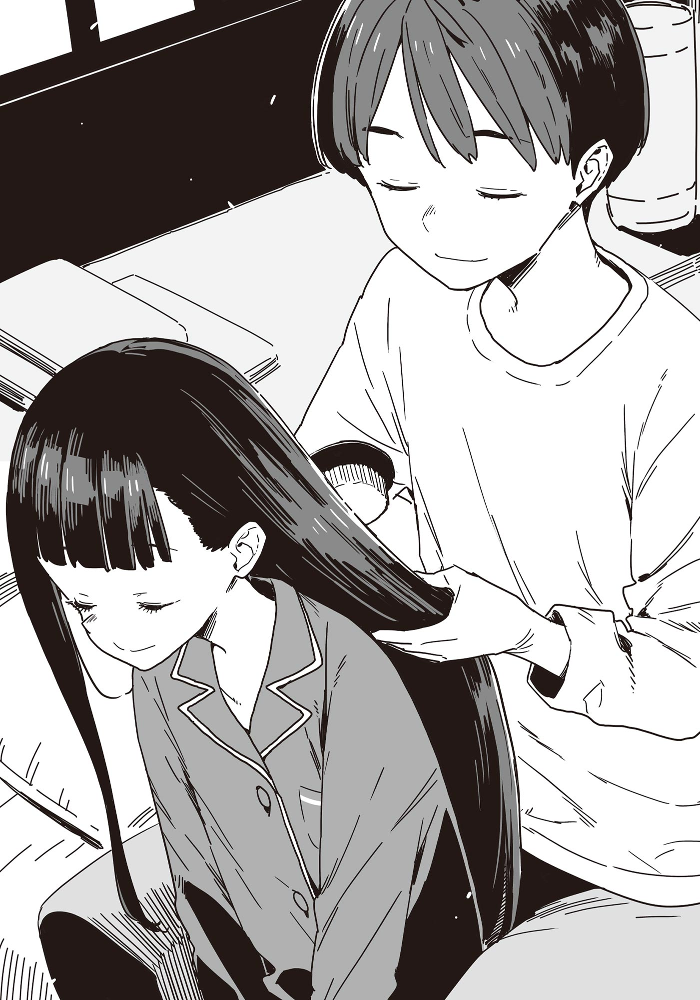

# Ch.86 — เล่ม 7 บทที่ 3-4

Ch.86 — เล่ม 7 บทที่ 3-4

By Monica

Published: 2025-05-16T13:51:13Z

Source: https://www.nekopost.net/novel/14560/86

เล่ม 7 บทที่ 3-4

คืนนั้น ผมนั่งอยู่ที่โต๊ะทำงานในห้องของตัวเอง กำลังคุยโทรศัพท์

< ขอโทษจริง ๆ นะ ฮิบะเน่คงจะทำเกินไปหน่อยใช่มั้ย? >

คนปลายสายคือซากุไรคุง เขารู้สึกผิดที่ประธานนักเรียนเข้ามามีส่วนร่วมในแผนของเราแบบดื้อ ๆ และโทรมาถามไถ่แทบทุกคืน ผมส่ายหัว แม้ว่าเขาจะมองไม่เห็นก็ตาม

< ไม่เป็นไรจริงๆนะ ? เดี๋ยวจะหาทางจัดการให้ >

[ ตอนนี้ยังไม่มีปัญหาอะไรเลย เธอช่วยงานได้ดีมาก พวกเราซาบซึ้งมากจริง ๆ ]

< แต่ครั้งนี้ฮิบะเน่ดูจะทุ่มเทมากเกินไป ผมกลัวว่าเธออาจจะสร้างปัญหาให้ >

ถ้าเทียบกับเทียร่าซัง ผมว่าความกระตือรือร้นของประธานนักเรียนนั้นดูน่ารักน่าเอ็นดูมากกว่าอีก การพูดคุยกับอีกคนนี่เหมือนกับเดินอยู่ในทุ่งกับระเบิดเลยทีเดียว

ผมห่อหุ้มความรู้สึกจริงใจของตัวเองด้วยถ้อยคำที่สุภาพพอควร จนซากุไรคุงดูเหมือนจะโล่งใจในที่สุด เราต่างกล่าวราตรีสวัสดิ์แล้วจบการสนทนา

…แต่ไม่ได้หมายความว่าปัญหาทั้งหมดจะหมดไป

ผมมองไปที่ปฏิทินบนผนัง

วันนี้คือวันแรกของวันหยุดโกลเด้นวีคห้าวัน

วันแต่งงาน— วันที่เราจะลงมือปฏิบัติแผนถูกกำหนดไว้เป็นสุดสัปดาห์ถัดจากวันหยุดนี้

[ อาบน้ำเสร็จแล้วค่ะ ท่านพี่ ]

คาจูพูดขึ้นพลางเดินเข้ามาในห้องด้วยชุดนอนสีน้ำเงิน

ผมเปียก ๆ ของเธอแผ่กระจายไปทั่วแผ่นหลังขณะที่เธอแกะผ้าขนหนูออกจากหัว

[ รีบเช็ดผมให้แห้งนะ คาจู เดี๋ยวจะเป็นหวัดเอา ]

[ งั้น ท่านพี่ช่วยทำให้หน่อยสิคะ ]

คาจูนั่งลงบนเตียง อา ให้ตายสิ เธอเป็นแบบนี้อีกแล้ว ชอบอ้อนตลอดเลย

ผมย้ายไปนั่งข้างหลังเธอ เตรียมไดร์เป่าผมพร้อมกับหยิบยกเรื่องที่ติดอยู่ในใจขึ้นมาพูด

[ คาจู เธอสนิทกับอาซากุโมะซังมากขนาดนั้นเลยเหรอ? ]

[ ค่ะ เมื่อเร็ว ๆ นี้เธอใจดีกับหนูมาก ]

อย่างนี้เองสินะ เธอใจดีกับคาจูมาก... น่ากังวลจริง ๆ

อาซากุโมะซังไม่ใช่คนไม่ดี แต่เธอจัดว่าอยู่ในลำดับสูงของคนที่ผมไม่อยากให้คาจูตามรอยไป และรุ่นพี่สิกิโนะคิครองอันดับหนึ่งในตอนนี้

คาจูหันกลับมามองตอนที่ผมกำลังจะเปิดไดร์เป่าผม

[ ท่านพี่ คาจูอยากเห็นท่านพี่ใส่สูทด้วยค่ะ ครั้งหน้าที่ไปสถานที่จัดงานแค่สองคนดีมั้ยคะ— ]

[ หันหน้ากลับไปให้เป่าผมก่อน! ]

ผทพูดตัดบทพร้อมเปิดไดร์เป่าผม

ผมใช้นิ้วแยกผมยาวของคาจูให้ลมอุ่นพัดผ่าน

ความร้อนคือศัตรูของเส้นผม จำเป็นต้องตรวจสอบอุณหภูมิด้วยหลังมือและใช้ปลายนิ้วสัมผัสความชื้นที่เหลืออยู่ แล้วเป่าอย่างระมัดระวังแต่รวดเร็ว

ประมาณสิบนาทีต่อมา ผมปิดไดร์เป่าผมและพยักหน้าอย่างพอใจ

...สมบูรณ์แบบ ผมของเธอนุ่มลื่นและเงางามมาก ขณะที่ผมตรวจสอบครั้งสุดท้ายด้วยปลายนิ้ว ก็สังเกตเห็นบางอย่าง

[ นี่ คาจู นั่นชุดนอนของพี่ไม่ใช่เหรอ? ]

[ อันนี้ของคาจูนะคะ พวกเราได้ชุดนอนเหมือนกันไง จำได้มั้ยคะ? ]

อ้อ ชุดนอนเหมือนกันงั้นเหรอ? แล้วทำไมเธอถึงเลือกสีเดียวกับผมล่ะ...?

คาจูยื่นแปรงมาให้ขณะที่ผมกำลังครุ่นคิดเรื่องนั้น

นี่คือแปรงขนหมูป่าที่ผมเคยให้เธอเป็นของขวัญ ซึ่งเป็นสิ่งสำคัญสำหรับการดูแลผมของเธอ

ผมพูดกับคาจูขณะที่ค่อย ๆ ใช้แปรงหวีผมให้เธอ

[ ตอนนี้เรียนเป็นยังไงบ้าง ? ในฐานะนักเรียนปีสาม」

[ เพราะพวกเราอยู่ปีสุดท้ายแล้ว และกำลังเตรียมตัวสำหรับสอบเข้า เซ็นเซเลยให้ความสำคัญกับการแนะแนวมากค่ะ แต่พวกเรายังไม่รู้สึกถึงความกดดันมากนักหรอกค่ะ ]

คาจูพูดขึ้นหลังจากลังเลอยู่ครู่หนึ่ง

[ ท่านพี่ คาจูตัดสินใจแล้วว่าจะสมัครเข้าซึวะบุกิค่ะ ]

ผมรู้อยู่แล้วว่าคาจูมุ่งมั่นที่จะเข้าโรงเรียนซึวะบุกิ แต่เธอไม่เคยพูดออกมาอย่างชัดเจนแบบนี้มาก่อน ผมถามเบา ๆ โดยไม่หยุดหวีผมให้เธอ

[ ตัดสินใจแน่ๆแล้วเหรอ? ]

[ ค่ะ หนูเริ่มเตรียมตัวกับเซ็นเซที่โรงเรียนแล้วค่ะ ฤดูใบไม้ผลิปีหน้า คาจูจะได้เข้าเรียนที่ซึวะบุกิพร้อมกับท่านพี่ค่ะ ]

เธอพูดด้วยน้ำเสียงที่มั่นใจและหนักแน่น

[ ...ท่านพี่คะ ปีที่แล้วช่วงนี้ท่านพี่ไม่มีเพื่อนเลย คาจูหวังว่าถ้าคาจูสอบเข้าโรงเรียนสซึวะบุกิได้ จะได้อยู่เคียงข้างท่านพี่ค่ะ ]

—เมื่อหนึ่งปีที่แล้ว ผมแทบจะไม่พูดคุยกับใครเลยนอกจากเรื่องจำเป็น แม้กระทั่งอามานัตสึเซ็นเซ ครูประจำชั้นของผมเอง ยังแทบจำหน้าผมไม่ได้

มันไม่ได้ทำให้ผมอึดอัดมากนัก แต่สำหรับคาจู เธอคงจะกังวลใจมาก

มือของผมหยุดหวีผมโดยไม่รู้ตัว คาจูวางมือลงบนมือของผม

[ แต่ตอนนี้มันต่างออกไปแล้วค่ะ คาจูอยากเข้าโรงเรียนซึวะบุกิเพื่อเรียนรู้จากรุ่นพี่ที่หนูเคารพค่ะ ]

[ ...ดีมาก ถ้ามีอะไรที่พี่ช่วยได้ก็บอกมาเลยนะ ]

[ ค่ะ ท่านพี่! ]

หลังจากที่ได้ประกาศเจตนาของเธอออกมา คาจูดูเหมือนจะรู้สึกผ่อนคลายขึ้น เธอเริ่มแกว่งขาไปมาและฮัมเพลงเบา ๆ

ผมกลับมาหวีผมให้เธอต่อเบาๆ เหมือนกำลังลูบหัวของเธอ

◇

วันที่สองของช่วงวันหยุด Golden Week ที่ยาวห้าวัน

เราสี่คน ซึ่งจะกลายเป็นอาชญากรในเร็วๆ นี้— ประธานนักเรียน ยานามิ ชิราทามะซัง และตัวผมเอง กำลังรวมตัวกันในห้องชมรมวรรณกรรม ขณะที่อาซากุโมะซัง ผู้มีประสบการณ์สูงในเรื่องการวางแผน ออกมากล่าวอย่างกระตือรือร้น

[ เมื่อวานนี้มีทั้งช่วงที่ดีและช่วงที่ลำบาก แต่การทัวร์สถานที่จัดงานถือว่าประสบความสำเร็จอย่างยิ่งใหญ่! ]

ยานามิส่งสายตาไม่พอใจมาที่ผมเมื่อได้ยินคำพูดนั้น

[...ใช่ มีเรื่องเกิดขึ้นเยอะจริงๆ มีบางคนที่ได้เพลิดเพลินกับอาหารฝรั่งเศสแสนอร่อยและมีช่วงเวลาที่สุดยอดไปแล้วสินะ ]

เมื่อวานนี้ ผมกับชิกิยะซังกลับไปโดยไม่ได้รอยานามิและคนอื่นๆ ที่หายไปหลังจากขาดการติดต่อ อาหารอร่อยมาก แถมชิกิยะซังก็มีกลิ่นหอม มันเป็นวันที่คุ้มค่าสุดๆ

[ พวกเราก็เจอเรื่องของเราเองเหมือนกัน เอาล่ะ อาซากุโมะซัง พูดต่อเลยเถอะ ]

[ ค่ะ งั้นเรามาเรียบเรียงข้อมูลจากเมื่อวานกัน ]

อาซากุโมะซังเริ่มวาดแผนผังชั้นของอาคารลงบนไวท์บอร์ด

[ ข้างๆ บริเวณต้อนรับมีห้องเปลี่ยนเสื้อผ้าสำหรับญาติๆ ถ้าผ่านจุดนั้นไป จะเจอกับพื้นที่โล่งที่ใช้เป็นห้องพักคอยของแขก ตรงนี้มีเคาน์เตอร์บาร์อยู่ด้วย ซึ่งจะดึงดูดความสนใจได้มากพอสมควร ]

เธอเปลี่ยนไปใช้ปากกาเมจิกสีแดง วาดลูกศรลงบนแผนผังที่ดูไม่ค่อยดีนัก

[ ข้ามพื้นที่พักคอยไป จะออกไปที่สวน ซึ่งเป็นที่ตั้งของโบสถ์ แต่ว่าเนื่องจากโบสถ์อยู่กลางแจ้งและมองเห็นได้จากห้องต้อนรับ การเคลื่อนไหวโดยไม่ให้ใครเห็นจึงทำได้ยาก ]

เธอวาดเส้นจากบันไดที่นำไปชั้นสองมุ่งไปยังโบสถ์

[ โชคดีที่เส้นทางจากห้องเจ้าสาวบนชั้นสองไปยังโบสถ์นั้นสั้น ถ้าเราพาทานากะเซ็นเซออกมาได้ การไปถึงโบสถ์จะเป็นเรื่องง่าย ]

ประธานนักเรียนที่กำลังครุ่นคิดอยู่กับมือที่ปิดปากพูดขึ้น

[ แต่การข้ามพื้นที่พักคอยแขกมีความเสี่ยง ทานากะเซ็นเซอาจเจอใครบางคนที่เขารู้จักด้วย ]

[ ค่ะ เห็นด้วย เพราะงั้น ดูตารางเวลานี้ด้วยค่ะ ]

อาซากุโมะซังวางแผ่นตารางเวลาลงบนไวท์บอร์ดพร้อมเสียงดังตุ้บ

[ เจ้าสาวจะมาถึงเวลา 7:30 น. และเจ้าบ่าวเวลา 9:00 น. หลังจากเปลี่ยนชุด จะมีการประชุมเกี่ยวกับการถ่ายภาพและพิธีแต่งงาน เริ่มเวลา 10:00 น. ]

เธอวางกระดาษอีกแผ่นหนึ่งลงข้างๆ

[ เวลา 10:30 น. รถบัสที่พาญาติๆ มาถึง และเริ่มการต้อนรับแขกเวลา 11:00 น. พิธีจะเริ่มตอนเที่ยง แต่ในเวลานั้นจะมีคนมากเกินไป แผนจะไม่สำเร็จแน่ๆ ]

อาซากุโมะซังวาดเครื่องหมายกากบาทสีแดงขนาดใหญ่ลงบนกระดาษแผ่นที่สอง

[ แต่ทานากะเซ็นเซจะมาตอน 9โมง แล้วไปพบช่างภาพตัวจริงในอีกหนึ่งชั่วโมงหลังจากนั้น เราแทบไม่มีเวลาถ่ายภาพเลย ]

ยานามิพูดขึ้นด้วยน้ำเสียงกังวล อาซากุโมะซังพยักหน้าอย่างจริงจัง

[ ใช่ค่ะ การปฏิบัติการต้องเริ่มระหว่าง 9.00 น. ถึง 10.00 น. โดยเฉพาะช่วงสั้นๆ หลังจากที่ตานากะเซ็นเซเปลี่ยนชุดเสร็จ ]

ประธานชมรมยิ้มกว้างอย่างตื่นเต้น

[ นี่มันเหมือนการแข่งกับเวลาเลยนะ น่าสนใจใช่มั้ยล่ะ? ]

ทุกคนต่างแสดงความเห็น อาซากุโมะซังเริ่มขีดเขียนเพิ่มเติมลงในตารางเวลาพร้อมกับปากกาเมจิกในมือ

[ ...นี่คือแผนหยาบๆ ของฉันค่ะ เวลา 9:30 น. ช่างภาพปลอมจะเรียกตัวเจ้าบ่าว ทานากะเซ็นเซ โดยอ้างว่าเป็นการทดสอบกล้อง ]

อาซากุโมะซังติดภาพถ่ายภายในโบสถ์ลงบนไวท์บอร์ด

[ จากนั้น ริโกะซัง ที่ซ่อนตัวอยู่ในโบสถ์ จะปรากฏตัวในภาพถ่ายระหว่างการทดสอบกล้อง ]

อาซากุโมะซังปิดฝาปากกาเมจิก และมีเสียง "คลิก"

...จากข้อมูลทั้งหมดที่เรามี นี่ดูเหมือนจะเป็นทางเลือกเดียวของเรา

ความเงียบเข้าครอบงำขณะที่ทุกคนครุ่นคิด ยานามิหยิบขนมปังออกมาจากกระเป๋า

[ ดูเหมือนว่าเราคงไม่มีทางเลือกอื่น ต้องลงรายละเอียดแผนให้ชัดเจนแล้ว ]

ยานามิพึมพำขณะกัดขนมปังบาแกตต์ยาวเข้าไปทั้งชิ้น พฤติกรรมประหลาดแบบนี้เป็นเรื่องปกติของยานามิ แต่ครั้งนี้สามคนที่เหลือจ้องเธอด้วยสายตาสงสัย

[ หืม? ทำไมทุกคนมองฉันแบบนั้นล่ะ? ]

เมื่อเห็นความเงียบของทั้งสามคน ผมจึงตัดสินใจพูดแทนพวกเขา

[ พวกเขากำลังสงสัยว่าทำไมเธอกินบาแกตต์ทั้งชิ้นแบบนั้น ]

[ ก็นุคุมิซึคุงได้กินอาหารฝรั่งเศสอร่อยๆ คนเดียวมันไม่ยุติธรรมเลย ฉันก็อยากกินบ้างเหมือนกัน! ]

ดังนั้น ในสายตาของยานามิ ขนมปังนี้คืออาหารฝรั่งเศส... เอาเถอะ อย่างน้อยมันก็ไม่ได้ผิดซะทีเดียว

[ ไม่ใส่เครื่องปรุงอะไรหน่อยเหรอ? ]

[ ฉันใส่แยมบ๊วยกับถั่วแดงหวานไปแล้วนะ แถมยังเตรียมผงถั่วเหลืองคินาโกะไว้โรยหน้าอีกด้วย—อ๊ะ ดันหยิบอันที่เค็มมา โชคไม่ดีเลย ]

เธอกินต่อไปอย่างไม่ค่อยพอใจเท่าไหร่ ทำไมถึงใส่ของที่ตัวเองไม่ชอบลงไปในขนมปังล่ะ? และส่วนประกอบที่ดูจะเป็นฝรั่งเศสก็ช่างน้อยเหลือเกิน... แต่ในเมื่อเป็นยานามิ ผมก็เลิกสงสัยดีกว่า

ผมหันกลับมาสนใจไวท์บอร์ด พยายามตัดเรื่องยานามิออกจากความคิด

[ เอาล่ะ กลับมาที่เรื่องแผนเถอะ ช่างภาพปลอมที่ว่า... พวกเขาจะไม่สงสัยเหรอ? ทานากะเซ็นเซรู้จักพวกเราอยู่แล้ว และเจ้าหน้าที่ที่สถานที่จัดงานก็อาจจับพิรุธได้ พวกเขาเองก็พูดถึงช่างภาพเฉพาะของสถานที่ตอนการประชุมเมื่อวานนี้ด้วย ]

ตามคาด อาซากุโมะซังหยิบนามบัตรออกมาจากกระเป๋า

[ นี่คือนามบัตรของช่างภาพที่งานแต่งงานของพี่สาวฉัน มันมาจากสตูดิโอดามอนด์ ไม่ใช่ของที่สถานที่จัดงาน ]

อาซากุโมะซังหันไปมองชิราทามะซัง ที่เสริมคำอธิบาย

[ เพื่อนของพี่สาวฉันทำงานที่นั่น เราเลยได้รับอนุญาตพิเศษให้ใช้บริการช่างภาพนี้ได้ และเราก็มีสิ่งนี้ด้วย ]

ชิราทามะซังวางนามบัตรที่ดูคล้ายกันบนโต๊ะ

ชื่อสตูดิโอเหมือนกัน แต่ชื่อช่างภาพต่างออกไป

..นี่มันนามบัตรปลอมชัดๆ ผมกำลังเห็นการก่ออาชญากรรมต่อหน้าต่อตา

หลังจากตรวจสอบนามบัตร อาซากุโมะซังส่งมันให้ประธานนักเรียน

[ รุ่นพี่โฮโคบารุ พกสิ่งนี้ไปในวันงานด้วยค่ะ ]

[ งั้นฉันต้องแสดงเป็นช่างภาพสินะ? ]

[ ใช่ค่ะ รุ่นพี่ และนุคุมิซึซังจะเป็นผู้ช่วยเอง ]

[ เอ๊ะ!? ผมด้วยเหรอ!? ]

ผมอุทานอย่างตกใจ อาซากุโมะซังพยักหน้าเหมือนเป็นเรื่องธรรมดา

[ จำเป็นต้องมีคนช่วยริโกะซังในระหว่างถ่ายภาพค่ะ ]

[ แต่ผมเพิ่งไปทัวร์สถานที่จัดงานมานะ! พวกเขาต้องจำหน้าผมได้แน่ๆ! ]

อาซากุโมะซังหัวเราะเบาๆ เมื่อเห็นผมพยายามขัดขืน

[ นุคุมิซึซัง จำได้มั้ยว่ามีคนมาถามทางที่หน้าประตูโรงเรียนเมื่อเช้านี้? ]

[ ...อา? ]

ตอนที่เธอพูดขึ้นมา ผมจำได้ว่าเช้านี้มีเด็กผู้ชายใส่หมวกแก๊ปกับหน้ากากมาถามทางไปร้านคาเฟ่บอร์ดเกม

[ แล้วมันเกี่ยวอะไรด้วย ? ]

[ เด็กคนนั้นคือคาจูซังค่ะ ]

อะไรนะ!? จะบ้าเหรอ?

[ ล้อเล่นใช่มั้ย ? เสียงนั่นได้ยินชัด ๆ ว่าเป็นผู้ชายแน่ ๆ ]

[ เสียงแรกที่เธอได้ยินจากด้านหลังเป็นเสียงที่บันทึกไว้ล่วงหน้า พวกเราปรับแต่งเสียงของคาจูซังให้เหมือนเด็กผู้ชายช่วงก่อนวัยรุ่น ]

[ ...แต่บทสนทนาที่เหลือผมพูดคุยกับเด็กผู้ชายคนนั้นโดยตรง ]

[ ใช่ นั่นคือการแสดงของคาจูซัง อย่างไรก็ตาม ความประทับใจจากเสียงแรกเป็นสิ่งสำคัญที่สุด ตราบใดที่เราตัดบทสนทนาออกก่อนที่จะมีข้อสงสัย ความประทับใจแรกก็จะคงอยู่ ]

เอ๊ะ...? ผมเข้าใจผิดเรื่องเสียงของคาจูจริงเหรอ?

ผมพยายามเถียงต่อไป

[ เด็กคนนั้นใส่หน้ากากก็จริง แต่ดวงตาไม่เหมือนกัน ตาของคาจูจะเห็นชัดกว่านั้น ]

[ เราใช้สติกเกอร์ทำตาชั้นเดียวเพื่อเปลี่ยนลักษณะดวงตา และใช้เครื่องสำอางปรับโทนสีผิว ส่วนผมก็ซ่อนอยู่ใต้หมวกเบสบอล โดยซ่อนส่วนที่โผล่ออกมาให้หมด ]

ผมอ้าปากจะเถียง แต่กลับหาข้อโต้แย้งไม่ได้ จนต้องยอมแพ้ด้วยการถอนหายใจ

ไม่น่าเชื่อ….ผมดูไม่ออกว่าคือคาจูปลอมตัวมา...

[ นุคุมิซึคุง ถึงขนาดนี้ยังจำไม่ได้ทั้ง ๆ ที่เป็นพวกซิสค่อนเนี่ย น่าสนใจดีนะ ]

ยานามิยิ้มเยาะอย่างมีความสุขที่เห็นผมลำบากใจ

[ ก็รู้สึกว่ามันแปลก ๆ อยู่ แต่เธอจะไปกล่าวหาเด็กคนอื่นว่าเป็นน้องสาวตัวเองสุ่ม ๆ ได้ยังไง ]

[ ใช่ ฉันคงโทรแจ้งตำรวจไปแล้วถ้าอยู่ตรงนั้น ]

ใช่เลย ไม่แปลกที่ผมจะจำไม่ได้ และบอกไว้ก่อนว่าผมไม่ใช่ซิสค่อน

อาซากุโมะซังกระแอมเบา ๆ แล้วอธิบายต่อ

[ ทานากะเซ็นเซรู้จักพวกเรา แต่ถึงเขาจะรู้สึกแปลก ๆ ปฏิกิริยาแรกของเขาก็คงจะเป็น— ]

อาซากุโมะซังมองไปรอบ ๆ พวกเรา

[ ...ไม่มีทางที่นักเรียนของฉันจะปลอมตัวมาอยู่ที่นี่ ]

เธอโบกนามบัตรปลอมในมือ

[ นี่เรียกว่าความลำเอียงแบบปกติซึ่งเป็นปรากฏการณ์ทางจิตวิทยาทั่วไป ความรู้สึกแปลกเล็ก ๆ น้อย ๆ จะไม่มีผลถ้าเรามีนามบัตรของ 'สตูดิโอดามอนด์: ซึโกะ โทระทานิ' เราจะทำทุกอย่างให้เสร็จก่อนที่ความรู้สึกแปลกนั้นจะกลายเป็นการฟันธง ]

ผมฟังอย่างเงียบ ๆ ด้วยความล้มเหลวที่ผมมองไม่ออกว่าคาจูปลอมตัวมา ผมไม่มีเหตุผลจะเถียงอะไรอีก

หน้าผากของอาซากุโมะซังเป็นประกายอีกครั้งเมื่อเห็นว่าทุกคนไม่มีข้อโต้แย้ง

[ เอาล่ะ เมื่อทุกคนเข้าใจแผนแล้ว ครั้งนี้ทุกคนจะต้องปลอมตัว! ]

หา!? ขอโทษนะ ผมไม่เข้าใจส่วนนี้

ตัวแทนกลุ่มที่สับสน ผมยกมือขึ้นอย่างลังเล

[ เอ่อ... แล้วเราจะใส่ชุดสูทอีกเหมือนตอนทัวร์สถานที่เหรอ? ]

[ ไม่ ชุดสูทพวกนั้นไม่ผ่านแน่นอน ]

อาซากุโมะซังดูจริงจังจนผมเองก็เริ่มรู้สึกไม่ดีไปด้วย

[ ตอนทัวร์สถานที่พวกเธอเป็นแขก อะไรที่แปลกอาจถูกมองข้ามไป แต่คราวนี้เราต้องเจอกับทานากะเซ็นเซและคนอื่น ๆ ถ้ามีอะไรผิดปกติ พวกเขาจะแจ้งเจ้าหน้าที่ทันที ]

ประธานชมรมขมวดคิ้วพลางเก็บนามบัตรปลอมใส่กระเป๋า

[ ภารกิจครั้งนี้มีเวลาจำกัด ถ้าโดนจับได้ พวกเราไม่มีโอกาสอีกแล้ว ]

[ ถูกต้อง เราต้องเตรียมตัวให้พร้อมที่สุด ฉันจะจัดการเรื่องชุดเอง แต่เรามายืนยันบทบาทสำหรับวันนั้นกันก่อน ]

อาซากุโมะซังเริ่มเขียนลงในไวท์บอร์ดที่ว่างเปล่า

กองบัญชาการ: อาซากุโมะ จิฮายะ , ยานามิ อันนะ

ช่างภาพ: โฮโคบารุ ฮิบาริ

ผู้ช่วย: นุคุมิซึ คาซึฮิโกะ

เข้าใจล่ะ ในวันปฏิบัติการ ผมกับประธานจะเข้าไปภายใน ขณะที่อาซากุโมะซังกับคนอื่น ๆ สนับสนุนจากข้างนอก คล้ายกับตอนทัวร์สถานที่...

คำบางคำทำให้ผมสะดุดตาเมื่อคิดถึงเรื่องนั้น

ชิราทามะ ริโกะ: ชิราทามะ ริโกะ

[ ...? ชิราทามะซังเล่นเป็นตัวเองเหรอ? ]

ผมเผลอพูดออกไป และอาซากุโมะซังหันมายิ้มให้

[ ใช่แล้ว เราต้องการคนภายในที่ช่วยประสานงานให้ทุกคนได้ ในวันแต่งงานมีเพียงคนเดียวที่อยู่ในที่นี้ที่จะดูไม่แปลกตาในสถานที่นั้น ]

ทุกสายตาหันไปที่ชิราทามะซัง ดวงตาของเธอกลมโตขึ้นเล็กน้อย

[ หมายถึงฉันเหรอ? ]

[ ใช่ค่ะ ริโกะซัง เธอจะช่วยสนับสนุนการเคลื่อนไหวของทุกคนในสถานที่ ]

เข้าใจแล้ว เราต้องการผู้ช่วยภายในที่จะพาชิราทามะซังในชุดเจ้าสาวไปที่โบสถ์อย่างปลอดภัย เธอจะไม่สร้างความสงสัยที่นั่น

[ แต่เดี๋ยวก่อน มีแค่ชิราทามะซังคนเดียวนี่นา ]

[ ถ้างั้นเราก็แค่ต้องสร้างชิราทามะอีกคนหนึ่ง ]

อาซากุโมะซังเติมชื่ออีกชื่ออย่างลื่นไหล

ชิราทามะ ริโกะ: ชิราทามะ ริโกะ, นุคุมิซึ คาจู

หา? คาจูเป็นชิราทามะซัง? อะไรนะ?

ผมสับสนจนพูดไม่ออก และอาซากุโมะซังปรบมือพร้อมกับมองไปที่ประตูห้องชมรม

[ เข้ามาได้เลยค่ะ ริโกะซัง ]

ประตูเปิดออก และเด็กผู้หญิงตัวเล็กในชุดนักเรียนโรงเรียนซึวะบุกิก็เดินเข้ามา

คาจูหมุนตัวไปมาเบา ๆ ตรงหน้าผม

[ เอเฮะเฮะ ท่านพี่ว่าไงคะ? ]

[ อ่า ดูดีนะ แต่เธอจะปลอมตัวเป็นชิราทามะซังได้ยังไง? ]

อาซากุโมะซังยืนข้างคาจูและวางมือลงบนหัวของเธอ

[ คาจูซังตัวเตี้ยกว่าชิราทามะซัง แต่การเพิ่มความสูงง่ายกว่าการลดมัน เราจะใช้รองเท้าและวิกปรับให้เหมาะสม ทั้งสองคนตัวบางคล้ายกัน การปรับรูปลักษณ์จะง่ายกว่าที่คิด ]

[ คาจูจะพยายามเต็มที่ค่ะ! ]

คาจูทำท่ากำหมัดด้วยความมุ่งมั่น เธอน่ารัก ผมยอมรับ แต่...

[ เดี๋ยวก่อนนะ... ]

ผมลุกขึ้นและมองไปรอบ ๆ ทุกคน

[ คาจูต้องถอนตัวจากปฏิบัติการนี้ ]

ผมไม่สนใจสีหน้าตกใจของอาซากุโมะซัง แล้วพูดต่อ

[ เรื่องนี้เป็นปัญหาของชมรมวรรณกรรม ผมเสียใจที่ต้องดึงประธานกับอาซากุโมะซังเข้ามา แต่คาจูไม่ใช่นักเรียนของโรงเรียนซึวะบุกิ เธอไม่ควรเกี่ยวข้องกับเรื่องนี้นะ ]

คาจูจ้องผมด้วยสายตาไม่พอใจ แต่ผมจ้องตอบกลับไปอย่างแน่วแน่

[ นี่เป็นปัญหาของชมรมวรรณกรรม เธอกำลังจะสอบเข้าในปีนี้ อย่าเอาตัวเองมาเกี่ยวข้องเลย ]

[ แต่— ]

คาจูเริ่มจะเถียง แต่ประธานก็เข้ามาแทรก

[ คาจูคุง พี่ชายเธอพูดถูกนะ ครั้งนี้ปล่อยให้เป็นหน้าที่ของพวกเราเถอะ ]

ผมเดินไปหาคาจูและลูบหัวเธอเบาๆ

[ ปีหน้าพวกเราจะได้อยู่ที่โรงเรียนซึวะบุกิด้วยกันใช่มั้ยล่ะ? ]

คาจูนิ่งเงียบไปครู่หนึ่ง ก่อนจะพูดพึมพำเสียงเบาๆ

[ ...เดท ]

[ เดทเหรอ? ]

[ หลังจากเรื่องนี้จบแล้ว ไปเดทกับคาจูนะ ]

[ อา... เอาสิ ออกเดทสินะ ? ]

ผมพยักหน้าอย่างจริงจัง คาจูเงยหน้าขึ้นแล้วทำหน้ามุ่ย

[ ...ทั้งวันเลยนะ ตั้งแต่เช้าจนถึงเย็น ]

[ ได้ จะทำตามที่เธอขอเลย ]

ถึงจะยังดูเหมือนยังไม่พอใจ แต่สุดท้ายคาจูก็ยอม เธอโค้งให้ทุกคนในห้องแล้วเดินออกไปอย่างเงียบๆ คงต้องชดเชยให้เธอทีหลังตอนกลับถึงบ้าน...

ขณะที่ผมถอนหายใจเบาๆ อาซากุโมะซังมองมาที่ผมด้วยสีหน้าเหมือนรู้สึกผิด

[ นุคุมิซุซัง ขอโทษด้วยนะ ฉันน่าจะรอบคอบกว่านี้ ไม่ควรดึงเด็กม.ต้นอย่างคาจูซังมาเกี่ยวข้องกับแผนนี้เลย ]

[ ไม่หรอก อาซากุโมะซัง ผมน่าจะพูดเรื่องนี้ตั้งแต่แรก - ]

ผมกำลังจะบอกว่าไม่ใช่ความผิดของเธอ แต่ก็หยุดตัวเองไว้ ขอโทษนะ แต่ผมโกหกตัวเองไม่ได้จริงๆ

ประธานนักเรียนเดินมาวางมือบนไหล่อาซากุโมะซังพร้อมรอยยิ้มเจื่อนๆ

[ ฉันก็ผิดเหมือนกันที่ไม่ทันคิด นุคุมิซุคุง นายเป็นพี่ชายที่ดีจริงๆ ]

[ ไม่หรอก คาจูเป็นคนเสนอตัวเข้ามาเอง ]

ยานามิที่เพิ่งกินบาแกตต์หมด ตบมือปัดเศษขนมปังออกแล้วเอียงคอ

[ แต่ตอนนี้ ในเมื่อน้องสาวจังออกไปแล้ว ใครจะเล่นบทชิราทามะจังล่ะ?」

ใช่เ พอคจูไม่ได้ร่วมแผน เราก็ต้องหาคนมาแทนที่ชิราทามะจังปลอม

จากนั้น อาซะกุโมะซังก็จ้องมาที่ยานามิและพูดขึ้น

[ ยานามิซัง ฉันมีข้อเสนอ ]

[ ยานามิซัง สูงพอๆ กับริโกะซังใช่มั้ย ? ความยาวขาและขนาดใบหน้าก็คล้ายกัน อาจจะเล่นแทนได้ ]

[ หา? ฉันเหรอ? ]

ยานามิส่งเสียงสับสนขณะกำลังค้นกระเป๋าของเธอ

ยานามิในบทชิราทามะซังงั้นเหรอ...?

[ แต่เดี๋ยวก่อนนะ ยานามิซังกับชิราทามะซังหนักต่างกัน- เอ่อ หมายถึง...รูปร่างต่างกัน ...หมายถึง... ]

[ …จะพูดอะไร นุคุมิซุคุง? ]

สายตาจิกกัดของยานามิทำให้คำพูดของผมชะงักกลางคัน

ท่ามกลางบรรยากาศที่เริ่มอึดอัด อาซากุโมะซังก็ยกโทรศัพท์ขึ้นมาด้วยรอยยิ้มสดใส

[ ยานามิซัง ริโกะซัง ช่วยไปยืนตรงนั้นหน่อยได้มั้ยคะ? ]

[ เอ๊ะ? ฉันเหรอ? ]

[ ใช่ค่ะ ทั้งคู่เลยนะ ]

ความไม่สนใจสถานการณ์รอบตัวของอาซากุโมะซังกลายเป็นข้อดีในเวลานี้

หลังถ่ายรูปเสร็จ อาซากุโมะซังก็เปิดคอมพิวเตอร์และหันจอมาให้พวกเราดู

[ ทุกคนดูนี่สิ ]

บนจอปรากฏภาพถ่ายเต็มตัวของยานามิและชิราทามะซัง แม้ส่วนสูงและสัดส่วนจะคล้ายกัน แต่รูปร่างก็ชัดเจนว่าต่างกัน เหมือนสินค้าคนละหมวดหมู่ในร้านอนิเมะเลย

อาซากุโมะซังเริ่มพิมพ์ข้อมูลลงในแป้นคีย์บอร์ด ปรับภาพของยานามิให้ดูผอมลง และปรับภาพของชิราทามะซังให้ดูอวบขึ้น

[ ฉันปรับแต่งรูปให้รูปร่างทั้งสองใกล้เคียงกันมากขึ้น ถ้าใช้เสื้อผ้ากับวิกที่เหมาะสม เราก็สามารถปลอมตัวได้」

[ ต่อให้ปรับภาพได้ แต่ความจริงก็ไม่เปลี่ยนหรอก- เอ่อ ไม่ได้ว่าอะไรนะ ยานามิซัง ]

ทำไมผมต้องระวังคำพูดขนาดนี้ด้วย?

อาซากุโมะซังก็ชี้ไปที่จอด้วยรอยยิ้มสดใส โดยไม่สนใจความลำบากใจของผม

[ การจำลองนี้แสดงให้เห็นว่า ถ้าริโกะซังเพิ่มน้ำหนัก 2 กิโล และยานามิซังลดน้ำหนัก 2 กิโล ก่อนวันแต่งงาน ความจริงจะใกล้เคียงกับภาพจำลองนี้ ]

เอ๊ะ หมายความว่า...

ยานามิเอียงคอขณะดูดซองแยมเล็กๆ

[ งั้นฉันไม่ควรกินบาแกตต์ชิ้นที่สองใช่มั้ย? ]

เรามองหน้ากัน ก่อนพยักหน้าอย่างพร้อมเพรียงด้วยสีหน้าจริงจังที่สุดในวันนี้
