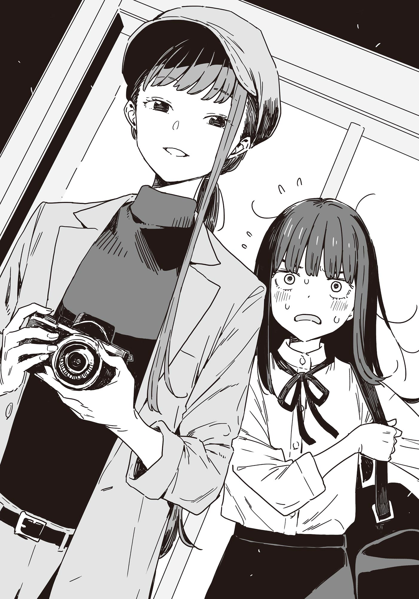

# Ch.90 — เล่ม  7 บทที่ 4-2

Ch.90 — เล่ม  7 บทที่ 4-2

By Monica

Published: 2025-05-16T13:52:43Z

Source: https://www.nekopost.net/novel/14560/90

เล่ม 7 บทที่ 4-2

...ผมไม่มีทางปล่อยให้คาจูเห็นผมในสภาพนี้เด็ดขาด

ผมสวมเสื้อเชิ้ตสีขาวที่ยานามิให้ยืมทับเสื้อวิ่งของผม ด้วยความไม่เต็มใจ

ไหล่กว้างๆทำให้รู้สึกไม่มั่นใจ แต่ตามที่ยานามิบอก มันคือ < เสื้อโอเวอร์ไซส์สำหรับใส่ซ้อนกัน > ดังนั้นผมจึงพยายามติดกระดุมจนสำเร็จ

ปกเสื้อที่มีลูกไม้ทำให้รู้สึกอึดอัด แต่ถือว่าผ่านด่านแรกมาได้ ตอนนี้ต้องเจอกับด่านถัดไปแล้ว...

ผมกลืนน้ำลายลงคอ

ตรงหน้าผมคือกระโปรงสีดำแบบไม่มีจีบอีกตัวที่ยานามิให้ยืม

มันมีลักษณะบานเล็กน้อยตรงชายกระโปรง คล้ายกับดอกทิวลิป

ใส่เสื้อเชิ้ตผู้หญิงยังพอว่า แต่ใส่กระโปรงเนี่ย...รู้สึกเหมือนกำลังข้ามเส้นที่ไม่ควรข้าม

[ เอ่อ หรือว่า...จะไม่ใส่ดี? ]

[ ทำคนเดียว.……………….ไม่ได้เหรอ? ]

ชิกิยะซังเริ่มเข้ามาใกล้ ผมรีบผลักเธอออกไป

[ ไม่ๆ ทำเองได้อยู่ ! อย่าเพิ่งเข้ามา! ]

เห้อ ไม่มีทางเลือกแล้ว ผมใส่กระโปรงทับกางเกง

...โอเค นี่คือด้านหน้า ติดตะขอ รูดซิป เรียบร้อย

ผมหายใจลึกๆ แล้วมองตัวเองในกระจกเต็มตัว

ลืมเรื่องการปลอมตัวไปเลย สิ่งที่เห็นตรงหน้าคือเด็กผู้ชายม.ปลายที่ใส่ชุดผู้หญิงเท่านั้นเอง

นี่มันยากกว่าที่คิดไว้เยอะเลย...

ด้วยความไม่เต็มใจ ผมหยิบวิกผมยาวที่วางไว้ขึ้นมาสวม แต่มันยิ่งทำให้การแต่งหญิงดูชัดเจนกว่าเดิม

[ นุคุมิซึคุง จะไม่ถอดกางเกงเหรอ? ]

[ จะถอดแล้ว! แต่หยุดแอบมองได้แล้ว ยานามิซัง! ]

เฮ้อ ไม่มีทางเลือก ต้องทำให้สุดแล้วล่ะ

ผมถอดกางเกงออก แล้วก้าวออกจากหลังม่านโดยไม่คิดอะไรมาก

[ โอเค ผมใส่แล้วนะ แต่ว่า...]

[ [ [ [ โอ้ววว! ] ] ] ]

เสียงสาวๆ ดังขึ้นพร้อมกัน ตามมาด้วยเสียงปรบมือ นี่พวกเธอปรบมือกันทำไม?

[ดูสิ มันดูไม่เนียนเลยใช่มั้ย? ผมปลอมตัวแบบนี้ไม่ได้แน่ๆ ]

ยานามิที่ดูสนุกเกินไปหยิบสายยางยืดเล็กๆ ออกมาจากกระเป๋า

[ กระโปรงไม่พอดีเหรอ? ฉันเตรียมสายปรับขนาดมาให้- ]

[ ...หา? ไม่อะ ก็พอดีดี ]

ผมพูด พลางสอดนิ้วเข้าไปตรงเอวของกระโปรง

[ ถ้าจะมีอะไร มันก็ดูหลวมไปนิด แล้วมันปรับด้วยสายเส้นนั้นได้จริงเหรอ?]

[ ...........]

[ เอ๊ะ? เฮ้ สาย... ]

ทำไมเธอมองเหมือนอยากฆ่าผมแบบนั้นล่ะ...?

เธอดูเหมือนกำลังจะรัดคอผมด้วยสายยางนั้น แต่ก่อนที่ผมจะเริ่มกังวล อาซากุโมะซังก็วางมือบนไหล่ของเธอเพื่อปลอบใจ

[ ตอนนี้ดูดีแล้ว ต่อไปเราใช้ชุดกระชับสัดส่วนกับวิกเพิ่ม งั้นฝากที่เหลือด้วยนะ ]

อาซากุโมะซังพาพวกประธานและชิราทามะซังเข้าไปในพื้นที่เปลี่ยนชุด

ประธานจะปลอมตัวเป็นผู้ชายงั้นเหรอ? ผมว่ามันต้องเหมาะกับเธอแน่ๆ...

ในขณะที่ผมกำลังคิดไปเรื่อย ผมสังเกตเห็นชิกิยะซังมองมาที่ผมอย่างตั้งใจ

[ เอ่อ จะแต่งหน้าให้ผมใช่มั้ย? ]

[ แค่นั้น...ไม่พอหรอก... ]

ชิกิยะซังเดินเข้ามาใกล้ด้วยท่าทางเซๆ

[ เราต้อง...ซ่อนมือกับเท้า...แล้วก็คอด้วย... ]

[ คอ ? ]

นิ้วเรียวยาวของเธอแตะคอของผมเบาๆ

[ ผู้ชายจะมี……...ลูกกระเดือก... ]

เธอหยุดชั่วครู่ มือยังคงวางอยู่ที่คอของผม ก่อนจะเอียงหัวอย่างสงสัย

[ ทำไมของนาย.……..เล็กจัง? ]

นี่เป็นครั้งแรกที่มีคนพูดแบบนั้น ยานามิก็โน้มตัวเข้ามามองคอของผม

[ แม้แต่นุคุมิซึ- อุวะ เล็กจริงๆ ด้วย ]

[ ใช่.……เล็กมาก... ]

[ ใช่ ของนายเล็กกว่าของโซสุเกะเยอะเลย ]

ผมถูกล้อมรอบด้วยสองสาวที่เอาแต่พูดว่าผม "เล็ก" ซ้ำไปมา มันทำให้ความมั่นใจของผมลดฮวบไปหมด นี่มันสถานการณ์อะไรกันเนี่ย?

ในขณะที่ผมก้าวถอยหลังโดยสัญชาตญาณ ชิกิยะซังก็เริ่มสัมผัสตัวผมมากขึ้น

[ ขานาย...เนียนมาก... ]

[ ไม่ใช่นะ! ฟุ๊วะ!? ]

อยู่ดีๆ มือของชิกิยะซังก็เลื่อนเข้าไปใต้กระโปรงของผม

แต่ยานามิก็รีบคว้าแขนของเธอไว้ ดึงตัวออกจากผม

[ เดี๋ยวก่อนค่ะ รุ่นพี่! ทำอะไรเนี่ย!? ห้ามแตะต้องในชมรมวรรณกรรมนะ ! ]

ยานามิลากชิกิยะซังไปที่มุมห้อง

[ แต่ว่า...ขาของเขา...เนียนมาก.. ]

[ ถึงจะเป็นอย่างนั้น แต่เขาก็ยังเป็นผู้ชายนะคะ บางครั้งเขายังมองฉันแบบหื่นๆ เลย ]

ยานามิบ่นเบาๆ พร้อมกับส่งสายตาแปลกๆ มาทางผม จริงเหรอ? ผมเป็นแบบนั้นในสายตาเธอเหรอ?

[ แต่...ร่างกายของนุคุมิซึคุงเหมือน...ผู้หญิง...]

[ หา? จริงเหรอ? ]

ไม่ครับ ผมเป็นผู้ชายทั้งแท่ง ทั้งร่างกายและจิตวิญญาณ

เมื่อรู้สึกถึงสายตาที่จ้องมองเข้ามา ผมดึงชายกระโปรงลงโดยสัญชาตญาณ ในขณะนั้นเอง ม่านบริเวณพื้นที่เปลี่ยนชุดก็ถูกเปิดออกอย่างเงียบๆ

ประธานปรากฏตัวออกมาในชุดเต็มยศ

เธอเดินเข้ามาที่กลางห้องด้วยความมั่นใจ ประธานใส่รองเท้าหนังสีน้ำตาลกางเกงลายตารางที่คาดด้วยสายเอี๊ยม

เสื้อคอเต่าสีดำถูกเก็บไว้ใต้แจ็คเก็ตสีน้ำตาลอ่อน และผมทั้งหมดของเธอถูกซ่อนไว้ใต้หมวกแบน ชุดของเธอให้ความรู้สึกเหมือนนักข่าวยุคไทโช - โดดเด่น น่าเกรงขาม และเข้ากับบุคลิกของเธอได้อย่างสมบูรณ์แบบ

[ อืม ก็ไม่ดูผิดธรรมชาตินะ แต่จะตัดสินด้วยตัวเองก็ยากอยู่ ]

[ เหมาะมากค่ะ ดูน่าเชื่อถืออย่างบอกไม่ถูก ]

ผมยังไม่แน่ใจกับคำชมของตัวเองนัก แต่อาซากุโมะซังก็พยักหน้าเห็นด้วย และยืนเคียงข้างเธอ

[ เสื้อคอเต่าช่วยปกปิดความแตกต่างของลำคอระหว่างเพศ และการเก็บผมไว้ใต้หมวกก็ทำให้ดูเป็นธรรมชาติ ]

อาซากุโมะซังอธิบายพร้อมกับเคาะไหล่ประธานเบาๆ

[ ต่อไป เราจะโฟกัสที่รูปร่าง ใช้ชุดกระชับสัดส่วนและเสื้อผ้าซ้อนชั้นกันและพันซาราชิอีก เดี๋ยวรุ่นพี่ชิกิยะจะจัดการเรื่องเมคอัพให้ค่ะ ]

อาซากุโมะซังเหลือบมองนาฬิกาบนผนัง

- 7:30 น. คือเวลาที่เจ้าสาว ชิราทามะ มิโนริ จะเข้ามาในสถานที่

[ เริ่มภารกิจเฟสแรกกันเลยนะคะ หลังจากที่ชิราทามะซังเข้ามาในสถานที่แล้ว เราจะสลับตัวเธอกับยานามิซัง ]

ใช่แล้ว ผมคือหัวหน้าโปรเจกต์ ดันลืมไปได้ยังไง - อ่า ผมไม่อยากทำเรื่องนี้เลยจริงๆ...

แต่ถอยกลับตอนนี้ไม่ได้แล้ว ผมยืดตัวตรง แล้วมองไปรอบๆ เห็นใบหน้าของทุกคนที่เต็มไปด้วยความคาดหวัง

[ เอาล่ะ งั้นมาเริ่มปฏิบัติการล้างแค้นครั้งใหญ่ของชิราทามะ ริโกะ...หรืออะไรแบบนั้นกันเถอะ ]

คำสั่งแบบขอไปทีของผม เป็นสัญญาณเริ่มต้นแผนการของพวกเราทั้งหมด

◇

ยานามิและคนอื่นๆ ออกไปแล้ว ถึงเวลาเตรียมการสำหรับเฟส 2

สัมผัสนุ่มของแปรงบนใบหน้า ความเย็นจากปลายนิ้วของชิกิยะซังที่แตะบนแก้ม เสียงเสื้อผ้าสัมผัสกัน ลมหายใจเบาๆ ของเธอ... และกลิ่นน้ำหอมที่ผสมกับกลิ่นเครื่องสำอาง

เมื่อหลับตา ความรู้สึกอื่นๆ กลับชัดเจนยิ่งขึ้น

ขณะที่ผมยืนตัวแข็งและใจเต้นรัว-

[ ลืมตา…..ได้แล้วนะ..? ]

เสียงแหบๆ ของชิกิยะซังดังอยู่ใกล้ๆ

เมื่อผมค่อยๆ ลืมตาขึ้น ชิกิยะซังกำลังยื่นกระจกเงาให้ผม

นี่...คือผมเหรอ...? ดูเปลี่ยนไปจากเมื่อครู่เลย...

คนในกระจกดูเหมือนอายุ 20 ปี เป็นภาพของหญิงสาวธรรมดาที่ไม่ฉูดฉาด แต่แต่งตัวให้น่ารักที่สุดเท่าที่จะทำได้ พร้อมแฝงความเป็นผู้ใหญ่เล็กน้อย น่าจะเป็นคนที่รักการอ่านและฝันถึงการพบเจอที่แสนวิเศษ

ไม่ใช่แค่การแต่งหน้า รูปร่างของผมถูกปรับด้วยการพันซาริชิและซ่อนคอด้วยผ้าพันคอ แจ็กเก็ตถูกเลือกมาเพื่อช่วยให้ไหล่ดูกว้างน้อยลง ขณะที่ขาที่โผล่ออกจากกระโปรงถูกปกคลุมด้วยถุงน่องเนื้อบาง

[ อืม ดู...น่ารักดีนะ…อยากกอดเลย... ]

ชิกิยะซังกระซิบด้วยน้ำเสียงที่เต็มไปด้วยความจริงใจ

ทันใดนั้น ประตูห้องก็เปิดออกพร้อมกับอาซากุโมะซังและชิราทามะซังที่รีบร้อนเข้ามา

[ การสลับตัวกับยานามิซังสำเร็จ! เฟส 1 เสร็จสิ้น! เราไม่มีเวลามาก ไปใส่ชุดเจ้าสาวกันเถอะ! ]

[ ค่ะ เข้าใจแล้ว! ]

อาซากุโมะซังรีบพุ่งเข้าไปในพื้นที่เปลี่ยนชุดตามด้วยชิราทามะซังที่แกะโบว์ของตัวเองขณะเดินเข้าไป

[ ฉันจะช่วย…….เปลี่ยนเสื้อผ้า... ]

ชิกิยะซังที่ดูเหม่อลอย เดินโซเซตามเข้าไปหลังม่าน

ผมรู้สึกคลุมเครือว่ามันอาจจะแย่ แต่เพราะไม่แน่ใจว่าทำไม เลยตัดสินใจเมินมันไป

ประธานนักเรียนดึงสายเอี๊ยมเข้าที่แล้วสวมแจ็กเก็ต

[ โอเค ต่อไปคือเฟส 2 เราต้องล่อยชิราทามะคุงเข้าไปในโบสถ์โดยให้ยานามิคุงช่วย จากนั้นก็พาทานากะเซ็นเซออกมาและถ่ายรูป- รู้สึกประหม่าเลย ]

นี่แหละคือบททดสอบของจริง แผนทั้งหมดจะล่มถ้าการแฝงตัวเป็นช่างภาพปลอมล้มเหลว

[ ว่าแต่ กล้องอยู่ไหนครับ ประธาน? ]

[ อ่า ฉันให้บาโซริคุงช่วยเอามาไว้แล้ว น่าจะอยู่ในห้องสภานักเรียน- ]

ผมกับประธานหยุดนิ่งขณะสบตากัน

[ เดี๋ยว หมายความว่าอยู่ที่ซึวะบุกิ !? ]

[ อาจจะเป็นฮิโรโตะที่เก็บรวมกับอุปกรณ์อื่นๆไว้ รอก่อนนะ ฉันจะไปดูให้ ]

ประธานเลื่อนตัวผ่านม่านเข้าไปในพื้นที่เปลี่ยนชุด

แต่เดี๋ยวสิ ถ้าไม่มีกล้อง เราจะเป็นช่างภาพได้ยังไง

ขณะที่ผมกำลังเผชิญหน้ากับวิกฤตครั้งใหญ่ มีเสียงเคาะประตูดังขึ้น ก่อนที่ประตูจะเปิดออก

[ ขอโทษค่ะ ฉันเป็นนักเรียนจากโรงเรียนซึวะบุกิ ชื่อบาโซริ... ]

เทียร่าซัง!? ผมหันหลังให้เธออย่างรวดเร็ว

[ ขอโทษที่รบกวนนะคะ แต่โฮโคบารุอยู่ที่นี่หรือเปล่าคะ? ]

[ เอ๊ะ!? อ่า! ค่ะ! เธออยู่ที่นี่ แต่เพิ่งออกไปเมื่อกี้เอง! ]

เทียร่าซังพึมพำว่า "ฉันว่าแล้ว" และเริ่มเดินตรงมาหาผมอย่างรวดเร็ว

[ ฉันเอาของที่เธอลืมมาให้ค่ะ เธออยู่ที่ไหนเหรอ? ]

[ อ-อาจจะยังไม่กลับมาอีกสักพัก ถ้ายังไงวางไว้ตรงนั้นก็ได้ค่ะ! ]

น้ำเสียงของผมสูงขึ้นผิดปกติ และเทียร่าซังก็หยุดกึก

[ ฉันอยากจะยื่นให้เธอโดยตรง ถ้าฉันรอจะเป็นอะไรมั้ย? ]

[ อ่า ค่ะ เชิญค่ะ ]

...เธอคงยังไม่รู้ใช่มั้ย ผมยืนหันหลังให้เทียร่าซัง กลั้นหายใจ และพยายามทำตัวให้ดูไม่เด่นที่สุด

ใช่แล้ว ผมคือภูตแห่งโรงเรียนคิริโนะกิ คนที่สมองเน่ามองไม่เห็นผมหรอก-

[ เอ่อ ขอถามอะไรหน่อยได้มั้ยคะ ? ]

เธอมองเห็นผมชัดเลย ผมพยักหน้าเงียบๆ ทำตัวนิ่งๆ

หลังจากลังเลเล็กน้อย เทียร่าซังก็พูดขึ้น

[ ทำไมโฮโคบารุถึงมาที่นี่เหรอคะ ? ]

เดี๋ยวสิ เธอจับแผนเราได้แล้วเหรอ...?

[ อะไรนะ? อ่า เธอมาที่นี่...เพื่อเขียนข่าวชมรมการแสดงน่ะค่ะ ]

[ แต่เธอมากับชมรมวรรณกรรมไม่ใช่เหรอ? ทำไมเธอถึงทำข่าวเกี่ยวกับชมรมการแสดงกับคนของชมรมวรรณกรรมล่ะ? ]

[ คะ-ใครจะรู้ล่ะคะ ฉันแค่ช่วยงานเธอเฉยๆ ]

กลืนน้ำลายเอื๊อกใหญ่ ผมพยายามกลบเกลื่อน

มีช่วงหนึ่งที่ทุกอย่างเงียบไป ก่อนที่เทียร่าซังจะพูดเบาๆ

[ ...นุคุมิซึซังนี่ไม่ไหวเลย ]

[ เอ๊ะ ผมเหรอ? ]

[ เอ๊ะ!? ]

แย่แล้ว ผมรีบยกมือปิดปากตัวเอง แต่สายไปแล้ว

[ ขอฉันดูหน้านายหน่อย! ]

เทียร่าซังจับไหล่ผมแล้วหันผมกลับมา

เธอจ้องมองผมด้วยความตกตะลึง ตาเบิกกว้าง

[ นุคุมิซึซัง!? ทำไมแต่งตัวแบบนี้ล่ะ !? ]

[ อ-อ่า เรื่องนั้นคือ... ]

ขณะที่ผมพยายามคิดคำแก้ตัว ม่านก็เปิดออก และประธานก็โผล่ออกมา

[ ...อ้าว เสียงนั้น? บาโซริคุงเองเหรอ? รู้ได้ไงว่าเรามาอยู่ที่นี่? ]

[ มันเขียนอยู่ในตารางของห้องสภานักเรียนค่ะ! นี่มันอะไรกัน- เอิ๊กกก!? ]

เธอร้องเหมือนไก่โดนบีบคอ

ประธานเดินเข้ามาอย่างสง่างามและรับกระเป๋ากล้องจากมือเทียร่าซังที่ยืนนิ่ง

[ เธอมาส่งกล้องให้เรางั้นเหรอ? ขอบคุณมากเลยนะ ฉันซาบซึ้งมาก ]

[ ประธา- นุ- เอ๊ะ- นี่- ]

ปากของเทียร่าซังอ้าแล้วปิดสลับกัน ขณะเธอหันไปมองประธานกับผม

[ ประธานกลายเป็นผู้ชาย แล้วนุคุมิซึซังก็กลายเป็นผู้หญิง หมายความว่า- พวกเธอสองคนคือแบบนั้น!? ]

ไม่ใช่เลย

ไม่รู้ทำไม ประธานพยักหน้าเหมือนเพิ่งเข้าใจอะไรบางอย่าง

[ อืม ฉันก็ไม่ค่อยเข้าใจเหมือนกัน แต่น่าจะใช่มั้ง ]

[ เงียบไปเลยค่ะ ประธาน ! ]

เทียร่าซังร้องเหมือนไก่โดนบีบคออีกครั้ง

จากนั้น เลือดไหลออกจากจมูกเธอเล็กน้อย ก่อนที่เธอจะล้มลงตรงนั้น

◇

เวลา 9:30 น. ภารกิจเข้าสู่เฟส 2

ผมปรับน้ำหนักของกระเป๋าที่สะพายอยู่บนไหล่และมองขึ้นไปยังทางเข้าของสถานที่จัดงาน

นี่เป็นครั้งที่สองที่ผมมาเยือน ที่ผ่านมา ผมมาในฐานะผู้มาเยี่ยมชม แต่ครั้งนี้ ผมเป็นผู้บุกรุก

[ ...เทียร่าซังจะโอเคมั้ย? ]

ผมพึมพำกับตัวเอง พยายามกลบเกลื่อนความกังวล ประธานนักเรียนตบไหล่ผมเพื่อให้กำลังใจ

[ ชิกิยะอยู่กับเธอ ดังนั้นเธอน่าจะไม่เป็นไร ]

นั่นแหละที่ทำให้ผมกังวล คิดว่าไม่ต้องอธิบายว่าทำไม

เมื่อเหลือบมองไปด้านข้าง ผมเห็นสองร่างในช่องว่างระหว่างอาคาร

พวกเขาคืออาซากุโมะซังและชิราทามะซัง คนหลังคลุมชุดแต่งงานด้วยเสื้อโค้ต เธอจะลอบเข้าไปในโบสถ์ด้วยความช่วยเหลือจากยานามิเมื่อเราเข้าไปข้างใน

ประธานนักเรียนตบไหล่ผมอีกครั้ง ก่อนจะผลักประตูทางเข้าขนาดใหญ่ให้เปิดออก

สถานที่จัดงานยังคงดูหรูหราเหมือนครั้งก่อน ด้วยเพดานสูงที่ให้ความรู้สึกสงบและสง่างาม แต่ไม่เหมือนกับการมาเยือนครั้งก่อน ครั้งนี้พนักงานดูวุ่นวายกับการเตรียมงาน

ประธานนักเรียนเดินตรงไปที่โต๊ะต้อนรับและยื่นนามบัตรให้ โดยไม่ลังเล

[ ขอโทษที่รบกวนครับ ผมคือโทราทานิ จากสตูดิโอดามอนด์ วันนี้เรามาถ่ายภาพให้ ท่านทานากะ กับ ท่านชิราทามะครับ ]

พนักงานหญิงที่กำลังกรอกเอกสารเงยหน้าขึ้นมามองเธอด้วยสีหน้างุนงง

[ ขอบคุณที่มาทำงานค่ะ แต่ฉันได้รับแจ้งว่าการนัดหมายอยู่ในเวลา 10 โมงเช้า... ]

[ นี่เป็นครั้งแรกที่ผมมาที่สถานที่ เลยหวังว่าจะได้ดูสถานที่ถ่ายภาพคร่าวๆ ก่อน ถ้าเป็นไปได้ ผมขอถือโอกาสนี้ทักทาย ท่านทานะกะที่เป็นเจ้าบ่าวเลย ได้มั้ยครับ? ]

ประธานนักเรียนยิ้มเสน่ห์ในลุคชายหนุ่ม

พนักงานหญิงดูเหมือนจะหยุดหายใจไปชั่วขณะก่อนพยักหน้าเหมือนตกอยู่ในภวังค์

[ ...อ๊ะ แน่นอนค่ะ ถ้าอย่างนั้นฉันจะไปแจ้งเจ้าบ่าวให้นะคะ ]

[ ขอบคุณมากครับ พวกเราจะตามไป ]

ประธานนักเรียนยังคงหว่านเสน่ห์มัดใจไม่เปลี่ยน

ผมเดินตามหลังพวกเขาไป พยายามไม่ให้ตัวเองเด่นด้วยการก้มหน้าตลอดทาง

...อ๊ะ นั่นยานามิในคราบชิราทามะปลอม กำลังซุ่มอยู่ใกล้ห้องน้ำ

ยานามิที่กำลังเดินเตร็ดเตร่อย่างไร้จุดหมาย สังเกตเห็นพวกเราและยกนิ้วโป้งให้แบบลับๆ หยุดทำแบบนั้นเดี๋ยวนี้

[ —— ผมคิดว่านี่เป็นงานที่ยอดเยี่ยมมากเลยนะครับ การมอบความฝันให้กับทุกคนเนี่ย ภูมิใจในตัวเองเถอะครับ ]

[ ขอบคุณค่ะ รู้สึกสบายใจขึ้นเยอะเลย ]

[ ถ้าวันไหนอยากพูดคุย ผมพร้อมรับฟังเสมอ….แวะมาที่สตูดิโอได้ตลอดเลยนะครับ ]

เดี๋ยว. อะไรนะ? ประธานนักเรียนกำลังนั่งฟังชีวิตส่วนตัวของพนักงานคนนี้อยู่เหรอ? ผมเสียสมาธิกับนิ้วโป้งของยานามิไปนานแค่ไหนเนี่ย ...?

ผมเดินตามพวกเขาขึ้นไปยังชั้นสอง

เมื่อขึ้นบันไดไป ด้านซ้ายคือห้องประชุมที่ใช้บรีฟงาน ส่วนด้านขวาคือห้องแต่งตัวของเจ้าบ่าวและเจ้าสาว

เจ้าบ่าวและเจ้าสาวแต่ละคนมีห้องแต่งตัวแยกกัน และเนื่องจากสถานที่นี้จัดงานแต่งงานได้สองงานต่อวัน จึงมีห้องแต่งตัวทั้งหมดสี่ห้องเรียงกันอยู่

ถัดจากห้องแต่งตัวไปยังมีบันไดอีกชุดที่นำลงไปสู่ห้องจัดเลี้ยง

พนักงานเคาะประตูห้องที่สองจากท้ายสุดซึ่งมีป้ายเขียนว่า < ห้องเจ้าบ่าว - ครอบครัวทานากะ >

[ ท่านทานากะคะ ช่างภาพมาถึงแล้วค่ะ ]

ประตูเปิดออกแทบจะทันที ทานากะเซ็นเซที่อยู่ในชุดทักซิโดมองมาที่พวกเราด้วยความประหลาดใจ

[ อ๊ะ มาค่อนข้างเร็วเลยนะ ]

[ ครับ นี่เป็นครั้งแรกที่เรามาที่นี่ เลยอยากทำการทดสอบกล้องก่อน หวังว่าจะไม่รบกวนนะครับ ]

ขณะที่เขารับนามบัตรจากประธานนักเรียน ทานากะเซ็นเซดูพอใจ

[ ไม่เป็นปัญหาเลยครับ ผู้ชายเตรียมตัวกันเร็วอยู่แล้ว ผมก็แค่รออยู่เฉยๆ ]

ประธานนักเรียนยิ้มให้พนักงานที่ยังจ้องเธออยู่ด้วยสีหน้ามึนงง

[ ขอบคุณนะครับ นัตสึมิซัง กลับไปทำหน้าที่ของคุณได้เลยครับ ]

[ ค่ะ ถ้าต้องการอะไรบอกได้เลยนะคะ ]

นัตสึมิซังส่งสายตาที่ดูมีความหมายให้ประธานนักเรียนก่อนจะเดินออกไป อ่อ เธอชื่อนัตสึมินี่เอง

...หวังว่าการลอบเข้าโบสถ์ของชิราทามะซังจะราบรื่นดีนะ

ผมแอบเหลือบมองสมาร์ตวอทช์ของตัวเองขณะที่ประธานนักเรียนยังคุยเล็กคุยน้อยกับทานากะเซ็นเซ

ข้อความเด้งขึ้นมาบนหน้าจอพอดี

< ข้าวสุกแล้ว >

— นั่นคือสัญญาณจากยานามิ ชิราทามะ ริโกะ ลอบเข้าโบสถ์สำเร็จแล้ว

ผมเคาะหลังประธานนักเรียนเบาๆ ขณะเธอยังคงพูดคุยกับทานากะเซ็นเซย์

[ โทราทานิซัง พระอาทิตย์เริ่มขึ้นสูงแล้วนะ ]

ประธานนักเรียนยกกล้องขึ้นข้างใบหน้า พร้อมรอยยิ้มที่สะกดทุกสายตาไม่ว่าจะชายหรือหญิง

[ ถ้าอย่างนั้น ทานากะซัง รบกวนตามพวกเรามาเลยครับ— เราจะถ่ายภาพที่ดีที่สุดกัน ]

