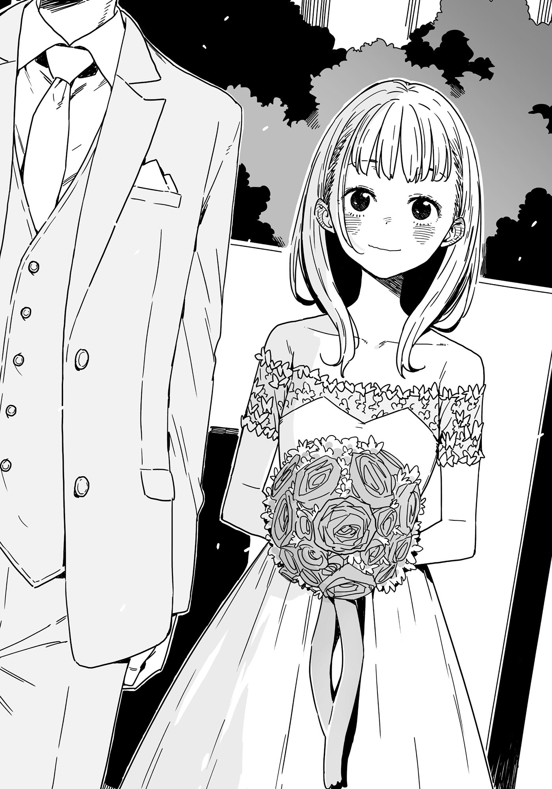

# Ch.91 — เล่ม 7 บทที่ 4-3

Ch.91 — เล่ม 7 บทที่ 4-3

By Monica

Published: 2025-05-16T13:53:02Z

Source: https://www.nekopost.net/novel/14560/91

เล่ม 7 บทที่ 4-3

บสถ์เต็มไปด้วยแสงระยิบระยับ

แสงแดดยามเช้าส่องผ่านหน้าต่างทั้งสาม บรรยากาศในห้องถูกเติมเต็มด้วยความสว่างราวกับถูกพัดขึ้นไปด้วยพัดลมเพดานที่หมุนอยู่ข้างบน บรรยากาศดูเคร่งขรึมและสงบ

ขณะที่ผมยืนดูภาพรวม ประธานหันมามองผม

[ เตรียมทุกอย่างให้พร้อมนะ คาซึโกะคุง ]

คาซึโกะ... หมายถึงผมสินะ? ผมรีบดึงแผ่นสะท้อนแสงแบบพับได้ออกมาจากกระเป๋า

แผ่นสะท้อนแสงเป็นแผ่นที่ช่วยสะท้อนแสงเพื่อให้ภาพดูสวยขึ้น แผ่นที่เราใช้นี้ขยายได้กว้างกว่าหนึ่งเมตร

ทานากะเซ็นเซเดินเข้ามาด้วยความสนใจ ผมยกแผ่นสะท้อนแสงขึ้นบังหน้า

[ อุปกรณ์นี่ดูจริงจังดีนะ จะใช้ในพิธีจริงด้วยหรือเปล่า? ]

[ เรากำลังจำลองแสงธรรมชาติในพิธีครับ ทานากะซังช่วยขยับไปทางขวาสี่ก้าวได้มั้ยครับ? ]

[ อ๊ะ โทษทีครับ ตรงนี้ใช่มั้ย? ]

ประธานนักเรียนปรับกล้อง

[ ใช่แล้วครับ สมบูรณ์แบบเลย ตอนนี้หมุนตัวไปทางขวาอีก 30 องศา หันหน้าเข้ากำแพง—อ่า ใช่เลยครับ อยู่ท่านั้นนะครับ ]

แชะ แชะ แชะ เสียงชัตเตอร์ดังต่อเนื่อง

ประธานนักเรียนถอยออกจากช่องมองภาพกล้องและส่งสัญญาณมือให้ผม

[ คาซึโกะคุง ช่วยสะท้อนแสงจากระยะไกลอีกหน่อยได้มั้ย ? ]

นั่นคือสัญญาณ ผมพยักหน้าและค่อยๆ เข้าไปใกล้แท่นพูด โดยพยายามไม่ส่งเสียง

ผมเลี่ยงไปด้านหลังแท่นพูด คำนวณตำแหน่งของผมกับทานากะเซนเซ็ย์—ตรงนั้น ด้านหลังแท่นพูดคือชิราทามะซังในชุดแต่งงานสีขาว สายตาของเราสบกันชั่วครู่

ผมวางแผ่นสะท้อนแสงลงกับพื้นและมองชิราทามะซังเคลื่อนตัวอย่างช้าๆ จากหลังแท่นพูดไปยังด้านหลังของแผ่นสะท้อนแสง

[ คิดว่าเราต้องการแสงเพิ่มอีกหน่อย คาซึโกะคุง ช่วยขยับเข้าใกล้มากขึ้นอีกได้มั้ย? เอาจริงๆ มายืนข้างๆ เจ้าบ่าวเลยก็ได้ ]

ผมพยักหน้าและเดินไปข้างหน้าอย่างเงียบๆ……..ไม่มากเกินไป ช้าๆ และมั่นคง

ระยะทางเพียงสามเมตร แต่ตอนนี้มันรู้สึกเหมือนยาวนานชั่วนิรันดร์

[ ปกคอทักซิโดของคุณดูเบี้ยวไปนิดนะครับ สูงขึ้นอีกนิด—ใช่ๆ สมบูรณ์แบบเลยครับ…! เดี๋ยวถ่ายอีกภาพนะครับ หมุนตัวเข้ากำแพงอีกนิดหนึ่งครับ หน้าอยู่อย่างนั้นแหละนะครับ ห้ามขยับ! ]

แชะ แชะ แชะ

ในจังหวะเสียงชัตเตอร์ ผมก้าวสุดท้ายและเลื่อนแผ่นสะท้อนแสงออกไปด้านข้าง

และในชั่วพริบตา ทุกอย่างก็เปลี่ยนไป

ตำแหน่งที่ผมยืนเมื่อครู่ กลายเป็นชิราทามะซังที่ปรากฏตัวขึ้นพร้อมช่อดอกไม้ในมือ ใส่ชุดแต่งงาน ยืนอยู่ข้างเจ้าบ่าว

เหตุการณ์นี้กินเวลาเพียงไม่กี่วินาทีในโลกจริง และยิ่งน้อยกว่านั้นเมื่อจับภาพผ่านกล้อง

ประธานนักเรียนยกนิ้วขึ้นหนึ่งนิ้ว เป็นสัญญาณว่างานถ่ายภาพเสร็จสมบูรณ์

ผมรีบเข้ามาใกล้และตั้งแผ่นสะท้อนแสงตั้งตรงกับพื้น

ชิราทามะซังหลบหลังแผ่นสะท้อนแสงทันที ขณะที่ทานากะเซ็นเซหันกลับมา

สายตาของเราสบกันในระยะใกล้

[ อ่า โทษทีครับ ผมเข้ามาใกล้ไปหน่อย ฮะๆๆ… ]

[ เมื่อกี้คุณเหรอ? รู้สึกเหมือนมีคนอื่นอยู่ข้างๆ ผมเลยนะ ]

ทานากะเซ็นเซเริ่มขยับเข้ามาใกล้ แต่ประธานนักเรียนก้าวเข้าไปขวางอย่างราบรื่น

[ ขอโทษครับ ผู้ช่วยของผมเข้าใกล้มากไปหน่อย การทดสอบกล้องเสร็จเรียบร้อยแล้วครับ ]

[ อ๊ะ จริงเหรอ? ดีเลยครับที่ได้ช่วย ]

ทานากะเซ็นเซดูเหมือนจะยังงงๆอยู่เล็กน้อย ประธานนักเรียนโอบไหล่เขาและเริ่มพาเขาเดินออกจากโบสถ์

[ ผมจะถ่ายช่วงเวลาที่ดีที่สุดในพิธีจริงให้แน่นอนนะครับ ได้เห็นเจ้าสาวในชุดแต่งงานหรือยังครับ? ]

[ เคยเห็นตอนลองชุดแล้วครับ ]

[ นั่นดีมากเลยครับ ในวันสำคัญเธอจะดูสวยขึ้นไปอีกขั้นแน่นอน ]

ทั้งสองพูดคุยกันต่อขณะที่ออกจากโบสถ์

ขณะที่ผมยืนมองประตูที่ปิดลงทันใดนั้นก็สังเกตเห็นชิราทามะซังยืนอยู่ข้างๆ

[ โอเคมั้ย ? ทุกอย่างผ่านไปด้วยดีเลย ]

[ อ่า…ค่ะ… ]

ชิราทามะซังดูเหมือนกำลังเหม่อลอย ยืนนิ่งราวกับจมอยู่ในความคิด

ผมรู้สึกถึงความไม่สบายใจของเธอ จึงพูดอีกครั้ง

[ ไปซ่อนอีกทีจนกว่ายานามิซังจะมารับนะ เดี๋ยวจะไปดูให้แน่ใจว่าทานากะเซ็นเซกลับเข้าห้องแล้ว ]

เธอพยักหน้าเบาๆ ผมพับแผ่นสะท้อนแสงและเดินออกจากโบสถ์

เราใกล้จะทำภารกิจสำเร็จแล้ว เหลือเพียงแค่หนีออกไป ทุกอย่างก็จะจบลง

ขณะที่ผมส่งข้อความหายานามิว่าเราทำภารกิจสำเร็จ ผมก็เดินตามประธานนักเรียนขึ้นบันไดไปยังชั้นสอง

การเตรียมตัวทั้งหมดที่ทำมาตลอดสัปดาห์ดูเหมือนจะผ่านไปในพริบตา

ในที่สุดผมก็รู้สึกเหมือนยกภูเขาออกจากอก โล่งใจที่ไม่ต้องใช้แผนสำรอง…

แต่ข้อความที่ได้รับจากยานามิทำให้ผมตื่นมาเผชิญความจริงอีกครั้ง

< ชิราทามะจังหายไปไหนไม่รู้ >

◇

ชิราทามะซังหายตัวไป

ประธาน ยานามิ และผมมารวมตัวกันในโบสถ์ที่เป็นสถานที่สุดท้ายที่มีคนเห็นเธอ

[ หลังจากฉันให้สัญญาณ เธอก็ไม่ออกมา ฉันเดินไปดู แต่ไม่มีใครอยู่ตรงนั้นเลย ]

ยานามิพูดพร้อมกับโบกไม้โบกมืออย่างลนลาน

ประธานละสายตาจากโทรศัพท์และส่ายหัว

[ อาซากุโมะคุงก็ยืนยันว่าเธอไม่ได้ออกจากตึกนี้ ]

ซึ่งหมายความว่า... ชิราทามะ ริโกะ ยังคงซ่อนตัวอยู่ที่ไหนสักแห่ง

ถ้าเธอหายไปโดยไร้ร่องรอย เธอน่าจะวางแผนอะไรบางอย่าง

ผมจัดทรงหน้าม้าของวิกผมให้เข้าที่ พยายามดึงสติกลับมา

[ ยืนอยู่เฉยๆ คงไม่ช่วยอะไร แยกย้ายกันไปหาเธอกันเถอะ ]

[ เห็นด้วย โชคดีที่แขกยังมาไม่ถึง ]

[ นี่ ฉันขอช่อดอกไม้ของชิราทามะจังทีหลังได้มั้ย? ถือไว้แล้วเหมือนจะได้แต่งงานเป็นคนถัดไปใช่มั้ยล่ะ? ]

คนแรกที่รับมันไว้ยังไม่มีโอกาสแม้แต่จะถูกปฏิเสธเลย นับประสาอะไรกับแต่งงาน... แต่ก็แล้วแต่เธอเถอะ

เราทิ้งโบสถ์และเดินเข้าไปในอาคารหลักของสถานที่จัดงาน

ถ้าชิราทามะซังซ่อนตัวอยู่ อาจจะเป็นในห้องแต่งตัวของครอบครัว ห้องน้ำ หรือห้องเก็บของ...

ขณะที่ผมเดินไปทางทางเข้า คิดถึงความเป็นไปได้เหล่านี้ ผมก็สังเกตเห็นชายสองคนที่เคาน์เตอร์ต้อนรับคุยกันอยู่

มีกระเป๋ากล้องสะพายอยู่ที่ไหล่ของพวกเขา—ช่างภาพตัวจริงมาถึงแล้ว

[ ...คาซึโกะคุง ถอยก่อน ]

ประธานคว้าแขนผมแล้วดึงกลับไปทางเดิมที่เราเดินมา

ยานามิเดินตามมาพร้อมสีหน้าสงสัย

[ เดี๋ยวเราจะทำยังไงต่อ? ฉันควรทำอะไร ? ]

[ ยานามิซัง อย่าอยู่กับเราจะดีกว่า เราแยกกันตรงนี้เลย ]

ประธานและผมทิ้งยานามิไว้ข้างหลัง และออกจากอาคาร กลับไปที่ด้านหน้าโบสถ์

[ ไปซ่อนก่อนเถอะ ประธาน ]

[ มีที่ดีๆมั้ย? ]

[ ทางนี้ครับ ]

ผมพาประธานเข้าไปในพุ่มไม้ระหว่างโบสถ์กับกำแพง

แม้ว่าด้านข้างและด้านหน้าของโบสถ์จะมีหน้าต่างบานใหญ่ แต่ก็มีมุมหนึ่งที่พ้นสายตา

เราทั้งคู่ถอนหายใจอย่างโล่งอกเมื่อแน่ใจแล้วว่าไม่มีใครเห็นเรา

[ ไม่ดีเลย ถ้าเราเจอช่างภาพตัวจริงเข้า เราจะไม่มีข้อแก้ตัวเลย ]

[ ตอนนี้เราไม่มีทางเลือก คงต้องหนีแหละ ]

[ ออกทางประตูหน้ามันจะเสี่ยงเกินไป พวกเขาอาจจะตามหาเราอยู่ ]

ประธานจับปีกหมวกของเธอแล้วเงยหน้าขึ้นมองกำแพงสูง

[ เราปีนข้ามกำแพงนี้ไปเลยก็ได้ ฉันจะช่วยพยุง นายปีนขึ้นไปก่อน ]

เป้าหมายบรรลุแล้ว การตัดสินใจหนีคงเป็นตัวเลือกที่ฉลาดที่สุด

แต่ยังมีปัญหาของชิราทามะซัง เธอจะเลือกยอมรับความรู้สึกตัวเองและกลับไปใช้ชีวิตตามปกติก็ได้

— หรือจะเลือกตัดสินใจทำอะไรที่รุนแรงและละทิ้งทุกอย่างก็ทำได้เหมือนกัน

[ ...ผมจะอยู่ต่อ ]

ผมพูดต่อ โดยหันไปหาประธานที่ดูตกใจ

[ ผมทิ้งชิราทามะซังไว้แบบนี้ไม่ได้ ต้องดูให้แน่ใจว่าผมทำทุกอย่างที่ทำได้แล้ว ]

[ งั้นฉันจะอยู่กับนาย ฉันทิ้งนายไว้ที่นี่คนเดียวไม่ได้ ]

ผมส่ายหัว

[ ในห้องชมรมละครมีกระเป๋าดัฟเฟิลสีดำใบใหญ่ ช่วยเอามาให้แล้วโยนมันข้ามกำแพงมาได้มั้ย? ]

ประธานยืนนิ่งไปครู่หนึ่ง ก่อนมองผมด้วยสีหน้าประหลาดใจ

[ ...คาดการณ์ไว้เหรอ? ตั้งแต่แรกเลย? ]

[ เรียกว่าผมเตรียมพร้อมไว้ดีกว่า ]

สมาร์ทวอทช์ของผมแสดงเวลา 10:00 น. พอดี งานแต่งจะเริ่มตอนเที่ยง

ในเวลานี้ ผมต้องตามหาชิราทามะซัง เกลี้ยกล่อมเธอ เปลี่ยนชุดให้เธอ และพาเธอไปเข้าร่วมพิธี…...ก็เท่านั้นเอง

ผมส่งสัญญาณนิ้วโป้งให้ประธาน

[ ฝากไว้ที่ผมเถอะครับ ผมชินกับสถานการณ์แบบนี้แล้ว ]

เรื่องแบบนี้เกิดขึ้นตลอดในชมรมวรรณกรรม และถึงหน้าตาผมจะดูแบบนี้ แต่ผมก็เป็นประธานชมรมนะครับ

◇

เวลา 11:00 น. แขกเริ่มทยอยมาถึงงานเลี้ยงรับรอง

เมื่อพื้นที่รอและสวนเริ่มเต็มไปด้วยผู้คน ผมก็ออกมาจากที่ซ่อน

ไม่ใช่ในฐานะ คาซึโกะ อิซึมิ ผู้ช่วยช่างภาพ แต่ในฐานะนักเรียนมัธยมปลายธรรมดาๆ ‘นักเรียน A’

ประธานนำกระเป๋าดัฟเฟิลสีดำมาให้ผม

ในนั้นมีชุดนักเรียนชายจากโรงเรียนมัธยมคิริโนกิ ซึ่งยืมมาจากชมรมละคร

นักเรียนส่วนใหญ่มักเข้าร่วมงานแต่งในชุดนักเรียน ทำให้การปลอมตัวนี้ดูเนียนและไม่ดึงดูดความสนใจ

[ ใช่เลย กางเกงนี่ใส่สบายกว่าเยอะ… ]

ถึงอย่างนั้น ผมก็ยังไม่คุ้นกับความรู้สึกโปร่งโล่งๆ แต่ในฤดูร้อนมันอาจจะให้ความสดชื่นอย่างน่าประหลาด...

ผมเดินเข้าไปในพื้นที่รอด้านใน พลางนึกถึงฤดูร้อนอันร้อนระอุของโทโยฮาชิ

เก้าอี้และโต๊ะเรียงรายไปตามผนัง โดยมีประตูกระจกเปิดสู่สวนอยู่ด้านหนึ่ง ประตูเปิดกว้าง ปล่อยลมต้นฤดูร้อนที่สดชื่นเข้ามา

ผมสอดส่ายสายตามองหาแขกที่กำลังพูดคุยกัน แต่ไม่พบวี่แววของชิราทามะซัง

เมื่อเดินมาถึงเคาน์เตอร์บาร์ ผมตัดสินใจหยิบชาอู่หลงมาดื่ม เพื่อสงบสติอารมณ์

ตอนนี้ผ่านมาเกินชั่วโมงแล้วตั้งแต่ชิราทามะซังหายตัวไป เธออาจซ่อนตัวอยู่ที่ไหนสักแห่งและไม่ได้เคลื่อนไหว

ชั้นแรกคนแน่นเกินไป ผมคงต้องลองหาที่ชั้นสองต่อ…

ระหว่างที่ผมจิบชาอู่หลง สองคุณครูเดินเข้ามายืนข้างๆ

[ ว้าว โนริทามะจังน่ารักจังเลยนะ เธอดูดีเกินไปสำหรับทานากะเซ็นเซอีก ]

หา!? นะ้นมัน—อามานัตสึเซ็นเซ!?

ผมรีบหันหน้าหนี จากนั้นก็ได้ยินเสียงครูอีกคนพูดขึ้น

[ อาระ แต่ เธอเหมาะกับผู้ชายมีอายุนะ เธอเป็นคนที่รับผิดชอบมาก เธอควรมีใครสักคนที่ทำให้เธอผ่อนคลายหรืออ้อนบ้าง ]

โคนุกิเซ็นเซก็อยู่ด้วย ผมค่อยๆ ขยับตัวถอยออกมา หวังว่าจะไม่มีใครสังเกตเห็น

[ ฉันก็อยากอ้อนเหมือนกันนะ… ฉันควรซื้อคอนโดนั้นไปเลยดีมั้ย…? ]

[ โคนามิ เธอดื่มไปแล้วหรือยัง? ]

[ ถ้าฉันดื่มไป นี่คงแค่ 1% ของพลังทั้งหมดของฉัน ]

เธอเป็นแบบนี้แม้แต่ในชีวิตส่วนตัวเหรอ? ผมรีบหลบออกมา ในขณะที่ครูทั้งสองยังสนุกกับบทสนทนาของตัวเอง

ชัดแล้วว่าชิราทามะซังไม่อยู่ในกลุ่มคนพวกนี้ นั่นหมายความว่าเธออาจซ่อนตัวอยู่ในที่ที่เงียบสงบกว่านี้...

ผมเดินไปตามทางเดินที่แสงไฟสลัวๆ มุ่งหน้าไปยังพื้นที่ด้านหลัง พยายามไม่ดึงดูดความสนใจ

เดินไปอีกหน่อยก็เจอประตูที่มีป้าย <ห้องเก็บของ> แขวนอยู่ ผมมองไปรอบๆ ให้แน่ใจว่าไม่มีใครเห็น แล้วเอื้อมมือไปจับลูกบิด ประตูไม่ได้ล็อก ผมค่อยๆ เปิดประตูออก

[ ชิราทามะซัง อยู่ในนี้หรือเปล่า...? ]

ห้องเก็บของมืดสนิท ขณะที่ผมพยายามคลำหาสวิตช์ไฟ ทันใดนั้นก็มีคนคว้ามือผมอย่างแรง

[ ห๊า!? ]

[ นายไปไหนมาน่ะ นุคุมิซึคุง!? ]

เป็น— ยานามิที่ดึงผมเข้ามาในห้องเก็บของและปิดประตูทันที

แสงจากโทรศัพท์ของยานามิส่องให้เราเห็นหน้ากันในความมืด

[ ทำไมมาอยู่ที่นี่ ยานามิซัง? ]

[ ญาติๆ ของชิราทามะจังมาถึงทันทีหลังจากนายออกไป ! ถ้าพ่อแม่เธอเจอฉัน ฉันคงตายแน่! ฉันวิ่งหลบไปทั่วเลย! ]

ยานามิไม่ปล่อยให้ผมพูดตอบและเข้ามาใกล้จนหน้าแทบชิดกัน

[ แล้วยังมีอีกเรื่อง! ลุงคนหนึ่งของเธอจับฉันได้ก่อนที่ฉันจะหลบเข้ามาในนี้! เขาบอกว่าดีใจที่ได้เจอกันหลังจากไม่ได้เจอกันมานาน แต่ฉันไม่เคยเจอเขามาก่อนเลยนะ! แล้วเขายังเรียกฉันอ้วนถึงห้าครั้งเลยนะ! ห้าครั้งเชียวนะ! ทั้งที่ฉันลดไปตั้งสามกิโลเลยนะ ! ]

[ เอ่อ... ก็ดีที่ไม่โดนจับได้ แต่เราต้องหาชิราทามะซังให้เจอ ]

ผมพยายามปลอบยานามิในขณะที่หยิบโทรศัพท์มาดูเวลา

ตอนนี้เลย 11:15 น. ไปแล้ว งานแต่งจะเริ่มตอนเที่ยง เวลาของเรากำลังจะหมดลง

หลังจากที่ยานามิระบายความอัดอั้นจนพอใจ เธอก็ใส่หน้ากากสีน้ำเงิน

[ เอาล่ะ นุคุมิซึคุง ช่วยฉันหน่อย เธอไม่ได้อยู่ในห้องน้ำ ที่เหลือก็มีแค่ชั้นสองแค่นั้น ]

สุดท้ายมันก็มาจบตรงนี้สินะ ผมพยักหน้าอย่างเงียบๆ และเปิดประตูห้องเก็บของออก
