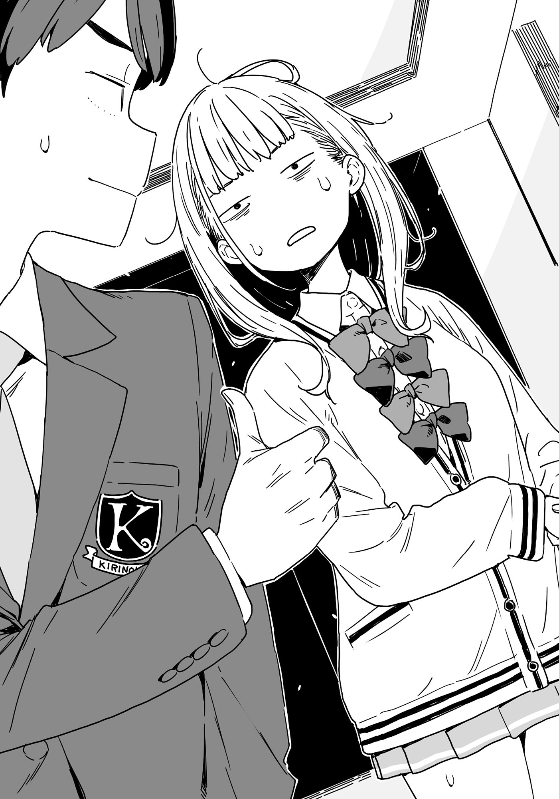

# Ch.92 — เล่ม 7 บทที่ 4-4

Ch.92 — เล่ม 7 บทที่ 4-4

By Monica

Published: 2025-05-16T13:53:25Z

Source: https://www.nekopost.net/novel/14560/92

เล่ม 7 บทที่ 4-4

ชั้นสองของอาคารนี้เป็นที่พักรอของเจ้าบ่าวและเจ้าสาว

แม้ว่าจะดูเหมือนไม่มีแขกขึ้นมาที่นี่ แต่ก็มีญาติและเพื่อนสนิทมาทักทายอยู่เรื่อยๆ ทำให้มีคนเดินไปมาพอสมควร

พวกเราเริ่มสำรวจบริเวณฝั่งตรงข้ามกับห้องพักเจ้าบ่าวเจ้าสาว โดยเลี้ยวซ้ายทันทีที่ขึ้นบันได

เราเข้าไปตรวจสอบห้องประชุมที่สุดปลายทางเดิน ซึ่งมีขนาดประมาณห้องเรียนเล็กๆ

ที่นี่คือสถานที่ที่เราได้รับคำชี้แจงครั้งแรกตอนมาทัวร์สถานที่ และวันนี้มันถูกใช้เป็นพื้นที่เก็บของชั่วคราว

ผมลองเช็กระเบียงที่มองเห็นผ่านหน้าต่างบานใหญ่ด้านหลัง แต่ก็ไม่พบวี่แววของชิราทามะซัง เมื่อผมออกจากห้อง ยานามิที่กำลังตรวจสอบห้องอื่นๆ อยู่ ก็ส่ายหน้า

[ เธอไม่อยู่ที่นี่เหมือนกัน ]

- นั่นทำให้เหลือแค่บริเวณที่เป็นห้องพักรอของเจ้าบ่าวและเจ้าสาวเท่านั้น

ยานามิกลืนน้ำลายอย่างประหม่า

[ นายว่าเธอคงไม่ได้เจออะไรน่ากลัวใช่มั้ย? ฉันไม่อยากเป็นคนแรกที่เห็นใครโดนแทงด้วยมีดนะ นุคุมิซึคุง เดินนำหน้าไปก่อนสิ ]

[ บริเวณนี้คนเดินพลุกพล่านเกินกว่าจะเกิดอะไรแบบนั้น เธอน่าจะซ่อนตัวอยู่ในห้องจัดเลี้ยงที่เลยไปจากตรงนั้นมากกว่า ]

[ ห้องจัดเลี้ยง...? ]

ยานามิกอดอกทำท่าครุ่นคิด

[ มีอะไรหรือเปล่า? ]

[ ฉันคิดออกแล้ว... ต้องเป็นเค้กแน่ๆ! ]

[ นี่เธอหิวเหรอ? ]

[ ฉันหิวนะ แต่ไม่ใช่เรื่องนั้น รู้ใช่มั้ยว่าที่งานแต่งจะมีเค้กก้อนใหญ่มาก แถมสูงกว่าตัวนายอีก? บางทีชิราทามะจังอาจกินทางเข้าไปแล้วซ่อนตัวอยู่ข้างในก็ได้! ]

เดี๋ยว... เธอจริงจังหรือเปล่า? แน่นอนว่าใช่ เพราะนี่มันยานามินี่นา

[ รู้มั้ย นอกจากส่วนที่เขาตัดเสิร์ฟให้แขกแล้ว เค้กพวกนั้นส่วนใหญ่ก็แค่ของประดับนะ ]

[เอ๊ะ? เค้กนั่นเป็นของปลอมเหรอ? นี่มันล้อเล่นกันใช่มั้ยเนี่ย ]

ยานามิ อันนะ วัย 16 ปี ยืนนิ่งเหมือนโดนฟ้าผ่าเมื่อได้รู้ความจริง

ผมเข้าใจนะว่ามันน่าตกใจสำหรับเธอ แต่ตอนนี้ไม่ใช่เวลามาหยุดช็อก

[ เอาน่า ยังไงถ้าเธอต้องการ เธอก็สั่งให้ทั้งก้อนนั่นเป็นของจริงได้อยู่แล้ว ไปต่อเถอะ ]

[ ในยุคฟองสบู่คงเป็นของจริงหมดใช่มั้ย...? ตอนนั้นเค้กทุกก้อนอาจจเป็นของจริง... ]

[ ใช่ หวังว่ายุคฟองสบู่จะกลับมานะ ]

ผมพูดพลางเร่งให้ยานามิรีบเดินต่อ เรามุ่งหน้ากลับไปที่บันได

แต่พอไปถึง ก็มีผู้หญิงวัยกลางคนที่กำลังขึ้นบันไดมาหยุดอยู่ตรงหน้าเรา

[ อาระ นี่ริโกะจังหรือเปล่า? จำป้าได้มั้ย? ป้ามิตสึเอะจากโคไซไง ]

อะไร ?! ญาติของชิราทามะซังมาโผล่ที่นี่ได้ยังไง ?

[ ใช่ค่ะ ริโกะเอง ไม่ได้เจอกันนานเลยนะคะ ]

ป้ามิตสึเอะยิ้มอย่างอบอุ่นและจับมือยานามิไว้

[ ไม่ได้เจอกันนานมากจริงๆ! ตอนประถมเธอตัวผอมบางมาก แต่ตอนนี้ดูอ้วนขึ้น—ดูดีมากเลย! ]

[ ค่ะ ฉันชอบกินข้าวค่ะ ]

ยานามิตอบด้วยเสียงของชิราทามะซัง ทำให้เธอต้องเล่นบทสนทนาต่อโดยใช้เสียงบันทึก

ยานามิที่ชัดเจนว่ากำลังตื่นตระหนก หันมามองผมด้วยสายตาเหมือนร้องขอความช่วยเหลือ นี่มัน...

-ปล่อยให้ฉันจัดการเอง นายไปก่อนเลย

ต้องเป็นสิ่งที่เธอพยายามบอกแน่ๆ มันต้องเป็นแบบนั้น

ผมตัดสินใจถอยหลังช้าๆ พร้อมชูนิ้วโป้งให้ยานามิ ก่อนจะค่อยๆ เลี่ยงออกจากสถานการณ์นั้น

ระหว่างที่เดินจากมา ผมรู้สึกได้ถึงสายตาของยานามิที่จ้องเขม็งตามหลังมา

◇

ในทางเดินที่นำไปยังห้องจัดเลี้ยง มีประตูทั้งหมดสี่บาน

บานที่อยู่สุดทางเดินเป็นห้องพักรอของเจ้าสาว และถัดมาคือห้องของเจ้าบ่าว

หลังจากลังเลอยู่ครู่หนึ่ง ผมตัดสินใจลองหมุนลูกบิดประตูที่อยู่ก่อนห้องเจ้าบ่าว

…ประตูไม่ได้ล็อก ผมค่อยๆ ผลักมันเปิดออก

แสงอ่อนโยนที่ส่องผ่านหน้าต่างกระทบตัวชิราทามะ ริโกะ ที่ยืนอยู่

เธอยืดหลังตรง มือทั้งสองจับช่อดอกไม้ไว้อย่างสง่างาม คล้ายกำลังรอใครบางคน

เมื่อเธอเห็นผม ใบหน้าของเธอสั่นไหวเล็กน้อย ราวกับระลอกคลื่นที่แตะต้องผิวน้ำที่นิ่งสนิท

[ ประธานดูเปลี่ยนไปนะคะ แต่ชุดนี้ก็เหมาะกับประธานเหมือนกัน ]

ผมก้าวเข้าไปในห้องและปิดประตูตามหลัง

[ สำคัญกว่านั้น เธอต้องรีบเปลี่ยนชุดแล้วนะ จะไปพิธีไม่ทันเอา ]

[ ...ใช่ ถ้าฉันยังอยู่ที่นี่ คงไปไม่ทัน ]

น้ำเสียงของเธอทำให้ผมชะงักไป

ดวงตาของเธอใสกระจ่างราวกับกระจก มองมาที่ผมขณะที่เธอเริ่มพูดด้วยน้ำเสียงแผ่วเบา

[ ฉันไม่เคยรู้ตัวเลยว่า เวลาที่ต้องตัดใจฉันแย่แค่ไหน ]

ชิราทามะซังลดสายตาลงเหมือนไม่อยากสบตาผม ปลายชุดของเธอพลิ้วไหวเบาๆ

[ พอฉันได้สิ่งที่ปรารถนาหนึ่งอย่าง ฉันก็เริ่มอยากได้อีกอย่าง และถ้าสิ่งนั้นเป็นจริง ฉันก็คงอยากได้อะไรอีกต่อไปเรื่อยๆ ]

เธอเงยหน้าขึ้น เผยให้เห็นรอยยิ้มที่ไม่ใช่การดูถูกตัวเอง แต่มันเจ็บปวด ราวกับเสียงหัวเราะที่แห้งผากที่กัดกินหัวใจของเธอ

[ ชิราทามะซัง… ]

[ ฉันมันเป็นผู้หญิงแบบนี้แหละ ฉันอยากทำลายทุกอย่างแล้วหนีไป แต่ฉันขี้ขลาดเกินกว่าจะทำอะไรแบบนั้น ฉันก็แค่คนขี้ขลาดที่นั่งรอให้เวลาหมดไป เพราะงั้น… ]

เธอฝืนยกมุมปากขึ้นเป็นรอยยิ้ม

[ …ช่วยออกไปเถอะค่ะ ประธาน ]

ผมยืนอยู่ตรงนั้น หัวใจที่ว้าวุ่นไปด้วยความรู้สึกต่างๆ ทำให้ไม่อาจขยับได้

ผมโกรธ—ไม่ได้โกรธเธออย่างเดียว แต่โกรธตัวเองด้วย

ผมควรจะรู้จักด้านนี้ของเธอดีกว่านี้

ทั้งเอาแต่ใจและดื้อรั้น

ซุ่มซ่ามและมักทำให้ทุกอย่างพังพินาศ

แต่สุดท้าย—เธอกลับคิดถึงความสุขของคนอื่นก่อนเสมอ เด็กผู้หญิงบางคนเป็นแบบนั้น

และคำพูดปลอบใจที่ว่างเปล่าก็ไม่อาจเข้าถึงคนแบบเธอได้

ผมสบตาเธอ จ้องเธอด้วยความมุ่งมั่น

[ …เธอพร้อมตัดใจจากทานากะเซ็นเซแล้วจริงๆ เหรอ? ]

ชิราทามะซังดูเหมือนจะเตรียมตอบ แต่เธอหยุดชะงักไป ราวกับเพิ่งเข้าใจบางสิ่ง

[ ...กำลังบอกให้ฉันแย่งตัวพี่ชายมาจากเธอเหรอ? ]

[ ใช่แล้ว ]

ผมไม่ได้พยายามปิดบังความหงุดหงิดขณะเดินเข้าไปใกล้เธอ

[ เธอหลบอยู่ห้องข้างๆ ทานากะเซ็นเซโดยไม่ล็อกประตู ไม่ใช่เพราะเธออยากให้ใครมาเจอเธอเหรอ? ไม่ว่าจะบังเอิญหรือไม่ เธอก็อยากจะพังทุกอย่าง ด้วยความช่วยเหลือจากคนที่เธอรัก ใช่มั้ย ? ]

[ ประธาน! ฉันแค่— ]

ผมรีบพูดแทรกก่อนที่เธอจะทันพูดอะไรออกมา

[ ถึงเธอจะทำแบบนั้น เธอก็ยังตัดใจไม่ได้ใช่มั้ย ? เธอเก็บความรู้สึกนี้ไว้ในใจมานานมาก ไม่มีทางที่คนอย่างเธอจะตัดใจได้แค่เพราะเขาแต่งงานกับพี่สาวของเธอหรือเพราะเธอทำลายทุกอย่างแล้ว ]

ชิราทามะซังที่จ้องมองผมอย่างท้าทายอยู่เมื่อครู่ ท้ายที่สุดก็ลดไหล่ลงเหมือนยอมแพ้

[ ...ฉันไม่อยากทำลายความสุขของพวกเขา ]

[ งั้นถ้าพวกเขาไม่มีความสุขอีกต่อไปล่ะ? ]

[ นั่น… ]

ดวงตาของชิราทามะซังเบิกกว้าง

เธออยากจะแย้ง แต่สุดท้ายก็ยอมแพ้ ส่ายหน้าช้าๆ

[ …ไม่คิดว่าประธานจะโหดร้ายขนาดนี้นะคะ ]

[ ทำให้เธอผิดหวังเหรอ? ]

[ เปล่าค่ะ ก็แค่…หวั่นไหวนิดหน่อย ]

ถึงเธอจะพูดด้วยคำพูดกล้าหาญแบบนั้น แต่ช่อดอกไม้ในมือกลับหลุดร่วงลงพื้นอย่างแผ่วเบา

[ …ฉันจะรอ ]

เธอกล่าว พลางมองขึ้นมาที่ผมด้วยดวงตาที่เหมือนจะมองทะลุหัวใจของผู้ชายทุกคน

[ ...ฉันซ่อนความรู้สึกนี้ไว้มานานเป็นสิบปี แต่ฉันโตพอที่จะเข้าใจแล้ว ถ้ามันจำเป็น จะเก็บมันไว้อีกห้าปี สิบปีก็ได้ ]

[ ถ้างั้น ที่ที่เธอควรอยู่ตอนนี้ไม่ใช่ที่นี่ เธอควรไปแสดงความยินดีกับพวกเขาให้เหมาะสมและอยู่ข้างๆพวกเขา ]

[ ...ค่ะ ประธาน ]

ชิราทามะซังเปลี่ยนกลับมาใช้โทนเสียงปกติของเธอ พลางเผยรอยยิ้มสมบูรณ์แบบเหมือนเดิม

[ ถ้าเธอรีบเปลี่ยนชุดตอนนี้ ยังทันแน่นอน— ]

[ อึก! ]

หา? ทำไมเธอถึงส่งเสียงแบบนั้น?

ชิราทามะซังมีท่าทางอึดอัด ใบหน้าแดงซ่านขณะที่ก้มลงมองพื้น

[ ไม่ค่ะ คือว่า… อาซากุโมะซังให้ปุ่มสั่นมาน่ะ แล้ว…ฉันไม่มีที่เก็บก็เลย…แปะมันไว้ที่ต้นขาด้านใน ]

อ๋อ…เป็นแบบนั้นสินะ

[ ..งั้น ทำไมมันถึงสั่นตอนนี้? ]

[ คือ…ยานามิซังกดปุ่มนั้น...มาสักพักแล้ว… ]

…สักพักแล้ว? ถ้าผมจำไม่ผิด การกดหนึ่งครั้งหมายถึง 'ลุย' สองครั้งคือ 'ถอย'

และถ้ากดสี่ครั้งขึ้นไป หมายถึง— รีบหนีออกไปให้เร็วที่สุด

ผมรีบพุ่งไปที่ประตูแล้วล็อกทันที

ทันใดนั้นลูกบิดประตูก็ขยับ

[ อ๊ะ? มันล็อกนี่ มีใครเอากุญแจมามั้ย ยามาชิตะซัง? ]

[ เดี๋ยวนะ ผมคิดว่ามันอยู่แถวนี้… ]

ผมได้ยินเสียงของผู้ชายสองคนด้านนอก น่าจะเป็นเจ้าหน้าที่ของสถานที่ที่พยายามเข้ามาในห้อง

ไม่มีเวลาแม้แต่จะสบตากันอีกต่อไป ด้วยทางออกที่มีเพียงประตูเดียว อีกทางเลือกเดียวคือ—

พวกเราเปิดหน้าต่างที่นำไปสู่ระเบียงแล้วกระโดดออกไป โดยไม่ทันคิดและไม่ตรวจสอบว่าอีกฝั่งมีอะไร

ทันทีที่เราหนีออกมา ประตูห้องที่เราเพิ่งออกจากไปก็ส่งเสียงเปิดออก

…ชิราทามะซังและผมหมอบลง กลั้นหายใจในจุดที่ไม่สามารถมองเห็นได้จากหน้าต่าง

เสียงพนักงานหนุ่มที่เข้ามาในห้องดังมาถึงที่ที่เราซ่อนตัว

[ เสื้อนอกกับช่อดอกไม้นี่ของใครเหรอ? ]

[ อาจจะของกลุ่มที่เข้ามาก่อนหน้า เก็บไว้ก่อนละกัน ]

เสื้อนอก? อ๋อ ใช่ ชิราทามะซังสวมเสื้อนอกทับชุดแต่งงานอยู่

พวกเรานั่งเงียบที่สุดเท่าที่จะทำได้ ขณะที่พนักงานปิดหน้าต่างที่เปิดทิ้งไว้และล็อกด้วยเสียง "คลิก"

ตอนนี้ไม่มีทางกลับเข้าไปในห้องแล้ว

เราต้องวิ่งหนีทั้งที่อยู่ในชุดแต่งงานจริงๆ น่ะเหรอ...?

[ มาถึงขนาดนี้แล้ว ประธาน เราต้องฝ่าไปให้ได้แล้วล่ะค่ะ ]

ชิราทามะซังกระซิบใกล้ๆหูผมเหมือนอ่านใจผมออก

…เธอพูดถูก ตอนนี้มันไม่มีทางย้อนกลับแล้ว

ผนังด้านสวนของระเบียงสูงแค่ระดับเอว มีช่องว่างที่ตกแต่งทำให้มองเห็นได้บางส่วน ถ้าอยู่มุมที่ไม่ดี คนที่อยู่ในสวนอาจมองเห็นเราได้ง่ายๆ เราจึงอยู่ที่นี่นานไม่ได้

แต่ปัญหาใหญ่ที่สุดคือเวลา ผมเช็คสมาร์ตวอทช์

เรามีเวลาอีก 30 นาที ก่อนพิธีจะเริ่ม
