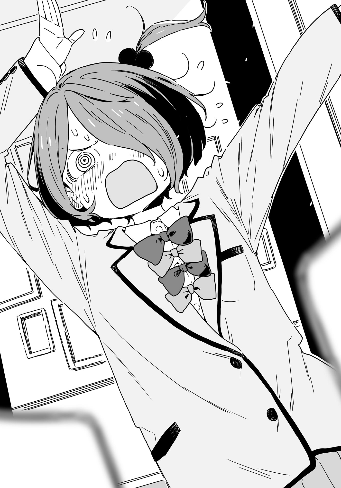

# Ch.93 — เล่ม 7 บทที่ 4-5

Ch.93 — เล่ม 7 บทที่ 4-5

By Monica

Published: 2025-05-16T13:53:39Z

Source: https://www.nekopost.net/novel/14560/93

เล่ม 7 บทที่ 4-5

กึก กึก กึก กึก กึก เราค่อยๆ เดินเลาะระเบียงไปอีกฝั่งของอาคาร จนมาถึงห้องประชุมขนาดใหญ่ที่ผมเคยค้นหาก่อนหน้านี้ ผมเลื่อนหน้าต่างเปิดออก และเราก็แอบเล็ดลอดเข้าไป

เราข้ามห้องไปแบบเงียบๆ ผมแนบหูเข้ากับประตู

...ไม่มีวี่แววว่าจะคนอยู่ข้างนอก ผมค่อยๆ เปิดประตูและพาชิราทามะซังออกไปในทางเดิน

ทางเดินนั้นเลี้ยวซ้ายที่ปลายทาง

เมื่อชะโงกมองตรงหัวมุม ผมเห็นทางเดินยาวกับบันไดที่อยู่ห่างออกไปไม่กี่เมตร

ถัดจากนั้นลงไปในทางเดินคือห้องพักที่เราหนีออกมาเมื่อกี้

ถ้าเราลงบันไดไป เราก็จะไปอยู่ใกล้ทางเข้า ถ้าตั้งใจไว้ล่วงหน้าว่าต้องถูกเห็น เราสองคนก็สามารถวิ่งออกไปได้

ปัญหาคือกลุ่มผู้หญิงวัยกลางคนที่มุงอยู่รอบๆ ยานามิหน้าบันได และดูเหมือนจะมีเพิ่มขึ้นเรื่อยๆ

[ ริโกะจัง โตขึ้นเยอะเลยนะ! ]

[ หนูดูเข้มแข็งขึ้นมากเลย เหมือนเป็นคนละคน ป้าชื่นใจจริงๆ ]

...ดูเหมือนความลับยังไม่แตก ตอนนั้นเอง ยานามิกับผมสบตากัน

สายตาของยานามิเต็มไปด้วยคำบ่นเงียบๆ อย่ามองผมแบบนั้นสิ

ผมค่อยๆ ส่ายหัวและชี้เบาๆ ไปข้างหลัง ส่งสัญญาณให้เธออยู่เฉยๆ

ยานามิที่กำลังจะขยับตัวมาทางเรา หยุดกึก

เธอดูเหมือนจะเข้าใจสถานการณ์และเอียงคอเล็กน้อย

ผมชี้ไปทางบันไดอย่างเงียบๆ ยานามิชะงักไป

จากนั้น เธอสูดลมหายใจเข้าลึกๆ ปิดตาแล้วลืมตาขึ้นพร้อมความมุ่งมั่น

[ นี่! ไหนๆ พวกเราก็มาที่นี่แล้ว ไปดูชุดแต่งงานของพี่สาวกันมั้ย ? ]

เธอพูดด้วยเสียงธรรมชาติของเธอเอง ชัดเจนและดังพอที่จะดึงความสนใจ

กลุ่มผู้หญิงหยุดนิ่งไปชั่วขณะด้วยความแปลกใจ

[ อ๊ะ ริโกะจัง เกิดอะไรขึ้นเหรอ? อยู่ๆ น้ำเสียงของหนูก็เปลี่ยนไป… ]

[ จริงด้วยนะ ถ้าหนูอยู่ในซึวะบุกิแล้ว หนูควรจะพูดให้ดูสุภาพหน่อยสิ ]

[ แต่หนูก็อยากเห็นชุดมิโนริจังเหมือนกันค่ะ! ]

กลุ่มนั้นที่ตอนนี้เริ่มคึกคักอีกครั้ง ล้อมรอบยานามิและเริ่มเดินไปตามทางเดิน ห่างจากบันได

เส้นทางหนีไปบันได—โล่งแล้ว

ผมสบตากับชิราทามะซังและพากันเดินไปทางบันไดอย่างรวดเร็ว ยานามิ ผมจะไม่ลืมการเสียสละของเธอ

โชคดีที่บันไดไม่มีใครอยู่ เรารีบวิ่งลงและมุ่งตรงไปยังทางเข้า—แต่จู่ๆ ผมก็หยุดเดินกะทันหัน

ชิราทามะซังชนเข้ากับหลังผมเบาๆ

[ เกิดอะไรขึ้น ? เราควรจะรีบวิ่งต่อไปนะ ถึงจะถูกเห็นก็เถอะ ]

[ รู้แล้วน่า แต่ว่า— ]

ผมชะโงกมองหัวมุมอย่างระมัดระวัง ชิราทามะซังชะโงกตามผมและรีบดึงตัวกลับ ใบหน้าซีดเผือด

[ คุณพ่อ…! ]

ใช่แล้ว คนที่ยืนอยู่ใกล้ทางเข้าและกำลังคุยอยู่คือพ่อของชิราทามะซัง

ถ้าผมไม่ได้เห็นรูปเขามาก่อน เราคงเดินไปชนเขาแน่

ชิราทามะซังตกใจจนต้องยกมือกุมหน้าอก สูดลมหายใจเข้าลึกเพื่อสงบสติ

[ ต้องไม่ให้เขาเห็นตัวเธอ รอจนกว่าเขาจะออกไปดีกว่า ]

[ ค่ะ เข้าใจแล้ว ]

...เดี๋ยวก่อน คนที่พ่อของชิราทามะซังกำลังคุยอยู่คือผู้จัดการสถานที่ ผมจำเขาได้จากตอนเดินชมสถานที่

และถ้าผมจำไม่ผิด เจ้าสาวจะต้องเข้าโบสถ์พร้อมกับพ่อในพิธี

เหลือเวลาอีก 25 นาที ก่อนพิธีจะเริ่ม

นั่นหมายความว่า ปลายทางถัดไปของพ่อชิราทามะซังน่าจะเป็นห้องเจ้าสาวบนชั้นสอง

เสียงพูดคุยเริ่มใกล้เข้ามาที่บันได

ผมคุ้นกับเสียงของพนักงานหนุ่ม พวกเขาเป็นเจ้าหน้าที่สถานที่

[ ประธานคะ! ]

ชิราทามะซัง ที่หน้าซีดเผือด จับเสื้อผมแน่น

…แย่แล้ว ทางเลือกเดียวที่จะหนีคือกลับขึ้นไปชั้นบน แต่เราจะถูกต้อนจนมุมแน่ๆ

ผมต้องหาวิธีให้ชิราทามะซังหนีไปได้ แม้จะต้องเป็นเธอคนเดียว—

ทันใดนั้น เสียงตะโกนสั่นเครือก็ดังก้องไปทั่วบริเวณ

[ ข-ขอโทษค่ะ ! มีใครเห็นมะ-แมววิ่งเข้ามาที่นี่บ-บ้าง!? ]

เป็นโคมาริ...

เสียงสั่นเครือของโคมาริดึงดูดความสนใจของทุกคน

เมื่อแอบชะโงกดูสถานการณ์ ผมเห็นโคมาริพุ่งเข้าไปในทางเข้าโดยไม่สนใจการห้ามปรามของใคร และหยุดยืนตรงหน้าพ่อของชิราทามะซัง

พ่อของชิราทามะซังมองเธอด้วยความงุนงง แต่พยายามปลอบเธอด้วยรอยยิ้มอ่อนโยน

[ คุณผู้หญิง ใจเย็นๆ ก่อนครับ มีแมววิ่งเข้ามาที่นี่เหรอครับ? ผมไม่เห็นเลยนะ มันหน้าตาเป็นยังไงเหรอ? ]

[ ม-แมวตัวนั้นมันขี้ตะกละมากค่ะ! ม-มันจะกินอาหารที่อยู่ตรงหน้าหมดทุกอย่างเลย ! เราต้องรีบจ-จับมันเร็วๆ! ]

...นั่นมันยานามิต่างหาก

แต่เจ้าเหมียวยานะมิก็ทำให้เกิดความวุ่นวายได้มากพอ

ผู้จัดการสถานที่เริ่มตะโกนสั่งให้พนักงานใกล้ๆ ช่วยกันตามหาเจ้าแมวที่ไม่มีตัวตนนั้น

[ อ๊ะ! ม-มันวิ่งไปทางนั้น! ป-ไปที่ห้องครัวค่ะ! เราต้องรีบตามมันไป! ]

[ แหม ๆ ไม่ต้องรีบร้อนขนาดนั้นก็ได้ ]

โคมาริที่ผลักพ่อของชิราทามะซังให้เดินไปในทิศทางตรงข้ามจากที่พวกเราอยู่ พาเขาออกไปไกล

ขณะเดียวกัน พนักงานสถานที่ที่ตอนนี้วุ่นอยู่กับการตามหาเจ้าแมวปลอมๆ ก็เริ่มมุ่งหน้าไปทางห้องครัว

เรามีเวลาแค่นิดเดียวเท่านั้น

เสียงฝีเท้ากำลังใกล้เข้ามาจากชั้นบน

ไม่มีเวลาให้ลังเลอีกต่อไป ผมคว้ามือชิราทามะซังและวิ่งไปที่ทางเข้า

เราวิ่งผ่านแขก ฝ่าออกจากตัวอาคารสู่พื้นที่เปิดโล่ง

ผู้คนในลานจอดรถหันมามองด้วยความตกใจ

เจ้าสาวที่ถูกชายคนหนึ่งลากตัวออกมาจากสถานที่จัดงาน พุ่งออกมาท่ามกลางสายตาผู้คน

แน่นอนว่าเรากำลังดึงดูดความสนใจ แต่เราก็ไม่มีเวลามาสนใจเรื่องนั้น

เราวิ่งเลียบกำแพง มุ่งหน้าไปยังช่องว่างระหว่างอาคาร และทันใดนั้น ชิราทามะซังก็ดึงมือผมไว้

[ เดี๋ยวก่อนค่ะ รองเท้าฉัน... ]

ผมหันกลับไปมอง เห็นรองเท้าสีขาวคู่หนึ่งตกอยู่หน้าสถานที่จัดงาน

พนักงานสถานที่วิ่งกรูออกมาทันทีที่ผมลังเล

...ความวุ่นวายครั้งนี้ดูเหมือนจะไม่จบลงง่ายๆ

ผมช้อนตัวชิราทามะซังขึ้นมาในอ้อมแขนแล้ววิ่งออกไปทันที โดยไม่ทันคิดอะไร

[ ประธานค่ะ !? ]

ผมอุ้มเธอในท่าเจ้าสาว วิ่งเข้าไปในพื้นที่แคบระหว่างอาคาร

...เธอตัวหนักกว่าคาจู แต่เมื่อเทียบกับยานามิแล้วก็ยังเบาเหมือนขนนก

ผมกระโจนผ่านช่องว่างในพุ่มไม้ที่อาซากุโมะซังบังเอิญเจอมาก่อนหน้านี้

[ คิย๊า ! ]

เสียงกรี๊ดน่ารักๆ ของชิราทามะซังดังขึ้นข้างหู ผมยังคงวิ่งต่อไปโดยไม่หยุด...
