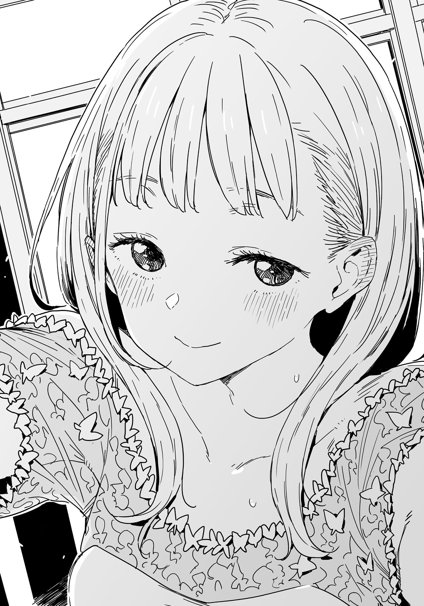

# Ch.94 — เล่ม 7 บทที่ 4-6

Ch.94 — เล่ม 7 บทที่ 4-6

By Monica

Published: 2025-05-16T13:53:57Z

Source: https://www.nekopost.net/novel/14560/94

เล่ม 7 บทที่ 4-6

ผมเงยหน้ามองเพดาน หอบหายใจหนักๆ อยู่ในห้องชมรมการแสดงของโรงเรียนคิริโนะกิ

...เรารอดแล้วสินะ?

หลังจากพุ่งตัวเข้าไปในพุ่มไม้ ทุกอย่างกลายเป็นภาพเบลอ ผมไม่แม้แต่จะหันกลับไป มุ่งหน้าแค่ข้างหน้าด้วยความเร็วสุดชีวิต

สุดท้ายเราก็มาถึงที่นี่ได้ แต่แขนกับเอวของผมเริ่มประท้วงอย่างหนัก

[ …ประธานปล่อยฉันลงได้แล้วนะคะ ? ]

[ หา!? ]

พอตั้งสติได้ ก็พบว่าตัวเองยังอุ้มชิราทามะซังอยู่ ผมรีบวางเธอลงบนพื้น

[ อ่ะ ขอโทษที เจ็บตรงไหนหรือเปล่า? ]

[ ไม่เลยค่ะ ขอบคุณที่ปกป้องฉันไว้นะคะ ประธาน ]

ผมตั้งใจฟังเสียงรอบๆ พยายามจับความเคลื่อนไหวว่าใครตามมาไหม แต่ไม่มีสัญญาณของใครเลย

สิ่งเดียวที่ได้ยินคือเสียงตะโกนไกลๆ จากนักกีฬา และเสียงเครื่องดนตรีทองเหลืองที่เล่นอย่างต่อเนื่อง

[ ดูเหมือนไม่มีใครตามมานะ ]

[ ค่ะ ตอนนี้เราปลอดภัยแล้ว ]

ชิราทามะซังยื่นมือมาเก็บใบไม้ที่ติดอยู่บนผมผมออก

ตอนนี้เราอยู่ในห้องเรียนที่มืดสลัว แค่สองคน เธอยังอยู่ในชุดแต่งงาน

ผมรู้สึกเขินจนต้องเกาแก้มตัวเองแล้วถอยหลังไปหนึ่งก้าว

[ เรามีเวลาเหลือแค่ 15 นาที รีบเปลี่ยนชุดเถอะ ]

[ แต่…ถ้าจะถอดออกหลังจากผ่านอะไรมาเยอะแยะขนาดนี้ มันดูน่าเสียดายนะคะ ]

ชิราทามะซังมองชุดแต่งงานของตัวเองด้วยอย่างเสียดาย ก่อนจะหมุนตัวไปรอบๆ อย่างงดงาม

เลื่อมบนชุดของเธอเปล่งประกายในห้องมืด

[ ดูเข้ากับฉันมั้ยคะ? ]

[ เอ่อ เคยถามไปแล้วไม่ใช่เหรอ? ]

[ อยากฟังอีกครั้งค่ะ ]

เธอยืนกรานอย่างน่าประหลาด ผมยอมแพ้และพยักหน้า

[ อ่า เหมาะมากเลย ]

[ แล้วนั่นหมายความว่าอะไรคะ ? ]

ชิราทามะซังเอนตัวมาข้างหน้า มองผมด้วยสายตาคาดหวัง นี่มันสถานการณ์แบบที่หนีไม่ได้จนกว่าจะพูดสิ่งที่เธออยากได้ยิน

...ผมมันเซียนเกมจีบสาวมืออาชีพอยู่แล้วนี่

[ อ่า ก็ได้ๆ เธอน่ารักดี แต่ผมจะไม่พูดอีกแล้วนะ ]

ผมตอบไปอย่างขอไปที พยายามปิดบังความเขินอาย แต่ผิดคาด สีหน้าของชิราทามะซังกลับเปลี่ยนเป็นจริงจังอย่างไม่คาดคิด

เธอยืนตรงหน้าผม ยื่นแขนออกมาก่อนจะพูดว่า

[ จูบกันดีมั้ยคะ? ]

...หา ? จูบเหรอ ?

นั่นมันสิ่งที่ควรจะเกิดขึ้นในเล่มสุดท้ายขอเลิฟคอมฯคลาสสิกนะ แต่ช่วงนี้บางเรื่องก็พยายามเล่นเกินขอบเขต ทำซีนนี้ตั้งแต่ตอนแรกเลยก็มี—

เดี๋ยวนะ!? จูบ!? ตรงนี้!? ตอนนี้เนี่ยนะ!?

ผมกระโดดถอยหลังด้วยแรงที่มากกว่าที่คิด ตกใจจนพูดไม่ออก

[ ชิราทามะซัง!? นั่นไม่ใช่สิ่งที่ควรพูดออกมาง่ายๆนะ ถึงจะแค่ล้อเล่นก็เถอะ! ]

[ ...งั้นจะไม่ทำเหรอคะ? ]

เธอเอียงคอนิดๆ อย่างน่ารักพร้อมกระพริบตา

[ อ่า ใช่ ไม่ทำหรอก... ]

[ งั้นเหรอ ไม่ทำสินะคะ ? ]

ชิราทามะซังลดแขนลง สีหน้าดูเหมือนผิดหวังเล็กน้อย

...เดี๋ยวนะ ใจเย็นก่อน นี่จริงจังเหรอ ? นี่จะกลายเป็นโมเมนต์เล่มสุดท้ายของผมจริงๆ ใช่มั้ย?

ในขณะที่ผมยืนนิ่งช็อกไป ชิราทามะซังก็หันหลังให้ผมแล้วเดินไปที่ม่านของพื้นที่เปลี่ยนเสื้อผ้า

[ งั้นไปเปลี่ยนชุดก่อนนะคะ ฉันจะเป็นเด็กดีแล้วไปร่วมพิธีให้เรียบร้อย ]

[ ...อ่า ]

ไม่สิ ทำไมผมถึงต้องคิดว่าเธอพูดจริงด้วยล่ะ? รุ่นน้องแค่ล้อเล่นเองนี่นา

ถ้าผมจริงจังขึ้นมาล่ะก็ อาจจะโดนกล่าวหาว่าคุกคามทางเพศ แถมได้จบเรื่องแบบแบดเอนด์ไปเลยก็ได้

ในขณะที่ผมพยักหน้าให้ตัวเอง พยายามปัดความคิดฟุ้งซ่านออกไป ชิราทามะซังก็หันกลับมามองผมก่อนจะเปิดม่าน

[ รู้อะไรมั้ยคะ ประธานค่อนข้าง... ]

[ เอ๋ อะไรนะ!? ]

เสียงของผมหลุดออกมา และชิราทามะซังก็หัวเราะเบาๆ

[ ขี้ขลาดจังเลยนะคะ ? ]

พูดจบเธอก็หายลับเข้าไปหลังม่าน
