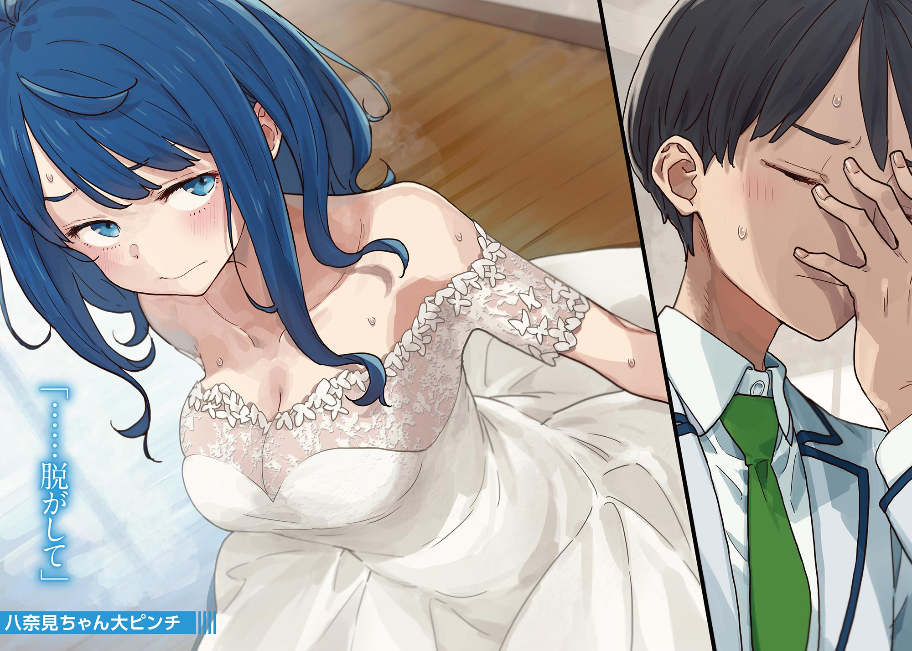

# Ch.95 — เล่ม 7 บทที่ 4-7

Ch.95 — เล่ม 7 บทที่ 4-7

By Monica

Published: 2025-05-16T13:54:11Z

Source: https://www.nekopost.net/novel/14560/95

เล่ม 7 บทที่ 4-7

ติ๊ง...

เสียงเตือนจากโทรศัพท์ดึงผมกลับมาจากอาการครึ่งหลับครึ่งตื่น

หลังจากที่ชิราทามะซังเปลี่ยนเป็นชุดนักเรียนแล้วมุ่งหน้าไปงานแต่งของพี่สาว ผมก็ทรุดตัวลงนอนบนโซฟาอย่างหมดแรง

สิ่งสุดท้ายที่ผมจำได้คือความคิดที่เริ่มพร่าเลือนจนหลับไป ดูเหมือนผมจะเผลอหลับไปโดยไม่รู้ตัว

ขณะที่ผมขยี้ตาและลุกขึ้นนั่ง เสื้อเบลเซอร์ของโรงเรียนซึวะบุกิก็หล่นลงจากไหล่และร่วงลงบนพื้น ดูเหมือนว่ามีใครสักคนคลุมมันให้ผมตอนหลับอยู่ เพราะผมสวมเบลเซอร์อยู่แล้ว เลยกลายเป็นใส่สองชั้น

พอคิดได้แบบนั้น ผมหยิบเบลเซอร์ขึ้นมา ความคุ้นเคยและขนาดที่พอดีบ่งบอกชัดเจนว่ามันเป็นของยานามิ...

ผมเช็คโทรศัพท์ พบว่าผมหลับไปได้ไม่ถึงชั่วโมง และเมื่อเปิดดูแจ้งเตือน ก็เห็นว่าภารกิจสำเร็จแล้ว แม้จะมีอุบัติเหตุเล็กน้อย

อาซากุโมะซังกับประธานกำลังเก็บอุปกรณ์ที่พวกเขาติดตั้งไว้รอบบริเวณนั้น

ผมไม่เข้าใจรายละเอียดทั้งหมด แต่ดูเหมือนว่าถ้าโดนจับได้ อาจจะเกิดปัญหาหนักเกี่ยวกับกฎหมายวิทยุและกฎหมายอื่นๆ

...แล้วจากนั้นล่ะ?

ชิราทามะซังตัดสินใจที่จะเก็บความรู้สึกที่มีต่อทานากะเซ็นเซไว้ และเป็นน้องสะใภ้ที่ดี และถ้าเธอเข้าชมรมวรรณกรรม อนาคตของเราก็คงจะปลอดภัย

ขณะที่ผมลุกขึ้นและแขวนเบลเซอร์ของยานามิกลับที่เดิม ผมสังเกตเห็นม่านในพื้นที่เปลี่ยนชุดขยับเล็กน้อย

[ นุคุมิซึคุง ตอนนี้อยู่คนเดียวใช่มั้ย...? ]

[ เอ๊ะ ยานามิซัง? ขอบคุณที่เอาเบลเซอร์มาคลุมให้นะ ]

ดีแล้วที่ผมไม่ได้พูดอะไรแปลกๆ กับตัวเอง

ขณะที่ผมถอนหายใจโล่งอก ยานามิเรียกเบาๆ อีกครั้ง

[ ...เฮ้ มานี่หน่อยสิ ]

เอ๊ะ? เข้าไปในม่านเนี่ยนะ?

[ ไม่มีทาง ถ้าเธอกำลังเปลี่ยนชุดอยู่ ก็ไม่เข้าไปหรอก ]

[ ฉันแต่งตัวเรียบร้อยแล้ว ไม่เป็นไร เข้ามาเถอะ ]

...ถ้างั้นทำไมไม่ออกมาล่ะ?

ผมไม่เข้าใจ แต่เถียงไปก็ดูจะเสียเวลา ผมเปิดม่านออก และภาพตรงหน้าทำให้ผมพูดไม่ออก

ยานามิยืนอยู่ตรงนั้นในชุดแต่งงานของชิราทามะซัง

เธอก้มหน้าลงเขินอาย ชุดสีขาวของเธอไหวเล็กน้อย

เมื่อเทียบกับชิราทามะซัง หน้าอกที่เด่นชัดกว่าของยานามิดูจะทำให้ชุดเกินพอดีจนแทบจะตึงจนปริ

[ เอ๊ะ? ทำไมถึงใส่- ]

[ ...ช่วยถอดให้หน่อยสิ ]

หา!? นี่ผมยังฝันอยู่หรือเปล่า!?

ผมกลัวว่านี่จะเป็นฝันร้าย ยานามิเงยหน้าขึ้นช้าๆ

น้ำตาคลอเล็กน้อยในดวงตาของเธอ

[ ไม่ดีกว่า ไปขอให้คนอื่น- ]

[ ฉันอยากลองใส่ดู แล้วตอนนี้ถอดไม่ได้! ทำอะไรสักอย่างสิ นุคุมิซึคุง! ]

...หา?

[ ซิปด้านหลังมันไม่ขยับ! คิดว่าหลังจากฉันใส่แล้วชุดมันหดได้น่ะ ! เรื่องแบบนี้เกิดขึ้นบ่อยๆ เชื่อฉันเถอะ! ]

งั้นเหรอ? เกิดขึ้นบ่อยสินะ ? นี่ผมยังฝันร้ายอยู่ใช่มั้ย

[ โอเค เดี๋ยไปตามอาซากุโมะซังกับคนอื่นๆ มา งั้นรออยู่ที่นี่ก่อนนะ ยานามิซัง ]

[ เดี๋ยว! อยากให้ฉันอยู่แบบนี้เหรอ? ฉันไม่อยากให้คนอื่นรู้เรื่องนี้นะ ! ]

แต่ผมรู้ได้ไม่เป็นไร?

ยานามิหันหลัง ยกผมขึ้นเพื่อโชว์ซิปด้านหลังให้เห็น

[ เร็วเข้า ช่วยดึงมันลงที ดึงลงเลย! ]

...จริงเหรอ? เราต้องทำแบบนี้จริงๆ เหรอ?

ถึงจะไม่อยาก แต่ผมก็ปฏิเสธไม่ได้ เพราะผมอ่านสถานการณ์เก่ง

ผมวางนิ้วซ้ายไว้ข้างซิป แล้วค่อยๆ ดึงมันลงด้วยมือขวา—

[ อ๊ะ มันติด ดึงไม่ลงเลย ]

[ เป็นไปไม่ได้ นุคุมิซึคุง นายอ่อนแอเกินไปหรือเปล่า? ]

...ผมน่าจะปล่อยเธอไว้แล้วกลับบ้าน

แต่ความมีน้ำใจของซามูไรทำให้ผมลองอีกครั้ง พยายามดึงซิปลงจนเผยให้เห็นผิวมากขึ้น ผมเบือนหน้าหนีเล็กน้อยด้วยความกระอักกระอ่วน

แต่ซิปก็หยุดค้างกลางทาง ไม่ขยับอีกเลย

[ เป็นอะไรไป? ดึงให้สุดสิ ]

[ เดี๋ยวก่อน ซิปมันติดอะไรบางอย่างที่เป็นสีน้ำเงินข้างใน... ]

[ ...อะไรสีน้ำเงิน? ]

ยานามิหยุดไปครู่หนึ่ง แล้วร้องเสียงหลงแทบจะเป็นเสียงร้องไห้

[ เดี๋ยว!? นั่นมันบราฉัน- ]

หา!? ไอ้สีน้ำเงินนี่มันชุดชั้นในเหรอ!? พอคิดดูดีๆ ก็เห็นว่ามีตะขออยู่

[ แย่แล้ว ผมจะไปตามคนมา— ]

[ ไม่! ฉันไม่ได้ใสไว้หรอก ! มันไม่ใช่บราหรอก ! ]

นั่นไม่น่าอายกว่าเดิมเหรอ?

แต่ถ้าเธอยืนยันว่านั่นไม่ใช่ชุดชั้นใน การทิ้งเธอไว้ตอนนี้คงทำให้ผมดูคิดมากเกินไป ซึ่งจะยิ่งแย่กว่าเดิม ผมเลยจำใจทำต่อ

[ ห้ามมองนะ นุคุมิซึคุง! แล้วก็ห้ามแตะต้องด้วย! ]

[ อ่า ก็ไม่อยากแตะเหมือนกัน- ]

[ อะไร? ฉันก็ซักเสื้อผ้านะ!? ช่วยหน่อย! ฉันยอมให้แตะก็ได้ แค่เอาไอชุดนี้ออกให้ที! ]

ผมไม่อยากเลยจริงๆ ทำไมผมต้องมาจับชุดชั้นในของคนอื่นด้วย?

แต่เราจะไม่มีทางไปต่อได้ถ้ายังเป็นแบบนี้

[ ยานามิซัง มีเนยหรือมาการีนมั้ย? ]

[ หา? จะกินฉันหรือไง? ]

เปล่า ไม่ได้เป็นแบบเธอหรอก

[ เอาเนยมาทาที่ซิป มันจะช่วยให้ลื่นขึ้น แต่เธอคงไม่มีเนยอยู่กับตัว— ]

[ อ๊ะ ฉันมีซองอยู่ในกระเป๋า ]

ทำไม ? แต่ตอนนี้ไม่ใช่เวลาจะถาม

และฝันร้ายก็จบลงในเวลาไม่นานนัก ด้วยความช่วยเหลือจากเนยของยานามิ

◇

...ผมหมดแรงแล้ว นี่มันเหนื่อยกว่าจัดการเรื่องของชิราทามะซังถึงสามเท่า

ผมทรุดตัวลงนอนบนโซฟาอย่างหมดแรง ส่วนยานามิที่กลับมาใส่ชุดนักเรียนแล้วก็ทิ้งตัวลงนั่งข้างผม

[ ...ฉันถูกทำลายแล้ว ]

คำพูดนั้นชวนให้เข้าใจผิดมาก จะว่าไป เธอต่างหากที่ทำลายผม

ยานามิเล่นกับริบบิ้นตรงอกของเธออยู่สักพัก ก่อนจะถอนหายใจแล้วพูดขึ้น

[ นายทำยังไงให้ชิราทามะจังยอมถอย? ]

[ หมายความว่าไง- ]

[ นายเกือบจะทำอะไรบุ่มบ่ามใช่มั้ย? การที่ทำให้เธอถอยง่ายขนาดนั้นมันต้องมีอะไรเกิดขึ้นแน่ๆ ]

มันไม่ใช่เรื่องใหญ่อะไรหรอก แต่ก็ไม่ใช่เรื่องที่อยากเล่าเท่าไหร่...

ผมเลือกคำพูดอย่างระมัดระวัง

[ ...ถ้าต้องพูดล่ะก็ คงเป็นเพราะเธอรู้ว่าตอนนี้ยังไม่ใช่เวลาที่เหมาะสม ]

[ ...หมายถึงเธอแค่เลื่อนไปก่อนใช่มั้ย? ]

[ ใช่ ก็ประมาณนั้น ]

...เลื่อนออกไป การตัดสินใจไม่ใช่คำตอบเสมอไป

คำตอบที่ไม่มีในตอนนี้ อาจจะมาปีหน้า หรือ อาจจะมาพรุ่งนี้ก็ได้

เมื่อถึงเวลานั้น เธออาจจะไม่ทันรู้ตัว และสิ่งที่เธอกำลังยึดมั่นในตอนนี้อาจกลายเป็นเพียงความทรงจำ

ผมไม่เชื่อในตัวเองในแบบที่เป็นอยู่ตอนนี้

เพราะฉะนั้น ผมจึงไม่สิ้นหวังกับอนาคต และก็ไม่คาดหวังเกินไปเช่นกัน

ชิราทามะซังอาจจะขโมยทานากะเซ็นเซไปในวันหนึ่ง หรือเธออาจจะเจอความรักใหม่

ทุกสิ่งจะดำเนินไปตามที่มันควรเป็น และมันจะเป็นแบบนั้นเสมอ

สิ่งเดียวที่เรามีความรับผิดชอบจริงๆ ก็คือตัวเราเองในปัจจุบัน—

ยานามิมองผมด้วยสายตาเรียบเฉยขณะที่ผมกำลังคิดเรื่องเหล่านี้

[ เอ๊ะ? อะไรเหรอ? ]

[ ...นี่ นุคุมิซึคุง นายไม่ได้อาศัยจังหวะเหมาะๆทำอะไรแปลกๆ กับชิราทามะจังใช่มั้ย? ]

[ แน่นอนว่าไม่- ]

ผมกำลังจะตอบ แต่แล้วภาพดวงตาลึกซึ้งชวนหลงใหลของชิราทามะซังก็แวบเข้ามาในหัว

— จูบกันดีมั้ยคะ. . . ?

ถึงมันจะเป็นแค่ความคิดชั่ววูบ แต่ถ้าคิดจริงจัง เธอจะเสียใจ นั่นแหละที่ชิราทามะ ริโกะเป็น

[ เดี๋ยวนะ เกิดอะไรขึ้นจริงๆใช่มั้ย!? นายทำอะไรกับเธอหรือเปล่า? จริงเหรอ? ]

[ ไม่! ผมปฏิเสธเธอ- ]

[ อะไรนะ!? หมายความว่าไง!? ]

แย่แล้ว ผมหลุดพูดออกไป ยานามิทำหน้าโกรธจัดก่อนจะคว้าเนคไทของผม

นี่ไม่ดีเลย—ถ้ายังเป็นแบบนี้ต่อไป ผมจะดูเหมือนคนเลวที่ล่วงเกินรุ่นน้อง

ขณะที่ผมพยายามคิดข้อแก้ตัว ผมสังเกตเห็นมีสายตาคู่หนึ่งจ้องมองเราอยู่ ผมหันไปมองที่ประตูห้องเรียน

ที่นั่น อาซากุโมะซังกับประธานยืนอยู่ พร้อมกับรอยยิ้มเจ้าเล่ห์ ปรากฏบนใบหน้าทั้งคู่

[ [ ขอบคุณสำหรับอาหารนะค่ะ ] ]

ยานามิกับผมรีบตะโกนตอบกลับอย่างพร้อมเพรียงกัน

[ [ ไม่ใช่แบบนั้นสักหน่อย! ] ]
