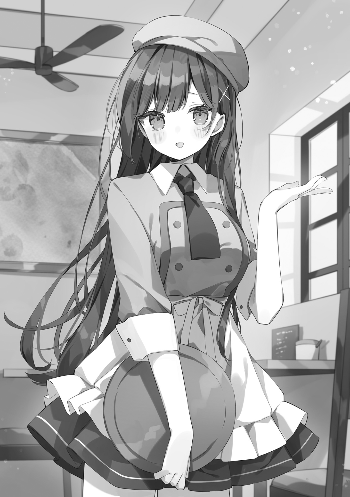

# Ch.20 — คาเฟ่

Ch.20 — คาเฟ่

By Maou Gakuin

Published: 2025-03-04T07:09:27Z

Source: https://www.nekopost.net/novel/14982/20

ตอนที่ 20: คาเฟ่

“...ที่นี่สินะ... ที่ทำงานพิเศษของ ฮิเมโนะ ซัง

แม่สาวงามประจำชั้น...”

ผมพึมพำเบา ๆ ขณะมองเข้าไปในคาเฟ่ที่ดูเหมือนร้านกาแฟโคดะแบบธุรกิจส่วนตัว

ถ้าเป็นปกติแล้ว ผมคงไม่มีวันเข้ามาที่แบบนี้แน่ ๆ หรือแม้แต่จะหันไปมองก็คงไม่ทำ แต่พอได้ยินว่าที่นี่เป็นที่ทำงานของฮิเมโนะซังเท่านั้นแหละ... รู้สึกอยากมาที่นี่ทุกวันเลย

"อย่างนี้นี่เอง นี่สินะ...พลังของสาวงาม"

ถ้าส่งข่าวนี้ไปทั่วโรงเรียน ค่าจ้างของฮิเมโนะซังอาจจะขึ้นรึเปล่านะ?

แต่ถ้าการทำแบบนั้นช่วยให้ค่าจ้างขึ้นได้จริง ฮิเมโนะซังก็คงทำไปแล้วล่ะ และถ้าเธอไม่บอกใคร ก็คงมีเหตุผลบางอย่างที่มันไม่เป็นผลดีกับเธอสินะ...

"อืม เข้าไปเร็ว"

"เดี๋ยว ๆ ขอเวลาตั้งตัวก่—"

"ยินดีต้อนรับค่ะ! สองที่นั่งใช่ไหมคะ!?"

"อืม"

"ถ้าอย่างนั้น เชิญทางนี้ค่ะ"

พอเข้ามาในร้าน ฮิเมโนะซังก็เดินมารับลูกค้าในชุดผ้ากันเปื้อนและหมวกเบเร่ต์

เพราะเป็นคนรู้จักกัน เธอดูเขินอายนิดหน่อย

แก้มแดงระเรื่อ ซึ่งยิ่งทำให้เธอดูน่ารักขึ้นไปอีก

เธอพาเรามานั่งที่โต๊ะสี่ที่นั่ง แล้วทันใดนั้นเอง ชายสูงวัยที่ดูยังไงก็คงเป็นเจ้าของร้านเดินออกมาจากด้านใน

เขามีรอยยิ้มใจดีและพูดกับเราอย่างเป็นกันเอง

"ขอบคุณที่แวะมานะ ฉันเป็นเจ้าของร้านนี้ พวกเธอเป็นเพื่อนของพนักงานดาวเด่นของร้านสินะ?

เป็นไงบ้าง ชุดของเมย์จัง?"

"น่ารักสุด ๆ เลยครับ ถ้าได้เห็นเธอในชุดนี้ ผมจะมาทุกวันเลย เจ๋งมากครับเจ้าของร้าน"

"อืม น่ารักสุด ๆ ใส่แล้วเหมาะมาก"

"ฮ่า ๆ จริงสินะ! ก็ชุดนี้ฉันสั่งตัดพิเศษให้เธอโดยเฉพาะเลยนี่นา จะให้ใส่ชุดธรรมดา ๆ ไม่ได้หรอก"

...เจ้าของร้าน เข้าใจอะไรดีจริง ๆ นะ

คุณนี่... เป็นอัจฉริยะรึเปล่า?

"หยุดเลยค่ะ...! คนที่โดนชมรู้สึกอายแย่นะคะ!"

ขณะที่ผมมองเจ้าของร้านด้วยสายตาชื่นชม ฮิเมโนะซังก็หน้าแดงก่ำ ปิดหน้าตัวเองพร้อมสั่นไปมาอย่างเขินอาย

แต่ว่า... ทำไมนะ รู้สึกอยากแกล้งให้เธอเขินมากกว่านี้ขึ้นมาแล้วสิ

และดูเหมือนว่าผมจะไม่ได้คิดแบบนี้คนเดียว... เพราะทั้งยูซุและเจ้าของร้านก็เหมือนจะคิดเหมือนกัน

"อืม น่ารักมาก อยากถ่ายรูป"

"ปล่อยให้เป็นหน้าที่ฉันเอง ยูซึ! ฉันพกกล้อง DSLR มาด้วยเพื่อเหตุการณ์แบบนี้แหละ"

"อืม ไอเดียดีเกินคาดแฮะ เอตะ"

"วิเศษมากหนุ่มน้อย งั้นฉันจะถ่ายให้เอง ไหน ๆ ก็ไหน ๆ ฉันเคยเป็นช่างภาพมาก่อนด้วยนะ"

"อ๊ะ...อ๊า..."

เรื่องราวดำเนินไปอย่างรวดเร็วจนฮิเมโนะซังตามไม่ทัน และสุดท้ายเจ้าของร้านถึงกับปิดร้านชั่วคราว ทำให้ที่นี่กลายเป็นพื้นที่ส่วนตัวสำหรับพวกเรา

หลังจากที่ถ่ายรูปกันเสร็จ เจ้าของร้านก็เสิร์ฟกาแฟกับเค้กให้พวกเราฟรี ๆ แล้วพวกเราก็นั่งคุยกัน

"อะ..เอ่อ เจ้าของร้าน..."

"ไม่เป็นไรหรอกเมย์จัง ฉันยังคิดเงินค่าชั่วโมงทำงานให้เธออยู่"

"มะ ไม่เป็นไรค่ะ! ได้เงินทั้งที่ไม่ได้ทำงานมัน..."

ฮิเมโนะซังรีบส่ายหัวและโบกมือปฏิเสธ เจ้าของร้านจึงยิ้มให้อย่างใจดี

"ไม่เป็นไรหรอกเมย์จัง นี่เป็นครั้งแรกที่เพื่อนของเธอมาเยี่ยมเลยนะ ฉันไม่ใจร้ายขนาดจะให้เด็กมาทำงานตอนแบบนี้หรอก"

...ปกติแล้วเขาควรจะให้เธอทำงานนะ

แต่ว่า... เจ้าของร้านนี่ใจดีเกินไปแล้ว

ที่นี่อะไรกันเนี่ย... ผมอยากทำงานที่นี่เลยนะ

จะให้ดี... อยากสมัครเป็นพนักงานประจำเลยด้วยซ้ำ

"ขะ ขอบคุณมากจริง ๆ ค่ะ!"

"ฮ่า ๆ ไม่เป็นไรหรอก ฉันเองก็คอยฟังเรื่องพวกเธออยู่ทุกวันเลยนะ เมย์จังชอบเล่าให้ฟังเสมอเลย"

"คะ...คุณเจ้าของร้าน...!?"

ฮิเมโนะซัง... พูดถึงพวกเราด้วยเหรอ?

ได้เป็นหัวข้อสนทนาของสาวงามเนี่ย... รู้สึกเป็นเกียรติจนอยากจะร้องไห้เลย

"เฮ้ ยูซึ... นี่มันไม่ใช่ความฝันใช่มั้ย?"

"อืม ฉันจะช่วยปลุกนายให้ตื่นเอง"

"โอ้โห! นี่มันความจริง! ช่างเป็นสิ่งที่ยอดเยี่ยม!"

ผมขยับตัวหนี ยูซึที่กำหมัดแน่นเหมือนจะต่อยจริง ๆ

พอเห็นแบบนั้น ทั้งฮิเมโนะซังและเจ้าของร้านก็หัวเราะ

"ฮ่า ๆ ๆ! พวกเธอนี่ตลกดีนะ แต่ดูเป็นเด็กดีทั้งคู่เลย ดีจังเลยนะ เมย์จัง"

"ค่ะ! พวกเขาเป็นเพื่อนที่สำคัญของฉันค่ะ!"

ฮิเมโนะซังยิ้มเขิน ๆ แต่ดูมีความสุขมาก

รอยยิ้มของเธอในตอนนี้ดูสดใสและน่ารักกว่าตอนอยู่โรงเรียนหลายเท่า

เมื่อเห็นแบบนั้น ผมกับยูซึก็สบตากันแล้วสื่อสารโดยไม่ต้องพูด

——จากนี้ไป ต้องมาที่นี่ทุกวันแล้วล่ะ

นอกจากนี้ เจ้าของร้านยังเสิร์ฟกาแฟ เค้ก และเจลลี่กาแฟที่เขาทำเอง ซึ่งอร่อยสุด ๆ

ตอนนี้ผมกำลังพิจารณาจริงจังเลยว่า... จะสมัครงานที่นี่ดีไหม
