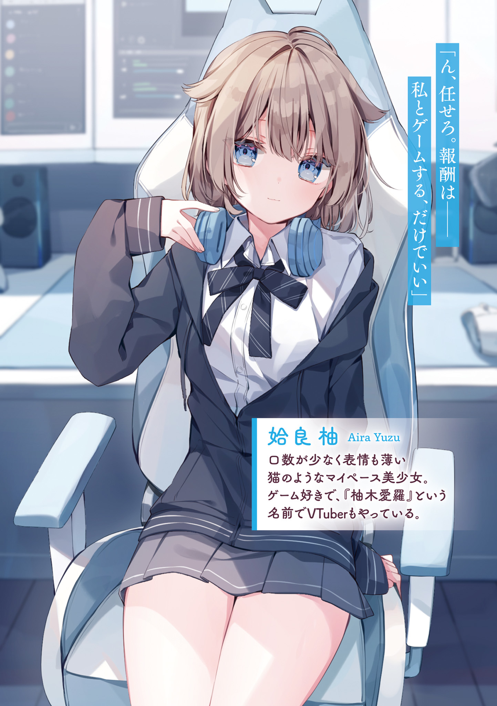

# Ch.26 — สัญญา (เครื่องเกม)

Ch.26 — สัญญา (เครื่องเกม)

By Maou Gakuin

Published: 2025-03-04T10:19:59Z

Source: https://www.nekopost.net/novel/14982/26

ตอนที่ 26 สัญญา (เครื่องเกม)

"——— เอ้ตะ นี่ เกม"

"หะ? อ๋อ… อยู่ดีๆ ทำไมถึงเอามาให้ล่ะ? แต่ก็พอดีเลยแฮะ"

ตอนที่ฉันอยู่ในห้องแยก กำลังเรียนรู้มารยาทการเป็นพ่อบ้านจาก คามิยามะ อาซาฮิ —— ยูซึ ก็โผล่มาหาฉันกะทันหัน

ดูเหมือนว่าเธอจะเอาเกมที่เคยสัญญาไว้ว่าจะขายให้ในราคาถูกมาให้ฉัน

พูดถึงเรื่องพ่อบ้าน จริงๆ แล้วรวมฉันด้วยพวกเรามีทั้งหมดสี่คน

หนึ่งในนั้นคือ ยางามิ มาซาโตะ——ถึงจะเป็นคนผมดำ แต่บุคลิกกลับดูเจ้าชู้มากทั้งคำพูดและท่าทาง

อีกคนคือ อาคิฮาระ โชเฮย์——เป็นพวกกล้ามล่ำจนเห็นได้ชัดแม้จะใส่ชุดเครื่องแบบอยู่

เหมือนกับฉัน ทั้งสองคนไม่มีประสบการณ์การเป็นพ่อบ้านมาก่อน ก็เลยต้องเข้าเรียน "คอร์สพ่อบ้าน" ของ

คามิยามะ อาซาฮิ ด้วยกัน

แต่ตอนนี้ นอกจาก คามิยามะ อาซาฮิ แล้ว ทุกคนต่างก็หมดสภาพกันหมด

มารยาทที่เข้มงวดกว่าที่คิด ไหนจะต้องรักษาท่าทาง

คำพูด และการเคลื่อนไหวให้ถูกต้อง มันทำให้พวกเราหมดแรงกันสุดๆ

สำหรับฉันแล้ว การที่ ยูซึ มาปรากฏตัวในเวลานี้เป็นอะไรที่น่าขอบคุณจริงๆ

"เยี่ยมมาก ทำได้ดีจริงๆ งั้นฉันขอกลับก่อนละ"

"อืม ฝึกที่บ้านด้วยล่ะ"

"รับทราบ"

"เห้ย! นี่จะทิ้งพวกฉันไปเฉยๆ งั้นเหรอ!? แบบนี้มันไม่แฟร์เลยป่ะ!?"

"ใช่! ทำไมให้พวกฉันซ้อมกันอยู่คนเดียว——"

"มีปัญหาอะไรมั้ย?"

"…ไม่มีครับ" "…ไม่มีครับ"

ทั้งสองคนที่พยายามเรียกร้องความเป็นธรรมให้ตัวเอง ถึงกับเงียบไปทันทีเมื่อเจอรอยยิ้มอันเปี่ยมเสน่ห์แต่เต็มไปด้วยแรงกดดันของ คามิยามะ อาซาฮิ

สุดท้ายพวกเขาก็ทรุดลงไปกับพื้น สีหน้าดูหมดหวังสุดๆ

ก็เอาเถอะ ยังไงพวกเขาก็คงจะได้สนุกกับการทำงานที่คาเฟ่พ่อบ้านกับสาวๆ อยู่ดี

แต่สำหรับฉันน่ะเหรอ? ต้องมารับบทพ่อบ้านที่ตัวเองไม่ได้อยากทำเลยสักนิด แถมยังกลายเป็นเป้าหมายความอาฆาตของนักเรียนแทบทั้งโรงเรียน

ยังไงซะนี่ก็ต้องเป็นหนึ่งในช่วงเวลาที่ฉันอยากจะลบออกจากชีวิตแน่นอน

"……ไปกันเถอะ"

"หืม? เป็นอะไรไป ทำไมดูอารมณ์ไม่ดีจัง?"

ตอนที่ฉันกำลังคิดอะไรในใจอยู่ ยูซึ ก็เดินตรงไปข้างหน้าพร้อมกับดึงแขนเสื้อฉัน ราวกับจะเร่งให้ฉันตามไป

ยิ่งไปกว่านั้น วันนี้เธอดูจะไร้อารมณ์มากกว่าปกติ ไม่ใช่แค่ไม่พอใจ…แต่เหมือนจะสับสนอะไรบางอย่างมากกว่า

พอเดินมาถึงตู้รองเท้า ยูซึ ก็หยุดลงเป็นครั้งแรก และปล่อยมือจากแขนเสื้อของฉัน

จากนั้นก็เอียงคอเล็กน้อยด้วยความสงสัย

"……หายแล้ว ทำไมกันนะ?"

"หาย? อะไรหาย? หรือว่าไปเจ็บตรงไหนมา?"

ฉันถามกลับ แต่เธอกลับส่ายหัวปฏิเสธ

"ไม่ใช่… แค่… ไม่เป็นไรแล้ว"

"ไม่เป็นไร!? เฮ้ย! นั่นมันทำให้ฉันสงสัยกว่าเดิมอีกนะ!? เธอจะตัดบทแบบนี้ได้ไง!? เดี๋ยวๆ ยูซึ! บอกฉันทีเถอะ! ฉันอยากรู้จนทนไม่ไหวแล้ว!"

ฉันพยายามเค้นคำตอบออกมา——แต่เธอกลับหัวเราะเบาๆ อย่างเจ้าเล่ห์

"——— ฮึ… ไม่เอา เอ้ตะต้องคิดถึงฉันไปตลอดก็พอแล้ว"

"……สาวน่ารักนี่มันเจ้าเล่ห์ชะมัด……"

พอเจอรอยยิ้มแบบนั้นเข้าไป ฉันก็ทำอะไรไม่ได้อีกต่อไปสุดท้ายก็ทำได้แค่เดินตามเธอไปเท่านั้น

---

"ว่าแต่ เธอเอาเกมมาให้ฉันแล้วใช่ไหม?"

ฉันถามขึ้น ตอนที่เรามาถึงจุดที่เรามักจะแยกกันกลับบ้าน แต่พอคิดดูแล้ว ยูซึ ถือแค่กระเป๋านักเรียนธรรมดาเท่านั้น ดูยังไงก็ไม่น่าจะพกเครื่องเกม P◯5 ที่มีขนาดใหญ่ขนาดนั้นมาได้

…แต่ไม่รู้ทำไม ฉันกลับรู้สึกได้เลยว่าเธอกำลังจะพูดอะไรบางอย่างที่ฉันคาดไว้ล่วงหน้า

ไม่น่าจะใช่เรื่องนั้น… ใช่ไหม…?

ต่อให้เป็น ยูซึ ก็คงไม่ทำอะไรที่ดูไร้สามัญสำนึกขนาดนั้นหรอก…

หรือบางที ฉันควรคาดหวังให้เธอมีความละอายต่อสังคมบ้าง…?

ตอนที่ฉันกำลังวิตกหนักในใจ——เธอกลับพูดออกมาหน้าตาเฉย

"อืม เอ้ตะต้องไปที่บ้านฉัน"

"ว่าแล้วเชียว!!! แต่เดี๋ยวนะ! ฉันเป็นผู้ชายนะ! เธอควรจะมีความเขินอายอะไรบ้างไหม…!?"

"งั้นไม่เอาก็ได้นะ?"

"เอา!"

"งั้นก็ตามมา"

"……ครับ"

สุดท้ายฉันก็เลิกคาดหวังให้เธอมีสามัญสำนึก

และตั้งปณิธานแน่วแน่ว่าจะต้องชวน ฮิเมโนะซัง มาสั่งสอนเธอให้ได้ในเร็ววัน
