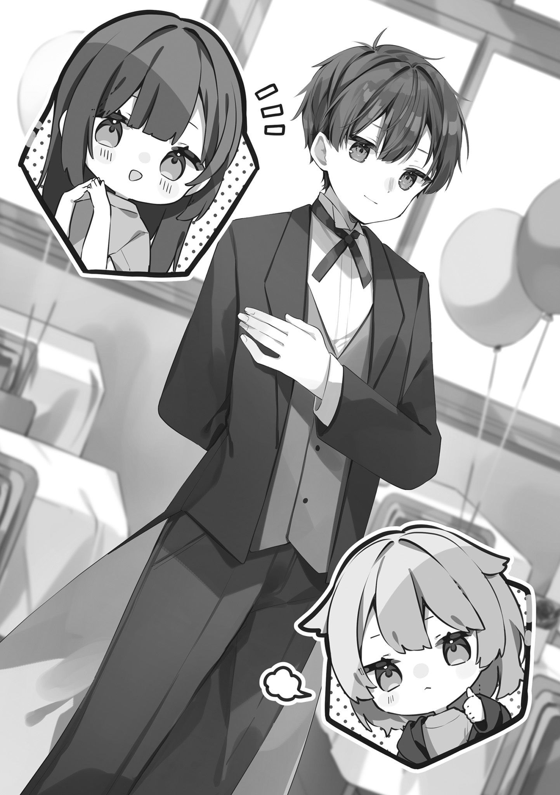

# Ch.32 — ชุดพ่อบ้านกับสองสาวงาม

Ch.32 — ชุดพ่อบ้านกับสองสาวงาม

By Maou Gakuin

Published: 2025-03-05T01:41:46Z

Source: https://www.nekopost.net/novel/14982/32

ตอนที่ 32: ชุดพ่อบ้านกับสองสาวงาม

กาลเวลาเดินผ่านไป จนกระทั่งถึงวันงานวัฒนธรรมในที่สุด

พวกเรานักเรียนมาถึงโรงเรียนเร็วขึ้นกว่าปกติราวหนึ่งชั่วโมงเพื่อเตรียมการขั้นสุดท้าย เวลาขณะนี้คือเก้าโมงเช้า พิธีเปิดจะเริ่มในเวลาเก้าโมงครึ่ง นั่นหมายความว่าเรามีเวลาเพียงสามสิบนาทีเท่านั้นเพื่อเตรียมทุกอย่างให้สมบูรณ์———

"แย่ละ... ตื่นเต้นจริง ๆ"

"นั่นดิ ทำไมรู้สึกตื่นเต้นยิ่งกว่าตอนแข่งชมรมอีกวะ..."

"…………(ตายแน่)"

ยากามิ มาซาโตะ ที่ปกติเป็นคนทะเล้น ตอนนี้กลับมีสีหน้าตึงเครียดผิดปกติ ส่วน อากิฮาระ โชเฮย์ ที่มีกล้ามเนื้อแข็งแกร่งก็ถึงกับตัวสั่นเล็กน้อย

...แล้วฉันล่ะเหรอ?

แน่นอนว่าฉันเองก็กลัวสายตาของแขกที่จะมองมาจนแทบขาดใจ พูดให้ถูกกว่านั้น ตอนนี้ฉันอาจจะตายไปแล้วครึ่งหนึ่งด้วยซ้ำ

"อะฮะฮะ... ไม่เป็นไรหรอก ทุกคน พวกเราฝึกซ้อมมาด้วยกันไม่ใช่เหรอ?"

"แต่การฝึกซ้อมกับของจริง———"

"มันไม่ต่างกันหรอก! ในเมื่อเราทำได้ตอนซ้อม งั้นของจริงก็ไม่มีปัญหาใช่ไหม?"

"「———อ๊ะ? อยู่ดี ๆ ความตื่นเต้นก็หายไปหมดเลย!

ได้เวลาก้าวไปข้างหน้าแล้วสินะ!!」"

เพียงแค่ อาซาฮิ เอ่ยคำพูดที่ทำให้นึกถึงตอนฝึกซ้อม ทุกคนก็ตอบรับอย่างพร้อมเพรียงกันราวกับนัดกันไว้

หรือพูดให้ถูกก็คือ พอนึกถึงการฝึกซ้อมแล้วก็ยิ่งหวาดกลัวเข้าไปอีก แต่เพื่อรักษาฟอร์มเลยไม่พูดออกไปจะดีกว่า

พวกเราทั้งสี่ที่ได้รับมอบหมายให้เป็นพ่อบ้านสวมชุดพ่อบ้านและยืนประจำที่หน้าประตู พร้อมต้อนรับลูกค้าทุกเมื่อ ในมุมหนึ่งของห้องเรียนที่ถูกดัดแปลงเป็นครัว

เหล่านักเรียนที่เก่งเรื่องทำอาหารก็กำลังทบทวนเมนูที่คิดขึ้นร่วมกันโดยมีฉันเป็นคนริเริ่ม

...แล้วพวกนั้นจะตื่นเต้นกันทำไม? ฉันให้สูตรละเอียดขนาดนั้นแล้วนะ...

คาเฟ่ของพวกเรามีเมนูตั้งแต่เครื่องดื่มอย่างกาแฟและน้ำผลไม้ ไปจนถึงของหวานเบา ๆ เช่นเค้กและคุกกี้

รวมถึงอาหารหนักอย่างสปาเกตตี้นาโปลิตัน

แทบทั้งหมดเป็นไอเดียของฉันเอง และประมาณ 70% เป็นเมนูออริจินัลของฉัน ส่วนที่เหลือเป็นสูตรที่ฝ่ายอาหารคิดขึ้นมาเอง

"ว่าไปแล้ว... พวกผู้หญิงไม่ค่อยบ่นอะไรแฮะ"

ตอนที่ฉันแจกสูตรให้ดู เหมือนจะมีสายตาชื่นชมปนมาด้วยเล็กน้อย อาจจะเป็นเพราะพวกเธอไม่ได้อยู่ข้างเดียวกับ ไซออนจิ หัวโจกของฝ่ายหญิงก็เป็นได้

แต่ไม่ว่าเหตุผลจะเป็นอะไร อย่างน้อยก็ทำให้รู้ว่าสาว ๆ ในห้องไม่ได้เป็นศัตรูทั้งหมด ก็ถือเป็นเรื่องดี

ขณะที่ฉันกำลังคิดอะไรเรื่อยเปื่อย—เสียงประกาศเริ่มพิธีเปิดก็ดังขึ้น

《เอาล่ะ———ขอประกาศเปิดงานวัฒนธรรมครั้งที่ 27 อย่างเป็นทางการ!》

"「「「ยินดีต้อนรับกลับบ้านนะครับ คุณหนู」」」"

"ว้าวววว!! หล่อกันทุกคนเลย! คาเฟ่พ่อบ้านที่มีระดับหน้าตาสูงแบบนี้หาได้ไม่ง่ายเลยนะ!"

"อ๊าา... แค่ได้มองหน้า อาซาฮิคุง ดวงตาของฉันก็กลับมามีชีวิตอีกครั้ง!"

"กล้ามเนื้อนั่น... หืม... น่ากิน..."

หญิงสาวสามคนเดินเข้ามาและเลือกพ่อบ้านแต่ละคนให้นั่งด้วย จากนั้นพวกเธอก็ส่งเสียงกรี๊ดกร๊าดอย่างมีความสุขขณะพูดคุยกับพ่อบ้านของตน

———ยกเว้นฉัน

"…………รู้อยู่แล้ว แต่แบบนี้มันก็โหดร้ายไปหน่อยนะ"

ไม่เพียงแค่ไม่มีใครเลือกฉัน

แต่พอฉันต้องไปดูแลโต๊ะเพื่อให้จำนวนคนพอดี แขกยังทำหน้าผิดหวังออกมาชัดเจนอีกต่างหาก

ทั้งที่ฉันตั้งใจฝึกมารยาทและกิริยามากกว่าพวกนั้นสองเท่าแท้ ๆ

"…………สุดท้ายก็เป็นเรื่องหน้าตาสินะ"

ก็หน้าตาสินะ! ให้ตายเถอะ... พวกหล่อ ๆ บนโลกนี้จงหายไปให้หมดเลย!  (((อย่าๆ เดี่ยวคนแปลหาย))

แล้วก็จ่ายค่าทำขวัญให้ฉันซะ!!

ตอนนี้ฉันหมดกำลังใจสุด ๆ อยากจะเลิกไปให้รู้แล้วรู้รอด หรือจะเรียกว่าอยู่ในสภาพ "กักขังทรมาน" ก็ยังได้

หลักฐานก็คือ ตอนนี้ฉันแค่นั่งขดอยู่ในมุมห้องมืด ๆ อย่างไร้วิญญาณ ไม่มีใครพูดด้วย หรือแม้แต่ชายตามอง

"……เฮ้อ นี่ฉันร้องไห้ได้ไหม? ร้องไห้ได้ใช่ไหม?

แบบนี้มันร้องได้แล้วใช่ไหม?"

แม้จะพึมพำออกมา แต่ก็ไม่มีใครตอบรับ เสียงของฉันเพียงแค่สลายหายไปในความว่างเปล่า

อา—เศร้าจัง ขณะที่ฉันกำลังหมดหวังจริง ๆ ลูกค้ากลุ่มใหม่ก็เดินเข้ามา

คิดว่าเป็นพวกสาว ๆ สามคนนั้นอีกตามเคย... แต่ทันใดนั้น เสียงที่คุ้นเคยก็ดังขึ้นในคาเฟ่พ่อบ้าน

"———ฉันเลือกเอตะ"

"ฉันก็อยากให้เอตะคุงบริการค่ะ!"

———ยูซุ กับ ฮิเมโนะ... เมย์ นั่นเอง

สองสาวที่เปล่งออร่าโดดเด่นเหนือใคร ทั้งยังงดงามเป็นพิเศษ วันนี้พวกเธอใส่เสื้อยืดทีมของห้องเรียน ทำให้ดูน่ารักเป็นกันเองมากกว่าปกติ

แม้ว่าเหตุผลที่ฉันต้องมาติดอยู่ในสภาพนี้จะเป็นเพราะคนใดคนหนึ่งในนั้น แต่ฉันก็ยังอดดีใจไม่ได้

ถึงขั้นตั้งใจให้บริการอย่างสุดความสามารถเลยทีเดียว

"ยินดีต้อนรับกลับบ้านนะครับ คุณหนูยูสซุคุณหนูเมย์

ที่นั่งของท่านอยู่ทางนี้ครับ"

น้ำเสียงและท่าทีที่สมบูรณ์แบบของฉัน ทำให้ทั้งสองถึงกับอึ้งไปชั่วขณะ

"......อืม ราวกับเป็นคนละคน"

"นั่นสินะ... ดูพ่อบ้านมากเลยค่ะ! ถึงฉันจะไม่เคยเห็นของจริงก็เถอะ!"

สุดยอดเลย พวกเธอนี่แหละที่สุดแล้ว

ฉันรู้สึกขอบคุณทั้งสองคนจากใจจริง
