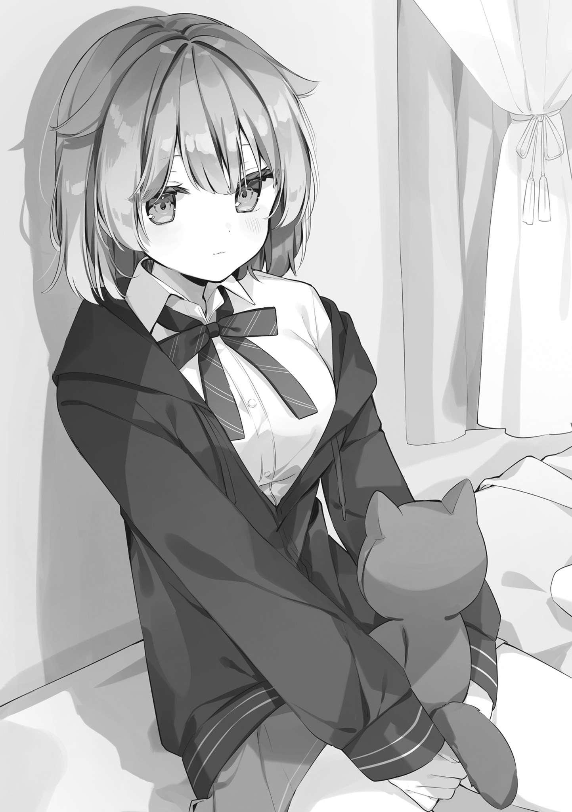

# Ch.36 — สิ่งที่อยากปกป้อง (มุมมองของยูซุ)

Ch.36 — สิ่งที่อยากปกป้อง (มุมมองของยูซุ)

By Maou Gakuin

Published: 2025-03-05T11:17:01Z

Source: https://www.nekopost.net/novel/14982/36

ตอนที่ 36 สิ่งที่อยากปกป้อง (มุมมองของยูซุ)

———ดูเหมือนว่าฉันจะตื่นเต้นเกินไปกับการได้เดินชมงานวัฒนธรรมกับเพื่อนเป็นครั้งแรก

---

"———เธอเป็นนักเรียนของโรงเรียนนี้ใช่ไหม?"

"ไปเดินด้วยกันไหม?"

"รับรองว่าสนุกแน่นอน!"

"ไม่ล่ะ ไม่เอาเด็ดขาด"

ตอนที่ฉันกำลังจะกลับไปพร้อมกับไก่คาราอาเกะที่ซื้อมา ฉันก็โดนกลุ่มหนุ่มเจ้าชู้สามคนเข้ามาทัก ดูแค่แวบเดียวก็รู้ได้ทันทีว่าพวกเขามาเที่ยวเล่นกันแน่ ๆ

ฉันเข้าใจดีว่าตัวเองมีหน้าตาที่โดดเด่นกว่าคนอื่นอย่างเห็นได้ชัด ดังนั้น เวลาที่ออกไปข้างนอกในวันหยุดก็มักจะโดนจีบแบบนี้แทบจะเป็นเรื่องปกติ แต่เพราะอย่างนั้น ฉันเองก็พอรู้วิธีรับมือกับพวกจีบสาวพวกนี้อยู่บ้าง

แม้ว่าหนุ่มเจ้าชู้กลุ่มนั้นจะพยายามชวนฉันไปด้วยรอยยิ้มจอมปลอม แต่แน่นอนว่าฉันปฏิเสธทันที ถ้าแสดงให้เห็นว่าไม่สนใจเลยแบบนี้ พวกจีบสาวส่วนใหญ่ก็มักจะถอยไปเอง

แต่———พวกนี้ต่างจากนักเรียนชายในโรงเรียน หรือพวกจีบสาวทั่วไป พวกเขาไม่ยอมแพ้ง่าย ๆ

"เฮ้อออ~ ทำไมเธอเล่นตัวจัง! แค่นิดเดียวเอง สนุกออกนะ!"

"ไปเล่นกับผู้ใหญ่แทนเด็ก ๆ พวกนั้นดีกว่านะ!"

พวกเขาดูเหมือนนักศึกษามากกว่านักเรียน มันน่าจะตรงไหนที่เรียกว่า 'ผู้ใหญ่' กันนะ?

ถ้าเทียบกันแล้ว เอตะที่เป็นคนเอาใจใส่และสามารถทำอะไรเพื่อคนอื่นได้ ยังดูเป็นผู้ใหญ่กว่าพวกนี้เยอะเลย

"ไม่ล่ะ ถ้ายังตื๊อมากกว่านี้ ฉันจะเรียกเจ้าหน้าที่รักษาความปลอดภัย"

ฉันเริ่มรู้สึกว่ามันน่ารำคาญแล้ว จึงค่อย ๆ ถอยออกห่างจากพวกนั้นพร้อมกับพูดออกไป ทันทีที่คำว่า 'เจ้าหน้าที่รักษาความปลอดภัย' หลุดออกจากปาก พวกนั้นก็หยุดนิ่งไป

ดูเหมือนว่ามันจะได้ผล

พอฉันเริ่มรู้สึกโล่งใจและกำลังจะเดินกลับไป ชายคนหนึ่งก็รีบก้าวเข้ามาดักทาง สีหน้าของเขาดูโกรธขึ้นมาอย่างเห็นได้ชัด

"———พวกฉันพูดดี ๆ ด้วยแล้วอย่ามาทำเป็นได้ใจ! ผู้หญิงน่ะ ควรจะทำตามที่ผู้ชายบอกก็พอแล้ว!"

คำพูดที่เต็มไปด้วยอคติทางเพศอย่างชัดเจนทำให้ฉันรู้สึกเย็นชากับผู้ชายแบบนี้มากขึ้นไปอีก

ชายอีกสองคนที่ยืนอยู่ข้าง ๆ ดูเหมือนจะเริ่มกังวลขึ้นมา

"เฮ้... นี่มันไม่ดีแล้วนะ! นี่อยู่ในโรงเรียนนะเว้ย!"

"จริง ถ้าโดนจับได้จะโดนไล่ออกแน่ ๆ..."

ดูเหมือนว่าพวกเขาจะยังพอมีสำนึกอยู่บ้าง แต่ก็ไม่ได้ช่วยให้ฉันรู้สึกดีขึ้นเลย

พูดก็พูดเถอะ มีหลายคนในโรงเรียนที่ชอบเรียกเอตะว่า 'ไอ้เลว' อยู่บ่อย ๆ แต่ฉันคิดว่าคนที่เป็นขยะจริง ๆ น่ะ คือคนพวกนี้ต่างหาก คนพวกนั้นคงไม่เคยเจอพวกขยะจริง ๆ มาก่อนสินะ ถึงได้พูดแบบนั้น

"……อะไร? ฉันจะกลับแล้ว หลบไปซะ"

"อย่าคิดว่าตัวเองดีเกินไปหน่อยเลย! เด็ก ม.ปลายแบบเธอน่ะ ฉันจัดการได้ในพริบตา!"

เขาขมวดคิ้ว สีหน้าแดงก่ำก่อนจะคว้าข้อมือฉันไว้แน่นโดยไม่ลังเล

แรงของเขามากพอที่จะทำให้ฉันที่ไม่ได้แข็งแรงมากนัก รู้สึกหวาดกลัว———เป็นครั้งแรกที่ฉันกลัวผู้ชายจริง ๆ

"……อึก เจ็บ...! ปล่อยนะ…!"

พอฉันร้องออกมาด้วยสีหน้าที่แสดงความเจ็บปวด

เขากลับยิ้มกว้างขึ้นเหมือนเริ่มได้ใจ

"หึ ใครจะไปปล่อย———"

ยังไม่ทันที่เขาจะพูดจบ เสียงที่ฉันคุ้นเคยและรู้สึกพึ่งพาได้ก็ดังขึ้นจากข้างหลัง

"———เฮ้! ไอ้พวกขยะเอ๊ย!! อย่ามายุ่งกับเพื่อนอันน้อยนิดของฉันนะเว้ย!!"

"———อ้าก!?"

เอตะพุ่งเข้ามาแล้วเตะเข้ากลางลำตัวของชายคนนั้นจนเขาปล่อยข้อมือฉันและกระเด็นไปไกลหลายเมตร

แต่เอตะไม่ได้สนใจพวกนั้นเลย เขารีบวิ่งมาหาฉันทันที

"ยูซุ! เป็นอะไรไหม!?"

สีหน้าของเอตะ———แตกต่างจากปกติอย่างสิ้นเชิง

ครั้งนี้เขากังวลเกี่ยวกับฉันอย่างจริงจัง

ท่าทางและสีหน้าของเอตะที่ไม่เหมือนเดิมทำให้หัวใจของฉันเต้นแรงขึ้นมาทันที

…………?

ฉันรู้สึกแปลกกับความรู้สึกที่เกิดขึ้นในตัวเอง

แต่ก็พยายามตอบกลับไป

แม้หลังจากนั้น เอตะก็ยังคงเป็นห่วงฉันไม่หยุด

มันทำให้ฉันดีใจ

ทั้งที่เขาช่วยฉันเอาไว้

ทั้งที่เขาคอยเป็นห่วงฉัน

ทั้งที่ก่อนจะเตะเจ้าพวกนั้น เขาเรียกฉันว่า 'เพื่อนที่สำคัญ'

ทุกสิ่งทุกอย่างทำให้ฉันรู้สึกสดชื่น มีความสุข และหัวใจอบอุ่นขึ้นมา

"ไม่ใช่ความผิดของเอตะหรอก ฉันแค่ประมาทเอง ต่างหาก กลับกัน ฉันดีใจมากที่เอตะช่วยฉันไว้ ขอบคุณนะ"

ฉันพยายามพูดความรู้สึกของตัวเองออกไป———แต่ก็ตามคาด มันออกมาได้ไม่ดีนัก

ฉันไม่เก่งเรื่องการแสดงความรู้สึก ไม่ว่าพูดออกมาแค่ไหนก็ดูราบเรียบ และสีหน้าก็แทบไม่เปลี่ยน

ฉันเริ่มไม่ชอบตัวเองแบบนี้ขึ้นมาอีกแล้ว

แต่———เอตะที่เรียกฉันว่า 'เพื่อนที่สำคัญ' คนนี้ ฉันอยากจะรักษาเขาไว้ให้ดีที่สุด
