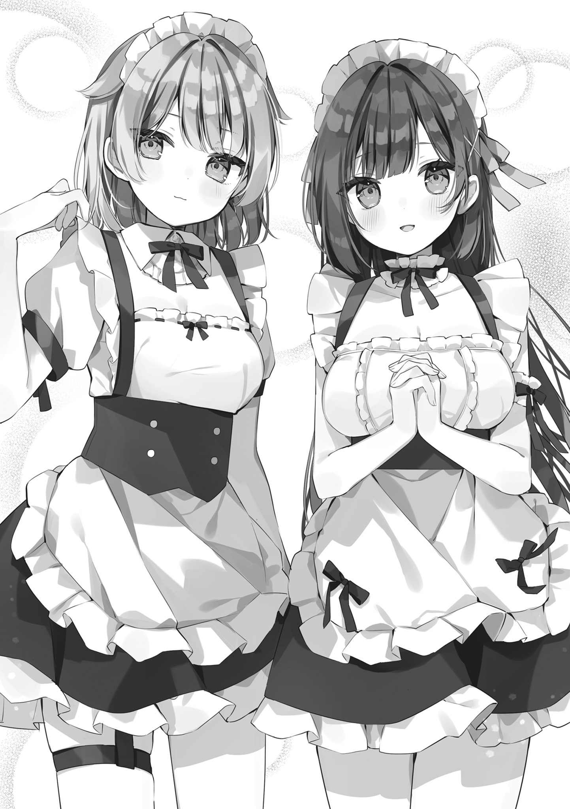

# Ch.37 — วันที่สอง (เมดคาเฟ่)

Ch.37 — วันที่สอง (เมดคาเฟ่)

By Maou Gakuin

Published: 2025-03-05T11:16:20Z

Source: https://www.nekopost.net/novel/14982/37

ตอนที่ 37 วันที่สอง (เมดคาเฟ่)

——— วันถัดมา

ฉันเปลี่ยนจากชุดพ่อบ้านมาเป็นเสื้อยืดของห้องเรียน และยืนเข้าแถวรอเข้าเมดคาเฟ่ตั้งแต่เริ่มงานวันที่สอง พร้อมกับมิสึกิ

แต่ว่าความนิยมของร้านนี้มันสุดยอดมาก แม้พวกเราจะรีบมาที่นี่ตั้งแต่ต้น แต่ก็ยังเข้าไปได้ไม่ทันที และต้องรออยู่ประมาณอันดับที่สิบ

"ในที่สุดก็มาถึงนะ... พี่ชาย..."

"ใช่... แต่ฉันกังวลมากกว่าว่าเธอจะทำอะไรแปลก ๆ หรือเปล่า"

"ฉันไม่ได้จะทำอะไรแปลก ๆ สักหน่อย! พูดแบบนี้เสียมารยาทมาก!"

"ปากไหนพูดวะ ปากไหน..."

เมื่อวาน หลังจากเรื่องวุ่นวายทุกอย่างจบลง ก็บอกได้ว่ามันเป็นวันที่ค่อนข้างสงบ แม้บรรยากาศจะซาลงไปบ้าง แต่ก็นับว่าเป็นวันที่สนุกพอสมควร แต่ในทางกลับกัน

ดูเหมือนพี่ชายของฉันจะไปทำอะไรบางอย่างเข้า และบังคับให้ฉันสัญญาว่าจะต้องแนะนำยูซุกับเมย์ให้เขารู้จักให้ได้

"พี่เตรียมใจพร้อมรึยัง?"

"ก็พอไหวอยู่ แล้วก็เลิกดูถูกพี่ได้แล้วนะ ถึงแบบนี้แต่พี่ก็เริ่มมีภูมิต้านทานกับผู้หญิงขึ้นมาบ้าง ตั้งแต่รู้จักกับสองคนนั้นน่ะ"

"เอ๋~ ไม่เชื่ออ่ะ"

"ทำไมต้องทำหน้าสงสัยขนาดนั้นด้วย ฉันอยากจะถามให้ชัด ๆ เลยนะ"

"ก็พี่ไม่เคยมีแฟนเลยนี่นา"

"อึก... เล่นจี้จุดเจ็บเลยนะ..."

มิสึกิมองฉันด้วยสายตาเต็มไปด้วยความสงสัย และพูดแทงใจดำฉันเต็ม ๆ พอถึงขนาดถูกน้องสาวตัวเองพูดเรื่องไม่มีแฟนเข้าให้ มันก็ทำให้ใจฉัน...

"——— เดี๋ยวก่อนนะ เธอเองก็ไม่เคยมีแฟนเหมือนกันไม่ใช่รึไง"

"กึก... ฉะ-ฉันเคยมีนะ! แค่ไม่ได้บอกพี่เฉย ๆ แล้วก็มีประสบการณ์เยอะมากด้วย!"

"คนที่มีประสบการณ์จริง ๆ คงไม่พูดอะไรแบบนั้นหรอกนะ"

ฉันจ้องไปที่มิสึกิที่เริ่มหลบตาไปมา และรีบเถียงกลับอย่างลนลาน แต่ในฐานะพี่ชายที่รู้จักเธอมานาน

บอกได้เลยว่าเธอกำลังโกหก... หรือจริง ๆ ก็คือ ใครก็ดูออกว่าเธอดูพิรุธสุด ๆ

"ช่างมันเถอะ! คุยไปเราก็มีแต่จะเจ็บกันทั้งคู่..."

"นั่นสินะ พอเถอะ เรื่องนี้มันไร้สาระจริง ๆ"

ก่อนที่พวกเราจะพูดอะไรให้เจ็บกันไปมากกว่านี้

ก็หยุดการถกเถียงที่ไร้สาระนี้ไปและในจังหวะเดียวกัน เพื่อนร่วมห้องของยูซุกับเมอิก็เดินเข้ามาหาพวกเราด้วยท่าทางกล้า ๆ กลัว ๆ

"อะ-เอ่อ... จะเข้าไปเลยไหมคะ?"

"「เข้าไปค่ะ/ครับ」"

"อะ... งั้น รอสักครู่นะคะ"

เพื่อนร่วมห้องคนนั้นมองพวกเราด้วยสายตาประหลาด ๆ ก่อนจะหันไปพูดอะไรบางอย่างข้างในร้าน แล้วกลับมาหลังจากผ่านไปประมาณ 30 วินาที

"พร้อมแล้วค่ะ เชิญเลย"

"อ่า ขอบคุณครับ"

"เปิดละนะ พี่ชาย..."

มิสึกิกลืนน้ำลายลงคอด้วยความตื่นเต้น ก่อนจะเปิดประตูเข้าไป ——

"——— ยินดีต้อนรับค่ะ ท่านเจ้าของบ้าน!"

"ยินดีต้อนรับค่ะ ท่านเจ้าของบ้าน"

สิ่งที่รออยู่ตรงหน้าก็คือ ยูซุกับเมย์

ทั้งสองคนอยู่ในชุดเมด

ขอย้ำอีกครั้ง

——— พวกเธออยู่ในชุดเมด

เมอิสวมชุดเมดที่ประดับด้วยระบายฟูฟ่อง ดูน่ารักสดใสและให้ความรู้สึกอ่อนเยาว์ แต่ว่า... ส่วนหน้าอกนั้น มันถูกบีบรัดจนแทบจะปริออกมาอยู่แล้ว และด้วยท่าทีที่ยังมีความเขินอายอยู่นิด ๆ มันยิ่งทำให้เธอดูน่ารักแบบสุด ๆ

ส่วนยูซุ เธอสวมชุดเมดที่ดูเป็นผู้ใหญ่ และมีความใกล้เคียงกับชุดเมดจริง ๆ มากกว่า แม้ว่าเธอจะไม่เด่นเท่าเมย์ แต่ขนาดของเธอก็ยังค่อนข้างใหญ่ และกระโปรงที่สั้นเหนือเข่าทำให้เห็นขาเรียวยาวที่มีสายรัดถุงน่องติดอยู่ ซึ่งก็ดูเซ็กซี่มากเช่นกัน

ถ้าจะสรุปเป็นคำเดียว...

——— มันสุดยอดมาก

"…………น้องสาวของข้า..."  ****(ใจเย็นน้องรัก)

"ฟุฟุ… ไม่ต้องพูดอะไรทั้งนั้น ฉันก็คิดเหมือนกัน..."

ฉันกับมิสึกิมองภาพตรงหน้าด้วยความปลื้มปิติ

น้ำตาแห่งความสุขไหลออกมา

เมย์ที่เห็นดังนั้น ก็รีบเข้ามาหาเราด้วยท่าทางร้อนรน

และตอนนั้นเอง หน้าอกของเธอก็เด้งขึ้นลงอย่างรุนแรง

"ม-มันสั่นไหว…!"

"เอ๋!?"

"อย่าพูดออกมาเซ่ เจ้าบ้า! เมย์จะอาย— อืม เปลี่ยนใจละ ทำดีมาก มิสึกิ"

เมย์หน้าแดงก่ำ รีบยกมือขึ้นมากุมหน้าอกของตัวเองด้วยความเขินอาย

มันให้ความรู้สึกเหมือนกับเมดจอมซุ่มซ่ามที่มักจะเจอในนิยาย ซึ่งน่ารักสุด ๆ

และไม่ใช่แค่เมย์ ยูซุเองก็ยืนนิ่งอยู่ตั้งแต่แรก แต่ขาเรียว ๆ ที่มองเห็นแวบ ๆ ก็ดูดีไม่แพ้กัน

ขณะที่ฉันกำลังมองขาของยูซุ จู่ ๆ ก็รู้สึกเหมือนถูกจ้องมอง พอเงยหน้าขึ้นไป ก็พบว่าสายตาของเราประสานกันพอดี ยูซุจ้องฉันด้วยสายตาเย็นชา

"อะ เอ่อ..."

"หืมท่านเจ้าของบ้านกำลังมองด้วยสายตาหื่นกามนะคะ"

"ม-ไม่ใช่สักหน่อย...! เอ่อ ก็ไม่ปฏิเสธหรอก แต่ว่า... นี่มันเกินกว่าที่นักเรียนชายทั่วไปจะทนไหวแล้ว!"

"แต่เพื่อเห็นแก่เมื่อวาน ฉันจะยกโทษให้"

"ขอบคุณมากครับ!!"

...เมดคาเฟ่... มันสุดยอดจริง ๆ

ฉันขอขอบคุณพวกหนุ่ม ๆ ห้อง 2 ที่ช่วยทำให้เมดคาเฟ่นี้เกิดขึ้นจากใจจริง
