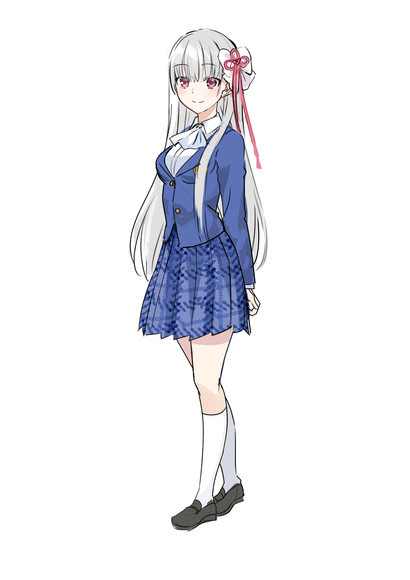
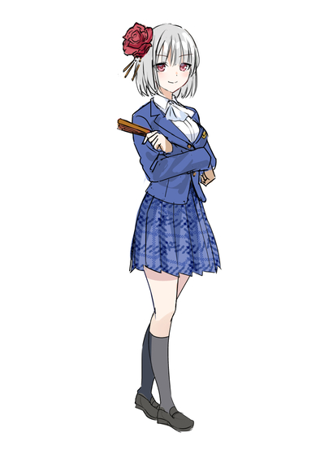

# Ch.113 — ทุกสิ่งที่ฉันทำได้ 4

Ch.113 — ทุกสิ่งที่ฉันทำได้ 4

By แปลไปเรื่อย

Published: 2025-05-23T06:00:10Z

Source: https://www.nekopost.net/novel/14609/113

ตอนที่ 113 ทุกสิ่งที่ฉันทำได้ 4

“ใครกันนะ...อา หรือว่า...”

ใบหน้าของเธอแทบไม่เปลี่ยนไปจากตอนนั้นเลย แต่ท่าทีที่สดใสและสง่างามในตอนนี้กลับไม่ซ้อนทับกับภาพของเธอในอดีต

“เราเคยรู้จักกันมาก่อนหรือเปล่านะ ฉันจำอะไรไม่ค่อยได้ก่อนขึ้นม.2…อ๊ะ ชุดนักเรียนแบบนั้น นั่นเป็นโรงเรียนที่จะมาร่วมงานเทศกาลวัฒนธรรมกับโรงเรียนของฉันใช่ไหมคะ พี่สาวเคยพูดถึงเอาไว้”

“ใช่ครับ…คุณคือ น้องสาวของประธานโคโนฮานะใช่ไหมครับ”

“ค่ะ ฉันชื่อโคโนฮานะ ฮินะ เป็นน้องสาวของประธานค่ะ ปีนี้ฉันเฝ้ารอเทศกาลวัฒนธรรมนี้มากเลยล่ะค่ะ”

ฮินะตอบรับคำทักของชิซุกุด้วยรอยยิ้ม

“คุณฮินะตั้งตารอเทศกาลนี้มาตลอดเลยนี่นา”

“สุดยอดเลยนะ กล้าทำอะไรหลายๆ อย่าง”

“แค่อยากลองทำหลายๆ อย่างน่ะค่ะ ก็ไหนๆ ตอนนี้สุขภาพดีกลับมาแล้ว”

ฮินะที่รายล้อมด้วยเพื่อนๆ และท้าทายสิ่งใหม่ๆ อย่างกล้าหาญ…เธอคือฮินะจริงๆ เหรอ คนที่เคยไม่มีเพื่อนผู้หญิงเลย และเอาแต่เขียนนิยายอย่างเดียว

“คุณคืออาซาฮินะ อาริสะใช่ไหมคะ?”

“หือ ฉันเหรอ!?”

คำถามนั้นทำให้สึมุกิตกใจสุดขีด

“ได้ยินมาว่าในโรงเรียนของคุณมีหญิงสาวที่สวยอย่างไม่น่าเชื่ออยู่ ไม่ใช่แค่สวย แต่ยังเป็นอัจฉริยะในทุกๆ ด้านด้วย เพราะคุณก็น่ารักสะดุดตา ฉันก็เลยคิดว่าอาจจะเป็นคุณ”

“มะ ไม่ใช่นะ! อาริสะจังสวยกว่าฉันไม่รู้กี่เท่าแน่ะ”

“ฟุฟุ งั้นเหรอคะ ฉันวางแผนจะเข้าร่วมประกวดมิสโรงเรียนในวันแรกด้วย ถ้าคุณเข้าร่วมด้วยก็คงดี จะได้เป็นเพื่อนกันแน่นแฟ้นขึ้น แน่นอนว่ากับคุณด้วยค่ะ”

ฮินะกล่าวทักทายด้วยท่าทีอบอุ่น ก่อนจะเดินจากไปพร้อมเพื่อนๆ

“...”

เธอมองมาทางผมแว้บหนึ่ง แต่ก็คงจำไม่ได้ แล้วก็เดินกลับเข้าอาคารเรียนไปแล้ว นั่นคือฮินะสินะ...สวยกว่าเมื่ออยู่ม.2 แต่แทบจะเป็นคนละคนเลย...

“นั่นคือรักแรกของเรียวมะสินะ”

“ถึงกับเรียกเสียงดังขนาดนั้น ยังมีเยื่อใยอยู่แน่ๆ เลย เจ้าชู้จังเลยนะ”

“ก็แค่ตกใจเองต่างหาก แล้วคำว่าเจ้าชู้มันออกจะต่างกันไม่ใช่เหรอ”

ผมโดนสองสาวจ้องด้วยสายตาแสบๆ คันๆ แล้วก็เริ่มรู้สึกเสียใจอยู่นิดๆ แต่...ถ้าเป็นฮินะในตอนนี้ ผมยังจะตกหลุมรักเธออยู่อีกไหมนะ

“ดูยังไงๆ เธอก็คล้ายอาริสะจังเลยไม่ใช่เหรอ?”

“ใช่เลย ผมยาว หน้าสวย แถมยังหน้าอกใหญ่อีก เรียวมะชอบแบบนั้นชัดๆ”

“พอเลย!”

อย่ามาวิเคราะห์รสนิยมของผมสิ! ผมน่ะไม่ได้ตกหลุมรักอาริสะหรือฮินะแค่เพราะหน้าตาสักหน่อย ถึงจะพูดยังไงสองคนนี้ก็คงไม่เชื่ออยู่ดี…กลับถึงบ้านแล้วคงต้องเปิดประชุมวางแผนกันเลยแหละ

——

“ทุกคน ขอโทษที่ให้รอนะคะ”

ช่วงเวลาคือพักกลางวัน ตอนที่พ้นคาบเรียนเข้าสู่ช่วงพัก และทุกคนในห้องยังอยู่พร้อมหน้า เป็นจังหวะเดียวที่มีโอกาสจัดการเรื่องนี้ได้

พอเห็นทุกคนกำลังเอาข้าวกล่องออกมา หรือกำลังจะไปโรงอาหาร เราก็รีบกันไว้ให้อยู่ในห้องเรียน การที่เป็นกรรมการงานเทศกาลของโรงเรียน ก็หมายความว่าเราก็ต้องเป็นแกนนำในห้องด้วย ทั้งผมและชิซุกุต้องเป็นคนรวบรวมความเห็นของห้องเรื่องกิจกรรมที่จะทำในงาน ทั้งการประสานกับโรงเรียนและกับห้องเรียน บอกเลยว่างานหนักกว่าที่คิด แต่คนข้างๆ กลับทำหน้านิ่งสบายๆ เหมือนไม่ใช่เรื่องอะไรเลย

“วันนี้เราจะมาตัดสินใจกันเรื่องกิจกรรมของห้องค่ะ ก่อนหน้านี้ได้ขอให้ทุกคนนำไอเดียมาเสนอ ไม่ทราบว่าเป็นยังไงบ้างคะ”

เสียงนุ่มนวลของชิซุกุดังขึ้น ทำให้ห้องทั้งห้องเงียบกริบ

แต่เพราะทุกคนก็ยุ่งกับทั้งเรียนและชมรม จึงไม่มีใครคิดไอเดียอะไรออกเลย แถมบางคนก็มีบทบาทในชมรมมากจนไม่มีเวลาให้กับงานของห้องเรียนอีก

และอีกเหตุผลหนึ่งก็คือ ห้องนี้มีสองตัวท็อปอย่างฮิราซาวะ เรโอเ และอาซาฮินะ อาริสะอยู่ ใครจะกล้าเสนออะไรไปสวนกับสองคนนั้นกัน

นั่นแหละ คือสิ่งที่เรียกว่าระบบลำดับชั้นในห้องเรียน

พอรอไปสองสามนาทีก็ไม่มีใครยกมือเสนอไอเดีย ชิซุกุก็หันมามองผม

“รู้ล่วงหน้าแล้วล่ะเนอะ งั้น เรียวมะคุง ฝากอธิบายต่อเลย”

ผมกลายเป็นลูกน้องของชิุกุซะงั้น แม้จะเข้าใจว่าช่วงนี้เธอช่วยผมไว้เยอะ แต่รู้สึกว่าเรื่องนี้จะโดนขยี้ไปตลอดชีวิตแน่ๆ ผมสูดหายใจเฮือกหนึ่ง แล้วเริ่มพูด

“ในฐานะกรรมการ ผมขอเสนอหนึ่งไอเดียครับ อย่างที่รู้กันว่าห้องนี้มีคนดังที่เด่นสะดุดตาอย่างเรโอะและ—เอ่อ—อาซาฮินะอยู่ ดังนั้นผมคิดว่าเราควรใช้จุดนี้ให้เป็นประโยชน์ จะว่าเป็นไอเดียพื้นๆ ก็ได้ แต่ผมขอเสนอว่าให้ทำร้านอาหารครับ”

“หมายถึงให้เรโอะกับอาริสะมาเป็นพนักงานร้านน่ะเหรอ? ฉันว่าน่าสนใจดีนี่นา ไหนจะมีสึมุกิอีก คงเรียกคนได้เพียบแน่ๆ”

“เห็นด้วยเลย”

สองสาวแกลของฝ่ายอาริสะออกโรงสนับสนุน แน่นอนว่าผมได้ไปปูทางกับทั้งกลุ่มของเรโอะและอาริสะเรียบร้อยแล้ว

“ฟังดูเข้าท่านะ”

“สามคนนี้แค่ยืนเฉยๆ ก็ชนะแล้วล่ะ”

เสียงพยักหน้าตามๆ กันดังไปทั่วห้อง ดูเหมือนทุกคนจะเห็นด้วยว่า ดีกว่าทำกิจกรรมแปลกๆ ที่ไม่ดึงดูดคน เพราะเรายังอยู่แค่ปีหนึ่งเอง

“ฉันไม่ติดอะไรนะ”

“ฉันก็ด้วย อยากช่วยอยู่แล้ว”

พอทั้งสองคนนี้เห็นด้วย ไม่มีใครกล้าแย้งอีกต่อไป

“เข้าใจว่าให้พวกนั้นเป็นพนักงาน แต่แนวร้านล่ะ จะทำร้านอะไรดี? ได้ยินว่าห้องอื่นจะทำร้านเมดคาเฟ่กับบัตเลอร์คาเฟ่กัน”

เสียงจากกลุ่มผู้ชายดังขึ้นมา ถ้าพูดถึงงานเทศกาลวัฒนธรรม ร้านเมดคาเฟ่คือสิ่งที่แทบทุกคนคาดหวัง ใครล่ะจะไม่อยากเห็นอาริสะหรือสึมุกิใส่ชุดเมดน่ารักๆ ถึงผมเองก็เคยเห็นเธอในชุดเมดหูแมวสุดเซ็กซี่มาแล้วล่ะนะ…

“จริงด้วยนะครับ ได้ยินว่ามีหลายห้องเสนอแบบนั้นกับทางกรรมการแล้ว ถ้าเราไปทำตามคงซ้ำซากเกินไป ดังนั้นผมขอเสนอทางเลือกนี้ครับ”

ผมวางจานใบใหญ่ที่มีฝาครอบเก็บความร้อนไว้ตรงหน้าทุกคน เสียงอุทานว่า "อะไรกันน่ะ!" ดังขึ้น แล้วผมก็เปิดฝาครอบออก…

สิ่งที่อยู่ข้างในคือข้าวผัดสีทองอร่าม ผมเตรียมไว้ตั้งแต่คาบสี่

ว่าเรียนคาบนั้นแล้วทำได้ยังไงน่ะเหรอ? อย่าถามเลย! ผมรีบแบ่งใส่จานเล็กๆ แล้วแจกจ่ายให้ทุกคนลองชิม

“อร่อยมาก!”

“นี่มันข้าวผัดบ้าอะไรกันเนี่ย!”

“อื้ม ข้าวผัดของเรียวมะนี่สุดยอดเลย”

มันคือข้าวผัดสูตรพิเศษที่ผมเคยทำให้เรโอะกินบ่อยๆ เป็นผลงานชิ้นโบว์แดงของผมเอง

“นี่คือข้าวผัดที่ผมทำเองครับ! เพราะฉะนั้นผมขอเสนอให้ห้องเราทำร้านอาหารจีนครับ!”

“จริงจังเหรอ!”

ขณะที่ทุกคนกำลังตกใจ ชิซุกุก็พูดเสริมขึ้นมา

“ร้านอาหารมีข้อกำหนดหลายอย่าง โดยเฉพาะพวกวัตถุดิบสดถือว่ามีข้อห้ามเยอะ แต่พวกร้านอาหารจีนที่เน้นอาหารปรุงสุกจะได้รับอนุญาตง่ายกว่าค่ะ”

“อ๋อ อย่างนี้นี่เอง…”

“ถ้าเป็นร้านอาหารจีน งั้นเรโอะ อาซาฮินะซัง แล้วก็ฮิอิรางิซังจะ…”

“ใช่ค่ะ! พวกผู้ชายจะใส่ชุดฉางช้าน ส่วนผู้หญิงจะใส่ชุดฉีเผา!”

(TLN:ชุดกี่เพ้านั่นแหละ ง่ายๆคือชุดจีน)

“ฉันอยากเห็นฮิราซาวะคุงใส่ชุดจงซานจวงบ้างจัง!”

(TLN:ก็ชุดๆนึงนั่นแหละ GG หาได้)

“น่าจะดูเท่ดีนะ!”

“อาซาฮินะกับฮิอิระกิในชุดกี่เพ้าเหรอ!?”

“อะไรจะดีไปกว่านี้อีก!”

ชุดแนวจีน—ที่รู้จักกันดีในชื่อชุดกี่เพ้า—ยังคงได้รับความนิยมเสมอ ด้วยคุณภาพของอาหารที่ดี บวกกับการแต่งกายที่โดดเด่น จะกลายเป็นจุดขายของร้านนี้ได้แน่นอน

“ผมจะเป็นหัวหน้าทีมทำอาหารเองครับ ไม่ใช่แค่ข้าวผัด ผมยังเชี่ยวชาญอาหารจีนอื่นๆ ด้วย ฝากไว้กับผมได้เลยครับ”

“รสชาติแบบนี้ ชนะได้สบายๆ เลยล่ะ”

“เราอาจได้รางวัลยอดเยี่ยมของห้องเลยก็ได้มั้ง?”

“แต่นายทำอาหารคนเดียวไม่ไหวหรอก ถ้ามีเรโอะหรืออาซาฮินะอยู่ ลูกค้าต้องแห่มาแน่นอนอยู่แล้ว”

แน่นอนว่ามีเสียงท้วงแบบนี้ตามมา เพราะถ้าผมทำอาหารทั้งหมดคนเดียวจริงๆ ต่อให้มีเวลาทั้งวันก็ไม่พอแน่ แต่คนที่มีฝีมือระดับเดียวกับผมไม่ได้มีอยู่มากมายในห้องเรียน ดังนั้นแน่นอนว่า…

“ไม่ต้องห่วงนะคะ ฉันจะช่วยดูแลด้วยค่ะ”

ถ้ามีชิซุกุซังช่วยเหลือก็คงเหมือนมีพลังเพิ่มอีกเป็นร้อยเท่า แบบนั้นเราก็น่าจะจัดการทุกอย่างได้อย่างเพียงพอ แค่มีเรื่องที่น่ากังวลอยู่อย่างเดียว…

“จริงๆ ฉันก็เตรียมมาด้วยเหมือนกันนะคะ เป็นขนมจีบ ลองชิมกันดูค่ะ คนละลูกนะคะ”

ไม่รู้ทำไม ชิซุกุซังถึงได้เตรียมอาหารมาเองเหมือนกัน เธอแจกขนมจีบให้ทุกคนในห้องลองชิม และเมื่อทุกคนได้ลิ้มลอง…

“อะไรเนี่ย ขนมจีบนี้! อร่อยเกินไปแล้ว!”

“ไม่แพ้ข้าวผัดเลยนะเนี่ย!”

สมกับเป็นชิซุกุซังจริงๆ แกล้งทำให้ดูเหมือนจะช่วย แต่กลับเน้นให้เห็นว่าเธอก็มีฝีมือไม่แพ้ผมเลย

“ถ้าทุกคนทานกันอร่อย ฉันก็ดีใจค่ะ”

เมื่อเธอยิ้มอย่างสดใส เหล่าเพื่อนชายในห้องต่างก็เงียบลงไปทันที พร้อมใบหน้าที่แดงระเรื่อ

“เฮ้ย โอสึกินี่ก็มีเสน่ห์แบบแปลกๆ เหมือนกันนะ… พอดูดีๆ แล้วก็น่ารักมากเลย”

“นี่เป็นครั้งแรกที่ได้กินอาหารที่ผู้หญิงทำให้เลย… รู้สึกเหมือนจะตกหลุมรักเลย…”

เธอเริ่มจะจับหัวใจของเพื่อนๆ ผ่านกระเพาะแล้วก็ว่าได้ แม้จะไม่งดงามอลังการเหมือนอาริสะหรือสึมุกิ แต่เสน่ห์ของเธอก็ค่อยๆ เปิดเผยออกมาอย่างช้าๆ

แต่…

“(แววตาคมกริบ)”

“เหวอ!”

“อย่ามองชิซุกุด้วยสายตาหื่นกามนะเฟ้ย!”

พอโดนเรโอะขู่เข้าไป ไม่มีใครกล้าพูดอะไรต่อได้ และด้วยเหตุนี้ งานแสดงของห้องเราก็ได้ข้อสรุปเป็นร้านอาหารจีนพร้อมชุดสไตล์จีนตามที่วางแผนไว้ และเมื่อทุกอย่างลงตัว ผมกับชิซุกุซังก็เดินไปตามทางเดินของโรงเรียน

“ชิซุกุซัง ของที่ผมขอไว้ เตรียมพร้อมแล้วใช่ไหม?”

“อื้ม… แต่เอาจริงๆ ฉันว่ามันเกินไปหน่อยนะ”

ชิซุกุซังส่งเอกสารให้ผม

“ไม่ใช่แค่ของโรงเรียนเรา แต่จะไปช่วยแก้ปัญหาให้โรงเรียนฝ่ายตรงข้ามทั้งหมดเลยเนี่ยนะ… ระวังสุขภาพด้วยเถอะ”

ในช่วงนี้ เรื่องร้องเรียนและปัญหาต่างๆ ที่ส่งถึงสภานักเรียนของทั้งสองโรงเรียนเยอะมาก และผมก็ตัดสินใจจะรับผิดชอบทั้งหมด เพื่อให้ความพยายามของผมโดดเด่นขึ้นในสายตาคนอื่น

มนุษย์มักอ่อนแอต่อคนที่ทุ่มเทและพยายาม ผมต้องการชนะในเวทีประกวดมิสคอน และเพื่อให้ชนะได้ ผมต้องมีชื่อเสียงให้มากที่สุด

การสารภาพรักกับอาริสะและโดนปฏิเสธ การเป็นเชฟหลักของงานห้องเรียน มันยังไม่พอ

“แถมชุดของห้องเรียนก็จะให้เรียวมะคุงเป็นคนตัดใช่ไหม”

“ไม่คิดเลยว่าเทคนิคการตัดเย็บที่ใช้ทำชุดให้ฮิโยริจะได้ใช้ในเรื่องแบบนี้”

ชุดที่เรโอะ อาริสะ และสึมุกิจะใส่ ผมจะเป็นคนตัดเอง สมาชิกคนอื่นจะซื้อชุดตามงบห้องเรียน แต่สามคนหลักนี้ ผมจะทำชุดพิเศษให้ด้วยตัวเอง

“ฉันอยากช่วยเหมือนกันนะ… แต่งานตัดเย็บฉันไม่เก่งเท่าไหร่”

“เธอทำอาหารได้ขนาดนั้น ถ้าเย็บผ้าได้อีกก็กลายเป็นมนุษย์เหล็กแล้วล่ะ”

“เรียวมะคุงก็ไม่ต่างกันนี่”

“ฉันมีเวลาเยอะต่างหาก… เพราะฉันทิ้งทุกสิ่งที่ตัวเองชอบ แล้วทุ่มเททั้งหมดให้กับการตัดเย็บเสื้อผ้าเพื่อฮิโยริ”

ตอนที่เย็บชุด ผมสามารถลืมทุกสิ่งไปได้ และเมื่อฮิโยรินางฟ้ามาใส่มัน มันเหมือนสิ่งใหม่ได้ถือกำเนิดขึ้น ตอนนี้แค่เปลี่ยนจากฮิโยริมาเป็นอาริสะ สึมุกิ และเรโอะเท่านั้นเอง

“เธออยากไส่กี่เพ้าบ้างไหม?”

“เอ๊ะ!? ฉันไม่อยากให้เรียวมะคุงรู้ขนาดตัวฉันนะ”

“ฮะๆ ไม่ต้องกังวลเรื่องความต่างระหว่างอาริสะกับสึมุกิหรอก”

“อยากโดนฉันชกใช่ไหมเนี่ย”

เกือบโดนต่อยจริงๆ เลยหยุดแซวเรื่องขนาดร่างกายทันที

“ถ้าให้ฉันทำ ฉันจะทำชุดกี่เพ้าที่เรโอะชอบแน่นอน”

“หึมมม...”

“เธออยากให้เรโอะชมว่าน่ารักใช่ไหมล่ะ”

“อืม... ก็ได้! แต่ห้ามโป๊เด็ดขาดเลยนะ!”

“รู้แล้วน่า”

สุดท้ายแล้ว เด็กคนนี้ก็อ่อนแอเวลาพูดถึงเรโอะ ถึงแม้จะเป็นฝ่ายถูกสารภาพรัก แต่ตอนนี้เหมือนจะมีใจให้ชิชิเพียงคนเดียวแล้วก็ว่าได้

“เรื่องอาหาร เดี๋ยวฉันจะช่วยดูแลให้เท่าที่ไหวเลยนะ เรียวมะคุงอย่าหักโหมเกินไปล่ะ”

“...พูดตามตรง ฉันดีใจมากที่ชิซุกุซังช่วย ทั้งที่ตอนแรกเธอไม่เห็นด้วยกับแผนนี้แท้ๆ”

เมื่อผมพูดแบบนั้น ชิซุกุซังก็ถอนหายใจออกมา

“ไม่ใช่อะไรหรอก… แค่ช่วยเพื่อนรักมันก็เรื่องปกติน่ะ”

“อืม...”

ถูกแล้ว ถ้าเป็นผมในสถานการณ์กลับกัน ผมเองก็คงยื่นมือช่วยเหมือนกัน

“แต่ต้องทำชุดให้ฉันน่ารักจริงๆ ด้วยล่ะ”

“แน่นอน จะทำให้เรโอะถึงกับหลงใหลเลย”

---

ฮินะ

ซาคุยะ

